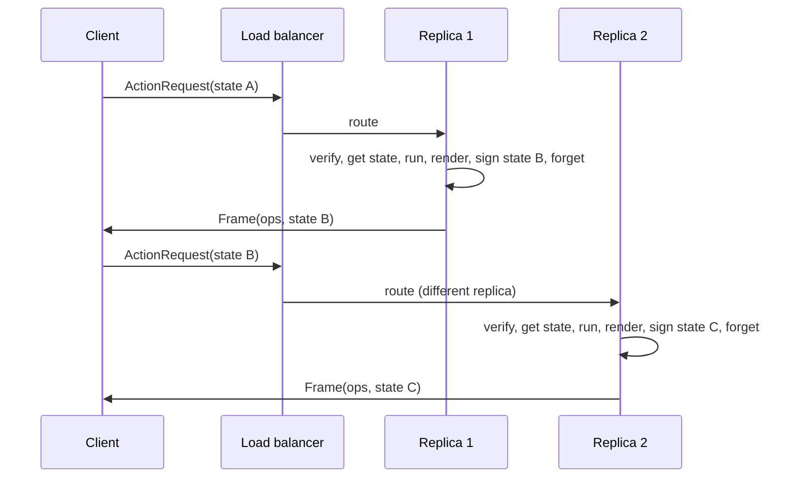

# 09. Stateless execution: any replica, no per-user memory

_Written in ASD-STE100 Simplified Technical English (STE). Code and identifiers stay as they
are._

**Abbreviations in this file.** Server-Sent Events (SSE); user interface (UI); AeroSpace and
Defence Industries Association of Europe (ASD), the owner of the STE standard ASD-STE100.

## 1. The idea, laid out

Source: `foundation_ui_rearchitecture.md` §4 ("The Stateless Execution") and §1 ("massive,
horizontal system scalability").

**An action request can land on any server replica.** This is one option, not a rule for every
action. A replica that does not hold a live signal graph for the user:

1. checks the tag ([08](./08-state-security-and-replay.md));
2. gets the state that it needs. The server chooses: it uses the context in the request, or it
   takes a key from the signed state and loads the data from the backend (D13);
3. runs the action;
4. renders the result and signs the new state;
5. clears the memory context.

No session store is required. No sticky routing is required for these actions.

**What stays the same.** The client gets one response or a stream of updates, as it did before.
The wire does not change shape. The server chooses what it sends and how it builds it (D15).

**What is new.** Only where the state lives between requests. In live mode, the server keeps the
signal graph. In stateless mode, the request carries the signed state, so any replica can serve
the action. Both modes run side by side.



_The diagram shows two actions handled by two replicas with no shared session._

_North star fit: this is the shared dispatcher that every platform set uses (D38,
[13](./13-platform-capabilities.md))._

## 2. Current state

| Part | Where | Status |
|---|---|---|
| Stateful server `App`: signals in memory on one thread; "the App never leaves its thread" | `backends/foundation_wasm_ui/src/server/mod.rs:1-24` | **Stays.** Signals cannot move across threads, and the signal library is the core of the design |
| `Broadcaster` fans frames out to live clients, with a replayed backlog for late joiners | `server/mod.rs:71`, `:151` | **Stays.** A replay backlog is a good property: a client that reconnects gets the updates it missed |
| `FrameTransport` for SSE and WebSocket | `server/mod.rs:38` | **Stays.** The transport carries both modes |

Today an action needs the replica that holds the `App`. This is correct for a live client. It
stays. The stateless mode is an addition for an action that does not need a live signal graph.
It does not replace the live mode, and the live mode loses nothing (D15, PR #157 review
2026-11-11).

## 3. The new way

### 3.1 Two modes, both supported

The document assumes everything is stateless. A live stream is not: a stream is a connection on
one replica, joined to a signal graph. The new way names both modes and supports both. The
component and the server choose.

| Mode | Server holds | Routing | Use | Status |
|---|---|---|---|---|
| **Live** | The signal graph, for the connection | The replica that owns the graph | Push updates, collaboration, dashboards | **Exists.** Stays unchanged |
| **Stateless action** | Nothing per user | Any replica | Clicks, forms, navigation, most UI | **New.** An addition |

A component can use both: its actions can run stateless; a stream pushes data frames to it. A
stream frame never changes the component's signed state; it changes data shown by the
component. If a push must change state, the server sends a new `SignedState` in a `StateUpdate`
frame ([02](./02-unified-wire-contract.md)).

**How is this different from what we had?** The response was never the difference. A server
could always answer with one response or with a stream; it still can. The difference is only
where the per-user state lives between requests. In live mode it is the signal graph on the
replica. In stateless mode it is the signed state in the request, plus the backend.

### 3.2 The action lifecycle as code shape

```rust
// sketch of the dispatcher, plain library code (not macro output)
pub async fn dispatch(req: ActionRequest<'_>, ctx: &RequestCtx) -> Result<Frame, ActionError> {
    let verified = ctx.signer.verify(req.state(), &ctx.session)?;          // 08
    let action = ctx.registry.get(req.action())?;                          // 10, 11, D31
    let response = action.call(ctx, verified, req.input()).await?;         // the action gets the state
    let signed = ctx.signer.sign(response.next_state(), &ctx.session)?;    // new state
    Ok(Frame::ops(req.sequence_id(), response.view(), signed))             // render
}   // every local value drops here: "clear the memory context"
```

`verified` is an input, not the truth. The action reads a key from it and loads the data it
needs, or it uses a context that the server already holds (D13). The framework gives both
paths; the server chooses.

"Clear the memory context" is not a special step in Rust: the request-scoped values drop at the
end of the async function. The design must make sure nothing request-scoped is cached in a
global, so the property holds.

The dispatcher is one shared implementation (D38). The platform set supplies the registry, the
renderer and the transport behind it. The server, WASM and a compiled Rust binary run the same
dispatcher ([13](./13-platform-capabilities.md) §3.1).

### 3.3 The server decides how it holds state

The framework supplies the request, the signed state, the action registry and the frame builder.
Everything else is the server's decision (D15):

- It can hold a signal graph for live clients.
- It can read the domain data from the database on each action.
- It can keep a cache, a queue, or a background replay buffer.
- It can send one update or a stream of updates, and let the frontend render.

The framework does not prescribe a store, a cache or a session table. It requires only that a
stateless action does not depend on per-user memory on the replica that happens to receive it.

### 3.4 Improvements over the document

- Both modes are supported and named. The document says "everything stateless", which would
  remove the live mode. The live mode stays.
- The server chooses how it gets state. The document makes rehydration from the request the
  only way. A key in the state plus a backend read is equally valid (D13, D15).
- Sequence ids and `ack_action` match a response to a request across replicas
  ([02](./02-unified-wire-contract.md)).
- The transport is a boundary concern (D25). Live streams use the existing `<mount-stream>`
  paths and the header negotiation; a client can connect for SSE or for WebSocket (D30). The
  framework does not prescribe a Durable Object, a thread or a replica layout.

## 4. What this changes for us

- **Nothing is removed.** The stateful `App`, the `Broadcaster` and its replay backlog stay, as
  the live mode.
- A new dispatcher handles **stateless actions**. A server chooses it per action or per
  component. It is an addition, not a mandatory replacement.
- The frontend needs no change for either mode. It renders a frame from one response or from a
  stream in the same way.

## 5. Open questions

No open questions in this file. Q20 is answered: use the existing `<mount-stream>` paths and
header negotiation (D30).
