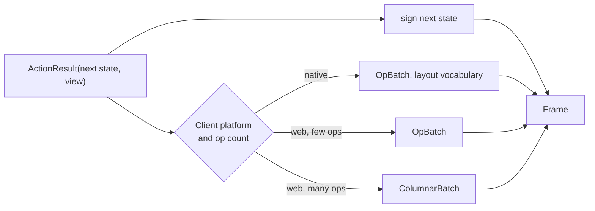

# 10. The action model: `#[action]`, typed interactions and platform-adaptive responses

_Written in ASD-STE100 Simplified Technical English (STE). Code and identifiers stay as they
are._

**Abbreviations in this file.** user interface (UI); remote procedure call (RPC); Document Object
Model (DOM); identifier (id); AeroSpace and Defence Industries Association of Europe (ASD), the
owner of the STE standard ASD-STE100.

## 1. The idea, laid out

Source: `foundation_ui_rearchitecture.md` §5.

**A server action is a plain function with an attribute. Its signature decides how the request
is parsed and how the response is sent.**

```rust
pub struct Interaction<T> { pub node_id: u32, pub event_name: String, pub input_value: String, pub state: T }

pub enum Response {
    UIUpdate(Vec<DomOp>),   // "Automatically translates to Columnar/MobileLayout FlatBuffers"
    DataUpdate(Vec<u8>),    // raw Arrow, MessagePack or custom binary
}

#[foundation_ui::action]
pub fn increment_counter_ui(ctx: &Context, event: Interaction<Counter>) -> Response {
    let next_state = Counter { counter_id: event.state.counter_id, current: event.state.current + 1 };
    let ops: Vec<DomOp> = html! { ctx, Some(&next_state),
        <button class="btn-primary" primal:onclick="increment_counter"> "Count: " { next_state.current } </button>
    };
    Response::UIUpdate(ops)
}
```

The document's ideas here:

1. **Type-directed routing.** The macro reads the signature. `Interaction<Counter>` tells it to
   decode the state as `Counter`.
2. **Atomic transactional boundary.** One action is one unit of work.
3. **Platform-adaptive response.** `UIUpdate` is encoded per client: columnar for the web, mobile
   layout for native. The author does not choose.
4. **State-aware template.** `html! { ctx, Some(&state), … }` renders the view, encodes the state,
   signs it and attaches it to the root element in one step.
5. **Event wiring by name.** `primal:onclick="increment_counter"` links an element to an action.

## 2. Current state

| Part | Where |
|---|---|
| `html!` pure and reactive forms; reactive form queues `DomOp`s | `backends/foundation_macros/src/html_macro/mod.rs:6-29` |
| `primal:onX` binds to a **local** handler or signal setter | `html_macro/mod.rs:22-24`, `codegen.rs:520`, `parser.rs:562` |
| Events into WASM as JSON `EventData` | `backends/foundation_wasm_ui/src/events.rs:65` |
| Code-first ConnectRPC `#[service]` macro: typed registration, generated procedure ids, typed clients | `backends/foundation_macros/src/connectrpc_service.rs:1-19` |
| No server action macro, no action registry, `html!` takes no state | — |

## 3. The new way

### 3.1 Signature

```rust
#[action(component = Counter)]
async fn increment(ctx: &ActionCtx, state: CounterState, input: NoInput)
    -> Result<ActionResult<CounterState>, ActionError>
{
    ctx.authorize(Permission::EditCounter(state.counter_id)).await?;   // every action authorizes
    let next = CounterState { current: state.current + 1, ..state };
    Ok(ActionResult::render(next, counter_view(&next)))
}
```

- **`async fn`** (`CLAUDE.md` rule 6). Real actions read a database.
- **`state: S` and `input: I` are separate.** `S` is the verified, decoded, server-signed state.
  `I` is typed, **unsigned** user input (text field value, selected id). The server treats `I` as
  untrusted. The document mixes them (`input_value: String` beside `state`).
- **Both are generated FlatBuffers types** (rule 5). No `String` input, no serde guesswork.
- **`Result`** with a typed error that maps to an `Error` frame.

### 3.2 What the macro generates, and what it does not

| Macro generates | Library code does (testable without the macro) |
|---|---|
| A stable numeric `action_id` (hash of component and name, checked for collisions at build) | Verify the tag, check expiry and bindings |
| A registration entry in the action registry | Decode `S` and `I` |
| The client stub for local and remote calls (like ConnectRPC typed clients) | Authorize, run, sign the next state |
| The id constant that templates use | Pick the payload tier and vocabulary for the client |

Keeping the macro thin keeps compile errors readable and the logic testable.

### 3.3 Platform-adaptive response

`ActionResult<S>` holds the next state and a **view description** in the layout vocabulary
([04](./04-vocabulary-and-interning.md)). The framework encodes it per client, from the
`ClientHello` ([02](./02-unified-wire-contract.md)):



_The diagram shows how one result becomes the right frame for each client._

Data pushes (the document's `DataUpdate(Vec<u8>)`) become typed `DataTable` frames
([03](./03-payload-tiers.md)), not raw bytes.

### 3.4 Templates do not sign

The document's `html!` signs state inside the template. That pulls the signing key into view code
and makes every render depend on it. The new way: the template only describes the view; the
dispatcher signs once, at the boundary ([09](./09-stateless-execution.md)). The template gets
the state as a normal value.

### 3.5 Event wiring by id

`primal:onclick="increment_counter"` becomes `on:tap={Counter::increment}`. The macro resolves it
to the numeric `action_id` at compile time. A typo is a compile error, not a runtime miss.

### 3.6 Actions are RPC procedures

An action is an RPC with a fixed request shape (`ActionRequest`) and a fixed response shape
(`Frame`). The ConnectRPC `#[service]` macro already generates typed registration and clients.
The new way builds `#[action]` on the same machinery, so there is one router, one transport and
one interceptor chain (auth, rate limit) for both.

## 4. What this changes for us

- New `#[action]` macro beside `#[service]`, sharing its code.
- `html!` gets a layout-vocabulary output mode and typed event bindings to action ids.
- The action registry is shared with the device ([11](./11-app-store-and-command-bus.md)).

## 5. Open questions

Q21 and Q22 in [`questions.md`](./questions.md): actions as ConnectRPC procedures or a separate
router, and how action ids are derived and kept stable.
