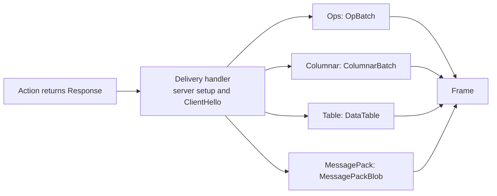

# 10. The action model: `#[action]`, typed interactions and response handling

_Written in ASD-STE100 Simplified Technical English (STE). Code and identifiers stay as they
are._

**Abbreviations in this file.** WebAssembly (WASM); remote procedure call (RPC); identifier
(id); AeroSpace and Defence Industries Association of Europe (ASD), the owner of the STE
standard ASD-STE100.

## 1. The idea, laid out

Source: `foundation_ui_rearchitecture.md` §5.

**A server action is a plain function with an attribute.** The function returns a logical
response. What encodes that response on the wire is the handler that delivers it, not the
action.

```rust
pub struct Interaction<T> {
    pub node_id: u32,
    pub event_name: String,
    pub input_value: String,
    pub state: T,
}

pub enum Response {
    UIUpdate(Vec<Op>),   // view description in the layout vocabulary (04)
    DataUpdate(Vec<u8>), // data; the handler picks the encoding (D16)
}

#[action]
async fn increment_counter_ui(ctx: &Context, event: Interaction<Counter>) -> Response {
    let next = Counter { current: event.state.current + 1, ..event.state };
    Response::UIUpdate(html! { ctx, Some(&next),
        <button class="btn-primary" primal:onclick="increment_counter">
            "Count: " { next.current }
        </button>
    })
}
```

The document writes `Vec<DomOp>`. D10 retires `DomOp` as a separate vocabulary, so the view
description is a list of schema ops from [04](./04-vocabulary-and-interning.md). The shape of
the idea does not change.

The document's ideas here:

1. **Type-directed routing.** The macro reads the signature. `Interaction<Counter>` tells it to
   decode the state as `Counter`.
2. **Atomic transactional boundary.** One action is one unit of work.
3. **The action returns a response; the handler encodes it.** `Response::UIUpdate` is a view
   description. The handler that delivers the response to the client decides its encoding. The
   action does not choose (D16).
4. **State-aware template.** `html! { ctx, Some(&state), … }` renders the view and attaches the
   state to the root element. The dispatcher signs the state, not the template (§3.5).
5. **Event wiring by name.** `primal:onclick="increment_counter"` links an element to an action.

## 2. Current state

| Part | Where |
|---|---|
| `html!` pure and reactive forms; reactive form queues ops | `backends/foundation_macros/src/html_macro/mod.rs:6-29` |
| `primal:onX` binds to a **local** handler or signal setter | `html_macro/mod.rs:22-24`, `codegen.rs:520`, `parser.rs:562` |
| Events into WASM as JSON `EventData` | `backends/foundation_wasm_ui/src/events.rs:65` |
| `foundation_context::Ctx`: a clonable handle with a clock, a config, a random number generator and a typed map | `backends/foundation_context/src/lib.rs:152` |
| No server action macro, no action registry, `html!` takes no state | — |

## 3. The new way

### 3.1 Signature

The signature in §1 stands. The macro reads it and the library runs it:

```rust
#[action]
async fn increment_counter_ui(ctx: &Context, event: Interaction<Counter>) -> Response {
    let next = Counter { current: event.state.current + 1, ..event.state };
    Response::UIUpdate(html! { ctx, Some(&next), /* view */ })
}
```

- **`async fn`** (`CLAUDE.md` rule 6). A real action reads a database.
- **`Interaction<T>` decides the state type.** The macro generates the decode from `T`. `T` is
  the verified, server-signed state type.
- **The action returns `Response`.** There is no wrapper type and no nested `Result` (owner
  review, 2026-11-11). The document's shape is the shape.
- **`Interaction<T>` is typed by its `T`.** The generic gives the payload type, so the macro
  decodes a typed interaction, not an untyped map (owner review, 2026-11-11). `input_value`
  stays a `String` inside that typed struct, as the document has it. The action converts the
  value to the type it needs, and the server treats it as untrusted.
- **An action can fail.** The client then gets an `Error` frame; the schema has
  `Body::Error` ([02](./02-unified-wire-contract.md)). The document does not give an error
  signature, so Q28 asks you. This research does not invent one.

### 3.2 What the macro generates

The macro reads the signature. It is not only a registry entry (owner review, 2026-11-11). From
`Interaction<T>` it knows the state type, so it generates the decode as code, not as a runtime
lookup.

| The macro generates | The shared library does (testable without the macro) |
|---|---|
| The decode of `Interaction<T>`, from `T` in the signature | Verify the tag, check expiry and bindings |
| A struct named after the function; its name is the action tag (D23, D31) | Sign the next state |
| The registry entry under the action name, and the name constant that templates use | Hand the `Response` to the delivery handler |
| The call glue from an event name to the function | Run the generated glue in the dispatcher |

The split follows what the macro knows: the signature. A step that is the same for every action
stays in the library, where a test can call it.

### 3.3 Encoding is the handler's business

The action returns a logical `Response`. A response handler turns it into a frame for the
client. The handler is part of the server setup, so the server chooses the encoding (D16).



_The diagram shows one logical response and four encodings. The action does not pick one._

- The handler picks one of the schema bodies ([02](./02-unified-wire-contract.md)): `Ops`,
  `Columnar`, `Table` or `MessagePack`.
- The choice can depend on the client, the data size and the server configuration. It is not a
  rule inside the action.
- `DataUpdate(Vec<u8>)` is data, not a view. It becomes a `DataTable` or a `MessagePack` body.
- JSON is another encoding a server may want. It is not a body type today. A server that wants
  it adds a body type to the schema ([02](./02-unified-wire-contract.md) §3.1).
- The action does not change when the server changes its encoding.

### 3.4 `Ctx` and `Context`

Owner decision D17. `Ctx` is our wrapper over `foundation_context::Ctx`. The clock, the random
number generator and the typed entries pass through it. `Context` wraps `Ctx` and adds what an
action needs.

```rust
// sketch of the wrapper; the crate name is not fixed yet
pub struct Ctx(foundation_context::Ctx);

impl Ctx {
    pub fn clock(&self) -> Arc<dyn Clock> { self.0.clock() }
    pub fn rng(&self) -> Arc<Mutex<ChaCha8Rng>> { self.0.rng() }
    pub fn get<T: Any + Send + Sync>(&self) -> Option<Arc<T>> { self.0.get() }
}

pub struct Context {
    ctx: Ctx,                          // clock, random number generator, config, entries
    session: Session,                  // who is asking
    actions: &'static ActionRegistry,  // action name to action
}
```

- Core code reads the clock and the random number generator from `Ctx`; it never calls
  `SystemTime::now()` or `getrandom` (rule 11).
- `foundation_context::Ctx` is a cloneable handle. The action receives `&Context`; the server
  clones the inner `Ctx` for a spawned task, as valtron requires.
- A host entry point builds the real one (`Ctx::host`). Tests build a deterministic one
  (`Ctx::fixed`, `Ctx::with_seed`).
- `Context` can gain fields without a change to `Ctx`.

### 3.5 Templates do not sign

The document's `html!` signs state inside the template. That pulls the signing key into view
code and makes every render depend on it. The new way: the template only describes the view; the
dispatcher signs once, at the boundary ([09](./09-stateless-execution.md)). The template gets
the state as a normal value.

### 3.6 Event wiring by id

`primal:onclick="increment_counter"` becomes `on:tap={Counter::increment}`. The macro resolves it
to the action name at compile time. The name is the tag the registry uses (D31). A typo is a
compile error, not a runtime miss.

### 3.7 Actions are not RPC procedures

Owner decision D18. An action is a plain function with an attribute, as the document shows. The
design does not put actions behind an RPC router and does not require ConnectRPC. The
`#[service]` macro stays for code that wants RPC. A server can expose an action over any
transport it uses; the action does not change.

## 4. What this changes for us

- New `#[action]` macro. It does not share code with `#[service]` (D18).
- `html!` gets a layout-vocabulary output mode and typed event bindings to action names.
- New `Ctx` and `Context` types that wrap `foundation_context::Ctx` (D17).
- The action registry is shared with the device ([11](./11-app-store-and-command-bus.md)).
- A response handler in the server encodes each `Response` (D16).

## 5. Open questions

Q28 in [`questions.md`](./questions.md): the error path. Q21 is withdrawn by D18. Q22 is
closed: an action is identified by its name, not by a derived numeric id (D31).
