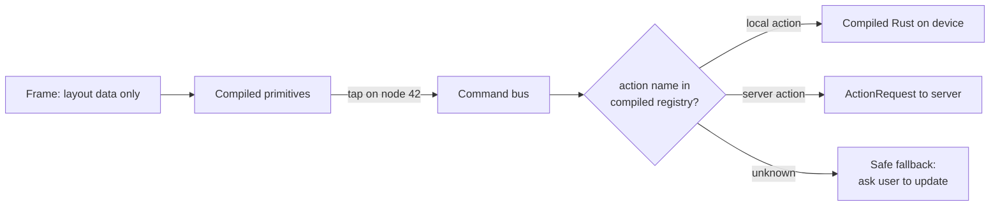
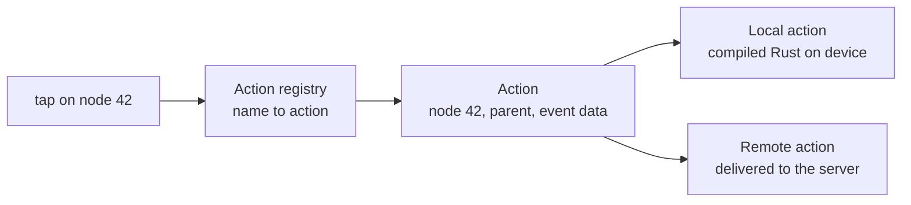

# 11. App Store compliance and the declarative command bus

_Written in ASD-STE100 Simplified Technical English (STE). Code and identifiers stay as they
are._

**Abbreviations in this file.** user interface (UI); WebAssembly (WASM); JavaScript (JS);
HyperText Markup Language (HTML); identifier (id); AeroSpace and Defence Industries Association
of Europe (ASD), the owner of the STE standard ASD-STE100.

## 1. The idea, laid out

Source: `foundation_ui_rearchitecture.md` §6 and §3 ("Mobile apps completely drop … remote
bytecode runtimes").

Apple App Store Review Guideline 2.5.2 says an app must not download, install or run code that
adds or changes features. Google Play has a similar rule. The document meets it by design, with
three rules:

1. **Data, not code.** The server sends declarative layout data. Never scripts, bytecode or
   binaries.
2. **Compiled primitives.** All UI primitives are compiled into the app. The server arranges
   them and sets their values.
3. **Declarative command bus.** An event names an action. The app maps the name to a
   **compiled action in its registry**. Nothing is interpreted.

_The diagram shows that every event resolves to a compiled action or a safe fallback._

_North star fit: the registry and the App Store rules that every platform set shares (D37,
[13](./13-platform-capabilities.md))._

## 2. Current state

| Part | Where | Problem for 2.5.2 |
|---|---|---|
| Spec 52 deployment surfaces 1 and 3: "WASM hot-swap, no review" | `specifications/52-tauri-foundation-platform/decisions/04-deployment-surfaces.md:32-34`, `:715` | Downloaded logic. This is what 2.5.2 forbids. |
| Update module | `backends/foundation_platform/src/ota.rs` | Tauri platform crate; out of scope (D2) |
| Component behaviour in scoped JS | `backends/foundation_ui_components/src/machinery/mod.rs:46` | Keep it, web only. A native surface never receives it. A native equivalent is needed ([12](./12-scoped-behaviour.md)). |
| `DomOp::MorphNode` carries an HTML string | `backends/foundation_ui_traits/src/dom_op.rs:159` | HTML can hold scripts. The op is web only (D8), so a native client must never receive it. |
| No action registry, no native primitive set | — | — |

## 3. The new way

### 3.1 The schema has no code fields for native

The layout vocabulary ([04](./04-vocabulary-and-interning.md)) has no field that holds code,
markup, an expression language, a condition or a loop. A one-page compliance note in the design
spec lists every field of every payload type that a native client can receive, and shows this.
Review of a schema change checks it again.

There are two schema members that a native client must not run: `HtmlMorph`
([01](./01-compile-time-targeting.md), [03](./03-payload-tiers.md), owner decision D8) and
`ScriptNode` (D37). The first carries an HTML fragment; the second carries a scoped script for
a web island. Both are **web only**:

- The server reads `mount` from `ClientHello` ([02](./02-unified-wire-contract.md)) and never
  sends them to a `Native` mount.
- A native reader that meets one anyway must report an unsupported operation. It must never
  render the string or run a script from it.
- On the web, downloaded HTML and JS are normal (D3, §4). The app store rule does not apply
  there.

The design spec must show this gate in the frame writer, so a single code path decides it.

### 3.2 One registry model, on the web and on device

The model is the same on both surfaces (owner review, 2026-11-11):

1. An event names the action that it wants to trigger.
2. The runtime looks the name up in an action registry.
3. The action gets the node that fired, its parent, and the information we choose to extract.
4. The action does its work. It can be local or remote; the caller does not care.

_The diagram shows the same lookup on the web and on device. The caller does not know whether
the action is remote._

**The registry is not a generated global.** The user builds it and registers the actions that
they want (owner review, 2026-11-11):

- The `#[action]` macro ([10](./10-action-model.md)) generates a struct with the name of the
  function. That name is the action tag; there is no derived numeric id (D31).
- The app supplies the struct to its registry. The registry is a normal value that the app owns
  and can change.
- The event tag carries the name. A template that uses the generated struct cannot misspell it.

**The registry can be Rust or JS** (D37, owner review 2026-11-12):

- In Rust it runs on the server, in WASM and on device.
- In JS it runs in the web runtime. It holds the functions that a scoped `<script>` defines
  beside the markup. Those functions become callable once the DOM mounts, which is the current
  web capability and stays. They run in JS and never leave the web.
- Each platform looks up the name in its own registry. The same name can have a Rust form and
  a JS form. An action declares its platform scope ([10](./10-action-model.md) §3.8).
- A native payload has no script field. Mobile never runs a script ([12](./12-scoped-behaviour.md)).

**Local and remote actions.** `#[action]` is the base marker. The owner proposes a second
marker, `#[remote_action]`, as a thought for now (Q30). It marks a client call that delivers the
name and the data to the remote side. The client uses the same registry shape for both.

The app sends a hash of its registered action names in `ClientHello`
([02](./02-unified-wire-contract.md)). The server never binds an event to a name that the
client's registry does not have.

### 3.3 Version skew is a normal case

An old app meets a new server every day. Rules:

- The server adapts down: it sends only vocabulary and actions the client declared.
- A FlatBuffers union member the client does not know reads as `NONE`. The client shows a
  fallback view for that node and reports it. It never crashes.
- When the server cannot express a screen for an old client, it sends a typed "update required"
  frame.

### 3.4 What the native app may receive

| Allowed (data) | Not allowed on native (logic) |
|---|---|
| Layout frames, strings, images, design tokens, feature flags that pick between compiled paths | WASM modules, JS, any interpreted script, new action handlers |

The table states the 2.5.2 rule for the payload. The update policy for native apps is not a
current concern (D33).

### 3.5 The grey zone

Apple accepts server-driven layout. Reviewers still judge "changes features" case by case. A
payload that can build any screen from primitives could look like shipping features without
review. The mitigation is the same rule as 3.1: a semantic, limited vocabulary with no logic in
the payload. All logic stays in compiled actions.

### 3.6 Scoped JavaScript stays, on the web

Scoped JavaScript (JS) is web only (owner review, 2026-11-11). A web island may use it. A
native surface never receives it: the schema has no field for it, and the server gates by
`mount` in `ClientHello`. Each behaviour that a component needs has a native equivalent,
compiled for each platform ([12](./12-scoped-behaviour.md)). The App Store rule covers
downloaded code, so it applies to the native surface only.

## 4. What this changes for us

- Per owner decision D3, spec 52 surfaces 1 and 3 ("WASM hot-swap") do not apply to native
  apps. On the web, downloaded JS and WASM stay normal.
- Component behaviour stays as scoped JS on the web. Each native platform gets a compiled
  equivalent ([12](./12-scoped-behaviour.md)).
- The registry has two hosts, Rust and JS, behind one name-based contract (D37). The web
  script functions stay web-only.

## 5. Open questions

Q30 in [`questions.md`](./questions.md): whether to add a `#[remote_action]` marker. Q23 and
Q24 are closed: the framework delivers state updates or UI updates (D32), and the update
policy is not a current concern (D33). Q25 is answered: build on spec 52 and decide what to
keep or to remove as the work proceeds (D34).
