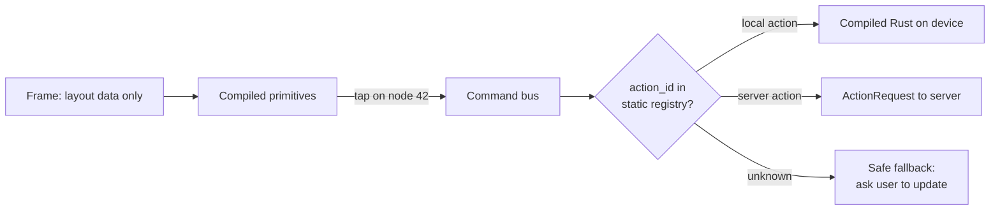

# 11. App Store compliance and the declarative command bus

_Written in ASD-STE100 Simplified Technical English (STE). Code and identifiers stay as they
are._

**Abbreviations in this file.** user interface (UI); WebAssembly (WASM); JavaScript (JS);
HyperText Markup Language (HTML); over the air (OTA); identifier (id); AeroSpace and Defence
Industries Association of Europe (ASD), the owner of the STE standard ASD-STE100.

## 1. The idea, laid out

Source: `foundation_ui_rearchitecture.md` §6 and §3 ("Mobile apps completely drop … remote
bytecode runtimes").

Apple App Store Review Guideline 2.5.2 says an app must not download, install or run code that
adds or changes features. Google Play has a similar rule. The document meets it by design, with
three rules:

1. **Data, not code.** The server sends declarative layout data. Never scripts, bytecode or
   binaries.
2. **Compiled primitives.** All UI primitives are compiled into the app. The server arranges
   them and sets their values.
3. **Declarative command bus.** An event names an action by id. The app checks the id against a
   **static registry of compiled actions**. Nothing is interpreted.

_The diagram shows that every event resolves to a compiled action or a safe fallback._

## 2. Current state

| Part | Where | Problem for 2.5.2 |
|---|---|---|
| Spec 52 deployment surfaces 1 and 3: "WASM hot-swap, no review" | `specifications/52-tauri-foundation-platform/decisions/04-deployment-surfaces.md:32-34`, `:715` | Downloaded logic. This is what 2.5.2 forbids. |
| OTA module | `backends/foundation_platform/src/ota.rs` | Tauri platform crate; out of scope (D2) |
| Component behaviour in scoped JS | `backends/foundation_ui_components/src/machinery/mod.rs:46` | JS inside markup would be downloaded code in a native app |
| `DomOp::MorphNode` carries an HTML string | `backends/foundation_ui_traits/src/dom_op.rs:159` | HTML can hold scripts |
| No action registry, no native primitive set | — | — |

## 3. The new way

### 3.1 The schema has no code fields

The layout vocabulary ([04](./04-vocabulary-and-interning.md)) has no field that holds code,
markup, an expression language, a condition or a loop. A one-page compliance note in the design
spec lists every field of every payload type and shows this. Review of a schema change checks
it again.

### 3.2 One registry, generated, shared by server and device

The `#[action]` macro ([10](./10-action-model.md)) generates the registry. Each entry has:

| Field | Meaning |
|---|---|
| `action_id` | Stable numeric id |
| `kind` | `Local` (compiled Rust on device), `Server` (send to server), `LocalThenServer` (optimistic local update, then confirm) |
| `input_type`, `state_type` | Generated type ids |

The app ships the registry for its version. The `ClientHello` sends a hash of it
([02](./02-unified-wire-contract.md)). The server never sends a frame that binds an event to an
action id that the client's registry does not have.

### 3.3 Version skew is a normal case

An old app meets a new server every day. Rules:

- The server adapts down: it sends only vocabulary and actions the client declared.
- A FlatBuffers union member the client does not know reads as `NONE`. The client shows a
  fallback view for that node and reports it. It never crashes.
- When the server cannot express a screen for an old client, it sends a typed "update required"
  frame.

### 3.4 What may still update over the air

| Allowed (data) | Not allowed on native (logic) |
|---|---|
| Layout frames, strings, images, design tokens, feature flags that pick between compiled paths | WASM modules, JS, any interpreted script, new action handlers |

### 3.5 The grey zone

Apple accepts server-driven layout. Reviewers still judge "changes features" case by case. A
payload that can build any screen from primitives could look like shipping features without
review. The mitigation is the same rule as 3.1: a semantic, limited vocabulary with no logic in
the payload. All logic stays in compiled actions.

## 4. What this changes for us

- Per owner decision D3, spec 52 surfaces 1 and 3 ("WASM hot-swap") do not apply to native
  apps. On the web, downloaded JS and WASM stay normal.
- Component behaviour must be compiled per platform, not shipped as scoped JS.

## 5. Open questions

Q23 in [`questions.md`](./questions.md): whether `LocalThenServer` (optimistic update) is in the
first version.
