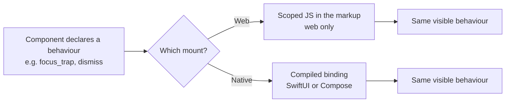

# 12. Scoped behaviour: web islands stay, native gets a compiled equivalent

_Written in ASD-STE100 Simplified Technical English (STE). Code and identifiers stay as they
are._

**Abbreviations in this file.** JavaScript (JS); application programming interface (API);
AeroSpace and Defence Industries Association of Europe (ASD), the owner of the STE standard
ASD-STE100.

## 1. The idea, laid out

Source: the owner's review of PR #157 on 2026-11-11.

**Scoped JavaScript (JS) is for the web. Keep it. It must never leave the web.**

Scoped JS is the behaviour path for an island: a region of the page that has its own reactive
and dynamic state. The component machinery adds a `<script scoped primal:script>` node to the
markup, and the web runtime runs it once with the component root as the scope. It is a small,
local script, not an application.

A native app cannot download script (App Store 2.5.2, [11](./11-app-store-and-command-bus.md)).
So each behaviour that a component needs also has a **compiled equivalent** for each native
platform. The web keeps scoped JS. Native uses a platform binding with the same name and the
same effect.

_The diagram shows one behaviour with two implementations. The server picks one by the mount
surface._

The owner also asked for a mobile equivalent of the web island idea, not only a translation of
each script. On native, the island counterpart is a region whose state lives in Rust
(`foundation_signals`) and whose views bind to it. That needs no downloaded code. It is
described in §3.3.

## 2. Current state

| Part | Where |
|---|---|
| `scoped_script` builds a `<script scoped primal:script>` node | `backends/foundation_ui_components/src/machinery/mod.rs:39-61` |
| Scoped `<script>` and `<style>` are transformed at compile time | `specifications/completed/39-foundation-wasm-ui/decisions/019-scoped-script-style-tags.md` |
| Behaviour modules, JS only: `dialog`, `dismiss`, `focus_trap`, `gestures`, `hover`, `listbox`, `measure`, `position`, `scroll_lock`, `transition` | `backends/foundation_ui_components/src/machinery/` |
| No native equivalent | — |

## 3. The new way

### 3.1 The web keeps its islands

- `scoped_script` and the compile-time transform of decision 019 stay as they are.
- A script node exists only in the web subset of the vocabulary ([04](./04-vocabulary-and-interning.md)).
  It is valid only on a `Web` mount ([02](./02-unified-wire-contract.md)).
- No change to the current web behaviour. The web is the first target (D4), and the mount paths
  keep working ([05](./05-web-zero-copy-applicator.md)).

### 3.2 The native equivalent

Each behaviour module has one of two native forms:

| Behaviour | Native form | Source of the behaviour |
|---|---|---|
| `dialog` | The platform sheet or alert | SwiftUI `sheet`/`alert`, Compose `Dialog` |
| `dismiss` | Tap outside, back button, swipe down | Platform control |
| `focus_trap` | Platform focus engine and accessibility order | Platform control |
| `gestures` | Platform gesture recognizers | SwiftUI `gesture`, Compose `pointerInput` |
| `hover` | Pointer or hover events | Platform pointer API |
| `listbox` | The platform list and its selection model | `List`, `LazyColumn` |
| `measure` | The platform layout pass | `GeometryReader`, `onGloballyPositioned` |
| `position` | The platform anchor and offset API | Native positioning API |
| `scroll_lock` | The platform scroll control | Native scroll view options |
| `transition` | The platform animation | SwiftUI animation, Compose animation |

The rule from the owner's review applies: **do not rebuild what the platform provides.** The
binding calls the native control. We implement only the small part the platform does not have,
for example a focus trap across a custom modal.

### 3.3 The island equivalent on native

The web island is reactive state in scoped JS. The native counterpart is the same state in
Rust (`foundation_signals`), bound to native views:

- A component declares its island state as signals. The state is part of the compiled app.
- A view binds to a signal. A change marks only that view.
- An event runs a compiled action, not a script ([10](./10-action-model.md)).
- The server can still own the state and send frames. Nothing in this model removes the
  server path; it only adds a local reactive path.

So the two mounts offer the same capability with different mechanisms. The web island and the
native island are the same idea.

### 3.4 The gate and the matrix

- The server reads `mount` from `ClientHello` and never sends a script node to a `Native`
  mount. The schema has no field for a script ([02](./02-unified-wire-contract.md),
  [11](./11-app-store-and-command-bus.md)).
- Each component declares the behaviours it uses. The build checks that every declared
  behaviour has a web form and a native form. A behaviour with no native form fails the build
  for that platform.
- The result is one behaviour matrix, generated in the design spec, not a list in a document
  that can fall behind the code.

## 4. What this changes for us

- The ten behaviour modules stay for the web. Each gains a native binding, written with the
  platform controls in the table above.
- The native bindings are new Swift and Kotlin code in the packages from
  [06](./06-native-rendering.md).
- The build gains a check: a component behaviour with no native form fails the native build.
- `foundation_ui_components` no longer treats scoped JS as the only form of a behaviour.

## 5. Open questions

Q27 in [`questions.md`](./questions.md): which behaviours get a native binding first.
