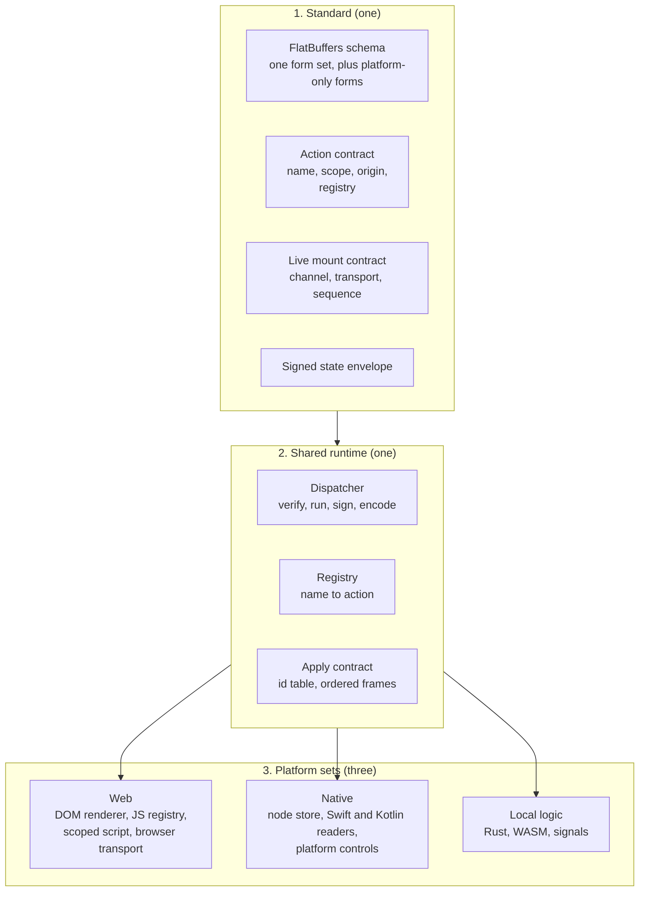
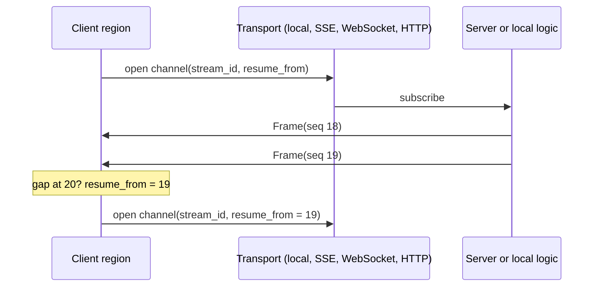

# 13. One standard, three platform sets: reuse and platform capability hooks

_Written in ASD-STE100 Simplified Technical English (STE). Code and identifiers stay as they
are._

**Abbreviations in this file.** user interface (UI); WebAssembly (WASM); JavaScript (JS);
Document Object Model (DOM); Server-Sent Events (SSE); hypertext transfer protocol (HTTP);
application programming interface (API); identifier (id);
AeroSpace and Defence Industries Association of Europe (ASD), the owner of the STE standard
ASD-STE100.

## 1. The idea, laid out

Source: the owner's review of PR #157 on 2026-11-12.

The north star is one contract, one action model and platform capabilities at the edges. This
file shows the three layers that make that work:

1. **The standard.** One FlatBuffers schema, one action name and registry contract, one live
   mount contract, one signed state envelope. Every platform reads the same rules.
2. **The shared runtime.** The dispatcher, the registry and the frame apply contract. The
   code is written once and used on the server, in WASM, in Rust and on device.
3. **The platform sets.** Web, native and local logic each provide the capabilities that only
   they have. They do not reimplement the standard.

The owner's words: "Break down the current architecture to allow reuse across platform but
also set out specific capabilities that maybe only for one platform type allowing flexibility
where it matters and standards at the top."



_The diagram shows one standard and one shared runtime over three platform sets. A platform
implements capabilities; it does not fork the standard._

**Do not redesign what works.** The schema, `primal-id`, the HTML morph, the signal islands,
the state envelope and the live mode stay as the earlier decisions define them (D8, D14, D15,
D40). This file adds the split and the hooks. It does not add a second framework.

## 2. Current state

| Layer | What exists | What is missing |
|---|---|---|
| Contract | `foundation_ui_traits` with `DomOp`, `Envelope`, a 6-byte header; HTML-shaped ids | One schema with core and platform variants; no `foundation_ui_wire` crate |
| Shared runtime | `foundation_signals`, `foundation_context::Ctx`; the `App` and `Broadcaster` in `foundation_wasm_ui` | No action registry, no shared dispatcher, no capability traits |
| Web | the JS runtime, `<mount-stream>` and `<mount-data>`, scoped JS, the HTML morph | No generated reader, no JS action registry, no capability split |
| Native | `ViewKind::Native` as a type only | No node store, no Swift or Kotlin packages, no platform capability layer |
| Local logic | Rust and WASM run the signal graph and local handlers | No platform scope, no action origin, no defined capability boundary |

The current code mixes the layers. The JS runtime contains the transport, the parser, the
renderer and the island logic in one place. The native side does not exist yet. The split
below gives each layer one job.

## 3. The new way

### 3.1 The three layers

| Layer | Holds | Rule |
|---|---|---|
| Standard | The schema ([02](./02-unified-wire-contract.md)); the action name, scope, origin and registry contract ([10](./10-action-model.md), [11](./11-app-store-and-command-bus.md)); the live mount contract (§3.4); the signed state envelope ([07](./07-element-riding-state.md), [08](./08-state-security-and-replay.md)) | One definition. Every platform reads it. A platform never adds a private field to it. |
| Shared runtime | The dispatcher, the registry, the frame decode and apply contract, the sequence and resume rules ([09](./09-stateless-execution.md)) | Written once, in Rust. The same code runs on the server, in WASM and on device. |
| Platform set | The renderer, the transport it serves, the local action host, the behaviour bindings, the platform effects | Each platform implements its set behind the same capability interface. No shared code calls a platform API directly. |

The layers communicate through the standard, not through each other. The web renderer never
calls a Rust function directly; it reads a frame. Rust never calls a DOM API; it sends a frame
or a `NativeCommand` ([06](./06-native-rendering.md) §3.2).

### 3.2 One form per change

The owner's rule: "the message format will have cross platform message types and ui nodes …
and then mobile specific messages and web specific message variants that each side specific
supports its own, this way once can within the same line specify a message for web and another
for mobile."

**A change has one form.** The schema has one set of forms that every platform can do, plus
platform-specific forms only for what that set cannot express (owner correction, 2026-11-12):

1. **Cross-platform members** work on every platform: `CreateNode`, `SetText`, `SetProp`,
   `AppendChild`, `Remove`, `ReplaceSubtree`. They use the core vocabulary
   ([04](./04-vocabulary-and-interning.md)).
2. **Web members** exist only when the cross-platform set cannot express the change:
   `HtmlMorph` (D8) and `ScriptNode` (a scoped script island).
3. **Mobile members** exist only when the cross-platform set cannot express the change:
   `NativeControl` and `NativeCommand`.

The rule is strict:

- If the cross-platform set can express a change, it is a cross-platform member on all three
  surfaces. It does **not** also get a web form or a mobile form.
- If the cross-platform set cannot express it, it gets a platform-specific member for the
  platform that needs it. That member belongs to one platform only. There is no core version
  and no other-platform version of it.

```flatbuffers
union Op {
  // cross-platform forms, every surface applies them
  CreateNode: CreateNode, SetText: SetText, SetProp: SetProp,
  AppendChild: AppendChild, Remove: Remove, ReplaceSubtree: ReplaceSubtree,
  // forms that only the web can express
  HtmlMorph: HtmlMorph, ScriptNode: ScriptNode,
  // forms that only a native surface can express
  NativeControl: NativeControl, NativeCommand: NativeCommand
}
table OpRow { op: Op; }
table OpBatch { ops: [OpRow]; }
```

The reader rule is short and the same on every platform:

1. A cross-platform member applies on every platform.
2. A platform-specific member applies on its own platform.
3. A runtime that meets a member for another platform reports `UnsupportedPlatformOp` with the
   row index and continues the batch. It never applies a form for another platform.

One batch can hold cross-platform members and platform-specific members together. A broadcast
batch can carry a web region and a native region; each client applies the members for its own
platform and skips the rest. The platforms do not share a duplicate form of the same change.

Rules for the variants:

- A web member may use the web subset of the vocabulary. A mobile member uses native controls
  and the core vocabulary.
- A web member applies only on a `Web` mount; a mobile member applies only on a native mount.
- Do not add a cross-platform form beside a platform-specific form of the same change. That is
  the duplication this rule prevents.
- A new platform variant is a new union member. It is not a second schema and not a second
  vocabulary.

### 3.3 The platform capability hooks

The shared runtime asks a platform for a capability through one small interface per
capability. The design spec fixes the names; the shape is:

| Capability | The shared runtime asks | Web provides | Native provides | Local Rust or WASM provides |
|---|---|---|---|---|
| Render | apply this batch to the id table | DOM applicator ([05](./05-web-zero-copy-applicator.md)) | node store and platform views ([06](./06-native-rendering.md)) | nothing; it sends frames |
| Update state | verify, replace or load the signed state | base64url attribute on the root element (D12) | the node record bytes (D12) | the in-memory state |
| Run an action | route this `origin:name` reference on this surface | `server:`, `native:` or `js:` registry (D37) | `server:` or `native:` registry | `server:` or `native:` registry |
| Live mount | open a channel and feed frames | `<mount-stream>` or `<mount-data>` ([05](./05-web-zero-copy-applicator.md)) | a live mount record and a channel (§3.4) | an in-process channel |
| Behaviour | bind this behaviour to this node | scoped JS and browser APIs ([12](./12-scoped-behaviour.md)) | the platform control | the signal graph |
| Platform effect | run this effect | a DOM API | a `NativeCommand` ([06](./06-native-rendering.md)) | nothing; it sends a command |

**The action hook.** An action has two explicit markers. The declaration gives its platform
scope; the reference gives its origin. The two are independent, so they compose (D37, owner
correction 2026-11-12).

*At the declaration: the platform scope.*

```rust
#[action]                 // every platform
#[action(web)]            // web only
#[action(mobile)]         // iOS and Android
```

*At the reference: the origin.*

| Reference | Runs in | Available on |
|---|---|---|
| `server:` | The backend | Every surface with a connection |
| `native:` | A local WASM module or Rust core | Every surface that carries the core |
| `js:` | Page JavaScript (a scoped `<script>` function) | Web only |

A **central action manager** parses the reference, checks the origin and the declared scope,
and coordinates the call ([10](./10-action-model.md) §3.8). The rules:

- **Actions follow the same rule.** A scoped action exists only where the platform capability
  really differs (browser picker vs native picker). If it can be written once, it is unscoped
  and runs everywhere.
- **The registry is told the origin.** The registration call adds the action to the registry
  for its origin: the server registry, the local registry or the JS registry.
- **The manager checks both.** An unavailable origin or a scope that excludes this surface is
  a typed error. It is not a silent no-op.
- **The server accepts only `server:` references.** A request with another origin is rejected.
- **The web script capability stays.** The functions that a scoped `<script>` defines register
  as `js:` actions and never leave the web. A native payload has no script field.
- **The same name can have one form per scope.** The Rust names must not collide; the macro
  adds a scope suffix or the forms live in different modules.

This is a shape, not a final syntax (Q31).

**The behaviour hook.** A component names a behaviour, for example `focus_trap`. Each platform
registers its form under that name ([12](./12-scoped-behaviour.md)). The web form is scoped
JS; the native form is a platform binding. The build checks that every declared behaviour has
a form for every target platform. A missing form fails that platform's build.

**The rule for engineers.** They write the shared part once and add a hook only where the
platform differs. They do not write a second implementation of the standard.

### 3.4 Live mounts on every platform

The owner's rule: "support the ideas of mount-streams, mount-data as well for mobile … a
location that indicates it is live and reacts to incoming changes across some channel and
transport which could be all local, SSE, websocket or a plain http requests."

A **live mount** is a node region with four fields:

| Field | Meaning |
|---|---|
| `kind` | `stream` for an ordered series of frames; `data` for the latest value only |
| `channel_id` | the stream id that the frames carry ([02](./02-unified-wire-contract.md)) |
| `transport` | `local`, `sse`, `websocket` or `http` |
| `resume_from` | the last sequence id that the region applied |

The semantics are the same on every platform:

1. The region marks itself live when it mounts.
2. It opens a channel over the chosen transport. The client can ask for SSE or WebSocket; the
   header negotiation tells it what the server serves (D25, D30).
3. It applies frames in `sequence_id` order. A gap asks to resume from the last applied id.
4. A `stream` region keeps every frame in order. A `data` region keeps the latest value and
   drops older values.
5. The region closes the channel when it unmounts.

| Platform | Representation |
|---|---|
| Web | `<mount-stream>` and `<mount-data>` custom elements, as today. The JS runtime owns the channel. |
| Native | A live mount record in the node store. The Swift or Kotlin host owns the channel and feeds frames to the store. The native views render the region. |
| WebView island | The web representation inside the native app (D11). It uses the same web runtime. |
| Local Rust or WASM | An in-process channel between a signal graph and a region. No network transport. |

The payload is the same `Frame` schema on every path (D29). The core idea is one contract. The
orchestration differs per platform, and that is allowed (D38).



_The diagram shows one live mount contract over any of the four transports._

### 3.5 What each platform implements

| Capability | Web | iOS | Android | WASM or Rust |
|---|---|---|---|---|
| Schema reader | generated TypeScript | generated Swift | generated Kotlin | generated Rust |
| Renderer | DOM | SwiftUI | Jetpack Compose | none |
| Action registry | Rust through WASM, plus JS | Rust and native | Rust and native | Rust |
| Action origins | `server:`, `native:`, `js:` | `server:`, `native:` | `server:`, `native:` | `server:`, `native:` |
| Web script actions (`js:`) | yes, web only | no | no | no |
| State | base64url attribute (D12) | node record bytes (D12) | node record bytes (D12) | in memory |
| Live mount | custom element | live mount record | live mount record | in-process channel |
| Behaviours | scoped JS ([12](./12-scoped-behaviour.md)) | platform controls | platform controls | signal graph |
| Effects | DOM API | `NativeCommand` | `NativeCommand` | sends a command |

No row says "reimplement". Each row says which existing mechanism provides the capability.

### 3.6 Reuse map for the code

| Layer | Crate today | Change |
|---|---|---|
| Contract | none | New `foundation_ui_wire` with the schema and the generated Rust, TypeScript, Swift and Kotlin (D21) |
| Shared runtime | `foundation_ui_traits` | Keep it `no_std`; add the capability traits and the generated types |
| Dispatcher and registry | `foundation_wasm_ui` (partial), `foundation_context` | Move the shared parts into the shared runtime crate; keep the `App` and `Broadcaster` for live mode (D15) |
| Web set | `foundation_wasm_ui`, `foundation_wasm` | Generated reader, JS registry, live mount elements; keep the apply loop and scoped JS |
| Native set | none | Swift and Kotlin readers, node store, native actions, live mounts, behaviour bindings |
| Logic | `foundation_signals`, `foundation_ui_components`, `foundation_macros` | Add the platform scope and the behaviour hooks |

## 4. What this changes for us

- The research now has one integrating model. The idea files keep their detail and point to
  this file for the layer split.
- The schema gains one cross-platform form set and the platform-only forms (§3.2). `02` and
  `03` change.
- The action model gains the platform scope, the origin reference and the central action
  manager (§3.3). `10`, `11` and `12` change.
- The mobile side gains the live mount representation (§3.4). `06` changes.
- No working part is removed. The web mount paths, the HTML morph, the signal islands, the
  state envelope and the live mode stay (D40).

## 5. Open questions

Q31 in [`questions.md`](./questions.md): the exact syntax of the platform scope and of the
registration that names the origin.
