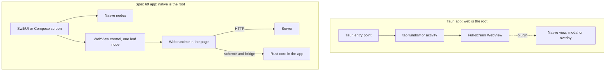

# 14. The WebView control: build on Tauri, or build our own

_Written in ASD-STE100 Simplified Technical English (STE). Code and identifiers stay as they are._

**Abbreviations in this file.** browser view embedded in an app (WebView); inter-process communication (IPC); user interface (UI); hypertext transfer protocol (HTTP); Uniform Resource Locator (URL); Foreign Function Interface generator (UniFFI); application programming interface (API); application binary interface (ABI); Java Native Interface (JNI); JavaScript (JS); WebAssembly (WASM); software development kit (SDK); continuous integration (CI); operating system (OS); Extensible Markup Language (XML); Cross-Origin Resource Sharing (CORS); Content Security Policy (CSP); AeroSpace and Defence Industries Association of Europe (ASD), the owner of the STE standard ASD-STE100.

**How to read the source marks.** A source is a URL, or a file path and line in this repository. "Not confirmed" means that this research run could not read a primary source. Each such claim names what would confirm it. Section 6 lists them all.

## 1. The idea, laid out

Decision D46 (`requirements.md` section 2.4) asks for one control that loads a WebView inside a native app. A server frame can place it with `MountWebView { node_id; parent_id; url }`. The app code can place it too. The place is free: a full screen, a view, or a component inside a SwiftUI or Compose screen.

Inside the WebView, our web runtime (`backends/foundation_wasm_ui/runtimes/foundation-wasm-ui.js`) talks to a server over HTTP, or to a Rust backend in the app over an IPC channel. The messages are the same on both.

The question for the owner: build this control **on Tauri**, or build **our own** control and learn from Tauri?

The key fact is who owns the root of the app.

| Design | Root of the app | The WebView is |
|---|---|---|
| Tauri app | Tauri (the Rust `tao` and `wry` libraries) owns the window, the activity and the view controller | The main thing. Native UI is an add-on |
| Spec 69 native renderers | Our Swift package `EweUI` and Kotlin library `ewe-ui` own the screen tree | One control (a leaf node) inside a native screen |

_The diagram shows the two directions of ownership. Tauri puts a native add-on next to a web root. Spec 69 puts a web leaf inside a native root._

Sources for the Tauri side: section 2.1 and section 3.1.

## 2. Current state

### 2.1 What the repository has today

| Part | Where | What it does |
|---|---|---|
| Tauri dependency | `backends/foundation_platform/Cargo.toml:13` (`tauri = { version = "2.11.5" }`) | The platform crate wraps `tauri::Builder` |
| Pinned versions | `Cargo.lock:14123` `tauri 2.11.6`; `:17517` `wry 0.55.1`; `:14043` `tao 0.35.3`; `:14261` `tauri-runtime-wry 2.11.4` | The lock file fixes these versions |
| Window create | `backends/foundation_platform/src/window.rs:51-135` (`TauriWindowOps`), `WebviewWindowBuilder` at `:73` | One Tauri window per label. A window is a full window, not a child view |
| Window trait | `backends/foundation_platform/src/window.rs:23-40` (`WindowOps`) | `create`, `navigate`, `show`, `hide`, `close`, `screenshot`, `eval`, `open_url`. All use window labels |
| URL scheme | `backends/foundation_platform/src/ewe.rs:24-26` (`register_uri_scheme_protocol("ewe", …)`) | One `ewe://` scheme. Routes go to the session |
| Asset path | `ewe.rs:48-53`, `:72-99` (`/__platform__/`) | The handler sets the `Content-Type` itself. Its comment says `WebViewAssetLoader` does not set the type for `.js` and breaks ES modules |
| Android URL form | `ewe.rs:182-185` and `runtimes/platform-scheme-interceptor.js:1-41` | On Android, wry turns `ewe://` into `http://ewe.localhost/`. The script rewrites links to match |
| IPC commands | `backends/foundation_platform/src/builder.rs:223-226` (`generate_handler!`); `__ewe_capabilities` `:259-284`; `__ewe_ipc` `:293-324`; `__ewe_ipc_stream` `:334-383` | Tauri commands. `__ewe_ipc` takes `Option<Vec<u8>>` bytes |
| Web side of IPC | `runtimes/capability-bridge.js:20-25` (checks `window.__TAURI_INTERNALS__`), `:44` and `:81` (`invoke('__ewe_ipc' …)`) | The JS runtime calls Tauri directly. No other native transport exists |
| View kind | `backends/foundation_ui_traits/src/platform_types.rs:175-187` | `ViewKind::WebView` is the default. `ViewKind::Native` is "post-MVP" |
| Multi-WebView | `specifications/52-tauri-foundation-platform/decisions/10-multi-webview-stack.md:5-14` | Says multi-WebView is desktop and unstable only. One shared WebView is the v1 default on mobile |
| Deployment surfaces | `specifications/52-tauri-foundation-platform/decisions/04-deployment-surfaces.md` ("Overview", "How the shell wraps Tauri") | The shell runs inside Tauri's lifecycle. Tauri owns the event loop, windows and WebViews |
| Example iOS app | `examples/platform_ios/src-tauri/src/lib.rs` (`#[tauri::mobile_entry_point]`, `platform_run!`); `tauri.conf.json` has one window | A Tauri app. `src-tauri/gen/` holds only `schemas` (no Xcode project is committed) |
| Example Android app | `examples/platform_android/src-tauri/gen/android/app/src/main/java/com/ewe/platform/MainActivity.kt` (`class MainActivity : TauriActivity()`) | The activity extends the Tauri activity |
| Wasm engine on iOS | `backends/foundation_platform/src/lib.rs:8-16` | The wasmtime engine uses a just-in-time (JIT) compiler. iOS refuses it. The crate leaves it out on iOS |
| CI for iOS | `.github/workflows/check.yaml:765-771` | Only `cargo check --target aarch64-apple-ios`. No `cargo tauri ios build`, no Xcode build of an app |
| Spec 69 iOS | `features/14-native-ios-renderer/feature.md:60,445` | `WebViewControl`: `WKWebView` through `UIViewRepresentable`. iOS 17 minimum |
| Spec 69 Android | `features/15-native-android-renderer/feature.md:60,134,353` | `WebViewControl`: `AndroidView` over `android.webkit.WebView`. `minSdk` 26 |
| Device core | `features/13-native-core-and-commands/feature.md:241-242` | UniFFI passes `Vec<u8>` as `Data` or `ByteArray`, by copy |

### 2.2 What Tauri gives on mobile

| Fact | Source |
|---|---|
| Tauri uses `wry` to host the system WebView: `WKWebView` on iOS, `android.webkit.WebView` on Android | `wry` README: https://raw.githubusercontent.com/tauri-apps/wry/dev/README.md |
| On iOS, `tao` creates its own `UIWindow`, `UIViewController` and `UIView` subclasses (`TaoUIWindow`, `TaoUIViewController`, `TaoUIView…`). It sets its controller as the root view controller | `tao` source `src/platform_impl/ios/view.rs`: https://raw.githubusercontent.com/tauri-apps/tao/dev/src/platform_impl/ios/view.rs (the `setRootViewController` call is in `window.rs`, reported by the fetch tool; not read directly) |
| On iOS, `wry` makes a `WKWebView` and calls `addSubview` on the `UIView` it gets through the raw window handle. The view auto-resizes with its parent | `wry` source `src/wkwebview/mod.rs`: https://raw.githubusercontent.com/tauri-apps/wry/dev/src/wkwebview/mod.rs |
| On Android, `wry` asks the activity (found through the window handle) to create the WebView on its main thread. The activity must inherit `AppCompatActivity`. The app must call `wry::android_setup` and `wry::android_binding!` | `wry` README (above); `src/android/mod.rs`: https://raw.githubusercontent.com/tauri-apps/wry/dev/src/android/mod.rs |
| `WryActivity` is `abstract class WryActivity : AppCompatActivity()`. Its `onCreate` calls `Rust.onCreate(this)`. The WebView is made on the Rust side | https://raw.githubusercontent.com/tauri-apps/wry/dev/src/android/kotlin/WryActivity.kt |
| The generated Android project in this repository has `MainActivity : TauriActivity()` | `examples/platform_android/src-tauri/gen/android/app/src/main/java/com/ewe/platform/MainActivity.kt` |
| That `TauriActivity` extends `WryActivity` | Not confirmed. A read of the `TauriActivity.kt` file in the `tauri` repository would confirm it |
| The Rust entry point is a function marked `#[tauri::mobile_entry_point]`. Tauri calls it from the generated native project | `examples/platform_ios/src-tauri/src/lib.rs`; the macro itself is not read |
| A mobile plugin is a Swift class that extends `Plugin`, or a Kotlin class that extends `app.tauri.plugin.Plugin` with `@TauriPlugin`. Commands are `@objc func name(_ invoke: Invoke)` or `@Command` methods. Rust calls them with `run_mobile_plugin` | Tauri plugin guide https://v2.tauri.app/develop/plugins/develop-mobile/ (read through a web search summary only; the page itself did not load); `tauri` source `src/plugin/mobile.rs`: https://raw.githubusercontent.com/tauri-apps/tauri/dev/crates/tauri/src/plugin/mobile.rs |
| Plugin calls carry JSON text, not binary. The code shows no binary path and no size limit | `src/plugin/mobile.rs` (above) |
| On iOS, a plugin gets the `WKWebView` through `load(webview:)`. `PluginManager` keeps `viewController: UIViewController?`. The entry point `on_webview_created(webview, viewController)` sets it | https://raw.githubusercontent.com/tauri-apps/tauri/dev/crates/tauri/mobile/ios-api/Sources/Tauri/Tauri.swift |
| Mobile multi-window (several full-screen windows, each with its own WebView) is in `tauri` 2.11. It uses iOS scenes and Android activity embedding. It does not embed WebViews in native containers. Tauri has "no supported way to place native UI alongside the webview" | Pull request #14484, merged 2026-03-23: https://github.com/tauri-apps/tauri/pull/14484 (page summary read; the 2.11 release is inferred from the pull request text) |
| `Window::add_child` (multi-WebView) is `#[cfg(any(test, all(desktop, feature = "unstable")))]`. The doc says it is "only available on desktop" | https://raw.githubusercontent.com/tauri-apps/tauri/dev/crates/tauri/src/window/mod.rs |

### 2.3 Wry and the child WebView

| Question | Answer | Source |
|---|---|---|
| Does `WebViewBuilder::build_as_child` work on iOS and Android? | The doc says "**Android/iOS:** Unsupported." | https://raw.githubusercontent.com/tauri-apps/wry/dev/src/lib.rs |
| Does a `new_as_child` method exist? | No. The doc of `with_bounds` names it, but the builder has `build_as_child`. The text is stale | same file |
| What does the iOS code do with the window handle? | It accepts only the `RawWindowHandle::UiKit` handle, reads `ui_view`, and adds the new `WKWebView` as a subview. `build` and `build_as_child` share the same function. The only difference is a flag that changes the background color | `src/wkwebview/mod.rs` (above) |
| So can wry attach to a `UIView` that it did not create on iOS? | The code path does it, but the docs call `build_as_child` unsupported. A call to `build` with a handle for our own `UIView` is not a documented use. Not confirmed on a device. A spike on an iOS 17 simulator would confirm it | combined from the two rows above |
| Can wry attach to an Android `ViewGroup` that it did not create? | No path is visible. `InnerWebView::new` sends `CreateWebView` to the activity found by the window manager. `new_as_child` only calls `new`. The Kotlin side was not read in full | `src/android/mod.rs` (above) |
| Is multi-WebView stable on mobile in Tauri? | No. It is desktop and `unstable` only | `window/mod.rs` (above) |

## 3. The options

### 3.1 Option A: Tauri as the shell

The app is a Tauri app. The `MountWebView` operation maps to a Tauri window, or to the one main WebView. Native SwiftUI or Compose screens come from a Tauri mobile plugin.

**What it gives**
- A working WebView host on both OSes. The repository already uses it (`foundation_platform`).
- A command system with permissions, and the `ewe://` route code in `foundation_platform`.
- Generated Xcode and Gradle projects (`cargo tauri ios`, `cargo tauri android`).
- Plugins in Swift and Kotlin for platform effects.

**What it costs**
- Tauri owns `main`, the activity and the view controller (section 2.2). Our native renderers are meant to own the screen tree (features 14 and 15). The direction is reversed.
- No supported child WebView on mobile. A `MountWebView` that places a WebView as a component inside a native screen is not possible with the Tauri API. Mobile multi-window gives full-screen windows only (section 2.2).
- A plugin can reach the `UIViewController` and present a native view (section 2.2, `Tauri.swift`). Whether a plugin can host a SwiftUI view inline, next to the WebView, is not confirmed. A spike would confirm it.
- Plugin calls carry JSON text. Binary frames need an encoding (section 2.2, `mobile.rs`).
- Our native packages (`EweUI`, `ewe-ui`) must run inside a Tauri-generated project. The project files then belong to the Tauri command line tool. Not confirmed how well Tauri accepts a Swift package that owns screens. A spike would confirm it.
- Build and CI. The generated iOS project needs Xcode and a macOS runner. CI today only runs `cargo check` for the iOS target (`.github/workflows/check.yaml:765-771`). The check workflow removes the preinstalled Android SDK on Linux to free disk (`check.yaml:179`, `:202`; the same on `:659`, `:676`). An Android Tauri build must put the SDK back.
- Binary size. Not confirmed. The search found only desktop figures from blogs. A measured build of `examples/platform_ios` and `examples/platform_android` would confirm it.
- Tauri 2 versions move fast. The repository pins `tauri 2.11.6` and `wry 0.55.1`. Our rule 17 says to use the latest stable version. A mobile API change then blocks us.

**Risks**
- Medium: the spec says the native renderer owns the screen (S4, S5). A Tauri root fights that.
- High for our goal: embedding the WebView inside a native screen needs work in `tao` and `wry`, as the Tauri pull request text itself says. That is work in a third-party project.
- App Store guideline 2.5.2. Both options load web content in `WKWebView`, so the guideline does not separate them. See section 4.2.

### 3.2 Option B: `wry` directly, from our Rust core

Our device Rust core (feature 13) would call `wry` to make the WebView. Swift and Kotlin would own the view tree.

**What it gives**
- Reuse of `wry` code for custom protocol, IPC and initialization scripts.
- One Rust API for both OSes.

**What it costs**
- iOS: `wry` needs a raw window handle with a `UIView` pointer (section 2.3). UniFFI has no type for a `UIView`. We would write a hand-made C bridge to pass the pointer from Swift to Rust. The docs call `build_as_child` unsupported on iOS.
- Android: `wry` needs an `AppCompatActivity` that is set up with `wry::android_setup` and `wry::android_binding!`. It creates the WebView itself through the activity (section 2.2). It does not attach to a Compose `AndroidView`. No source shows another path.
- The WebView object would live in Rust, but SwiftUI and Compose need the object in Swift and Kotlin to place, size, hide and tear it down. We would build a second bridge for that.
- It still needs the same native pieces (scheme handler, message bridge) because `wry` is a thin layer over `WKWebView` and `android.webkit.WebView` (section 3.3 shows each).

**Risks**
- High. It uses `wry` in a way that its docs do not support (child on iOS and Android). It adds a pointer bridge that UniFFI does not cover. Verdict: not practical when Swift and Kotlin own the views. Not confirmed on a device. A spike would confirm it.

### 3.3 Option C: our own control (a thin native control that learns from wry)

Two small native controls: a SwiftUI `UIViewRepresentable` over `WKWebView`, and a Compose `AndroidView` over `android.webkit.WebView`. They match `features/14` and `features/15`, which already list `WebViewControl`.

**The pieces, and what Tauri or wry does for each**

| Piece | iOS (WKWebView) | Android (WebView) | What `wry` or Tauri does, and what we can copy |
|---|---|---|---|
| View wrapper | `UIViewRepresentable` returns a `WKWebView` | `AndroidView` factory returns a `WebView` | `wry` adds the `WKWebView` as a subview and sets flexible width and height (`wkwebview/mod.rs`). On Android it creates the view in the activity. We copy the settings list from `RustWebView.kt`: JS on, DOM storage on, media autoplay setting (https://raw.githubusercontent.com/tauri-apps/wry/dev/src/android/kotlin/RustWebView.kt) |
| Load a URL | `WKWebView.load(URLRequest)` | `WebView.loadUrl` | Same calls. Not fetched from Apple or Android pages in this run. The repository uses `loadDataWithBaseURL` in `examples/platform_demo/src-android/java/com/ewe/platform/MainActivity.java` |
| Serve bundled web assets and the runtime | `WKURLSchemeHandler` set on the `WKWebViewConfiguration` before the view exists | `WebViewAssetLoader` inside `shouldInterceptRequest`, or our own handler | `wry` registers a scheme handler class with `start` and `stop` (https://raw.githubusercontent.com/tauri-apps/wry/dev/src/wkwebview/class/url_scheme_handler.rs). On Android, `wry` uses `WebViewAssetLoader.AssetsPathHandler` when a domain is set (`RustWebViewClient.kt`: https://raw.githubusercontent.com/tauri-apps/wry/dev/src/android/kotlin/RustWebViewClient.kt) |
| MIME types | Our handler sets `Content-Type` | `WebViewAssetLoader` has a known gap per the repository comment | `ewe.rs:49-50` and `:72-83` set the type for `.js`, `.wasm`, `.html`, `.css`. Copy this table. The comment about `WebViewAssetLoader` is a repository claim. Not confirmed in the Android docs. A test with an ES module would confirm it |
| Inject the web runtime before page scripts | `WKUserScript` at document start | `WebViewCompat.addDocumentStartJavaScript` when supported | The `wry` doc for `with_initialization_script` says: on Android, without document-start support, `wry` prepends scripts to each HTML head, "only supported on custom protocol URLs". For remote URLs it uses `onPageStarted`, which is not guaranteed to run first (https://raw.githubusercontent.com/tauri-apps/wry/dev/src/lib.rs). The Android docs say `addDocumentStartJavaScript` runs before any page script and blocks page load, so keep it short (https://developer.android.com/reference/androidx/webkit/WebViewCompat) |
| Reach a Rust backend in the app | Scheme handler calls the core in process, for example through UniFFI | `shouldInterceptRequest` calls the core in process | `ewe_handler` does this on desktop and mobile today (`ewe.rs:30-68`). The rule: no open local port; one in-process call |
| Message bridge, page to native | `WKScriptMessageHandler` (`userContentController(_:didReceive:)`) | `addJavascriptInterface`, or `WebViewCompat.addWebMessageListener` / `WebMessagePort` | `wry` Android IPC handler takes `Request<String>`: text only (`src/android/mod.rs`) |
| Message bridge, native to page | `evaluateJavaScript` | `evaluateJavascript`, or `WebMessagePort` | `wry` Android `eval` returns a `String` (`src/android/mod.rs`; `RustWebView.kt` uses `evaluateJavascript`) |
| Binary frames, page to native | See "Binary data" below | See "Binary data" below | |
| Navigation and origin rules | `WKNavigationDelegate` `decidePolicyFor` | `shouldOverrideUrlLoading`, `shouldInterceptRequest` | Not fetched from the platform pages in this run. See open question Q3 |
| Lifecycle | Remove from the view tree on teardown. Cancel tasks on `stop` | Call `destroy`. Re-create after configuration change | `wry` re-sends `CreateWebView` after a configuration change (`src/android/mod.rs`, `android_setup`). Compose can re-create the `AndroidView`. We keep the state in the node store, not in the WebView |

**Binary data across each bridge.** This table matters because our frames are binary FlatBuffers.

| Bridge | Carries binary? | Cost | Source |
|---|---|---|---|
| iOS `WKScriptMessage.body` | No. The body is `NSNumber`, `NSString`, `NSDate`, `NSArray`, `NSDictionary` or `NSNull`. No `ArrayBuffer` | Base64 in a string: about 33 percent more bytes plus encode and decode time (the percent is general base64 arithmetic) | WebKit header `WKScriptMessage.h`: https://webkit.googlesource.com/WebKit/+/49e061d8a3dbe8c30f3935dcdd27d7b6b9ae2882/Source/WebKit/UIProcess/API/Cocoa/WKScriptMessage.h (named by a search result; page text not read) |
| iOS scheme handler, request body (`fetch` POST) | Yes. `wry` reads `HTTPBody`, or else reads `HTTPBodyStream` in 128-byte chunks into a `Vec<u8>` | One copy into memory. Not streamed | `url_scheme_handler.rs` (above). Whether `fetch` bodies always reach the handler on every iOS 17 release is not confirmed. A spike test would confirm it |
| iOS scheme handler, response | Yes. `wry` sends one `didReceiveResponse`, one `didReceiveData` with the whole body, then `didFinish` | One buffer in `wry`. Our own handler may call `didReceiveData` more than once to stream. Not confirmed in the Apple page, which did not load. The Apple `WKURLSchemeTask` page would confirm it | `url_scheme_handler.rs` |
| Android `shouldInterceptRequest`, request body | No. Tauri's script says: "on Android we never use it because Android does not have support to reading the request body" | A `fetch` POST cannot carry the frame. Use another bridge | https://raw.githubusercontent.com/tauri-apps/tauri/dev/crates/tauri/scripts/ipc-protocol.js |
| Android `shouldInterceptRequest`, response | Yes. `WebResourceResponse` carries a body. `wry` passes `Vec<u8>` | The whole body for `wry`. Streaming with an `InputStream` is not confirmed from a fetched page | `src/android/mod.rs`; `RustWebViewClient.kt` |
| Android `addJavascriptInterface` | Text only in the common use | Base64 | `wry` IPC is `Request<String>`. The Android reference page for `addJavascriptInterface` was not read. Not confirmed |
| Android `WebMessagePort` and `addWebMessageListener` | Yes. The message is a string or `ArrayBuffer`. The app reads `message.getArrayBuffer()`. The app must first check `isFeatureSupported(WEB_MESSAGE_ARRAY_BUFFER)` | No base64 when the feature exists. A fallback to base64 is needed when it does not | https://developer.android.com/reference/androidx/webkit/WebViewCompat |
| Tauri `invoke` with raw bytes | iOS: yes, by `fetch` to the `ipc` scheme with `application/octet-stream`. Android: no, it uses `postMessage` because of the body gap | Android sends JSON text. How binary goes in that JSON is not confirmed | `ipc-protocol.js` (above); `src/ipc/protocol.rs`: https://raw.githubusercontent.com/tauri-apps/tauri/dev/crates/tauri/src/ipc/protocol.rs |

**A pattern to copy from Tauri.** The page sends a small signal. The native side keeps the bytes. The page then pulls the bytes with a `fetch` to the custom scheme. Tauri keeps the custom-protocol path on Android for exactly this fetch (`fetchChannelDataCommand` in `ipc-protocol.js`). The response of `fetch` is binary on both OSes.

**Origin rules.** `wry` says that a page loaded from a custom protocol has a different origin on each OS: `http://<scheme>.localhost` on Windows and Android, and `<scheme>://localhost` on macOS, iOS and Linux (https://raw.githubusercontent.com/tauri-apps/wry/dev/src/lib.rs, `with_custom_protocol`). Android's `WebViewAssetLoader` uses `https://appassets.androidplatform.net/` by default (https://developer.android.com/reference/androidx/webkit/WebViewAssetLoader). Our own control picks one origin per OS and states it. It need not use the `ewe.localhost` workaround.

**What Option C costs**
- We write and test about two native files per OS (feature files list `WebViewControl.swift` and `WebViewControl.kt`).
- We own the Android and iOS differences (binary bridge, origin, injection).
- We do not get Tauri plugins, commands or permissions.

**Risks**
- Medium: the Android binary bridge depends on the `WEB_MESSAGE_ARRAY_BUFFER` feature. A base64 fallback needs a test.
- Medium: the iOS `fetch` body path needs a spike on iOS 17.
- Low: lifecycle on Compose recomposition. The WebView must not lose its page on each recomposition.

## 4. Comparison and recommendation

### 4.1 Comparison table

| Need | A. Tauri shell | B. `wry` direct | C. Own control |
|---|---|---|---|
| Native screen owns the app root (features 14, 15) | No. Tauri owns it | Yes | Yes |
| WebView as one component inside a SwiftUI or Compose screen | Not supported on mobile (section 2.2) | Not supported by `wry` docs on iOS and Android; needs a pointer bridge | Yes. Native API, standard use |
| Server `MountWebView` operation can place it anywhere | No | Partly, with extra bridges | Yes |
| Binary frames | iOS yes; Android by JSON | Same as `wry` | Our choice per OS (section 3.3) |
| Reuse of `foundation_platform` Rust code | High | Medium | Low (patterns only) |
| New native code | Plugins | Pointer bridge plus view glue | About two files per OS |
| Third-party risk | High: mobile APIs change; `tao` and `wry` limits | High: unsupported use | Low: only WebKit and Android WebView APIs |
| Build and CI | `cargo tauri ios/android`; Xcode; Android SDK | Rust plus Swift and Kotlin | Swift package and Kotlin library, as in features 14 and 15 |
| Fits UniFFI core (feature 13) | Separate IPC path | Pointer bridge outside UniFFI | Scheme handler calls the core through UniFFI |

### 4.2 Recommendation

**Build our own control (Option C). Learn from `wry` and Tauri. Do not build the control on Tauri or on `wry`.**

Reasons:
1. **Direction of ownership.** Spec 69 has native screens that own the app (features 14, 15). Tauri owns the root and has no supported way to put native UI beside the WebView (section 2.2, pull request #14484).
2. **No child WebView on mobile.** `build_as_child` is unsupported on iOS and Android, and `add_child` is desktop and unstable (section 2.3). D46 needs a free place for the WebView.
3. **The pieces are small.** Each OS needs a view wrapper, a scheme handler, a message bridge and navigation rules. `wry` shows how each works, and we copy the patterns (section 3.3).
4. **Binary frames need our choice.** Android cannot read a request body in `shouldInterceptRequest`, and iOS cannot pass `ArrayBuffer` in `postMessage`. We pick the best bridge per OS.
5. **The device core is UniFFI.** The scheme handler calls the core in process. This fits feature 13.
6. **App Store guideline 2.5.2 does not separate the options.** All use the system WebView and load web content. The official text was not read (section 6). The owner rule in feature 15 (I10) holds for Option C: the native payload has no script, and the WebView is the only place that runs web content.

Keep Tauri where it is. `foundation_platform` and the examples continue to use it for desktop and for the existing Tauri mobile apps. This research does not remove them.

## 5. Open questions for the owner

### Q1. How does the existing `foundation_platform` code map to the new control?

| Part | Reuse as code | Reuse as pattern | Does not apply |
|---|---|---|---|
| `ewe_handler` and `EweUrl` (`ewe.rs:30-144`) | The URL parse and the `Content-Type` table (`:72-83`) can move to a shared crate. It depends on `tauri::http` types today | Route to the session, then respond. Asset path `/__platform__/` | The `Manager` and `UriSchemeContext` calls |
| `platform-scheme-interceptor.js` | No | Shows that custom-scheme links fail on Android | The `http://ewe.localhost` rewrite is wry-specific. Our control picks its own origin and needs no rewrite |
| `capability-bridge.js` | The shape of `invokeIpc(name, action, payload)` | A transport function chosen at start. Today the Tauri branch is the only native one (`:20-25`) | The `__TAURI_INTERNALS__` calls. The new runtime gets a `send` function (D46, features 10 and 11) |
| `__ewe_ipc` and `__ewe_capabilities` (`builder.rs:259-324`) | The `IpcRequest` and `IpcResponse` types in `foundation_wasm::ipc` | Request with `payload` bytes and a content type | The Tauri command macros and `tauri::State` |
| `__ewe_ipc_stream` (`builder.rs:334-383`) | No | One-way stream of chunks with a sequence number | The Tauri `Channel`. The loop polls a queue. Rule 6 forbids a sync loop that spins on `Wait` |
| `ViewKind::WebView` and `Native` (`platform_types.rs:175-187`) | The enum | One route decision picks the view kind. `MountWebView` is the spec 69 equivalent | The `Native` "post-MVP" note |
| `WebViewStack` and pool (`stack.rs`, decision 10) | No | One shared WebView with screenshot swap (Basecamp pattern) | Window labels, `TauriWindowOps`, and desktop multi-WebView |
| `WindowOps` (`window.rs:23-40`) | The method set (`navigate`, `eval`, `hide`, `close`) names the control's operations | Same operations as node properties and a `MountWebView` operation | `create` by window label. The new control has a node id and a parent id |

Recommendation: no change to `foundation_platform`. Write the new control against the spec 69 traits. Move a code piece to a shared crate only when a second user needs it.

### Q2. Which binary bridge does the control use by default?

| Option | For | Against |
|---|---|---|
| A. Pull model on both OSes: a small text signal, then `fetch` to the scheme for binary | One code path; binary response on both | Page to native frames still need a body path. Android has none |
| B. Per OS: iOS `fetch` POST to the scheme; Android `WebMessageListener` with `ArrayBuffer`, base64 fallback | Best speed on each OS | Two paths; a feature check on Android |
| C. Base64 text on both | One simple path; works everywhere | About 33 percent more bytes; extra copies |

Recommendation: B, with C as the fallback. Keep C as the first spike result, so a first version ships early. Measure before the final choice.

### Q3. What navigation and origin rules apply?

| Option | For | Against |
|---|---|---|
| A. Allowlist of origins set by the app (default: the app origin plus the given server) | Safe default | The app must list its servers |
| B. Allow any `https` URL | Simple | An external page could reach the bridge |
| C. Allow only the app origin; open other URLs in the system browser | Strongest | Blocks pages on other servers |

Recommendation: A. The bridge answers only to origins on the list. The app sets the list (limits are configuration, rule 8). `wry` also says IPC request URLs differ across frames and OSes (`with_ipc_handler` doc in `src/lib.rs`). Test it.

### Q4. Does the Rust backend in the app use a local socket or an in-process call?

| Option | For | Against |
|---|---|---|
| A. In-process call from the scheme handler to the UniFFI core | No open port; no other app can connect | Binary body path on Android is the gap (Q2) |
| B. Local socket (loopback HTTP) | The page uses plain `fetch`; one path on all OSes | A port other apps can reach; needs a token; cleartext rules on Android (not confirmed) |

Recommendation: A. D46 allows a socket as one free transport. Use it only when A is not enough.

### Q5. Does the owner want to confirm the App Store rule for a WebView with downloaded web content?

The repository rule is: a native payload has no script, and a WebView loads web content as a browser does (D11, feature 15 I10). Spec 52 decision 04 says WASM hot-swap needs "no review" (its table of surfaces). That claim and spec 69 are different positions. This research cannot settle the Apple text.

| Option | For | Against |
|---|---|---|
| A. Owner reads guideline 2.5.2 and sets the rule in the spec | Primary source | Needs owner time |
| B. Keep the current rule (WebView = browser; no downloaded native code) | Matches D11 | Not checked against the official text |

Recommendation: A before the control ships.

### Q6. Should one `MountWebView` node own one WebView, or share a pool?

| Option | For | Against |
|---|---|---|
| A. One WebView per node; destroy on unmount | Simple; clear lifetime | Memory and battery per WebView (raised in pull request #14484 discussion) |
| B. A small pool, reuse on mount | Faster mount | More state; stale pages |

Recommendation: A first. Add a pool only when a measurement shows a need. The `stack.rs` pool stays a pattern.

## 6. Claims not confirmed, and sources not reached

**Not confirmed**
1. `TauriActivity` extends `WryActivity`. Confirm with `TauriActivity.kt` in the `tauri` repository.
2. A call to wry `build` on iOS with a handle for our own `UIView` works on a device. Confirm with a spike on an iOS 17 simulator.
3. A Tauri mobile plugin can host a SwiftUI view inline beside the WebView. Confirm with a spike plugin.
4. Tauri binary size on mobile. Confirm with a measured build of `examples/platform_ios` and `examples/platform_android`.
5. How Tauri sends binary in the Android `postMessage` JSON. Confirm in `ipc-protocol.js` (the processing function).
6. `fetch` POST bodies reach the `WKURLSchemeHandler` on every iOS 17 release. Confirm with a spike test.
7. Multiple `didReceiveData` calls stream a response on iOS. Confirm with the Apple `WKURLSchemeTask` page.
8. Android `WebResourceResponse` with an `InputStream` streams a large body. Confirm with the Android reference page.
9. Android `addJavascriptInterface` carries text only. Confirm with the Android reference page.
10. The Tauri 2.11 release includes pull request #14484 (the lock file pins 2.11.6, which is later than 2.11.0). Confirm with the Tauri release notes.
11. The `WebViewAssetLoader` gap for `.js` MIME type is a repository claim (`ewe.rs:49-50`). Confirm with a test.
12. Cleartext loopback HTTP rules on Android (Q4). Confirm with the Android network security configuration page.
13. App Store guideline 2.5.2 official wording. Confirm at https://developer.apple.com/app-store/review/guidelines/.
14. The `setRootViewController` call in `tao` `window.rs` was reported by the fetch tool but not read directly.

**Sources not reached**
- https://docs.rs/ (all pages): host blocked in this session.
- https://v2.tauri.app/ (all pages): host blocked for direct fetch. A web search returned summaries only.
- https://developer.apple.com/documentation/webkit/wkurlschemehandler: the page text did not load, so the Apple documentation was not read.
- `https://raw.githubusercontent.com/tauri-apps/tauri-docs/...`: path returned 404. The GitHub API for `tauri-apps/tauri-docs` was not allowed in this session.
- `wry` iOS IPC handler (`WKScriptMessageHandler` code): not found in `wry_web_view.rs`. Its file was not located.
- `wry` Android `RustWebView.kt`: the IPC interface code is inside template placeholders and was not visible.
