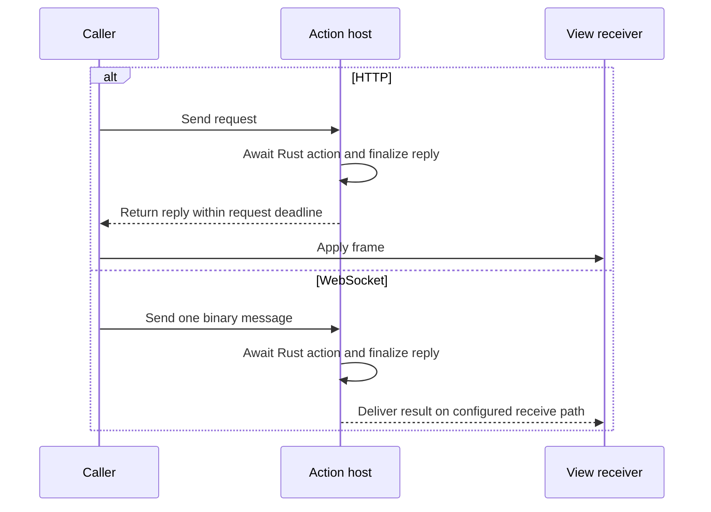

# Actions, signals and rendering

This study covers the checked-out implementations, the examples, and the decisions in spec 69.

## Glossary

| Term | Meaning |
|---|---|
| Signal | A value that tracks which effects read it. |
| Effect | Work that runs again when a tracked value changes. |
| Scope | The lifetime of a local component’s signals and effects. |
| Frame | A unit of delivery containing ordered messages. |
| Attachment | Signed bytes stored on a rendered node for a later action. |
| HTTP | Hypertext Transfer Protocol. |
| SSE | Server-Sent Events. |
| WASM | WebAssembly. |
| HTML | Hypertext Markup Language. |

## From the todo page to a visible update

The page handler calls `todo_page(ctx, &list)`. A submit calls `add_todo` with the verified attachment from the bound input.
The action appends the submitted text and calls the same page function with the changed list.
The author chooses which section to render. Row helpers contribute to one action reply.

A pure `html! { <…> }` returns an `Html` tree for later composition or mounting.
The existing receiver form also returns `Html`. It queues operations and registers effects before returning.
A new root still needs placement. Dropping the tree leaves queued work and live effects intact.
An existing mounted view can change again through a signal read in its template.
For example, `<Text>{count.get()}</Text>` describes a count. An effect can update only that text after stabilization.
The signed todo list still describes the render that supplied the attachment.

Sources include the [macro expansion](../../../backends/foundation_macros/src/html_macro/codegen.rs), [mount code](../../../backends/foundation_wasm_ui/src/slots.rs),
[signal update test](../../../backends/foundation_wasm_ui/tests/html_macro_tests.rs) and [full todo action](../features/05-action-runtime/feature.md).

## Which runtime owns the scope?

The browser test suite contains two useful examples. In `drive_greeting`, a Rust server owns the signal.
The server changes its value and stabilizes its graph. The browser applies the resulting text operation.
In `mode1_html_streams_to_real_browser`, the server sends island markup that morphs the browser element named `#stage`.
Neither example creates a browser Rust signal scope as a child of the server graph. [Browser examples](../../../backends/foundation_browser/tests/smoke.rs)

The local structural tests hide a `<Show>` branch and verify that its effects stop.
Keyed list rows keep their mounted instances during a reorder.
Earlier island examples also support local scripts and events in server-supplied markup.
These examples establish local behavior inside remote content. The script scope and the Rust signal scope have different owners.
[Structural tests](../../../backends/foundation_wasm_ui/tests/reactive_structure_tests.rs) · [Island decision](../../completed/39-foundation-wasm-ui/decisions/021-island-web-component.md)

We found no worked example in the checked-out examples or tests that links a remote graph’s lifetime to a local Rust graph.
The proposed cleanup case requires only local ownership.
When incoming output removes a locally mounted component, the renderer invokes that component’s local unmount hook.
Keep scopes for retained components. Dispose removed scopes once. The remote producer controls its own lifetime.
[Replacement contract and test](../features/08-html-macro-core-vocabulary/feature.md)

## Existing delivery paths

| Entry point | What arrives and where it goes |
|---|---|
| `<mount-data>` or `primal.mountData` | One endpoint response. The browser routes it into the destination. |
| `<mount-stream>` or `primal.mountStream` | A subscription delivers results over time. The programmatic form accepts a target node and returns the transport. |
| `WebSocketTransport.connect` | A host can receive messages in a callback without a mount element. It must route them into its renderer. |
| `WorkerTransport.onMessage` | A host with an injected worker receives its messages and chooses how to apply them. |
| Local WASM signal callback | The Rust callback changes a signal. Stabilization flushes operations to the registered browser applicator. |
| Server signal graph | The broadcaster replays its backlog at connection time and delivers later batches to connected clients. |

Plain HTML materializes in the mount destination. A morph wrapper selects an existing element and reconciles its children.
An operation batch addresses registered nodes. An ordinary JSON (JavaScript Object Notation) patch needs an installed signal bridge.
The local WASM event bridge alone does not map arbitrary endpoint data to Rust setters.
The current socket sender converts non-string values to JSON. The proposed action transport must send binary frame bytes directly.
[Browser transport and routing](../../../backends/foundation_wasm_ui/runtimes/foundation-wasm-ui.js) · [Server broadcaster](../../../backends/foundation_wasm_ui/src/server/mod.rs)

## Action execution and delivery in v2

The diagram shows when the caller waits and where the resulting frame arrives.

- **HTTP.** Await the reply until the normal configured HTTP deadline or a transport failure. Default to one attempt.
  The host can explicitly configure retries for HTTP action requests. A timeout can occur after the server ran the action.
- **WebSocket.** Complete the send when the open socket accepts the message. This reports local handoff.
  Route a later answer through the socket receiver, a live mount, or another configured frame receiver.
  Keep a correlated answer distinct from independent stream pushes. Reconnection does not resubmit the action.
- **Local WASM.** Rust owns the future across waits. Valtron supports thread-local futures and reschedules work through a browser microtask.
  A proposed bridge matches each completion to its caller. JavaScript can process other events while the action waits.
- **Native.** The plans use an asynchronous Rust dispatcher and a host transport. Swift and Kotlin apply frames to observable node records.
  A local frame listener can deliver updates without a network mount.
- **Targeted data.** A v2 data message identifies a node. The web plan dispatches `ewe:data`. Native code calls the node’s listener.
  The application can update a signal from the decoded data. Only an explicit state attachment supplies new signed action state.

The existing [Valtron future adapter](../../../backends/foundation_core/src/valtron/executors/non_sendables.rs) accepts owned futures without a thread-transfer bound.
The [WASM wake path](../../../backends/foundation_core/src/valtron/executors/wasm/foundation_wasm/mod.rs) queues an executor tick.
The v2 action bridge and target listeners are design contracts. See [web actions](../features/10-web-action-manager/feature.md),
[web delivery](../features/09-web-frame-applicator/feature.md) and [native core](../features/13-native-core-and-commands/feature.md).

## Decisions carried forward

Spec 39 established signal effects, mount elements and HTML morphs. Spec 69 preserves the live mode and adds stateless actions.
A component can use a stateless submit and an independent live count. Each has its own source of updates.
The proposed writer migration changes how operations are encoded for delivery.
A data request applies its complete reply. A stream applies distinct renders in order, including renders of different sections.
[Live and stateless execution](09-stateless-execution.md) · [Live mounts](../features/11-live-mounts-and-server-streams/feature.md) · [Writer migration](../features/20-migrate-to-frame-writer/feature.md)
