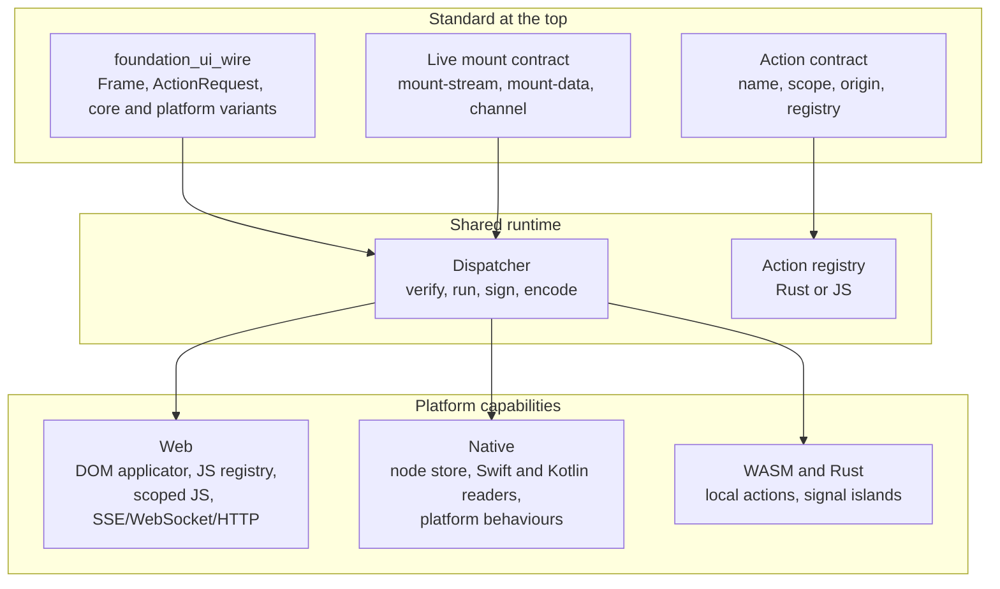

# Spec 69 research: foundation_ui v2

_Written in ASD-STE100 Simplified Technical English (STE). Code and identifiers stay as they
are._

**Abbreviations in this file.** user interface (UI); server-driven user interface (SDUI);
Document Object Model (DOM); virtual DOM (VDOM); WebAssembly (WASM); JavaScript (JS);
hypertext transfer protocol (HTTP); Server-Sent Events (SSE);
application programming interface (API); identifier (id); pull request (PR); AeroSpace and
Defence Industries Association of Europe (ASD), the owner of the STE standard ASD-STE100.

## 1. North star

**One FlatBuffers contract carries structured UI, data and actions across the web, mobile,
WASM and compiled Rust. One action model serves every surface. Each platform supplies the
capabilities that only it can provide.**

Source:
[`foundation_ui_rearchitecture.md`](../../65-agent-rpc-serving-system/resources/foundation_ui_rearchitecture.md).

The owner set four goals for this research (PR #157 review, 2026-11-12):

1. **One contract.** A consistent FlatBuffers API and message format that carries UI, data and
   actions on the web, mobile, WASM and a compiled Rust binary. It must be sensible and
   structured.
2. **One action model.** Standardise actions and the action registry per platform. The registry
   can live in Rust or in JS. The current web capability stays: a `<script>` defines functions
   that become callable once the DOM mounts. Isolate that capability to the web. The message
   format carries one cross-platform set of messages and UI nodes, plus a web-only or
   mobile-only form only for what that set cannot express. Each runtime takes the forms it can
   do.
3. **Reuse plus specific capabilities.** Break the architecture into shared parts that every
   platform reuses. Set out the capabilities that only one platform type needs, so there is a
   standard at the top and flexibility where it matters.
4. **Live mounts everywhere.** Support `mount-stream` and `mount-data` on mobile too. The
   representation and orchestration may differ, but the core idea is the same: a location that
   marks itself live and reacts to changes over a channel. The channel can be local, SSE,
   WebSocket or plain HTTP.

**What is fixed at the top:** the schema, the node ids, the action name, scope, origin and
registry contract, the signed state envelope, the live mount semantics and the platform scope
of a form.

**What each platform decides:** the renderer, the transport it serves, the behaviour bindings,
the local action implementations and the platform effects.

_The diagram shows one standard, one shared runtime and three platform sets. Each set
implements only its own capabilities._

**What this is not.** It is not a redesign of the parts that work. Signals, the mount islands,
the HTML morph, the state envelope and the live mode stay as the earlier decisions define them
(D8, D14, D15, D40). It is not a new transport (D25). It is not a prescribed store or session
table (D15). It is not a VDOM or a hydration layer (D20, [01](./01-compile-time-targeting.md)).

## 2. How this research is organised

Each idea file has the same five parts:

1. **The idea, laid out:** what the document says, as schemas, flows and diagrams, and what it
   buys.
2. **Current state:** what the repository has now, with file paths.
3. **The new way:** the target design, which takes the idea further where the document is
   thin or wrong.
4. **What this changes for us:** what is replaced, what stays, what is new.
5. **Open questions:** links to [`questions.md`](./questions.md).

[13](./13-platform-capabilities.md) is the integrating file. It shows how the schema, the
action registry, the capability hooks and the live mounts work together. Read it first, then
the idea file that you need. The design specification comes after the owner answers the
remaining questions.

## 3. Owner decisions (fixed input)

| # | Decision |
|---|---|
| D1 | Research the ideas in the document first; the design follows. |
| D2 | No Tauri content for now. |
| D3 | The new direction **overrides** spec 36 decision 10 and spec 39 decision 025 where they conflict. It overrides spec 52 only where spec 52 conflicts with App Store 2.5.2; the rest of spec 52 has valid use and we build on it (D34, revised 2026-11-12). |
| D4 | **Web first, then native** (revised by the 2026-11-11 review). The web must work consistently first, with the mount paths as they are today. The native layers come after. |
| D5 | **State signing:** "Client never signs, its always from the server or the wasm bundle running on the client on the web – for on-device, this does not matter." |
| D6 | **Replay protection:** "Look at industry standard, at Livewire and learn and refine what works best for us." |
| D7 | (PR #157 review) **FlatBuffers is the top format.** Everything else, columnar included, is a type in the FlatBuffers schema, code-generated for every supported language. |
| D8 | (PR #157 review) **HTML morph stays.** Carry it as one more schema message type for the web target. Do not retire `MorphNode` or decision 027. A native client never receives it. |
| D9 | (PR #157 review, 2026-11-11) **MessagePack stays.** Keep it as an opaque body type in the schema. |
| D10 | (PR #157 review, 2026-11-11) **One vocabulary.** `DomOp` does not stay as a second vocabulary. The core names work on every platform. The web adds a web-only subset, with a number for a known name and a string for a custom one. Mobile reports a web-only name that it cannot render. |
| D11 | (PR #157 review, 2026-11-11) **A mobile app may mount a WebView.** Whatever is mounted, native or web, renders the same server frames. |
| D12 | (PR #157 review, 2026-11-11) **State is a base64url string on the web.** An HTML attribute holds text, never binary. Native holds the same bytes in the node record. |
| D13 | (PR #157 review, 2026-11-11) **The server owns the truth.** It can ignore the state that the client returns. A valid key in the state is enough to load the authoritative state from the backend. So a client cannot cheat with state, even state that carries a real tag. |
| D14 | (PR #157 review, 2026-11-11) **Single use is a domain rule, not a second store.** The server knows when a payment is first created or a delete is requested. A second request for the same resource is rejected by the domain data. Do not delegate single use to a nonce store. |
| D15 | (PR #157 review, 2026-11-11) **The server decides how it handles state.** It delivers one update or a stream of updates; the client renders. The framework does not prescribe a store or a cache. The signal server and its replay backlog are good properties and stay. |
| D16 | (PR #157 review, 2026-11-11) **Encoding is the delivery handler's business.** An action returns a logical `Response`. The handler that delivers it to the client decides the encoding (ops, columnar, JSON, MessagePack). Encoding is not the action's concern. |
| D17 | (PR #157 review, 2026-11-11) **`Ctx` wraps `foundation_context::Ctx`.** Clocks and randomness pass down through it. `Context` then wraps `Ctx` and adds what the action needs. |
| D18 | (PR #157 review, 2026-11-11) **Actions are not RPC procedures.** The design does not put actions behind a remote procedure call router or require ConnectRPC. The simple idea stands: a plain function with an attribute. |
| D19 | (PR #157 review, 2026-11-11) **The `#[action]` macro does more than register an action.** It reads the signature and generates the request decode and the call glue. Shared steps (verify, sign, hand to the handler) stay in the library. |
| D20 | (PR #157 review, 2026-11-11; answers Q1) **Element ids are `primal-id`, as today.** An id is not state, so it needs no stability rule. A `View` or a `Div` has one fixed id from the code. A custom element uses a string or a user-defined id. |
| D21 | (PR #157 review, 2026-11-11; answers Q2) **The wire crate is `foundation_ui_wire`.** It holds the `.fbs` files, the generated Rust, and the generated TypeScript, Swift and Kotlin beside them. |
| D22 | (PR #157 review, 2026-11-11) **One action registry model on web and device.** The event names the action. The registry finds it. The action gets the node, its parent and the information we extract. The action can be local or remote; the caller does not care. |
| D23 | (PR #157 review, 2026-11-11) **The registry is user-built.** The macro generates a struct named after the function; the app registers it. No generated global registry and no fixed list of kinds. `#[action]` and `#[remote_action]` are the owner's proposal (Q30). |
| D24 | (PR #157 review, 2026-11-11; answers Q3) **Enforce 8-byte alignment.** Use `force_align: 8` on numeric vectors and confirm it in every generated language. |
| D25 | (PR #157 review, 2026-11-11; answers Q4) **The transport is a boundary concern.** The framework does not choose one. SSE, HTTP and WebSocket already work, and ConnectRPC is possible. Header negotiation tells the client what comes next. The user decides. |
| D26 | (PR #157 review, 2026-11-11) **Stored `foundation_ai` data is out of scope.** It is not the UI wire and not a framework concern. |
| D27 | (PR #157 review, 2026-11-11; answers Q7) **One consolidated representation for tier 1 and tier 2.** Retire the hand-written columnar code when the new form delivers the same functionality on the web. |
| D28 | (PR #157 review, 2026-11-11; answers Q8) **Keep the different data formats.** Arrow IPC stays for data that goes to Arrow tools. `DataTable` does not replace it. |
| D29 | (PR #157 review, 2026-11-11; answers Q11) **One `Frame` schema for the server, WASM and Rust.** The native side processes frames, so any of them can send a frame and the receiver applies it. |
| D30 | (PR #157 review, 2026-11-11; answers Q20) **Do not reinvent the stream path.** Live streams use the existing `<mount-stream>` paths and header negotiation; a client can connect for SSE or WebSocket. |
| D31 | (PR #157 review, 2026-11-11) **An action is identified by its name.** The macro-generated struct carries the function name, and that name is the tag. No derived numeric id. |
| D32 | (PR #157 review, 2026-11-11) **The framework delivers state updates or UI updates.** Either DOM updates or mobile UI updates; the delivery strategy is not its concern. |
| D33 | (PR #157 review, 2026-11-11) **The native update policy is not a current concern.** The 2.5.2 payload rule still holds. |
| D34 | (PR #157 review, 2026-11-11; answers Q25) **Spec 52 and `foundation_platform` have valid use.** Build on them; decide what to keep, remove or leave for later as the work proceeds. |
| D35 | (PR #157 review, 2026-11-12) **North star.** One FlatBuffers contract carries structured UI, data and actions across the web, mobile, WASM and compiled Rust. It must be sensible and structured. Do not redesign everything. |
| D36 | (PR #157 review, 2026-11-12, corrected in the follow-up) **One consistent set of forms, plus platform forms only where needed.** Every platform can do the cross-platform set. A change that the set cannot express gets a form for one platform only; it has no cross-platform or other-platform twin. One batch can hold cross-platform forms and platform-specific forms together; each runtime applies its own and skips the rest with a typed report. |
| D37 | (PR #157 review, 2026-11-12, corrected in the follow-up) **One action model with two explicit markers: platform scope and origin.** An action declares its platform scope: every platform, web only, or mobile only. A scoped action exists only where the platform capability really differs, for example a browser picker and a native picker; if it can be written once, it is unscoped and runs everywhere. A reference names the origin: `server:` (the backend), `native:` (a local WASM module or Rust core) or `js:` (page JavaScript, web only). A central action manager checks both markers and coordinates the call. Web `<script>` functions that become callable once the DOM mounts stay; they register as `js:` actions and never reach mobile. |
| D38 | (PR #157 review, 2026-11-12) **Platform capability hooks.** Shared parts stay at the top. Each platform supplies the capabilities that only it has. The build routes a hook to its surface: a platform-scoped action to web or mobile, an origin to the registry or transport that serves it. The scope and the origin are independent, so they compose; they are not alternatives. |
| D39 | (PR #157 review, 2026-11-12) **Live mounts on every platform.** `mount-stream` and `mount-data` exist on web and mobile. The core idea is a live location with a channel and a transport: local, SSE, WebSocket or plain HTTP. The representation differs; the semantics do not. |
| D40 | (PR #157 review, 2026-11-12) **Build on the current shape.** Keep the parts we agreed: the schema, `primal-id`, `HtmlMorph`, the signal islands, the state envelope and the live and stateless modes. Do not redesign what works. |

## 4. The ideas

| # | Idea (document section) | Current state | The new way |
|---|---|---|---|
| [01](./01-compile-time-targeting.md) | No VDOM, no hydration, compile-time registered elements (§1, §3) | True on the web (`primal-id`, `DomOp` by node id); `MorphNode` still diffs HTML | The mechanism stays; ids become schema fields shared by every platform; `MorphNode` becomes the web-only `HtmlMorph` op (D8); `DomOp` retires (D10); ids are compile-time `primal-id`, not state (D20) |
| [02](./02-unified-wire-contract.md) | One FlatBuffers contract for every frame (§1, §2) | 6-byte header, protocol byte table, hand-written bodies, no inbound schema | One `.fbs` schema in `foundation_ui_wire` (D21); one cross-platform form set plus platform-only forms for what it cannot express (D36); `flatc` generates Rust, TypeScript, Swift, Kotlin; `Frame` and `ActionRequest`; `ClientHello` handshake; MessagePack stays opaque (D9) |
| [03](./03-payload-tiers.md) | Three payload tiers: FlatBuffers ops, aligned columns, Arrow bulk data (§1, §2, §3) | Tier 2 by hand on the web; Arrow used for `DomOp` | All tiers are schema types (`OpBatch`, `ColumnarBatch`, `DataTable`); generated zero-copy readers; tier picked by the framework; tiers 1 and 2 share one consolidated representation (D27); Arrow IPC stays (D28) |
| [04](./04-vocabulary-and-interning.md) | Numeric tag and attribute ids with string fallback; compiled primitive families (§2, §6) | HTML wire id tables; HTML-shaped `DomOp` | One vocabulary: core names for every platform, a web-only subset, and the string fallback. The web maps core names to HTML names (D10) |
| [05](./05-web-zero-copy-applicator.md) | JS applicator reads frames and writes the DOM without WASM (§3) | Exists for server frames, with a hand-written parser; `<mount-stream>` and `<mount-data>` islands | Generated reader, one apply loop for all tiers and local WASM frames; the mount paths and islands stay; **the web comes first** (D4) |
| [06](./06-native-rendering.md) | SwiftUI and Compose, core compiled in; a WebView is allowed (§3, §6) | Type stub only; no Swift, Kotlin or bindings | Node store with one observable record per node; native controls provide the behaviour; platform-language readers; UniFFI for on-device Rust logic; WebView is a second mount surface (D11); mobile live mounts (D39) |
| [07](./07-element-riding-state.md) | State rides on elements, no client caches; eight state formats (§1, §2, §4) | Stateful server; decision 025 says the client never sends state | One `SignedState` per component root, generated body type; base64url on the web, bytes on native (D12); the server may load the truth from the backend (D13); authenticated encryption for private state |
| [08](./08-state-security-and-replay.md) | HMAC with a rotating secret, verified by any replica (§4) | Private HMAC signer with a key ring and constant-time compare; no UI state token | Tag binds version, key id, times, component, node and session; ordered checks; single use is a domain rule (D14); the [Livewire and industry study](./08b-replay-protection-study.md) sets the layers |
| [09](./09-stateless-execution.md) | Any replica runs an action with no per-user memory (§4) | One-thread stateful `App`, with a replay backlog for live clients | Both modes stay. The server chooses how it handles state and sends one update or a stream (D15). The signal server and its replay backlog stay |
| [10](./10-action-model.md) | `#[action]` macro, `Interaction<T>`, a logical `Response`, state-aware `html!` (§5) | Local handlers only; `html!` takes no state | `async fn` that returns `Response` directly; the macro generates the decode and the call glue (D19); the delivery handler encodes the response (D16); `Ctx` wraps `foundation_context::Ctx` (D17); no RPC layer (D18); action names, not ids (D31); a platform scope at the declaration and an origin at the reference, both routed by one manager (D37, D38) |
| [11](./11-app-store-and-command-bus.md) | App Store 2.5.2: data not code, compiled primitives, declarative command bus (§6) | Spec 52 plans WASM hot-swap; components use scoped JS | No code fields for native; one registry model built by the user (D22, D23); the registry can be Rust or JS (D37); `server:`, `native:` and `js:` references go to the matching registry or transport; a remote action is just an action; version skew handled by the handshake |
| [12](./12-scoped-behaviour.md) | Scoped JS and component behaviour (§3, §6) | Scoped JS in the component machinery; no native equivalent | Scoped JS stays, web only. Each native platform gets a compiled equivalent. One behaviour matrix, with a platform hook per behaviour (D38) |
| [13](./13-platform-capabilities.md) | Reuse across platforms plus platform-specific capabilities (owner review, 2026-11-12) | Shared traits exist; no capability split, no platform hooks | The standard, the shared runtime and the platform sets; the one-form rule; the action and behaviour hooks; live mounts on every platform (D35 to D39) |

## 5. Conflicts with earlier decisions

| Earlier decision | Why it gives way | Idea |
|---|---|---|
| Spec 36 decision 10 (`specifications/completed/36-agentic-api/decisions/10-serialization-format.md`): stored `foundation_ai` conversation data is JSON plus Arrow; the FlatBuffers fallback was dropped | It covers stored AI data, not the UI wire. FlatBuffers is the top format for the UI (D7). Stored AI data is out of scope (D26). | [02](./02-unified-wire-contract.md) |
| Spec 39 decision 025 (`…/39-foundation-wasm-ui/decisions/025-server-client-state-sync.md:8`, `:40`): the client never sends state; nothing is embedded | State is embedded and returned, signed by the server (D5). The client still never authors state. | [07](./07-element-riding-state.md) |
| `ViewKind::Native` "post-MVP" (`backends/foundation_ui_traits/src/platform_types.rs:180-187`) | Native is not post-MVP. The web comes first, then native (D4) | [06](./06-native-rendering.md) |
| Spec 52 deployment surfaces 1 and 3, "WASM hot-swap, no review" (`specifications/52-tauri-foundation-platform/decisions/04-deployment-surfaces.md:32-34`) | Downloaded logic conflicts with App Store 2.5.2 for native apps. The other spec 52 parts have valid use and stay (D34) | [11](./11-app-store-and-command-bus.md) |

**One earlier decision does not give way.** Spec 39 decision 027 and the `MorphNode`
behaviour (`backends/foundation_ui_traits/src/dom_op.rs:159`) stay (D8). The HTML morph becomes
`HtmlMorph`, one more union member in the schema, valid for the web target only
([01](./01-compile-time-targeting.md), [03](./03-payload-tiers.md)). The `DomOp` enum itself
does not stay: it becomes part of the web subset of the one vocabulary (D10).

## 6. Bugs found during this research

The research found one bug: `foundation_auth` `TokenSigner::verify` compared the HMAC tag in
non-constant time and had no key id (`backends/foundation_auth/src/shared/session.rs`).

**Status: fixed.** Commit `25cab64fe` compares the tag with `Mac::verify_slice`. Commit
`540611b30` adds the key ring and key ids. The repository no longer keeps a bug backlog file.
Findings become GitHub issues with a severity label (`CLAUDE.md` rule 9).

## 7. Review comments on PR #157 and how this research applies them

| Comment | Applied in |
|---|---|
| "What the heck is `agentic records`? … make FlatBuffers the top format and everything else, columnar included, a type in the schema" | D7; [02](./02-unified-wire-contract.md) §1, §2, §3.5 |
| "Dont we already do this?" (on the no-hydration loop and ids in the first frame) | [01](./01-compile-time-targeting.md) §2, §3 item 1: yes on the web; the new part is one schema and native readers |
| "Why not represent an `HtmlMorph` command … just another flatbuffer message type for the web?" | D8; [01](./01-compile-time-targeting.md) §3 item 3, §4; [03](./03-payload-tiers.md) §3.1 |
| "I never asked you to remove this, you can just have kept it opaque like Arrow and Columnar" (MessagePack) | D9; [02](./02-unified-wire-contract.md) §3.2, §3.5 |
| "What of the JS then, what exactly are you saying here?" (body encoders replaced) | [02](./02-unified-wire-contract.md) §4; [05](./05-web-zero-copy-applicator.md) §3, §4 |
| "Why not map web to the core names that work in both … HTML tags and attributes are custom names for it" | D10; [04](./04-vocabulary-and-interning.md) §3.1 |
| "If we are rewiring it all why does `DomOp` stay … one consistent vocabulary … scoped JS only on the web" | D10; [04](./04-vocabulary-and-interning.md) §3.1, §3.3, §4; [12](./12-scoped-behaviour.md) |
| "We should not lose these primitives … island style areas of reactive and dynamic state" | [05](./05-web-zero-copy-applicator.md) §2, §4 |
| "We should make web first … ensure the `<mount-stream>` and `<mount-data>` paths work as before … then we go native" | D4; [05](./05-web-zero-copy-applicator.md) §4; [06](./06-native-rendering.md) §1 |
| "Mobile apps can have webviews … we could use webviews" | D11; [06](./06-native-rendering.md) §1, §3.6 |
| "How does rust now trigger native behaviours?" | [06](./06-native-rendering.md) §3.2 |
| "We are trying to go for native speed here, why is this not synchronous?" | [06](./06-native-rendering.md) §3.5 |
| "Why are we rebuilding what the native Swift and Compose provides?" | [06](./06-native-rendering.md) §3.4, §3.5 |
| "Binary can't ride a HTML element, what's wrong with base64 the string?" | D12; [07](./07-element-riding-state.md) §3.3 |
| "the server can ignore all the state client sends and maybe only use a valid key to get what it considers authoritative state from the backend" | D13; [07](./07-element-riding-state.md) §3.5; [08](./08-state-security-and-replay.md) §4.4 |
| "Why this much complexity and storing … the server knows when a payment is initially … a delete is requested … the server should own this and not delegate to a secondary state store" | D14; [08b](./08b-replay-protection-study.md) §3, §4; [08](./08-state-security-and-replay.md) §4.2, §4.4 |
| "it chooses to use the context or get a relevant key from the state and pull from the backend" | [09](./09-stateless-execution.md) §3.2 |
| "these are not bad properties. Signals can't be moved across threads and we do want to use our signal library … a replay backlog is also good" | D15; [09](./09-stateless-execution.md) §2 |
| "we want this, what exactly is wrong and why was this being removed or designed out?" | D15; [09](./09-stateless-execution.md) §3.1, §4 |
| "None of your business, the server can set this up however … you can deliver a stream of updates or a single update" | D15; [09](./09-stateless-execution.md) §3.3 |
| "you could respond with a single response or a stream before, how is this any different?" | [09](./09-stateless-execution.md) §1, §3.1 |
| "how `Response::UIUpdate` gets rendered on the wire is left to the setup they want … that is not the business of the actions" | D16; [10](./10-action-model.md) §1, §3.3 |
| "`Ctx` should now be our wrapper over our `foundation_context::Ctx` … `Context` can then wrap `Ctx`" | D17; [10](./10-action-model.md) §3.4 |
| "what the heck is `ctx.authorize`? where was that even added or brought up" | [10](./10-action-model.md) §3.1: removed. No invented authorization call |
| "You now have a `Result<ActionResult<T>>`, are you mad? I get the `async` which is ok but what the fuck is this?" | [10](./10-action-model.md) §3.1: the action returns `Response` directly |
| "what the fuck did you pull out of your ass?" (on the `Result` bullet) | [10](./10-action-model.md) §3.1: removed. Errors are Q28, not an invented signature |
| "do you think everyone wants RPC? i gave you a simple idea and you built up crap" | D18; [10](./10-action-model.md) §3.7; Q21 withdrawn |
| "`#[foundation_ui::action]` could more than register that into an action registry, what nonsense are you pipling here?" | D19; [10](./10-action-model.md) §3.2 |
| "This basically just works like the web … the event just names the name of the action … the action might be remote and we dont care" | D22; [11](./11-app-store-and-command-bus.md) §1, §3.2 |
| "Do we really need this, let them instantiate a action registry … the macro generates a struct with the name of the function … we can have a `action` and `remote_action`" | D23; [11](./11-app-store-and-command-bus.md) §3.2; Q30 |
| "Yes primal-id, we do not need the id to be stable cause its not state" | D20; [01](./01-compile-time-targeting.md) §3 item 5, §5; Q1 |
| "Sure ui_wire, is fine with me" | D21; [02](./02-unified-wire-contract.md) §3.1, §4, §5; Q2 |
| "enforce 8 bytes then" | D24; [03](./03-payload-tiers.md) §3.2, §5; Q3 |
| "We currently support SSE, HTTP and Websocket, ConnectRPC is also possible … its just a transport (boundary concern)" | D25; [02](./02-unified-wire-contract.md) §5; [09](./09-stateless-execution.md) §3.4; Q4 |
| "foundation_ai, is none of your business" | D26; [02](./02-unified-wire-contract.md) §2; Q5 removed |
| "You retire it when the new one functions and delivers the same functionality as the current for the web … consistent consolidated representation to be used for both tier 1 and 2" | D27; [03](./03-payload-tiers.md) §3.2, §3.5, §4; Q7 |
| "we clearly support the different data formats to be used, why is this even a question?" | D28; [03](./03-payload-tiers.md) §3.4, §4, §5; Q8 |
| "one vocabulary … extend with web only parts … string fallback at the bottom" | D10; [04](./04-vocabulary-and-interning.md) §3.1; Q10 |
| "We said we will build the native side so they can process the frames, this way server, wasm and rust can send frames and be applied" | D29; [05](./05-web-zero-copy-applicator.md) §3; Q11 |
| "it comes with a T, which already defines the Type wanted, how is it not typed?" | [10](./10-action-model.md) §3.1: `Interaction<T>` is typed by `T`; `input_value` stays a `String` |
| "Sure" and "yes" (Q12 to Q17: device readers, OS versions, first spike, state cap, private state, browser WASM) | Recommendations confirmed; [06](./06-native-rendering.md), [07](./07-element-riding-state.md), [08](./08-state-security-and-replay.md) |
| "Sure but not your business, dont even go there" (single-use nonce store) | D14; [08](./08-state-security-and-replay.md) §4.4; Q19 |
| "Dont re-invent what we already fixed with both the frontend mount-streams, and header negotiation …" | D30; [09](./09-stateless-execution.md) §3.4, §5; Q20 |
| "Remove this crap" (derived action ids) | D31; [02](./02-unified-wire-contract.md) §3.3, §3.5; [10](./10-action-model.md) §3.2, §3.6; Q22 removed |
| "Not even your business right now" and "You are just to deliver either state updates or dom / mobile ui updates simple" | D32; [11](./11-app-store-and-command-bus.md) §5; Q23 removed |
| "Also not your current concern" (native update policy) | D33; [11](./11-app-store-and-command-bus.md) §3.4, §5; Q24 removed |
| "it has valid use, we build on it and we decide what to keep or what to remove or what is for later" (spec 52) | D34; [11](./11-app-store-and-command-bus.md) §5; Q25 |
| "create a flatbuffer based consistent API and message format that carries and works across web, mobile and wasm or compiled rust binary" | D35; [02](./02-unified-wire-contract.md), [13](./13-platform-capabilities.md) §1 |
| "the message format will have cross platform message types and ui nodes … and then mobile specific messages and web specific message variants" | D36; [02](./02-unified-wire-contract.md) §3.2, §3.3; [13](./13-platform-capabilities.md) §3.2 |
| "we want a consistent set of forms that are doable on all 3, so we do not have a core form and a web form, thats silly … there is only one for that platform" | D36 corrected; [02](./02-unified-wire-contract.md) §3.2; [03](./03-payload-tiers.md) §3.1; [04](./04-vocabulary-and-interning.md) §3.1; [13](./13-platform-capabilities.md) §3.2 |
| "actions are registered to a action registry whether in rust or on the js side … `<script>` of functions that once the dom mounts are callable … isolate it to the web" | D37; [10](./10-action-model.md) §3.8; [11](./11-app-store-and-command-bus.md) §3.2; [12](./12-scoped-behaviour.md) §3.1 |
| "the registery is always told where an action is: an action might be on the server, in wasm running locally or in js side … we can prefix the actions with markers e.g server: … native: … js: … there is a central action manager who knows and coordinate things accordingly" | D37; [10](./10-action-model.md) §3.8; [11](./11-app-store-and-command-bus.md) §3.2; [13](./13-platform-capabilities.md) §3.3 |
| "No we should keep both ideas" and "they are not mutually exclusive to each other" (platform scope and origin) | D37, D38; [10](./10-action-model.md) §3.8; [13](./13-platform-capabilities.md) §3.3 |
| "Break down the current architecture to allow reuse across platform but also set out specific capabilities that maybe only for one platform type" | D38; [13](./13-platform-capabilities.md) §3.1, §3.3 |
| "We should be supporting the ideas of mount-streams, mount-data as well for mobile … all local, SSE, websocket or a plain http requests" | D39; [06](./06-native-rendering.md) §3.7; [13](./13-platform-capabilities.md) §3.4 |
| "We should not go mad and redesign everything … take all the cool stuff we have here and in the current shape and make it make sense" | D40; [README](./README.md) §1; all idea files keep the earlier decisions |
