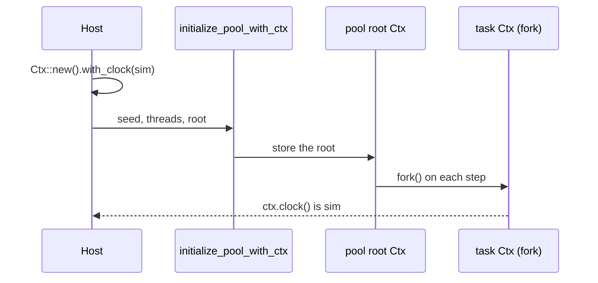

# Feature 115: the engine clock is replaceable at startup and by `Ctx::with_clock`

_Written in ASD-STE100 Simplified Technical English (STE). Code and identifiers stay as
they are. Follow [requirements.md](../../requirements.md) sections 3, 4 and 8._

## Problem (measured 2026-11-05, feature 108)

The engine clock is fixed when a pool starts, and no public call can replace it.

- `Ctx::clock()` (`backends/foundation_core/src/valtron/ctx.rs:218`) returns
  `CtxInner.clock`, and `CtxInner` (`ctx.rs:132`) is private.
- `Ctx::insert` (`ctx.rs:159`) writes the typed map, but `clock()` never reads the map.
- The pool root is `Ctx::new()` at two places: `ThreadRegistry::new`
  (`executors/multi/mod.rs:1552`) and `LocalThreadExecutor::from_seed`
  (`executors/local.rs:1007`).
- `ThreadRegistry.root` and the single-threaded `root` are private.

Feature 108 needed a simulated clock for the `Expect: 100-continue` timer. It carried the
clock in the request `Extensions` and read it in `GetHttpRequestRedirectTask`. That
override is correct for one request, but a deterministic simulation test (DST) needs the
whole pool on one simulated clock: every task reads `ctx.clock()`.

The owner set the direction in a comment on PR #180 (2026-11-05): make the clock
swappable on the `Ctx` at startup, and add `with_clock` that returns a new `Ctx`.

## Design



_One diagram: the host supplies the root `Ctx`, and every task fork keeps its clock._

### 1. `Ctx::with_clock`

```rust
/// A new handle over a copied map, the same config and RNG, and `clock`.
#[must_use]
pub fn with_clock(&self, clock: Arc<dyn Clock>) -> Ctx
```

- The new handle copies the map, the same rule as `fork()` (`ctx.rs:244`). The `config`
  and `rng` `Arc`s stay shared. The clock is the given `Arc`.
- The original `Ctx` keeps its clock. The method takes `&self`, so a caller can build
  several handles from one root.
- Why the map is copied and not shared: `fork()` sets that rule for a new handle. A
  shared map would let an insert through the clock-carrying handle change the original,
  which no other `Ctx` operation does.
- Why the clock is not a typed map entry: `clock()` would depend on the call order,
  because an entry is invisible until inserted. Also `insert::<Arc<dyn Clock>>` keys by
  `TypeId`, so two different clock types collide in one bucket. The field is the one
  source of truth.

### 2. Startup entry points

Add a `Ctx` parameter to the pool start. The old functions stay and pass `Ctx::new()`.

| Layer | New function | Old function keeps |
|---|---|---|
| `foundation_core::valtron` (dispatch) | `initialize_pool_with_ctx(seed: u64, user_thread_num: Option<usize>, root: Ctx) -> PoolGuard` | `initialize_pool` calls it with `Ctx::new()` |
| `executors/sendables.rs` (`multi`) | `initialize_pool_with_ctx(seed, user_thread_num, root)` | same |
| `executors/non_sendables.rs` (single) | `initialize_pool_with_ctx(seed, user_thread_num, root)` | same |
| `executors/multi/mod.rs` | `initialize_pool_with_config_and_ctx(seed, threads, config, root)`, `ThreadRegistry::with_config_and_root(seed, threads, &PoolConfig, root)` | `with_config` calls it with `Ctx::new()` |
| `executors/single/mod.rs` | `initialize_pool_with_ctx(seed, root)` | `initialize_pool(seed)` calls it with `Ctx::new()` |
| `executors/local.rs` | `LocalThreadExecutor::from_seed_with_root(..., root)` | `from_seed` calls it with `Ctx::new()` |
| thread bring-up | `initialize_current_thread_with_ctx(seed, root)` | `initialize_current_thread(seed)` calls it with `Ctx::new()` and stays idempotent |

Rules for each function:

- The `_with_ctx` form is the one that builds the state. The old form is a thin call, so
  there is one code path.
- `initialize_current_thread_with_ctx` keeps the existing rule: a thread that already has
  an engine keeps it.
- `PoolGuard::shutdown` is unchanged. The guard owns the root `Ctx` as it does today.

### 3. Macro argument `ctx`

- `#[valtron(ctx = expr)]` and `#[valtron_test(ctx = expr)]` pass `expr` as the root
  `Ctx`.
- `ctx` joins `Args`, `KNOWN_ARGS` and the error message in
  `foundation_macros/src/valtron_entry.rs`.
- The macro emits `initialize_pool_with_ctx(seed, threads, expr)` in the two places that
  call `initialize_pool` today (`valtron_entry.rs:410` and `:474`), and
  `initialize_current_thread_with_ctx(seed, expr)` in the timeout path (`:417`).
- Without `ctx`, the expansion is the same as today, so no existing call site changes.

### 4. A simulated clock for tests

Add `foundation_core::valtron::SimulatedClock` behind a new `test-clock` cargo feature:

```rust
impl SimulatedClock {
    pub fn new(origin: Duration) -> Self;
    pub fn advance(&self, by: Duration);
}
impl Clock for SimulatedClock { /* now(), elapsed() */ }
```

- `now()` returns the origin plus every `advance`, so a test names the instant it wants.
- The type is `Send + Sync`. It uses one `Mutex<Duration>` and no atomics with relaxed
  order, so a test can read it from any thread.
- Feature-gated so a production build carries no test code; the crate's own tests and
  the tests of dependent crates enable it as a dev-dependency feature.
- Foundation 108 wrote a private `SimClock` in
  `foundation_netio/tests/simple_http/nonblocking_client_tests.rs`. Leave it for now;
  replacing it is its own cleanup (see Follow-ups).

### 5. Known limit: engine parking stays on real time

The executor parks on the real monotonic clock. An injected clock changes what a task
reads from `ctx.clock()`, not how long the worker sleeps. A test that advances a
simulated clock past a deadline must also wake the worker, as feature 108's test does
with a second poll.

The follow-up that makes parking read the injected clock is recorded in
`docs/bug-backlog.md` §4. This feature does not need it, because its tests read the
clock and do not wait on the engine.

## Tests

All tests live in `backends/foundation_core/tests/valtron/` and register in
`tests/valtron/mod.rs`. They use only public API.

1. `with_clock_returns_the_given_clock_and_keeps_the_original`: build
   `Ctx::new().with_clock(sim)`; assert `Arc::ptr_eq(&forked.clock(), &sim)` and that the
   original `ctx.clock()` is still the monotonic clock.
2. `with_clock_shares_config_and_rng`: `Arc::ptr_eq` on `config()` and `rng()`.
3. `with_clock_copies_the_map`: insert a value before the call; it is visible in the new
   handle. Insert another value after the call; it is not visible there, and the
   original sees both. This matches `fork()`.
4. `the_pool_root_carries_the_injected_clock`: a `#[valtron_test(ctx = ...)]` test whose
   body reads `ctx.clock().now()`. Use a `static` clock with `LazyLock` so the test also
   holds the `Arc` and can `advance` it. Assert that a step reports the simulated
   instant, not the real one.
5. `the_task_ctx_inherits_the_pool_clock`: one test that runs a task through `execute(..)`
   and returns `ctx.clock().now()`; assert the simulated instant. The task gets a fork of
   the root, so this proves the clock survives the fork.
6. `the_macro_passes_the_ctx_to_the_timeout_path`: a `#[valtron_test(timeout = ...,
   ctx = ...)]` test. The timeout path runs the body on a new thread and calls
   `initialize_current_thread_with_ctx`; this test proves the clock reaches it.

A test that fails before the change: test 4 on the old tree, because `clock()` returns
the monotonic clock and the assertion on the simulated instant fails. State this in the
Result.

## Verify

```bash
cargo fmt --all --check
cargo clippy --profile uat -p foundation_core --all-targets --no-deps -- -D warnings
cargo clippy --profile uat -p foundation_core --all-targets --features multi --no-deps -- -D warnings
cargo clippy --profile uat -p foundation_macros --all-targets --no-deps -- -D warnings
cargo test --profile uat -p foundation_core
cargo test --profile uat -p foundation_core --features multi
cargo test --profile uat -p foundation_macros
```

Feature 116 runs first, so `foundation_core` already denies warnings and this feature
must keep it at zero.

## Version bump

Both crates gain public API, so both move, and every requirement in the workspace moves
in the same change:

- `foundation_core` 0.0.7 to 0.0.8. New: `Ctx::with_clock`, `initialize_pool_with_ctx`,
  `initialize_current_thread_with_ctx`, `SimulatedClock` (feature `test-clock`).
- `foundation_macros` 0.0.7 to 0.0.8. New: the `ctx` argument.
- Update every `foundation_core` and `foundation_macros` requirement in the workspace
  (about 39 and 70 `Cargo.toml` files). Refresh `Cargo.lock` once.

## Follow-ups (recorded, not in this feature)

- Replace the private `SimClock` in the netio tests with `SimulatedClock`.
- Make the executor parking read the injected clock, so a simulated clock drives a
  sleep. New backlog §4 entry and its own feature.

## Done when

- [x] `Ctx::with_clock` returns the given clock and leaves the original unchanged.
- [x] `initialize_pool_with_ctx` and `initialize_current_thread_with_ctx` exist and the
      old functions call them with `Ctx::new()`.
- [x] The `ctx` macro argument works for `#[valtron]` and `#[valtron_test]`, with and
      without `timeout`.
- [x] `SimulatedClock` is behind the `test-clock` feature.
- [x] The six tests pass; test 4 fails on the old tree.
- [x] Both crates and every workspace requirement move to 0.0.8.
- [x] `docs/bug-backlog.md` §4 entry for the clock is deleted; the parking entry is
      added.
- [ ] CI green.

## Result

Implemented on branch `spec70/priority-followups` (2026-11-06).

Public API added:

- `Ctx::with_clock(&self, clock: Arc<dyn Clock>) -> Ctx`.
- `initialize_pool_with_ctx` in the dispatch layer, `sendables.rs` and
  `non_sendables.rs`; `initialize_current_thread_with_ctx` in the same two files.
- `multi::initialize_pool_with_ctx` and
  `multi::initialize_pool_with_config_and_ctx`;
  `ThreadRegistry::with_config_and_root`.
- `single::initialize_pool_with_ctx`.
- `LocalThreadExecutor::from_seed_with_root`.
- `valtron::SimulatedClock` (`new`, `advance`, `Clock`) behind `test-clock`.
- The `ctx = expr` argument for `#[valtron]` and `#[valtron_test]`.

Measured facts:

- The six clock tests are in `tests/valtron/clock_injection.rs`. The default
  `test-clock` run has 749 tests in the `mod` binary (743 before this feature),
  0 failed. The other five test binaries plus the doctests are unchanged.
- Test 4, `the_pool_root_carries_the_injected_clock`, fails when
  `Ctx::with_clock` keeps the old clock: `left: Instant { tv_sec: 100422,
  tv_nsec: 205134916 }` (real monotonic time), `right: Instant { tv_sec: 104029,
  tv_nsec: 205084458 }` (simulated). The same test passes after the restore.
- `SimulatedClock::now()` is `base + offset`. On native, `Instant` is
  `std::time::Instant`, which cannot be built from a `Duration`, so the type
  stores a base `Instant` and a `Mutex<Duration>` offset. Differences between
  reads are exact; the absolute value is monotonic time shifted by the offset,
  not an epoch.
- The multi pool now builds each worker's `LocalThreadExecutor` from
  `LocalThreadExecutor::from_seed_with_root` with the registry root. Before this
  change a worker task read a fresh `Ctx::new()`, so an injected root could not
  reach it. Side effect: every task now forks the pool root, so all tasks share
  the root's `config` and `rng` `Arc`s. Before, each worker had its own
  `Ctx::new()` and its own seed-0 RNG stream. A deterministic simulation test
  (DST) wants one stream, which is this behaviour; no test depended on the old
  separation.
- The timeout path binds the `ctx` expression once (`__valtron_ctx`) and clones
  it for the outer pool, because the macro uses the same expression on the
  outer thread and on the body thread. Inlining the expression twice would move
  a non-`Copy` local twice.
- This feature adds no allow attribute. The only new compiler error found was
  `catch_unwind` now seeing the root `Ctx`; the worker closure uses
  `AssertUnwindSafe` with a comment, because it only builds a local executor.

Version bump: `foundation_core` and `foundation_macros` go from 0.0.7 to 0.0.8.
The change updates 99 inline requirements and 9 table-form `[dependencies.*]`
requirements (108 in all) in the workspace. `Cargo.lock` is refreshed once.

Local verify:

- `cargo fmt --all --check`: clean.
- `cargo clippy -p foundation_core --all-targets --no-deps -- -D warnings`:
  clean (default tree).
- The same with `--features multi`: clean.
- The same with `--features test-clock`: clean.
- `cargo test -p foundation_core`: 743 in `mod`, 0 failed.
- `cargo test -p foundation_core --features multi`: 784 in `mod`, 0 failed.
- `cargo test -p foundation_core --features test-clock`: 749 in `mod`, 0 failed
  (the six new tests included).
- `cargo test -p foundation_macros`: 99 passed, 0 failed.
- `cargo clippy -p foundation_macros --all-targets --no-deps -- -D warnings`
  fails with 62 pre-existing pedantic diagnostics, none of them new. The crate
  is not in `ci/packages.toml`. The debt is recorded in
  `docs/bug-backlog.md` §30 and scheduled as feature 120.

Known limit (also in `docs/bug-backlog.md` §4): the executor still parks on the
real monotonic clock. An injected clock changes what a task reads, not how long
a worker sleeps.

