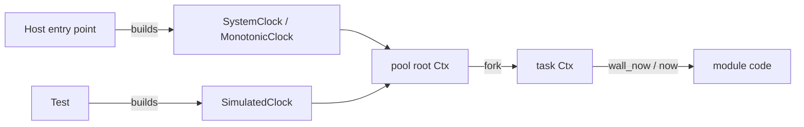

# Feature 117: every timestamp comes from the injected `Clock`

_Written in ASD-STE100 Simplified Technical English (STE). Code and identifiers stay as
they are. Follow [requirements.md](../../requirements.md) sections 3, 4 and 8._

This feature is the umbrella for one rule: no code reads a time source directly. Every
time read comes from the `Clock` that the engine puts in the `Ctx`. The first slice is
the `Clock` extension, the conversions and a CI gate. The crate groups follow as
scheduled sub-features (section 5).

## 1. Problem (measured 2026-11-05)

AGENTS rule 11 says side effects are injected, and names clocks first: no
`SystemTime::now()` or similar in core logic. Today most crates still read time
directly. Measured over `backends/*/src` and `backends/*/src` subtrees, excluding
`tests/`:

```bash
grep -rn 'SystemTime::now\|Utc::now\|Local::now\|OffsetDateTime::now' --include='*.rs' backends/ | grep -v '/tests/' | wc -l   # 193
grep -rn 'Instant::now' --include='*.rs' backends/ | grep -v '/tests/' | wc -l                                                  # 235
```

| Crate | Wall reads | Monotonic reads |
|---|---|---|
| foundation_auth | 62 | 1 |
| foundation_deployment_platform | 13 | 52 |
| foundation_ai | 39 | 2 |
| foundation_keychain | 25 | 0 |
| foundation_nativeapis | 24 | 14 |
| foundation_db | 7 | 0 |
| foundation_core | 2 | 35 |
| foundation_netio | 1 | 43 |
| foundation_http | 1 | 14 |
| foundation_connectrpc | 0 | 13 |
| foundation_proxy | 3 | 12 |
| foundation_wireguard | 1 | 29 |
| foundation_compact | 6 | 3 |
| foundation_platform | 5 | 0 |
| foundation_toolings | 2 | 5 |
| foundation_browser | 1 | 5 |
| foundation_testbed | 0 | 8 |
| foundation_cronjobs | 1 | 0 |
| Others | small | small |

The `Clock` trait (`backends/foundation_core/src/valtron/ctx.rs:64`) is monotonic only:
`now() -> Instant` and `elapsed() -> Duration`. It has no wall-time method, so a crate
that needs a calendar timestamp (token expiry, row `created_at`, log time) cannot get it
from the `Clock` even when the engine injected one.

Feature 115 makes the clock replaceable at startup. This feature makes the clock the
only place a time read may come from.

## 2. Design



_One diagram: the host or the test picks the clock; module code reads it from the `Ctx`._

### 2.1 Extend the `Clock` trait

```rust
pub trait Clock: Send + Sync + 'static {
    /// The current monotonic instant.
    fn now(&self) -> Instant;
    /// The time elapsed since this clock was seeded.
    fn elapsed(&self) -> Duration;
    /// The current wall-clock time, as the operating system reports it.
    fn wall_now(&self) -> SystemTime;
}
```

- A required method, not a defaulted one. A default that called `SystemTime::now()`
  would be a silent fallback to the real global, which rule 11 forbids.
- Implementors to update: `MonotonicClock` (`ctx.rs:95`), the test `MockClock`
  (`tests/valtron/ctx.rs:221`), the netio test `SimClock`
  (`tests/simple_http/nonblocking_client_tests.rs:126`), and `SimulatedClock` from
  feature 115.
- `MonotonicClock` keeps the name; its `wall_now` returns `SystemTime::now()`. It is the
  real backend, and it is the one place the real call stays.
- `SimulatedClock` gains `wall_origin: SystemTime` and `advance_wall(by: Duration)`, so a
  test can move both clocks.

### 2.2 Time conversions live in one place

`foundation_compact` gains a small `time` module with pure functions, so no crate
repeats an epoch conversion:

```rust
pub fn unix_millis(time: SystemTime) -> i64;
pub fn from_unix_millis(millis: i64) -> SystemTime;
pub fn unix_seconds(time: SystemTime) -> i64;
```

- A time before the UNIX epoch maps to a negative value. `SystemTime::duration_since`
  errors there; the functions handle it instead of panicking.
- The existing `timestamp_to_duration` (`foundation_compact/src/timestamp.rs`) stays as
  the wasm millisecond conversion.

### 2.3 How module code gets the clock

Three shapes, in this order of preference:

1. **Inside a valtron task**: the task has `Ctx`; call `ctx.clock()`.
2. **A plain function**: take `clock: &dyn Clock` (or `Arc<dyn Clock>`) as a parameter.
   The caller has the context. Do not read the time inside.
3. **A struct method**: store `Arc<dyn Clock>` on the struct, set from the `Ctx` when the
   struct is built.

A function that cannot get the clock at either of the three points is a design fault:
report it, do not read the global.

`foundation_cronjobs` already has its own `CronClock` trait with `UtcClock`
(`src/scheduler.rs:149`). Fold it into `Clock` in the crate's phase: one trait, one
injection point.

### 2.4 The CI gate

Add `scripts/ci/check_time_sources.py`:

- Scans `backends/*/src/**/*.rs` and a named list of other paths.
- Fails on `SystemTime::now`, `Utc::now`, `Local::now`, `OffsetDateTime::now`,
  `Instant::now` outside the allowlist.
- Allowlist starts with `backends/foundation_compact/src/` (the real backends) and
  `backends/foundation_core/src/valtron/ctx.rs` (`MonotonicClock`). Each sub-feature of
  this umbrella removes its own paths from the list, and adds them to the scan.
- A line may opt out with `// time-source: <reason>`. The script counts these, so a
  reader can see the total. Every marker needs a backlog entry.
- The script has unit tests in `scripts/ci/tests/` and runs as a step of the workspace
  check in `scripts/ci/ci.py`, so every CI run reports it.

The gate is the ratchet: the count only goes down. It also stops new code from adding a
direct read, which a one-time clean-up alone would not.

## 3. Tests

- `foundation_compact`: `unix_millis` round-trips `from_unix_millis`; a pre-epoch time is
  negative; the epoch itself is zero.
- `foundation_core`: `MonotonicClock::wall_now` is near `SystemTime::now()` (one read, in
  a test); `SimulatedClock::wall_now` follows `advance_wall` and does not move without
  it; a `#[valtron_test(ctx = ...)]` task reports the simulated wall time.
- `scripts/ci/tests`: the gate accepts a clean file, rejects each forbidden pattern, and
  accepts an allowlisted path and a marked line.
- The gate runs over the tree at the end of the feature. It must pass.

## 4. Verify

```bash
cargo fmt --all --check
cargo clippy --profile uat -p foundation_compact --all-targets --no-deps -- -D warnings
cargo clippy --profile uat -p foundation_core --all-targets --features multi --no-deps -- -D warnings
cargo test --profile uat -p foundation_compact
cargo test --profile uat -p foundation_core --features multi
python3 scripts/ci/check_time_sources.py --root . --check
python3 -m pytest scripts/ci/tests -q
```

## 5. The phases (each is its own feature, planned before it starts)

| Phase | Feature | Crates | Direct reads |
|---|---|---|---|
| A — this feature | 117 | `foundation_core`, `foundation_compact`, the gate | the `Clock` trait, the conversions, the gate |
| B — engine and I/O | next | `foundation_core`, `foundation_netio`, `foundation_http`, `foundation_connectrpc`, `foundation_testbed` | 152 |
| C — services | next | `foundation_auth`, `foundation_db`, `foundation_ai`, `foundation_keychain`, `foundation_cronjobs` | 136 |
| D — platform | next | `foundation_deployment_platform`, `foundation_nativeapis`, `foundation_wireguard`, `foundation_proxy`, `foundation_platform`, `foundation_toolings`, `foundation_browser` | the rest |

Each phase deletes its paths from the gate allowlist and states its new count in
`progress.md`. The umbrella is complete when the allowlist holds only
`foundation_compact` and `MonotonicClock`.

## Done when (this feature)

- [x] `Clock::wall_now` exists, and every implementor in the tree implements it.
      `MonotonicClock`, `SimulatedClock` and the core test `MockClock` implement it.
      The netio test `SimClock` stopped compiling when the method became required;
      the main session added its `wall_now` (`SystemTime::UNIX_EPOCH`, because that
      clock feeds only the monotonic path) in the follow-up commit, and
      `cargo test --profile uat -p foundation_netio` passes (1218 + 9 + 6 + 5 + 54).
- [x] `SimulatedClock` has a wall origin and `advance_wall`.
- [x] `foundation_compact::time` has the three conversion functions with tests.
- [x] `scripts/ci/check_time_sources.py` exists, has tests, and runs in `ci.py`.
- [x] The gate passes with the allowlist that holds every remaining offender.
- [x] Phases B, C and D are written as feature files with their scope and counts
      (features 132, 133 and 134).
- [ ] CI green.

## Result

Implemented on branch `spec70/priority-followups` (2026-11-06).

Public API added:

- `Clock::wall_now(&self) -> SystemTime` in `foundation_core::valtron`
  (`backends/foundation_core/src/valtron/ctx.rs`). It is a required method, not a
  defaulted one.
- `MonotonicClock::wall_now` returns `SystemTime::now()`. This is the one place in
  the engine where the real wall-clock read stays.
- `SimulatedClock` gains a `wall_origin` (the UNIX epoch) and a `wall_offset`, plus
  `advance_wall(&self, by: Duration)`. Its `wall_now` never reads the real clock.
- `foundation_compact::time` with `unix_millis`, `from_unix_millis` and
  `unix_seconds`.
- `scripts/ci/check_time_sources.py` and its allowlist
  `scripts/ci/time_sources_allowlist.txt`.

Measured facts:

- The gate scans the first-party `src/` trees (`backends/*/src`, `crates/*/src`,
  `bin/*/src`, `infrastructure/*/src`). Over the tree it finds **452 direct reads in
  180 files**, all allowlisted, **0 `// time-source:` markers, 0 violations**.
- The allowlist holds 439 reads in 173 files, each tagged with the phase that
  removes it (B, C or D), plus the two permanent entries:
  `backends/foundation_compact/src/` (9 reads) and
  `backends/foundation_core/src/valtron/ctx.rs` (4 reads).
- Per phase: B has 110 reads in 43 files, C has 137 reads in 51 files, and D has 192
  reads in 79 files. The plan's figures (152 and 136) are older than the tree; the
  feature files use the measured values.
- `foundation_boringtun` is skipped by name. It is the published upstream fork, and
  `check_errstacks.py` skips it for the same reason. It has 15 reads.
- The gate accepts a path or a trailing-slash directory prefix. A marker counts as an
  allowed read and appears in the summary.
- `scripts/ci/ci.py` runs the gate in the `foundation_core` build step, next to
  `check_executor_wake.py`. `python3 -m unittest discover -s scripts/ci/tests` runs
  the gate tests, and `pytest` passes them.

Tests:

- `backends/foundation_compact/tests/time.rs`: 6 tests. The epoch is zero; a
  millisecond value round-trips through `from_unix_millis`; a pre-epoch time is
  negative; `unix_seconds` truncates a positive time and rounds a pre-epoch time
  down.
- `backends/foundation_core/tests/valtron/clock_wall.rs`: 3 tests.
  `monotonic_clock_wall_now_is_near_real_time` runs in the default tree.
  `simulated_wall_time_moves_only_when_advanced` and
  `the_task_ctx_reports_the_simulated_wall_time` need `--features test-clock`.
- `scripts/ci/tests/test_check_time_sources.py`: 8 tests. A clean file passes; each of
  the five patterns fails; an allowlisted path and a marked line pass; a directory
  prefix works; the vendored crate and a `tests/` tree are not scanned.

Verify (all commands pass):

- `cargo fmt --all --check`: clean.
- `cargo clippy --profile uat -p foundation_compact --all-targets --no-deps --
  -D warnings`: clean. The run found one pre-existing `clippy::needless_continue`
  in `src/entropy/backends/getentropy.rs:31`; this feature fixes it.
- `cargo clippy --profile uat -p foundation_core --all-targets --features multi
  --no-deps -- -D warnings`: clean.
- The same with `--features test-clock`: clean.
- `cargo test --profile uat -p foundation_compact`: exit 0; the new file passes 6 of
  6.
- `cargo test --profile uat -p foundation_core --features multi`: exit 0, 786 in
  `tests/mod.rs`, 0 failed.
- `cargo test --profile uat -p foundation_core --features test-clock`: exit 0, 753 in
  `tests/mod.rs`, 0 failed. The three `clock_wall` tests pass.
- `python3 scripts/ci/check_time_sources.py --root . --check`: exit 0, 452 reads,
  0 violations.
- `python3 -m pytest scripts/ci/tests -q`: 19 passed.

Version bump:

- `foundation_core` 0.0.8 to 0.0.9. The change updates 42 requirements in the
  workspace (38 inline, 4 table-form) and its own package version.
- `foundation_compact` 0.2.3 to 0.2.4. The change updates 9 consumer requirements.
- `Cargo.lock` is refreshed once. 40 manifests change in all.

Closed after review:

- `backends/foundation_netio/tests/simple_http/nonblocking_client_tests.rs:126`
  implements `Clock` and did not implement `wall_now`, so the `foundation_netio`
  test target stopped compiling. The feature's brief limits the edits to
  `foundation_core`, `foundation_compact` and `scripts/ci`, so the agent reported it.
  The main session added the method in the follow-up commit:
  `fn wall_now(&self) -> SystemTime { SystemTime::UNIX_EPOCH }`. These tests read
  only the monotonic clock, so a fixed wall time is the correct value; a real
  reading would make the test depend on the machine's date. The backlog §2 entry
  is deleted, and the first step of feature 132 is removed.
- CI is not run here. The pull-request CI proves the two crates.

