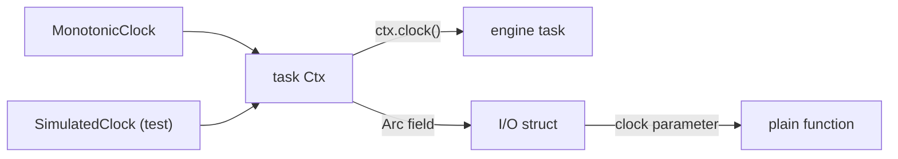

# Feature 132: phase B — the engine and I/O read the injected clock

_Written in ASD-STE100 Simplified Technical English (STE). Code and identifiers stay as
they are. Follow [requirements.md](../../requirements.md) sections 3, 4 and 8._

This feature is phase B of the umbrella feature 117. Feature 117 adds
`Clock::wall_now`, the `foundation_compact::time` conversions and the CI gate
`scripts/ci/check_time_sources.py`. This phase removes every direct time read from
the engine and I/O crates and deletes their entries from the gate allowlist.

## 1. Problem (measured 2026-11-06)

These crates still read a clock directly. A direct read ignores the `Clock` that the
host puts in the `Ctx`, so a deterministic simulation test (DST) cannot control it.

| Crate | Wall reads | Monotonic reads | Total | Files |
|---|---|---|---|---|
| foundation_core | 1 | 29 | 30 | 12 |
| foundation_netio | 1 | 43 | 44 | 16 |
| foundation_http | 1 | 14 | 15 | 6 |
| foundation_connectrpc | 0 | 13 | 13 | 5 |
| foundation_testbed | 0 | 8 | 8 | 4 |
| **Total** | **3** | **107** | **110** | **43** |

The count excludes `backends/foundation_core/src/valtron/ctx.rs` (the real
`MonotonicClock`, 4 reads) and `backends/foundation_compact/src/` (the time
polyfill, 9 reads). The gate allowlist holds these two entries for good.

The plan of feature 117 gave 152 reads for this phase. The tree changed after that
measurement (features 116 and 118 fixed part of `foundation_core`). This feature uses
the measured value, 110, as its starting point.

## 2. Design



_One diagram: engine code reads the clock from the `Ctx`, a struct field, or a parameter._

Apply the three shapes from feature 117 section 2.3, in this order:

1. **Inside a valtron task**: call `ctx.clock()`.
2. **A plain function**: take `clock: &dyn Clock` as a parameter.
3. **A struct method**: store `Arc<dyn Clock>` on the struct, set from the `Ctx`.

Rules for the crate group:

- A timeout, deadline, backoff or interval uses `clock.now()` and `clock.elapsed()`.
- A log time, a `created_at`, a cache age or a certificate check uses
  `clock.wall_now()`.
- Do not add a default trait method and do not keep a fallback to the real clock on a
  missing bundle. A missing clock is a design fault: report it.
- The executor still parks on the real monotonic clock. That is backlog §4 in
  `docs/bug-backlog.md` and it is not part of this phase.
- `foundation_netio` has a private `SimClock` in
  `tests/simple_http/nonblocking_client_tests.rs:126`. It now implements
  `Clock::wall_now` (a fixed `SystemTime::UNIX_EPOCH`, added in feature 117's
  follow-up commit). This phase can replace it with `SimulatedClock` when it needs
  a controlled wall clock.
- Each crate deletes its file entries from
  `scripts/ci/time_sources_allowlist.txt` as it lands. Do not delete another crate's
  entries.

Expected removals, one file at a time:

- `foundation_core`: 12 files, 30 reads.
- `foundation_netio`: 16 files, 44 reads.
- `foundation_http`: 6 files, 15 reads.
- `foundation_connectrpc`: 5 files, 13 reads.
- `foundation_testbed`: 4 files, 8 reads.

## 3. Tests

All tests live in each crate's `tests/` directory and register in its `tests/**/mod.rs`.

1. `foundation_core`: a `#[valtron_test(ctx = ...)]` task with a `SimulatedClock`
   reports the simulated `now()` and `wall_now()`. Advance both clocks and assert
   that the task sees the new values.
2. `foundation_netio`: a client timer test drives a deadline with the injected clock,
   not with `sleep`.
3. `foundation_http`: a server read timeout and an idle timeout read
   `ctx.clock().now()`; a test advances the clock and asserts the timeout fires.
4. `foundation_connectrpc`: a call deadline read from the `Ctx` clock; a test sets
   the simulated clock past the deadline and asserts `DeadlineExceeded` without a
   real wait.
5. `foundation_testbed`: any wall timestamp it reports comes from `ctx.clock()`.
6. The gate: `python3 scripts/ci/check_time_sources.py --root . --check` passes, and
   the summary shows the new count. The gate fails on the old tree for this crate
   group.

The first test must fail on the old code. State in the Result which test failed and
with what value.

## 4. Verify

```bash
cargo fmt --all --check
cargo clippy --profile uat -p foundation_core --all-targets --features multi --no-deps -- -D warnings
cargo clippy --profile uat -p foundation_netio --all-targets --no-deps -- -D warnings
cargo clippy --profile uat -p foundation_http --all-targets --no-deps -- -D warnings
cargo clippy --profile uat -p foundation_connectrpc --all-targets --no-deps -- -D warnings
cargo clippy --profile uat -p foundation_testbed --all-targets --no-deps -- -D warnings
cargo test --profile uat -p foundation_core --features multi
cargo test --profile uat -p foundation_netio
cargo test --profile uat -p foundation_http
cargo test --profile uat -p foundation_connectrpc
cargo test --profile uat -p foundation_testbed
python3 scripts/ci/check_time_sources.py --root . --check
python3 -m pytest scripts/ci/tests -q
```

## 5. Done when

- [ ] Every direct read in the five crates is gone; their allowlist entries are
      deleted.
- [ ] The gate passes and reports 342 or fewer direct reads (452 minus 110).
- [ ] Each crate has an injection test, and one of them fails on the old code.
- [ ] A new public API, if any, is a patch bump in the crate and in every consumer
      requirement in the same change.
- [ ] `docs/bug-backlog.md` has an entry for every marker and every limit left.
- [ ] `progress.md` and `learnings.md` have the dated entry.
- [ ] CI green.

## 6. Result

Not started.
