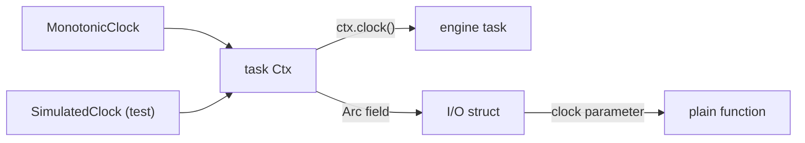

# Feature 132: phase B — the engine and I/O read the injected clock

_Written in ASD-STE100 Simplified Technical English (STE). Code and identifiers stay as
they are. Follow [requirements.md](../../requirements.md) sections 3, 4 and 8._

This feature is phase B of the umbrella feature 117. Feature 117 adds
`Clock::wall_now`, the `foundation_compact::time` conversions and the CI gate
`scripts/ci/check_time_sources.py`. This phase removes every direct time read from
the engine and I/O crates and deletes their entries from the gate allowlist.

## 1. Problem (measured 2026-11-06)

These crates still read a clock directly. A direct read ignores the `Clock` that the
host puts in the `Ctx`, so a deterministic simulation test (DST) cannot control it.

| Crate | Wall reads | Monotonic reads | Total | Files |
|---|---|---|---|---|
| foundation_core | 1 | 29 | 30 | 12 |
| foundation_netio | 1 | 43 | 44 | 16 |
| foundation_http | 1 | 14 | 15 | 6 |
| foundation_connectrpc | 0 | 13 | 13 | 5 |
| foundation_testbed | 0 | 8 | 8 | 4 |
| **Total** | **3** | **107** | **110** | **43** |

The count excludes `backends/foundation_core/src/valtron/ctx.rs` (the real
`MonotonicClock`, 4 reads) and `backends/foundation_compact/src/` (the time
polyfill, 9 reads). The gate allowlist holds these two entries for good.

The plan of feature 117 gave 152 reads for this phase. The tree changed after that
measurement (features 116 and 118 fixed part of `foundation_core`). This feature uses
the measured value, 110, as its starting point.

## 2. Design



_One diagram: engine code reads the clock from the `Ctx`, a struct field, or a parameter._

Apply the three shapes from feature 117 section 2.3, in this order:

1. **Inside a valtron task**: call `ctx.clock()`.
2. **A plain function**: take `clock: &dyn Clock` as a parameter.
3. **A struct method**: store `Arc<dyn Clock>` on the struct, set from the `Ctx`.

Rules for the crate group:

- A timeout, deadline, backoff or interval uses `clock.now()` and `clock.elapsed()`.
- A log time, a `created_at`, a cache age or a certificate check uses
  `clock.wall_now()`.
- Do not add a default trait method and do not keep a fallback to the real clock on a
  missing bundle. A missing clock is a design fault: report it.
- The executor still parks on the real monotonic clock. That is GitHub issue #102 and it
  is not part of this phase.
- `foundation_netio` has a private `SimClock` in
  `tests/simple_http/nonblocking_client_tests.rs:126`. It now implements
  `Clock::wall_now` (a fixed `SystemTime::UNIX_EPOCH`, added in feature 117's
  follow-up commit). This phase can replace it with `SimulatedClock` when it needs
  a controlled wall clock.
- Each crate deletes its file entries from
  `scripts/ci/time_sources_allowlist.txt` as it lands. Do not delete another crate's
  entries.

Expected removals, one file at a time:

- `foundation_core`: 12 files, 30 reads.
- `foundation_netio`: 16 files, 44 reads.
- `foundation_http`: 6 files, 15 reads.
- `foundation_connectrpc`: 5 files, 13 reads.
- `foundation_testbed`: 4 files, 8 reads.

## 3. Tests

All tests live in each crate's `tests/` directory and register in its `tests/**/mod.rs`.

1. `foundation_core`: a `#[valtron_test(ctx = ...)]` task with a `SimulatedClock`
   reports the simulated `now()` and `wall_now()`. Advance both clocks and assert
   that the task sees the new values.
2. `foundation_netio`: a client timer test drives a deadline with the injected clock,
   not with `sleep`.
3. `foundation_http`: a server read timeout and an idle timeout read
   `ctx.clock().now()`; a test advances the clock and asserts the timeout fires.
4. `foundation_connectrpc`: a call deadline read from the `Ctx` clock; a test sets
   the simulated clock past the deadline and asserts `DeadlineExceeded` without a
   real wait.
5. `foundation_testbed`: any wall timestamp it reports comes from `ctx.clock()`.
6. The gate: `python3 scripts/ci/check_time_sources.py --root . --check` passes, and
   the summary shows the new count. The gate fails on the old tree for this crate
   group.

The first test must fail on the old code. State in the Result which test failed and
with what value.

## 4. Verify

```bash
cargo fmt --all --check
cargo clippy --profile uat -p foundation_core --all-targets --features multi --no-deps -- -D warnings
cargo clippy --profile uat -p foundation_netio --all-targets --no-deps -- -D warnings
cargo clippy --profile uat -p foundation_http --all-targets --no-deps -- -D warnings
cargo clippy --profile uat -p foundation_connectrpc --all-targets --no-deps -- -D warnings
cargo clippy --profile uat -p foundation_testbed --all-targets --no-deps -- -D warnings
cargo test --profile uat -p foundation_core --features multi
cargo test --profile uat -p foundation_netio
cargo test --profile uat -p foundation_http
cargo test --profile uat -p foundation_connectrpc
cargo test --profile uat -p foundation_testbed
python3 scripts/ci/check_time_sources.py --root . --check
python3 -m pytest scripts/ci/tests -q
```

## 5. Done when

- [ ] Every direct read in the five crates is gone; their allowlist entries are
      deleted.
- [ ] The gate passes and reports 342 or fewer direct reads (452 minus 110).
- [ ] Each crate has an injection test, and one of them fails on the old code.
- [ ] A new public API, if any, is a patch bump in the crate and in every consumer
      requirement in the same change.
- [ ] A GitHub issue with a severity label exists for every marker and every limit left.
- [ ] `progress.md` and `learnings.md` have the dated entry.
- [ ] CI green.

## 6. Result

Implemented on branch `spec70/priority-followups` (2026-11-06).

### 6.1 Direct reads removed

The measured start was 110 reads in 43 files. The tree held 114 reads in the same
crates when work started: `foundation_connectrpc/src/native/transport/h2.rs` and
two comment lines in `foundation_core` had four more reads than the 2026-11-06
measurement. All 114 are gone.

| Crate | Before | After | Files |
|---|---|---|---|
| foundation_core | 32 | 0 | 12 |
| foundation_netio | 44 | 0 | 16 |
| foundation_http | 15 | 0 | 6 |
| foundation_connectrpc | 15 | 0 | 5 |
| foundation_testbed | 8 | 0 | 4 |
| **Total** | **114** | **0** | **43** |

`backends/foundation_core/src/valtron/ctx.rs` (the real `MonotonicClock`, 4 reads)
and `backends/foundation_compact/src/` (the time polyfill) stay allowlisted.

The gate reports **342 direct reads in 137 files, 0 violations, 0 markers**. The
allowlist has 144 lines after the feature.

### 6.2 How each crate gets the clock

- `foundation_core`: a task reads `ctx.clock()`. `Sleepers` and `DurationWaker`
  store `Arc<dyn Clock>`. `ExecutorState` keeps the pool root `Ctx` and exposes
  `clock()`. `WaitGroup::wait_timeout`, `BackgroundJobRegistry::shutdown` and
  `mpp::Receiver::recv_timeout` take `&dyn Clock`. `SleepingTask` and `TimeoutTask`
  resolve their deadline from the `Ctx` on the first poll.
- `foundation_netio`: tasks read `ctx.clock()`. Long-lived I/O structs store an
  `Arc<dyn Clock>` (`TimerReadiness`, `DeadlineReadiness`, `BatchFrameWriter`,
  `LatencyTracker`, `ClientClassifier`, `CachingDnsResolver`, `CookieJar`,
  `ReconnectingStream`). The request redirect task already held the engine clock
  from feature 117 and now uses it for every deadline.
- `foundation_http`: `ConnectionHandler`, `H2ConnectionHandler` and
  `ProtocolDetectHandler` store the engine clock. `RateLimiter` stores it. The
  writer's send timeout uses the valtron timer, so it needs no extra read.
- `foundation_connectrpc`: `Ctx` and `RequestContext` carry `Arc<dyn Clock>`.
  `clock_from_bag` reads it from the `ContextBag`; the HTTP server stores its
  clock in the app bag before it dispatches. The façade structs store the clock
  for every later deadline wait.
- `foundation_testbed`: the Docker builder stores its clock; the browser and
  wrangler runners take `&dyn Clock`.

### 6.3 The executor parking boundary

The executor's own blocking waits stay on the real clock (GitHub issue #102). The
valtron timer thread, the blocking notification queue, the QUIC setup and close
stamps, the server accept loop and the HTTP drain name `MonotonicClock` explicitly.
They read the real clock through a type, not through the global, and the code
comments say why. No `// time-source:` marker is used.

### 6.4 New public API and version bumps

- `foundation_core` 0.0.13 → **0.0.14**. New or changed: `Sleepers::new(clock)`,
  `Sleepers::with_max_readiness_wait(limit, clock)`, `Sleepers::clock`,
  `DurationWaker::new(.., clock)`, `DurationWaker::from_now(.., clock)`,
  `SleepIterator::new(.., clock)`, `SleepIterator::until(.., clock)`,
  `WaitGroup::wait_timeout(timeout, clock)`,
  `BackgroundJobRegistry::shutdown(clock)`, `mpp::Receiver::recv_timeout(duration,
  clock)`, `NotificationQueue::wait_for_item(timeout, clock)`,
  `ExecutorState::clock`, `ReferencedExecutorState::clock`,
  `single::clock`, `SleepingTask::deadline` returns `Option<Instant>`.
- `foundation_netio` 0.0.6 → **0.0.7**. New or changed: `TimerReadiness::new(..,
  clock)`, `DeadlineReadiness::at(.., clock)` and `after(.., clock)`,
  `io_or_deadline(.., clock)`, `BatchFrameWriter::new(.., clock)` and
  `with_defaults(.., clock)`, `LatencyTracker::new/with_config`,
  `EndpointLatency::new`, `LatencySample::new`, `ClientClassifier::new` and
  `with_thresholds`, `CachingDnsResolver::new` and `with_default_ttl`,
  `CookieJar::new`, `ReconnectingStream` constructors, `ConnectionPool`
  checkout/checkin/cleanup, `HttpConnectionPool::return_to_pool_with_clock`,
  `IdleDeadline::arm/expired`, `nonblocking::park`, and the WebSocket server
  constructors.
- `foundation_http` 0.0.5 → **0.0.6**. New or changed: `ConnectionHandler::new`,
  `H2ConnectionHandler::new`, `ProtocolDetectHandler::new` (now public in
  `native::server::protocol_detect`), `RateLimiter::new`.
- `foundation_connectrpc` 0.0.6 → **0.0.7**. New or changed:
  `RequestContext::for_dispatch(.., clock)`, `Ctx::clock`, public `SharedClock`
  and `clock_from_bag`.
- `foundation_testbed` 0.0.3 → **0.0.4**. New or changed:
  `TestEnvironmentBuilder::new(container, clock)`, `builder.clock()`,
  `builder.deadline()`, `browser::run(.., clock)`, `wrangler::run(.., clock)`.

The change updates 83 manifests: the five package versions and every workspace
`version` requirement. `cargo check --workspace --all-targets --profile uat`
passes.

### 6.5 Tests

- `foundation_core/tests/valtron/clock_driven_tasks.rs`: 2 tests. The timeout
  wrapper and a duration sleep fire when `SimulatedClock` passes the deadline.
- `foundation_netio`: the existing `SimClock` tests
  (`silent_server_gets_body_when_the_timer_fires`,
  `expect_continue_timer_fires_at_the_configured_deadline_and_not_before`) drive
  the client timer on the injected clock. They still pass.
- `foundation_http/tests/clock_injection_tests.rs`: 1 test. It advances a
  simulated clock past the protocol-detection timeout and the task ends.
- `foundation_connectrpc/tests/client_deadline_tests.rs`: 1 new test. A deadline
  in the past on a simulated clock returns `DeadlineExceeded` at once.
- `foundation_testbed/tests/clock_injection_tests.rs`: 1 test. The Docker
  readiness deadline follows the injected clock. It needs
  `--features docker-tests`.

Old-code evidence: with the old real-clock comparison put back, the HTTP test
failed with `left: Some(Delayed(3ms))`, `right: None` in
`the_protocol_detection_timeout_fires_on_the_injected_clock`.

### 6.6 Verify

All commands pass:

- `cargo fmt --all --check`: clean.
- The five `cargo clippy --profile uat -p <crate> --all-targets --no-deps --
  -D warnings` commands: exit 0 each.
- `cargo test --profile uat -p foundation_core --features multi`: exit 0.
- `cargo test --profile uat -p foundation_netio`: exit 0.
- `cargo test --profile uat -p foundation_http`: exit 0.
- `cargo test --profile uat -p foundation_connectrpc`: exit 0.
- `cargo test --profile uat -p foundation_testbed`: exit 0.
- `python3 scripts/ci/check_time_sources.py --root . --check`: exit 0, 342
  reads.
- `python3 -m pytest scripts/ci/tests -q`: 24 passed.

Extra runs: `cargo test --profile uat -p foundation_core --features
multi,test-clock` passes, and the testbed Docker injection test passes with
`--features docker-tests`. `cargo check --workspace --all-targets --profile uat`
passes.

### 6.7 Limits left

- A `ContextBag` built without an engine clock (a unit test that calls the
  dispatcher directly, a CLI) gets a `MonotonicClock` from `clock_from_bag`. This
  is an explicit host shortcut, not a silent global read. A host that needs
  deterministic time stores its clock in the bag first. GitHub issue #212 tracks
  the removal of this fallback.
- The HTTP accept loop and the HTTP drain have no task context. They name
  `MonotonicClock` explicitly (GitHub issue #102).
- The writer send timeout runs on the valtron timer thread (GitHub issue #102).
- This change fixes the `unused_must_use` warnings in the three crates that
  GitHub issue #211 names, because the clippy gate cannot pass with them. Issue
  #211 is closed.
