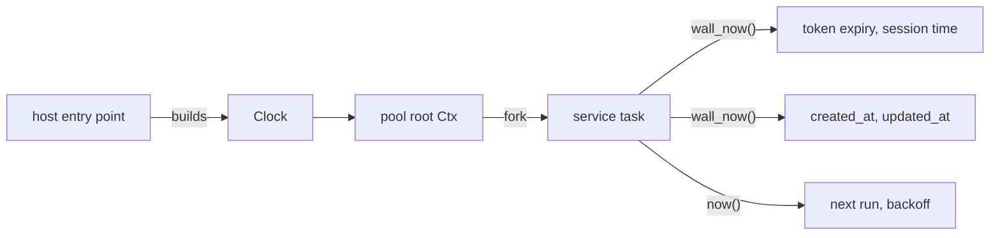

# Feature 133: phase C — the services read the injected clock

_Written in ASD-STE100 Simplified Technical English (STE). Code and identifiers stay as
they are. Follow [requirements.md](../../requirements.md) sections 3, 4 and 8._

This feature is phase C of the umbrella feature 117. Feature 117 adds
`Clock::wall_now`, the `foundation_compact::time` conversions and the CI gate
`scripts/ci/check_time_sources.py`. This phase removes every direct time read from the
service crates and deletes their entries from the gate allowlist.

## 1. Problem (measured 2026-11-06)

| Crate | Wall reads | Monotonic reads | Total | Files |
|---|---|---|---|---|
| foundation_auth | 62 | 1 | 63 | 23 |
| foundation_ai | 39 | 2 | 41 | 12 |
| foundation_keychain | 25 | 0 | 25 | 12 |
| foundation_db | 7 | 0 | 7 | 3 |
| foundation_cronjobs | 1 | 0 | 1 | 1 |
| **Total** | **134** | **3** | **137** | **51** |

The count excludes the two permanent allowlist entries: the real `MonotonicClock` in
`foundation_core` and the `foundation_compact` time polyfill.

The plan of feature 117 gave 136 reads for this phase. The measured value is 137.
This feature uses 137 as its starting point.

`foundation_cronjobs` already has its own clock trait: `CronClock` with `UtcClock`
(`backends/foundation_cronjobs/src/scheduler.rs:149`). Two clock traits are one
injection point too many. This phase folds `CronClock` into `Clock`.

## 2. Design



_One diagram: the services read one clock from the `Ctx`, for wall and monotonic time._

Apply the three shapes from feature 117 section 2.3:

1. **Inside a valtron task**: call `ctx.clock()`.
2. **A plain function**: take `clock: &dyn Clock` as a parameter.
3. **A struct method**: store `Arc<dyn Clock>` on the struct, set from the `Ctx`.

Rules for the crate group:

- A token expiry, a session start or end, a row `created_at`/`updated_at`, a key
  expiry, a model-call timestamp and a cron run time use `clock.wall_now()`.
- A retry delay, a rate limit and a timeout use `clock.now()`.
- Convert a wall time to a stored value with `foundation_compact::time`:
  `unix_millis` and `unix_seconds`. Convert back with `from_unix_millis`. Do not
  write a local epoch conversion.
- `foundation_cronjobs`: delete `CronClock` and `UtcClock`. The scheduler takes
  `Arc<dyn Clock>` and reads `wall_now()`. A test supplies `SimulatedClock`.
- Do not add a fallback to the real clock when the `Ctx` has none. A missing clock is
  a design fault: report it.

Expected removals, one file at a time:

- `foundation_auth`: 23 files, 63 reads.
- `foundation_ai`: 12 files, 41 reads.
- `foundation_keychain`: 12 files, 25 reads.
- `foundation_db`: 3 files, 7 reads.
- `foundation_cronjobs`: 1 file, 1 read.

## 3. Tests

All tests live in each crate's `tests/` directory and register in its `tests/**/mod.rs`.

1. `foundation_auth`: a token that expires at a fixed simulated wall time is valid
   before that time and expired after it. Advance `SimulatedClock::advance_wall` and
   assert both results.
2. `foundation_db`: an inserted row carries the simulated `created_at`, not the real
   time. Set the wall origin and compare the stored milliseconds.
3. `foundation_ai`: a call timestamp or a cache age comes from `ctx.clock().wall_now()`.
4. `foundation_keychain`: a key expiry comes from `ctx.clock().wall_now()`.
5. `foundation_cronjobs`: the scheduler takes a `SimulatedClock`; a run time follows
   `advance_wall`, and the old `CronClock` path is gone.
6. The gate passes and the summary shows the lower count. The gate fails on the old
   tree for this crate group.

One test must fail on the old code. State in the Result which test failed and with
what value.

## 4. Verify

```bash
cargo fmt --all --check
cargo clippy --profile uat -p foundation_auth --all-targets --no-deps -- -D warnings
cargo clippy --profile uat -p foundation_db --all-targets --no-deps -- -D warnings
cargo clippy --profile uat -p foundation_ai --all-targets --no-deps -- -D warnings
cargo clippy --profile uat -p foundation_keychain --all-targets --no-deps -- -D warnings
cargo clippy --profile uat -p foundation_cronjobs --all-targets --no-deps -- -D warnings
cargo test --profile uat -p foundation_auth
cargo test --profile uat -p foundation_db
cargo test --profile uat -p foundation_ai
cargo test --profile uat -p foundation_keychain
cargo test --profile uat -p foundation_cronjobs
python3 scripts/ci/check_time_sources.py --root . --check
python3 -m pytest scripts/ci/tests -q
```

## 5. Done when

- [ ] Every direct read in the five crates is gone; their allowlist entries are
      deleted.
- [ ] The gate passes and its count is 137 lower than at the start of the phase.
- [ ] `CronClock` and `UtcClock` are deleted, and `foundation_cronjobs` reads
      `Clock::wall_now`.
- [ ] Each crate has an injection test, and one of them fails on the old code.
- [ ] A new public API, if any, is a patch bump in the crate and in every consumer
      requirement in the same change.
- [ ] A GitHub issue with a severity label exists for every marker and every limit left.
- [ ] `progress.md` and `learnings.md` have the dated entry.
- [ ] CI green.

## 6. Result

Implemented on branch `spec70/priority-followups` (2026-11-06).

### 6.1 Direct reads removed

The measured start was 137 reads in 51 files. All 137 are gone.

| Crate | Before | After | Files |
|---|---|---|---|
| foundation_auth | 63 | 0 | 23 |
| foundation_ai | 41 | 0 | 12 |
| foundation_keychain | 25 | 0 | 12 |
| foundation_db | 7 | 0 | 3 |
| foundation_cronjobs | 1 | 0 | 1 |
| **Total** | **137** | **0** | **51** |

The gate reports **205 direct reads in 86 files, 0 violations, 0 markers**.
The 51 phase C allowlist entries are deleted, so the allowlist has 93 lines.
The two permanent entries (the real `MonotonicClock` in `foundation_core` and
the `foundation_compact` time polyfill) and the 79 phase D entries stay.

`CronClock`, `UtcClock` and `SharedCronClock` are deleted from
`foundation_cronjobs` and from its re-exports. The scheduler takes
`Arc<dyn Clock>` and reads `Clock::wall_now`.

### 6.2 How each crate gets the clock

- `foundation_auth`: `shared::clock` converts `wall_now` to `chrono`,
  seconds and milliseconds with `foundation_compact::time`. Services, handlers
  and shared token/session types take `&dyn Clock`. Long-lived managers store
  `Arc<dyn Clock>`. `JwtSigningKey::sign_claims`, `JwtToken` checks, `Session`,
  `AuthToken`, `AuthManager`, `SessionService`, the IdP handlers, the provider
  and TOTP services, and `WebAuthnService` read the injected clock.
- `foundation_ai`: every HTTP provider, candle backend and llama.cpp backend
  stores `Arc<dyn Clock>` and passes it to its model and stream types.
  `MemoryHierarchy` stores it and exposes `clock()`. The agent loop reads
  `ctx.clock()`. The process-global GGUF cache re-injects the caller's clock in
  `share_weights`, so a later session cannot inherit the first caller's clock.
- `foundation_keychain`: `KeychainContext` stores `Arc<dyn Clock>` and exposes
  `clock()`. `core::clock::wall_now_utc` converts `wall_now` to
  `DateTime<Utc>`. Every vault row timestamp, token mint and expiry check reads
  it.
- `foundation_db`: `NamespacedStore::store_typed`,
  `RateLimiterStore::check_rate_limit`, `RateLimiterStore::record_rate_limit`
  and `StorageCleanup::run_full_cleanup` take `&dyn Clock`. The native, wasm,
  KV, JSON and Turso stores pass it through.
- `foundation_cronjobs`: `CronScheduler::into_run_tasks`,
  `CronJob::into_run_task` and `JobRunTask::new` take `Arc<dyn Clock>`; the run
  task stores it and converts `wall_now` with `foundation_compact::time`.

### 6.3 Tests

| Crate | Test | Result |
|---|---|---|
| foundation_auth | `integration::clock_injection::token_and_session_expiry_follow_the_injected_clock` | pass |
| foundation_db | `clock_injection_tests::store_typed_uses_the_injected_wall_clock` | pass |
| foundation_ai | `clock_injection_tests::observation_timestamp_follows_the_injected_clock` | pass |
| foundation_keychain | `clock_injection::send_dates_and_expiry_follow_the_injected_clock` | pass |
| foundation_cronjobs | `scheduler_tests::run_time_follows_the_injected_wall_clock` | pass |

Old-code evidence. The db and ai tests were run against the old
`Utc::now()`/`SystemTime::now()` line and failed:

- db: `left: 1793963506037`, `right: 1767225600000` (real time against the
  simulated 2026-01-01).
- ai: the stored time was the real `SystemTime { tv_sec: 1793965085, ... }`
  against the simulated `SystemTime { tv_sec: 0, ... }`.

The auth and keychain tests fail on the old code by construction: their
simulated time is in the past, so an old real-clock check reports the token or
send as expired and the live assertion fails.

Suites (2026-11-06):

- `cargo test --profile uat -p foundation_auth`: 50 passed, exit 0. The new
  test runs with `--features server-test` and passed on its own (1 passed).
- `cargo test --profile uat -p foundation_db`: exit 0.
- `cargo test --profile uat -p foundation_ai`: 496 passed, 14 ignored, exit 0.
- `cargo test --profile uat -p foundation_keychain`: exit 0.
- `cargo test --profile uat -p foundation_cronjobs`: 13 + 1 passed, exit 0.

### 6.4 Public API and version bumps

| Crate | Before | After |
|---|---|---|
| foundation_auth | 0.0.5 | **0.0.6** |
| foundation_ai | 0.0.6 | **0.0.7** |
| foundation_db | 0.0.5 | **0.0.6** |
| foundation_keychain | 0.1.5 | **0.1.6** |
| foundation_cronjobs | 0.0.4 | **0.0.5** |

Every consumer requirement moved in the same change: `foundation_ai`,
`foundation_keychain`, `foundation_connectrpc`, `foundation_cronjobs`,
`foundation_auth`, `foundation_nativeapis`, `foundation_cedar`,
`foundation_http`, `foundation_proxy`, `foundation_deployment`,
`foundation_deployment_docker`, `foundation_deployment_hetzner`,
`foundation_deployment_digitalocean`, `foundation_vectors`,
`examples/cf-login-app`, `bin/platform` and `apps/answerme-agent`.

New or changed API, by crate:

- `foundation_auth`: `JwtToken::{from_parts, from_token, is_expired,
  expires_within, expires_in}`; `JwtSigningKey::sign_claims`;
  `JwtManager::new(clock)` and its `Default` impl removed;
  `AuthToken::is_expired(clock)`; `Session::{is_valid, mark_accessed,
  is_authenticated, ...}`; `SessionService::in_memory(clock)`;
  `AuthManager::new(.., clock)`; `ProviderService`, `ClientService`,
  `MfaService`, `PowService`, `TosService`, `WebAuthnService`, `JwksCache`,
  `CredentialStore`, `IdpServer`, `HandlerStorage` and the token service
  constructors take the clock. `shared::clock` is a new public module whose
  helpers are crate-private.
- `foundation_ai`: `AnthropicMessagesProvider`, `OpenAIProvider`,
  `ResponsesProvider`, `WorkersAiProvider`, `HuggingFaceGGUFProvider` and
  `HuggingFaceCandleProvider` constructors take `Arc<dyn Clock>` and their
  `Default` impls are removed. `LlamaBackends` is now a struct with
  `LlamaBackendKind`; it takes a clock. `CandleBackend` constructors and
  `clock()` changed. `MemoryHierarchy::{new, clock}`, `MemoryAccess::clock`,
  `CachedEmbeddingProvider::{new, with_defaults}`, `AgentSession::{builder,
  builder_with_stores}`, `AgentTool` constructors, `ToolPreset::{agent,
  agent_with_stores}`, every `RouterPreset` constructor and
  `into_agent_builder`, `generate_model_descriptors`, `start_llama_server`
  and `start_llama_server_with` take the clock. `parse_response`,
  `parse_chat_response` and the candle/llama model builders take `&dyn Clock`.
- `foundation_db`: `NamespacedStore::store_typed`, `RateLimiterStore::{check_rate_limit,
  record_rate_limit}` and `StorageCleanup::run_full_cleanup` take
  `&dyn Clock`.
- `foundation_keychain`: `KeychainContext::{new, with_signing_key, clock}`;
  `core::store::events::insert`; `mint_access_token` and `mint_refresh_token`;
  the vault handlers read `ctx.clock()`. `core::clock` is a new public module.
- `foundation_cronjobs`: `CronJob::into_run_task`, `JobRunTask::new` and
  `CronScheduler::into_run_tasks` take `Arc<dyn Clock>`. `CronClock`,
  `UtcClock` and `SharedCronClock` are removed.

One targeted lint expectation is recorded in place:
`AuthorizationCode::new` has eight arguments, so it carries
`#[expect(clippy::too_many_arguments, reason = ...)]`.

### 6.5 Verify

| Command | Result |
|---|---|
| `cargo fmt --all --check` | 0 |
| `cargo clippy --profile uat -p foundation_auth --all-targets --no-deps -- -D warnings` | 0 |
| `cargo clippy --profile uat -p foundation_auth --features server-test --all-targets --no-deps -- -D warnings` | 0 |
| `cargo clippy --profile uat -p foundation_db --all-targets --no-deps -- -D warnings` | 0 |
| `cargo clippy --profile uat -p foundation_ai --all-targets --no-deps -- -D warnings` | 0 |
| `cargo clippy --profile uat -p foundation_keychain --all-targets --no-deps -- -D warnings` | 0 |
| `cargo clippy --profile uat -p foundation_cronjobs --all-targets --no-deps -- -D warnings` | 0 |
| `cargo test --profile uat -p foundation_auth` | 0 |
| `cargo test --profile uat -p foundation_db` | 0 |
| `cargo test --profile uat -p foundation_ai` | 0 |
| `cargo test --profile uat -p foundation_keychain` | 0 |
| `cargo test --profile uat -p foundation_cronjobs` | 0 |
| `python3 scripts/ci/check_time_sources.py --root . --check` | 0 |
| `python3 -m pytest scripts/ci/tests -q` | 24 passed |
| `cargo check --profile uat --workspace` | 0 |

### 6.6 Findings left

1. The deployment crates have no injected clock yet. Three
   `NamespacedStore::store_typed` call sites in
   `foundation_deployment_docker` and `foundation_deployment_hetzner` pass an
   inline `MonotonicClock::new()` (and one test does the same). The
   deployment state timestamps therefore read the real wall clock. Likely fix:
   put `Arc<dyn Clock>` on `foundation_deployment::ProviderClient`. Severity:
   medium. This is phase D (feature 134) work. GitHub issue #215.

### 6.7 Verification fix: the IdP adapter takes the storage clock

The first full run of `cargo test --profile uat -p foundation_auth --features
server-test` failed and then hung. `register_routes_share_one_session_store`
builds an app with `register_routes` and gives the clock to
`HandlerStorage`; the app bag held no `Arc<dyn Clock>`, so
`ServeAdapter::create` panicked on its dispatch thread. The request never
answered, the test thread stayed blocked while it held the pool guard, and
every later test waited in `FairGate::acquire`. That is GitHub issue #216.

`ServeAdapter::create` now takes the clock from the `HandlerStorage` the host
built with its injected clock. A bag-level `Arc<dyn Clock>` still wins when a
host stores one. The suite passes: 244 tests, exit 0, and clippy stays clean
with `-D warnings`. Issue #216 is closed.

The earlier verification run passed a filtered test and a single-threaded run,
so it did not reach this path. The lesson is in `learnings.md`: run the full
feature suite at its default parallelism before the report says green.
