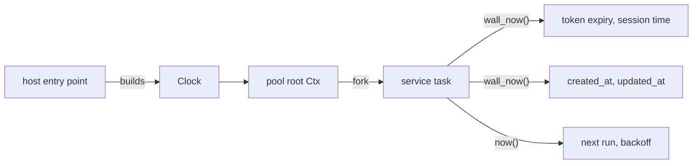

# Feature 133: phase C — the services read the injected clock

_Written in ASD-STE100 Simplified Technical English (STE). Code and identifiers stay as
they are. Follow [requirements.md](../../requirements.md) sections 3, 4 and 8._

This feature is phase C of the umbrella feature 117. Feature 117 adds
`Clock::wall_now`, the `foundation_compact::time` conversions and the CI gate
`scripts/ci/check_time_sources.py`. This phase removes every direct time read from the
service crates and deletes their entries from the gate allowlist.

## 1. Problem (measured 2026-11-06)

| Crate | Wall reads | Monotonic reads | Total | Files |
|---|---|---|---|---|
| foundation_auth | 62 | 1 | 63 | 23 |
| foundation_ai | 39 | 2 | 41 | 12 |
| foundation_keychain | 25 | 0 | 25 | 12 |
| foundation_db | 7 | 0 | 7 | 3 |
| foundation_cronjobs | 1 | 0 | 1 | 1 |
| **Total** | **134** | **3** | **137** | **51** |

The count excludes the two permanent allowlist entries: the real `MonotonicClock` in
`foundation_core` and the `foundation_compact` time polyfill.

The plan of feature 117 gave 136 reads for this phase. The measured value is 137.
This feature uses 137 as its starting point.

`foundation_cronjobs` already has its own clock trait: `CronClock` with `UtcClock`
(`backends/foundation_cronjobs/src/scheduler.rs:149`). Two clock traits are one
injection point too many. This phase folds `CronClock` into `Clock`.

## 2. Design



_One diagram: the services read one clock from the `Ctx`, for wall and monotonic time._

Apply the three shapes from feature 117 section 2.3:

1. **Inside a valtron task**: call `ctx.clock()`.
2. **A plain function**: take `clock: &dyn Clock` as a parameter.
3. **A struct method**: store `Arc<dyn Clock>` on the struct, set from the `Ctx`.

Rules for the crate group:

- A token expiry, a session start or end, a row `created_at`/`updated_at`, a key
  expiry, a model-call timestamp and a cron run time use `clock.wall_now()`.
- A retry delay, a rate limit and a timeout use `clock.now()`.
- Convert a wall time to a stored value with `foundation_compact::time`:
  `unix_millis` and `unix_seconds`. Convert back with `from_unix_millis`. Do not
  write a local epoch conversion.
- `foundation_cronjobs`: delete `CronClock` and `UtcClock`. The scheduler takes
  `Arc<dyn Clock>` and reads `wall_now()`. A test supplies `SimulatedClock`.
- Do not add a fallback to the real clock when the `Ctx` has none. A missing clock is
  a design fault: report it.

Expected removals, one file at a time:

- `foundation_auth`: 23 files, 63 reads.
- `foundation_ai`: 12 files, 41 reads.
- `foundation_keychain`: 12 files, 25 reads.
- `foundation_db`: 3 files, 7 reads.
- `foundation_cronjobs`: 1 file, 1 read.

## 3. Tests

All tests live in each crate's `tests/` directory and register in its `tests/**/mod.rs`.

1. `foundation_auth`: a token that expires at a fixed simulated wall time is valid
   before that time and expired after it. Advance `SimulatedClock::advance_wall` and
   assert both results.
2. `foundation_db`: an inserted row carries the simulated `created_at`, not the real
   time. Set the wall origin and compare the stored milliseconds.
3. `foundation_ai`: a call timestamp or a cache age comes from `ctx.clock().wall_now()`.
4. `foundation_keychain`: a key expiry comes from `ctx.clock().wall_now()`.
5. `foundation_cronjobs`: the scheduler takes a `SimulatedClock`; a run time follows
   `advance_wall`, and the old `CronClock` path is gone.
6. The gate passes and the summary shows the lower count. The gate fails on the old
   tree for this crate group.

One test must fail on the old code. State in the Result which test failed and with
what value.

## 4. Verify

```bash
cargo fmt --all --check
cargo clippy --profile uat -p foundation_auth --all-targets --no-deps -- -D warnings
cargo clippy --profile uat -p foundation_db --all-targets --no-deps -- -D warnings
cargo clippy --profile uat -p foundation_ai --all-targets --no-deps -- -D warnings
cargo clippy --profile uat -p foundation_keychain --all-targets --no-deps -- -D warnings
cargo clippy --profile uat -p foundation_cronjobs --all-targets --no-deps -- -D warnings
cargo test --profile uat -p foundation_auth
cargo test --profile uat -p foundation_db
cargo test --profile uat -p foundation_ai
cargo test --profile uat -p foundation_keychain
cargo test --profile uat -p foundation_cronjobs
python3 scripts/ci/check_time_sources.py --root . --check
python3 -m pytest scripts/ci/tests -q
```

## 5. Done when

- [ ] Every direct read in the five crates is gone; their allowlist entries are
      deleted.
- [ ] The gate passes and its count is 137 lower than at the start of the phase.
- [ ] `CronClock` and `UtcClock` are deleted, and `foundation_cronjobs` reads
      `Clock::wall_now`.
- [ ] Each crate has an injection test, and one of them fails on the old code.
- [ ] A new public API, if any, is a patch bump in the crate and in every consumer
      requirement in the same change.
- [ ] A GitHub issue with a severity label exists for every marker and every limit left.
- [ ] `progress.md` and `learnings.md` have the dated entry.
- [ ] CI green.

## 6. Result

Not started.
