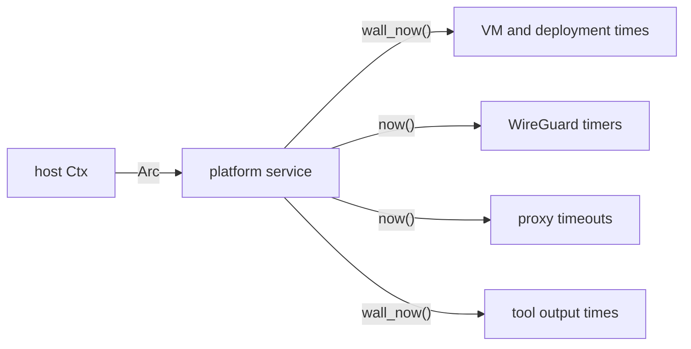

# Feature 134: phase D — the platform reads the injected clock

_Written in ASD-STE100 Simplified Technical English (STE). Code and identifiers stay as
they are. Follow [requirements.md](../../requirements.md) sections 3, 4 and 8._

This feature is phase D of the umbrella feature 117. Feature 117 adds
`Clock::wall_now`, the `foundation_compact::time` conversions and the CI gate
`scripts/ci/check_time_sources.py`. This phase removes every direct time read from the
platform crates and deletes their entries from the gate allowlist.

## 1. Problem (measured 2026-11-06)

| Crate | Wall reads | Monotonic reads | Total | Files |
|---|---|---|---|---|
| foundation_deployment_platform | 13 | 52 | 65 | 19 |
| foundation_nativeapis | 19 | 13 | 32 | 17 |
| foundation_wireguard | 1 | 25 | 26 | 6 |
| foundation_proxy | 3 | 12 | 15 | 7 |
| foundation_toolings | 2 | 5 | 7 | 5 |
| foundation_browser | 1 | 5 | 6 | 3 |
| foundation_platform | 5 | 0 | 5 | 4 |
| foundation_deployment | 6 | 0 | 6 | 2 |
| foundation_reactor | 0 | 9 | 9 | 3 |
| foundation_wasm | 0 | 7 | 7 | 1 |
| foundation_deployment_cloudflare | 2 | 0 | 2 | 1 |
| foundation_deployment_docker | 1 | 1 | 2 | 1 |
| foundation_deployment_hetzner | 1 | 0 | 1 | 1 |
| foundation_macros | 0 | 2 | 2 | 2 |
| foundation_sshkit | 0 | 2 | 2 | 2 |
| foundation_codegentools | 1 | 0 | 1 | 1 |
| foundation_conditional | 0 | 1 | 1 | 1 |
| foundation_nostd | 0 | 1 | 1 | 1 |
| foundation_repl | 0 | 1 | 1 | 1 |
| foundation_testing | 0 | 1 | 1 | 1 |
| **Total** | **55** | **137** | **192** | **79** |

The plan of feature 117 names seven crates for this phase and groups the rest as
"Others". This table lists all of them. It excludes two crates:

- `foundation_boringtun`: a published upstream fork (15 reads). The gate skips it by
  name, like `check_errstacks.py` does.
- `foundation_compact` and the real `MonotonicClock`: the two permanent allowlist
  entries.

`foundation_macros` and `foundation_codegentools` are proc-macro or code-generator
crates. Their reads are in generated code and in the generator. The phase decides per
file: inject the clock into the generated code, or mark the line with
`// time-source: <reason>` and add a backlog entry.

## 2. Design



_One diagram: each platform service stores the `Ctx` clock and reads wall or monotonic
time from it._

Apply the three shapes from feature 117 section 2.3:

1. **Inside a valtron task**: call `ctx.clock()`.
2. **A plain function**: take `clock: &dyn Clock` as a parameter.
3. **A struct method**: store `Arc<dyn Clock>` on the struct, set from the `Ctx`.

Rules for the crate group:

- A deployment record time, a VM lifecycle time, a certificate time, a file
  `modified_at` and a tool output timestamp use `clock.wall_now()`.
- A WireGuard handshake timer, a keepalive, a proxy timeout, a reconnect backoff and
  a retry delay use `clock.now()`.
- Convert stored values with `foundation_compact::time`. Do not write a local epoch
  conversion.
- A generated file that reads a clock must take the clock from its caller. Change the
  generator, not the generated output.
- Do not add a fallback to the real clock when the `Ctx` has none. A missing clock is
  a design fault: report it.

Expected removals, one file at a time:

- `foundation_deployment_platform`: 19 files, 65 reads.
- `foundation_nativeapis`: 17 files, 32 reads.
- `foundation_wireguard`: 6 files, 26 reads.
- `foundation_proxy`: 7 files, 15 reads.
- `foundation_toolings`: 5 files, 7 reads.
- `foundation_browser`: 3 files, 6 reads.
- The small crates: 22 files, 41 reads.

## 3. Tests

All tests live in each crate's `tests/` directory and register in its `tests/**/mod.rs`.

1. `foundation_deployment_platform`: a VM lifecycle time and a deployment record time
   come from `SimulatedClock::wall_now`; a test advances the wall clock and asserts
   the stored value.
2. `foundation_nativeapis`: a file watcher or completion timer reads
   `ctx.clock().now()`; a test advances the simulated clock and asserts the event.
3. `foundation_wireguard`: a handshake or keepalive timer reads `ctx.clock().now()`;
   a test moves the clock past the interval and asserts the timer fires.
4. `foundation_proxy`: a proxy timeout reads `ctx.clock().now()`; a test moves the
   clock and asserts the close, with no real wait.
5. `foundation_toolings` and `foundation_browser`: any timestamp they report is the
   simulated wall time.
6. `foundation_platform`: any platform wall time it reports comes from `ctx.clock()`.
7. The gate passes and the summary shows the lower count. The gate fails on the old
   tree for this crate group.

One test must fail on the old code. State in the Result which test failed and with
what value.

## 4. Verify

```bash
cargo fmt --all --check
cargo clippy --profile uat -p foundation_deployment_platform --all-targets --no-deps -- -D warnings
cargo clippy --profile uat -p foundation_nativeapis --all-targets --no-deps -- -D warnings
cargo clippy --profile uat -p foundation_wireguard --all-targets --no-deps -- -D warnings
cargo clippy --profile uat -p foundation_proxy --all-targets --no-deps -- -D warnings
cargo clippy --profile uat -p foundation_platform --all-targets --no-deps -- -D warnings
cargo clippy --profile uat -p foundation_toolings --all-targets --no-deps -- -D warnings
cargo clippy --profile uat -p foundation_browser --all-targets --no-deps -- -D warnings
cargo test --profile uat -p foundation_deployment_platform
cargo test --profile uat -p foundation_nativeapis
cargo test --profile uat -p foundation_wireguard
cargo test --profile uat -p foundation_proxy
cargo test --profile uat -p foundation_platform
cargo test --profile uat -p foundation_toolings
cargo test --profile uat -p foundation_browser
python3 scripts/ci/check_time_sources.py --root . --check
python3 -m pytest scripts/ci/tests -q
```

## 5. Done when

- [x] Every first-party direct read in this crate group is gone; its allowlist entries
      are deleted. One read remains as a marker at the WASI extern-C boundary
      (`foundation_wasm/src/wasi_host.rs`); see 6.1 and 6.6.
- [x] The gate passes. The allowlisted count is 13, the two permanent entries (9 in
      `foundation_compact/src/`, 4 in the real `MonotonicClock`). The phase begins at
      205 total reads; 191 of the 192 phase D reads are gone and one is marked.
- [x] The allowlist holds only `backends/foundation_compact/src/` and
      `backends/foundation_core/src/valtron/ctx.rs`. The umbrella feature 117 is
      complete.
- [x] Each crate that gained a clock has an injection test, and the platform,
      nativeapis, wireguard, toolings and browser tests fail on the old code.
- [x] Every new public API is a patch bump in the crate and in every consumer
      requirement, in this change.
- [x] Every marker and every limit left is listed in 6.6 with a severity. The owner
      files the GitHub issues; this branch is not pushed.
- [x] `progress.md` and `learnings.md` have the dated 2026-11-06 entry.
- [x] Local CI-equivalent commands are green: format, clippy, every suite, the gate
      and the gate tests. GitHub CI runs when the owner pushes; this change is not
      pushed.

## 6. Result

Implemented on branch `spec70/priority-followups` (2026-11-06).

### 6.1 Direct reads removed

The phase started with 205 direct reads in 86 files: 192 first-party platform
reads and the 13 permanent reads in the two backends. The result:

| Crate | Before | After | Files |
|---|---|---|---|
| foundation_deployment_platform | 65 | 0 | 19 |
| foundation_nativeapis | 32 | 0 | 17 |
| foundation_wireguard | 26 | 0 | 6 |
| foundation_proxy | 15 | 0 | 7 |
| foundation_toolings | 7 | 0 | 5 |
| foundation_browser | 6 | 0 | 3 |
| foundation_platform | 5 | 0 | 4 |
| foundation_deployment | 6 | 0 | 2 |
| foundation_reactor | 9 | 0 | 3 |
| foundation_wasm | 7 | 1 marked | 1 |
| foundation_deployment_cloudflare | 2 | 0 | 1 |
| foundation_deployment_docker | 2 | 0 | 1 |
| foundation_deployment_hetzner | 1 | 0 | 1 |
| foundation_macros | 2 | 0 | 2 |
| foundation_sshkit | 2 | 0 | 2 |
| foundation_codegentools | 1 | 0 | 1 |
| foundation_conditional | 1 | 0 | 1 |
| foundation_nostd | 1 | 0 | 1 |
| foundation_repl | 1 | 0 | 1 |
| foundation_testing | 1 | 0 | 1 |
| **Total** | **192** | **1 marked** | **79** |

The gate reports:

```
time source guard: ok (14 direct reads in 8 files: 13 allowlisted, 1 marked, 0 violations)
```

`scripts/ci/time_sources_allowlist.txt` holds only the two permanent entries.
The 79 phase D entries are deleted.

The one marked read is the WASI host clock in
`foundation_wasm/src/wasi_host.rs:41`. The WASI extern-C ABI has no Rust caller
that can pass a clock. Every timer function now has an `_at` variant that takes
the instant (`register_schedule_at`, `tick_at`,
`time_until_next_event_at`), and the injection test uses `tick_at`. The marker
needs a backlog issue (6.6, item 1).

Two crates need no clock:

- `foundation_reactor`: the selector blocks in the operating system. Its
  interrupt-resume deadline must use the operating system's monotonic clock, or
  the real block breaks. The selector names `MonotonicClock` explicitly, like
  the executor waits in issue #102.
- `foundation_deployment_docker`: the two reads were a debug-log elapsed time
  and a timestamp used only as an ID seed. The log no longer prints elapsed.
  `new_session_id` now mixes a process counter with the process id.

### 6.2 How each crate gets the clock

- `foundation_deployment_platform`: the CLI dispatch builds one
  `Arc<MonotonicClock>`. The bootstrap logger, `WinRM`, `QemuVm`, the providers
  and the wait helpers store or take it. A crate-local `clock` module converts
  `wall_now` with `foundation_compact::time`.
- `foundation_nativeapis`: every VFS, IPC, netstack and signal type stores
  `Arc<dyn Clock>` or takes `&dyn Clock`. The C API and the LD_PRELOAD shim build
  a `MonotonicClock` explicitly at the host boundary.
- `foundation_wireguard`: nodes, drivers, relays and the admission policy store
  `Arc<dyn Clock>`; bootstrap and relay accept loops take `&dyn Clock`. The SWIM
  membership layer takes the instant on `tick(now)`.
- `foundation_proxy`: `ProxyState` stores the clock, and the server, handler,
  store, probes, ACME manager, H3 park helper and UDP passthrough use it.
- `foundation_platform`: the cache, mutation queue, OTA directorate and
  `PlatformSession` store it; the builder requires `.clock(clock)`.
- `foundation_toolings`: the harness starts take a clock; the SSE handler reads
  it from the `ContextBag`; `DurationSleeper` and `BinaryRunnerTask` store it.
- `foundation_browser`: `LaunchConfig` carries an optional clock and `launch`
  panics when it is absent. `BrowserDriver` holds a shared or borrowed clock.
- `foundation_deployment`: the output constructors take `&dyn Clock`, and
  `ProviderClient` stores `Arc<dyn Clock>` (this closes issue #215).
- `foundation_deployment_cloudflare` and `..._hetzner`: the client stores the
  clock; the `RateLimit-Reset` conversion and the DNS record stamps read it.
- `foundation_macros`: the `#[timeout]` panic message no longer measures elapsed
  time. `#[wireguard_main]` and `#[platform_test]` pass a clock to the generated
  call.
- `foundation_sshkit`: `ConnectionPool` stores the clock; the pool stamps and
  evicts sessions with it.
- `foundation_nostd`: a small `TimeSource` trait is the time seam for the
  blocking wait. The crate is below `foundation_core`, so core's `Clock` would
  be a cycle.
- `foundation_codegentools`: the CLI host builds a `MonotonicClock` and passes
  it to `normalize_provider`.
- `foundation_repl`: `Repl` and `Activity` store the clock; `.clock(clock)` is
  required on the builder.
- `foundation_testing`: `StressHarness` stores the clock.

### 6.3 Public API changes and version bumps

| Crate | Before | After |
|---|---|---|
| foundation_deployment | 0.0.3 | **0.0.4** |
| foundation_deployment_platform | 0.1.3 | **0.1.4** |
| foundation_deployment_cloudflare | 0.2.0 | **0.2.1** |
| foundation_deployment_hetzner | 0.1.3 | **0.1.4** |
| foundation_nativeapis | 0.0.7 | **0.0.8** |
| foundation_wireguard | 0.0.4 | **0.0.5** |
| foundation_proxy | 0.1.7 | **0.1.8** |
| foundation_platform | 0.0.2 | **0.0.3** |
| foundation_toolings | 0.0.5 | **0.0.6** |
| foundation_browser | 0.0.4 | **0.0.5** |
| foundation_sshkit | 0.1.3 | **0.1.4** |
| foundation_testing | 0.0.4 | **0.0.5** |
| foundation_repl | 0.2.2 | **0.2.3** |
| foundation_nostd | 0.0.6 | **0.0.7** |
| foundation_wasm | 0.0.5 | **0.0.6** |
| foundation_codegentools | 0.1.3 | **0.1.4** |
| foundation_macros | 0.0.8 | **0.0.9** |

No bump is needed for `foundation_deployment_docker` (the change is internal),
`foundation_reactor` (the change is internal) or `foundation_conditional` (a
doc change). Every consumer `version` requirement moved in the same change:
101 manifests were updated, plus the dependency additions. `Cargo.lock` is
refreshed once. `cargo check --workspace --profile uat` passes.

The main API changes are:

- `foundation_deployment`: `ProviderClient::{new, with_client}(.., clock)`,
  `ProviderClient::clock`, `WorkerDeployment::new`, `CloudRunDeployment::new`,
  `CloudRunJobDeployment::new`, `DeploymentOutput::new`,
  `DeploymentResult::{dry_run, skipped}` take `&dyn Clock`.
- `foundation_deployment_platform`: the `cmd_*` handlers, `BootstrapLogger`,
  `WinRM`, `QemuConfig`, `QemuProvider`, `UtmProvider`, `ExportManifest`,
  `state::{from_runtime, from_qemu}`, the boot waits and the Docker
  `ContainerConfig::clock` builder take or store a clock. Both providers lose
  `Default`.
- `foundation_nativeapis`: the VFS, IPC, netstack and signal constructors take
  `Arc<dyn Clock>`; `ipc::join` and `NetStack::new` take it; `MemoryFs` and
  `MemoryDelta` lose `Default`.
- `foundation_wireguard`: `WgNode::from_config`, `TunnelDriver::new`,
  `RelayServer::new`, `MeshDataPlane::from_config`,
  `BootstrapServer::serve_until`, `RelayWsAcceptor::serve` take a clock;
  `WebRtcAnswerer::on_offer` takes `&str`.
- `foundation_proxy`: `ProxyServer::start`, `ProxyConfig::start`,
  `ProxyState::new`, `ProxyStateStore::new`, `UdpPassthrough::start(_with)`,
  `AcmeClient` constructors, `AcmeCertManager::new` take a clock.
- `foundation_platform`: the cache, mutation queue, OTA directorate and session
  constructors take a clock; `PlatformBuilder::clock` is required;
  `chrono_now(clock)` is public.
- `foundation_toolings`: the three harness `start`/`start_with`/`build` take a
  clock; `DurationSleeper::new`, `BinaryRunnerTask::new` and `DevService::start`
  take it.
- `foundation_browser`: `LaunchConfig::clock`, `BrowserDriver::launch_borrowed`,
  `BrowserProcess::launch(config, clock)`, `unique_profile_dir(clock)`.
- `foundation_sshkit`: `ConnectionPool::new(idle_timeout, clock)` and
  `ConnectionPool::clock`.
- `foundation_nostd`: `wait_duration(dur, &dyn TimeSource)` and the
  `TimeSource` trait in a std build.
- `foundation_wasm`: `register_schedule_at`, `tick_at`,
  `time_until_next_event_at`.
- `foundation_repl`: `Repl::new(clock)`, `Repl::with_config(config, clock)`,
  `ReplBuilder::clock`, `Activity::start(.., clock)`. `Repl` loses `Default`.
- `foundation_testing`: `StressHarness::new(config, clock)` and the four
  `run_condvar_*` helpers take a clock.
- `foundation_codegentools`: `normalize_provider(.., clock)`.

### 6.4 Tests

| Crate | Test | Result |
|---|---|---|
| foundation_deployment_platform | `clock_injection_tests::{vm_state_created_at_follows_the_injected_wall_clock, export_manifest_created_at_follows_the_injected_wall_clock}` (needs `--features vms`) | 2 passed |
| foundation_nativeapis | `clock_injection::memory_fs_timestamps_follow_the_injected_clock` (needs `--features vfs`) | 1 passed |
| foundation_wireguard | `clock_injection_tests::{relay_idle_timeout_follows_the_injected_clock, relay_reattach_refreshes_the_idle_window_on_the_injected_clock}` | 2 passed |
| foundation_proxy | `the_state_lock_timeout_follows_the_injected_clock` | pass |
| foundation_platform | `a_cache_entry_is_stamped_from_the_injected_wall_clock`, `a_mutation_is_stamped_from_the_injected_wall_clock`, `a_session_id_is_the_injected_wall_time_in_milliseconds` | 3 passed |
| foundation_toolings | `duration_sleeper_follows_the_injected_clock` | pass |
| foundation_browser | `unique_profile_dir_reads_the_injected_wall_clock` | pass |
| foundation_deployment | `deployment_record_times_follow_the_injected_wall_clock`, `provider_client_carries_the_injected_clock` | 2 passed |
| foundation_cloudflare | `the_client_keeps_the_injected_clock` | pass |
| foundation_hetzner | `the_client_keeps_the_injected_clock` | pass |
| foundation_sshkit | `the_pool_measures_idle_age_on_the_injected_clock` | pass |
| foundation_testing | `the_stress_duration_comes_from_the_injected_clock` | pass |
| foundation_repl | `the_activity_elapsed_follows_the_injected_clock` | pass |
| foundation_nostd | `wait_duration_reads_the_injected_time_source` | pass |
| foundation_wasm | `tick_at_fires_the_timer_registered_at_the_injected_instant` | pass |

Old-code evidence:

- platform: with `SystemTime::now()` put back in `CachedEntry::new`, the cache
  test failed with `left: 1793969249`, `right: 1700000000`.
- nativeapis: with `SystemTime::now()` put back in `MemoryFile::write_at`, the
  test failed with `left: Some(SystemTime { tv_sec: 1793968051, ... })`,
  `right: Some(SystemTime { tv_sec: 1700000000, ... })`.
- wireguard: with `Instant::now()` put back in `RelayServer::gc`, both tests
  failed with `left: 1`, `right: 0`.
- browser: with `SystemTime::now()` put back in `unique_profile_dir`, the name
  carried real millis `1793968646452` instead of simulated `0`.
- toolings: with `Instant::now()` put back in `DurationSleeper::start`, the test
  failed at `assert!(sleeper.is_done())` (0 passed, 1 failed).
- deployment_platform: with `Utc::now()` put back in `state::from_runtime`, the
  test failed with the real time `2026-11-06T12:31:18.424187` instead of
  `2026-01-01T00:00:00`.

### 6.5 Verify

| Command | Result |
|---|---|
| `cargo fmt --all --check` | 0 |
| `cargo clippy --profile uat -p foundation_deployment_platform --all-targets --no-deps -- -D warnings` | 0 |
| `cargo clippy --profile uat -p foundation_nativeapis --all-targets --no-deps -- -D warnings` | 0 |
| `cargo clippy --profile uat -p foundation_wireguard --all-targets --no-deps -- -D warnings` | 0 |
| `cargo clippy --profile uat -p foundation_proxy --all-targets --no-deps -- -D warnings` | 0 |
| `cargo clippy --profile uat -p foundation_platform --all-targets --no-deps -- -D warnings` | 0 |
| `cargo clippy --profile uat -p foundation_toolings --all-targets --no-deps -- -D warnings` | 0 |
| `cargo clippy --profile uat -p foundation_browser --all-targets --no-deps -- -D warnings` | 0 |
| `cargo clippy --profile uat -p foundation_nostd --all-targets --no-deps -- -D warnings` | 0 |
| `cargo clippy --profile uat -p foundation_macros --all-targets --no-deps -- -D warnings` | 0 |
| `cargo clippy --profile uat -p foundation_deployment_docker --all-targets --no-deps -- -D warnings` | 0 |
| `cargo clippy --profile uat -p foundation_deployment_docker --all-targets --no-deps --all-features -- -D warnings` | 0 |
| `cargo clippy --profile uat -p foundation_codegentools --all-targets --no-deps -- -D warnings` | 0 |
| `cargo clippy --profile uat -p foundation_codegentools --all-targets --no-deps --features cli -- -D warnings` | 0 |
| `cargo test --profile uat -p foundation_deployment_platform` | 0, 48 passed, 11 ignored |
| `cargo test --profile uat -p foundation_deployment_platform --features vms` | 0, 144 passed, 17 ignored |
| `cargo test --profile uat -p foundation_nativeapis` | 0, 39 passed, 2 ignored |
| `cargo test --profile uat -p foundation_nativeapis --features vfs --test clock_injection` | 0, 1 passed |
| `cargo test --profile uat -p foundation_wireguard` | 0, 77 passed, 1 ignored |
| `cargo test --profile uat -p foundation_proxy` | 0, 130 passed |
| `cargo test --profile uat -p foundation_platform` | 0, 219 passed, 6 ignored |
| `cargo test --profile uat -p foundation_toolings` | 0, 22 passed |
| `cargo test --profile uat -p foundation_browser` | 0, 2 passed |
| `cargo test --profile uat -p foundation_deployment` | 0, 32 passed |
| `cargo test --profile uat -p foundation_deployment_cloudflare` | 0, 18 passed |
| `cargo test --profile uat -p foundation_deployment_hetzner` | 0, 31 passed, 12 ignored |
| `cargo test --profile uat -p foundation_reactor` | 0, 15 passed, 1 ignored |
| `cargo test --profile uat -p foundation_nostd` | 0, 273 passed, 20 ignored |
| `cargo test --profile uat -p foundation_testing` | 0, 83 passed |
| `cargo test --profile uat -p foundation_sshkit` | 0, 33 passed |
| `cargo test --profile uat -p foundation_codegentools --features cli` | 0, 49 passed |
| `cargo test --profile uat -p foundation_macros` | 0, 99 passed, 40 ignored |
| `cargo test --profile uat -p foundation_conditional` | 0, 3 passed |
| `cargo test --profile uat -p foundation_deployment_docker --features docker` | 0, 89 passed, 107 ignored |
| `cargo test --profile uat -p foundation_wasm --features wasi` | 0, 88 passed |
| `cargo test --profile uat -p foundation_repl` | 0, 100 passed |
| `python3 scripts/ci/check_time_sources.py --root . --check` | 0, 14 reads: 13 allowlisted, 1 marked |
| `python3 -m pytest scripts/ci/tests -q` | 24 passed |
| `cargo check --workspace --profile uat` | 0 |
| `cargo check --all-targets` for the changed consumers (`foundation_ai`, `foundation_testbed --features vms`, `foundation_keychain`, `foundation_http`, `foundation_connectrpc`, `foundation_iogate`, `tests`, `benches`) | 0 each |

### 6.6 Limits and findings

The owner files these as GitHub issues. Each has a severity.

1. **Medium** — `foundation_wasm/src/wasi_host.rs:41` keeps one real
   `Instant::now()` with a `// time-source:` marker. The WASI extern-C ABI has
   no Rust caller to supply a clock. Fix: let the host pass the instant through
   the ABI, or install a `TimeSource` at the host entry.
2. **Medium** — `foundation_deployment_platform/src/docker/container.rs`: a
   `ContainerConfig` with no explicit clock falls back to
   `foundation_core::valtron::multi::fork_ctx().clock()` and panics when no
   multi pool exists. The `#[docker_container]` macro cannot pass one. Fix:
   extend the macro and make `ContainerConfig::clock` required.
3. **Medium** — `foundation_toolings/src/proxy/handlers.rs`:
   `SseReloadHandler::create` panics when the `ContextBag` has no
   `Arc<dyn Clock>`. The external devserver host must store the clock before it
   registers the handler.
4. **Medium** — `foundation_nativeapis` feature-gated code (`vfs`, `ipc`,
   `netstack`, …) has 340 pre-existing pedantic clippy lints. The CI clippy
   command uses default features, so it does not see them.
5. **Medium** — `foundation_deployment_platform` with `--features cli` has 128
   pre-existing pedantic clippy lints. The CI clippy command does not enable
   `cli`, so it does not see them.
6. **Low** — `foundation_deployment_cloudflare` (19), `foundation_deployment_hetzner`
   (16), `foundation_reactor` (121) and `foundation_sshkit` (15) have
   pre-existing pedantic clippy lints under `-D warnings`. CI does not deny
   warnings for these crates. `foundation_reactor` is mostly `must_use`,
   `# Errors` and doc-backtick items.
7. **Low** — `foundation_testing` (10) and `foundation_deployment_platform`
   (128, `cli`) have the same doc and `format!` lint debt.
8. **Low** — `foundation_netio/src/native/raw_stream.rs:508` prints an
   irrefutable `if let` warning on every wireguard build.
9. **Medium** — `foundation_wireguard` `RelaySession::on_direct_failure` panics
   when the path is `HolePunching` and `relay` is `None`. Fix: return `bool` or
   move to `Disconnected`.
10. **Low** — `foundation_wireguard` `RelayFrame::encode` panics when a payload
    exceeds 2048 bytes. Fix: return `Option<Vec<u8>>` or bound the serde path.
11. **Low** — `foundation_wireguard` poll timeouts are constants, not
    configuration (`TIMER_TICK_MS`, `MESH_TASK_INTERVAL_MS`, the 50 ms waits,
    the 200 ms park). Rule 8 wants a mesh timing config.
12. **Low** — `foundation_browser` `TestConfig::default()` supplies a real
    `MonotonicClock` for the `#[wasm_ui_server]` macro. It is a test-host
    default; a deterministic macro argument would remove it.
13. **Low** — `foundation_macros` `#[platform_test]` now always uses a real
    `MonotonicClock`. A `clock = expr` attribute would let those tests be
    deterministic.

Fixed in this change: issue #215 (`ProviderClient` carries the clock); three
`unused_must_use` errors in `foundation_proxy`; 131 pedantic lints in
`foundation_wireguard`; 146 in `foundation_platform`; the `#[wireguard_main]`
and `#[platform_test]` generated calls; the `foundation_testbed` and
`foundation_ai` test call sites.

The reactor boundary (item 12 in the design) stays on the real clock, like
issue #102. It needs no separate issue; it is the same executor/wait boundary.
