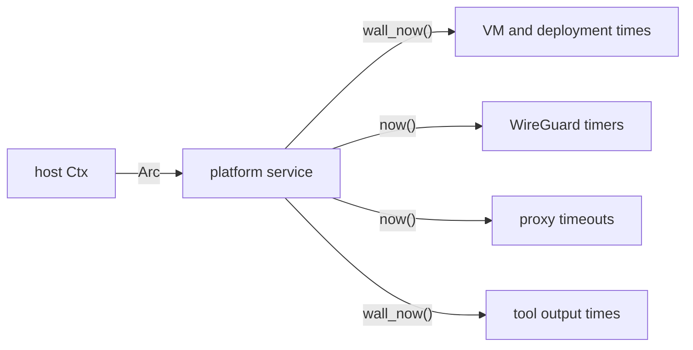

# Feature 134: phase D — the platform reads the injected clock

_Written in ASD-STE100 Simplified Technical English (STE). Code and identifiers stay as
they are. Follow [requirements.md](../../requirements.md) sections 3, 4 and 8._

This feature is phase D of the umbrella feature 117. Feature 117 adds
`Clock::wall_now`, the `foundation_compact::time` conversions and the CI gate
`scripts/ci/check_time_sources.py`. This phase removes every direct time read from the
platform crates and deletes their entries from the gate allowlist.

## 1. Problem (measured 2026-11-06)

| Crate | Wall reads | Monotonic reads | Total | Files |
|---|---|---|---|---|
| foundation_deployment_platform | 13 | 52 | 65 | 19 |
| foundation_nativeapis | 19 | 13 | 32 | 17 |
| foundation_wireguard | 1 | 25 | 26 | 6 |
| foundation_proxy | 3 | 12 | 15 | 7 |
| foundation_toolings | 2 | 5 | 7 | 5 |
| foundation_browser | 1 | 5 | 6 | 3 |
| foundation_platform | 5 | 0 | 5 | 4 |
| foundation_deployment | 6 | 0 | 6 | 2 |
| foundation_reactor | 0 | 9 | 9 | 3 |
| foundation_wasm | 0 | 7 | 7 | 1 |
| foundation_deployment_cloudflare | 2 | 0 | 2 | 1 |
| foundation_deployment_docker | 1 | 1 | 2 | 1 |
| foundation_deployment_hetzner | 1 | 0 | 1 | 1 |
| foundation_macros | 0 | 2 | 2 | 2 |
| foundation_sshkit | 0 | 2 | 2 | 2 |
| foundation_codegentools | 1 | 0 | 1 | 1 |
| foundation_conditional | 0 | 1 | 1 | 1 |
| foundation_nostd | 0 | 1 | 1 | 1 |
| foundation_repl | 0 | 1 | 1 | 1 |
| foundation_testing | 0 | 1 | 1 | 1 |
| **Total** | **55** | **137** | **192** | **79** |

The plan of feature 117 names seven crates for this phase and groups the rest as
"Others". This table lists all of them. It excludes two crates:

- `foundation_boringtun`: a published upstream fork (15 reads). The gate skips it by
  name, like `check_errstacks.py` does.
- `foundation_compact` and the real `MonotonicClock`: the two permanent allowlist
  entries.

`foundation_macros` and `foundation_codegentools` are proc-macro or code-generator
crates. Their reads are in generated code and in the generator. The phase decides per
file: inject the clock into the generated code, or mark the line with
`// time-source: <reason>` and add a backlog entry.

## 2. Design



_One diagram: each platform service stores the `Ctx` clock and reads wall or monotonic
time from it._

Apply the three shapes from feature 117 section 2.3:

1. **Inside a valtron task**: call `ctx.clock()`.
2. **A plain function**: take `clock: &dyn Clock` as a parameter.
3. **A struct method**: store `Arc<dyn Clock>` on the struct, set from the `Ctx`.

Rules for the crate group:

- A deployment record time, a VM lifecycle time, a certificate time, a file
  `modified_at` and a tool output timestamp use `clock.wall_now()`.
- A WireGuard handshake timer, a keepalive, a proxy timeout, a reconnect backoff and
  a retry delay use `clock.now()`.
- Convert stored values with `foundation_compact::time`. Do not write a local epoch
  conversion.
- A generated file that reads a clock must take the clock from its caller. Change the
  generator, not the generated output.
- Do not add a fallback to the real clock when the `Ctx` has none. A missing clock is
  a design fault: report it.

Expected removals, one file at a time:

- `foundation_deployment_platform`: 19 files, 65 reads.
- `foundation_nativeapis`: 17 files, 32 reads.
- `foundation_wireguard`: 6 files, 26 reads.
- `foundation_proxy`: 7 files, 15 reads.
- `foundation_toolings`: 5 files, 7 reads.
- `foundation_browser`: 3 files, 6 reads.
- The small crates: 22 files, 41 reads.

## 3. Tests

All tests live in each crate's `tests/` directory and register in its `tests/**/mod.rs`.

1. `foundation_deployment_platform`: a VM lifecycle time and a deployment record time
   come from `SimulatedClock::wall_now`; a test advances the wall clock and asserts
   the stored value.
2. `foundation_nativeapis`: a file watcher or completion timer reads
   `ctx.clock().now()`; a test advances the simulated clock and asserts the event.
3. `foundation_wireguard`: a handshake or keepalive timer reads `ctx.clock().now()`;
   a test moves the clock past the interval and asserts the timer fires.
4. `foundation_proxy`: a proxy timeout reads `ctx.clock().now()`; a test moves the
   clock and asserts the close, with no real wait.
5. `foundation_toolings` and `foundation_browser`: any timestamp they report is the
   simulated wall time.
6. `foundation_platform`: any platform wall time it reports comes from `ctx.clock()`.
7. The gate passes and the summary shows the lower count. The gate fails on the old
   tree for this crate group.

One test must fail on the old code. State in the Result which test failed and with
what value.

## 4. Verify

```bash
cargo fmt --all --check
cargo clippy --profile uat -p foundation_deployment_platform --all-targets --no-deps -- -D warnings
cargo clippy --profile uat -p foundation_nativeapis --all-targets --no-deps -- -D warnings
cargo clippy --profile uat -p foundation_wireguard --all-targets --no-deps -- -D warnings
cargo clippy --profile uat -p foundation_proxy --all-targets --no-deps -- -D warnings
cargo clippy --profile uat -p foundation_platform --all-targets --no-deps -- -D warnings
cargo clippy --profile uat -p foundation_toolings --all-targets --no-deps -- -D warnings
cargo clippy --profile uat -p foundation_browser --all-targets --no-deps -- -D warnings
cargo test --profile uat -p foundation_deployment_platform
cargo test --profile uat -p foundation_nativeapis
cargo test --profile uat -p foundation_wireguard
cargo test --profile uat -p foundation_proxy
cargo test --profile uat -p foundation_platform
cargo test --profile uat -p foundation_toolings
cargo test --profile uat -p foundation_browser
python3 scripts/ci/check_time_sources.py --root . --check
python3 -m pytest scripts/ci/tests -q
```

## 5. Done when

- [ ] Every first-party direct read in this crate group is gone; its allowlist entries
      are deleted.
- [ ] The gate passes and its count is 192 lower than at the start of the phase.
- [ ] The allowlist holds only `backends/foundation_compact/src/` and
      `backends/foundation_core/src/valtron/ctx.rs`. The umbrella feature 117 is
      complete.
- [ ] Each crate has an injection test, and one of them fails on the old code.
- [ ] A new public API, if any, is a patch bump in the crate and in every consumer
      requirement in the same change.
- [ ] `docs/bug-backlog.md` has an entry for every marker and every limit left.
- [ ] `progress.md` and `learnings.md` have the dated entry.
- [ ] CI green.

## 6. Result

Not started.
