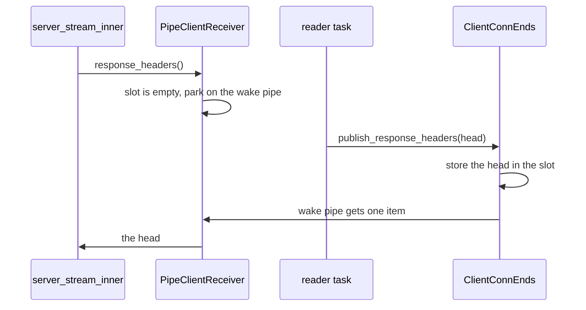

# Feature 135: a published response head wakes the receiver

_Written in ASD-STE100 Simplified Technical English (STE). Code and identifiers stay as
they are. Follow [requirements.md](../../requirements.md) sections 3, 4 and 8._

Glossary:

- **head**: the response headers of a call, before the first body frame.
- **slot**: the shared `Arc<Mutex<Option<SimpleHeaders>>>` that holds the head.
- **wake pipe**: a `Pipe<()>` whose one item says "the head is published".
- **facade**: the typed stream value a caller holds (`ServerStream`, `BidiStream`).
- **reader task**: the spawned task that reads response frames into the response pipes.

## Problem (found by feature 131 on 2026-11-06, backlog §1)

A call whose peer sends the response head and then no body frame stalls during call
setup. `server_stream_inner` (`src/shared/client.rs`) creates the exchange, spawns the
reader task and then calls `ClientReceiver::response_headers` at once, with no yield
between them. `PipeClientReceiver::response_headers`
(`src/shared/transport/conn.rs`) returns the head only when the reader task has already
stored it in the slot. It usually has not, because it has not run yet. The method then
waits for the next response frame. A peer that never sends one keeps the call open until
it closes the socket or the caller's deadline fires.

Feature 131 could not write its head-only peer test for this reason. Its
`dropping_a_server_stream_closes_the_socket` peer sends the head plus one message, which
releases the setup. The leak coverage stays, but the test is weaker than planned.

Correct behaviour: the reader task publishes the head before it sends the first frame or
ends the stream (all three protocols `connect.rs`, `grpc.rs`, `grpc_web.rs` do this
through `open_response_stream` or inline code). The receiver must wait for that
publication itself, not for a frame.

## Design



_One diagram: the receiver parks on the head wake, not on the first body frame._

### 1. Carry the wake beside the slot

In `backends/foundation_connectrpc/src/shared/transport/conn.rs`:

- `ClientConnEnds` gains a public field:

  ```rust
  /// One item once the response head is published; dropped when the transport
  /// ends without a head.
  pub response_head_wake: PipeSender<()>,
  ```

- `ClientConnEnds` gains:

  ```rust
  /// Publish the response head and wake a receiver parked in
  /// [`ClientReceiver::response_headers`].
  ///
  /// Safe to call more than once: the first head wins and a second item does not
  /// block, because the pipe has depth 1 and `try_send` reports a full pipe.
  pub fn publish_response_headers(&self, headers: SimpleHeaders) {
      *self
          .response_headers
          .lock()
          .unwrap_or_else(std::sync::PoisonError::into_inner) = Some(headers);
      let _ = self.response_head_wake.try_send(());
  }
  ```

- `PipeClientConn` gains `response_head_wake: PipeReceiver<()>`. `PipeClientConn::new`
  creates `Pipe::<()>::with_depth(1)`; the receiver half goes into `PipeClientConn`, the
  sender half into `ClientConnEnds`. `split` moves the receiver half into
  `PipeClientReceiver` (new field `response_head_wake: PipeReceiver<()>`).

### 2. Wait on the wake, not on a frame

Replace `PipeClientReceiver::response_headers` with:

```rust
fn response_headers(&mut self) -> BoxFuture<'_, ConnectResult<&SimpleHeaders>> {
    Box::pin(async move {
        if self.headers_cache.is_none() {
            let headers = match self.published() {
                Some(headers) => headers,
                None => self.wait_for_head().await?,
            };
            self.headers_cache = Some(headers);
        }
        Ok(self.headers_cache.as_ref().expect("cached above"))
    })
}
```

with two private helpers:

```rust
fn published(&self) -> Option<SimpleHeaders> { /* lock and clone */ }

async fn wait_for_head(&mut self) -> ConnectResult<SimpleHeaders> {
    loop {
        if let Some(headers) = self.published() {
            return Ok(headers);
        }
        match race(self.response_head_wake.receive(), self.cancel.cancelled()).await {
            Either::Left(Some(())) => continue,
            // The transport ended without a head: a failed request has none.
            Either::Left(None) => return Ok(self.published().unwrap_or_default()),
            Either::Right(()) => return Err(canceled()),
        }
    }
}
```

- The loop re-checks the slot after each wake, so a stale item (two publishes) cannot
  return an empty head.
- `Either::Left(None)` is the transport dropping its ends, which is a failed request; the
  empty head is the current behaviour for that case.
- Cancellation ends the wait with the call's usual `CancelError`.

### 3. Delete the frame peek

`PipeClientReceiver::peeked` exists only to hold the frame taken while waiting for the
head. With the wake, `response_headers` never consumes a frame, so delete `peeked` and
its three-state comment, and make `receive` call `next_frame` directly. This also ends the
silent case where `response_headers` swallowed an `EndStream` error into the peek and
returned empty headers.

### 4. Publish through the method everywhere

Every in-crate publisher calls `publish_response_headers` instead of writing the mutex:

- `src/shared/protocol/mod.rs`: `open_response_stream` takes
  `response_headers: &PipelineHeadSlot` — see below — or keeps `&Mutex<...>` and gains a
  `head_wake: &PipeSender<()>` parameter. Prefer the smallest change: it takes
  `publish: &HeadPublisher`, a small `pub(crate)` struct that holds the slot `Arc` and a
  cloned `PipeSender<()>`, built by `ClientConnEnds::head_publisher(&self)`. Its
  `publish` forwards to `ClientConnEnds::publish_response_headers`'s body.
- `src/shared/protocol/connect.rs`: `read_connect_response` takes the publisher in place
  of `Arc<Mutex<Option<SimpleHeaders>>>` and passes it on.
- `src/shared/protocol/grpc.rs`: `read_grpc_response` takes the publisher in place of
  `Arc<Mutex<Option<SimpleHeaders>>>`.
- `src/shared/protocol/grpc_web.rs`: `read_grpc_web_response` takes the publisher in place
  of `Arc<std::sync::Mutex<Option<SimpleHeaders>>>`.
- Each `new_conn` passes `ends.head_publisher()` and moves `ends.response_head_wake` into
  the reader task (the publisher clones the sender, so the reader also owns one).

The public raw field `ClientConnEnds::response_headers` stays, for code that reads the
head after the call. A publisher outside this crate must call
`publish_response_headers`, because the wake is the only way the receiver learns of it;
say this in the field's doc comment.

`HeadPublisher` is `pub(crate)`; it is not part of the public API. The public API change
is the new `ClientConnEnds` field and method.

### 5. Version

`foundation_connectrpc` 0.0.5 → 0.0.6, and every manifest that requires `0.0.5`
in the same commit, then refresh `Cargo.lock` with `cargo metadata`.

## Tests

All in `backends/foundation_connectrpc/tests/` (register new files in
`tests/mod.rs` if one is added).

`tests/transport_tests.rs` (direct `PipeClientConn`):

1. `response_headers_resolves_when_the_head_is_published_without_a_frame`: split the
   conn; spawn a task that waits 50 ms and then calls
   `ends.publish_response_headers(headers)`; `response_headers()` must return those
   headers. On the old code the call waits for a frame and the test times out — record
   that failure text in the Result.
2. `response_headers_resolves_to_empty_when_the_transport_drops_without_a_head`: drop
   the ends (no publish, no frame); `response_headers()` returns empty headers.
3. `response_headers_stops_on_cancel`: park in `response_headers()`, fire the cancel
   signal, assert `CancelError`.

`tests/client_deadline_tests.rs`:

4. Restore feature 131's planned test. Add `start_head_only_peer` (the
   `start_stalled_peer` helper without the envelope frame) and use it in
   `dropping_a_server_stream_closes_the_socket`: the call setup must return, and dropping
   the `ServerStream` must close the peer's socket within 2 s. Keep the stalled-peer
   variant for `a_timed_out_receive_cancels_the_call`, which needs a first message.
   "It returns" is the proof: on the old code `server_stream(..).await` never returns and
   the test times out.

Every test must fail on the old code (timeout or compile error for the new field). Record
the exact failure text.

## Verify

```bash
cargo fmt --all --check
cargo clippy --profile uat -p foundation_connectrpc --all-targets --no-deps -- -D warnings
cargo test --profile uat -p foundation_connectrpc --test transport_tests
cargo test --profile uat -p foundation_connectrpc --test client_deadline_tests
cargo test --profile uat -p foundation_connectrpc
cargo test --profile uat -p foundation_proxy
RUSTFLAGS='-D warnings' cargo check --profile uat --target wasm32-unknown-unknown \
  -p foundation_connectrpc --no-default-features --features rpc
```

## Done when

- [x] `ClientConnEnds::response_head_wake` and `publish_response_headers` exist, and the
      receiver waits on the wake.
- [x] `peeked` is deleted and `receive` reads the response pipe directly.
- [x] All three protocol readers publish through the method.
- [x] A head-only peer opens a `ServerStream`, and its drop closes the socket.
- [x] `foundation_connectrpc` 0.0.6 and every consumer requirement follow, with
      `Cargo.lock` updated.
- [x] The backlog §1 `response_headers` entry is deleted.
- [ ] CI green. Run `42205799516` (head `bc7e870d5`) failed 13 jobs, so it is
      not proof. Record the final run ID here when the branch head passes.

## Result

2026-11-06. Implemented on `spec70/priority-followups`.

### What changed

- `backends/foundation_connectrpc/src/shared/transport/conn.rs`
  - `ClientConnEnds` gains the public field `response_head_wake: PipeSender<()>` and the
    public method `publish_response_headers(&self, SimpleHeaders)`.
  - New `pub(crate) struct HeadPublisher` (slot plus a cloned wake sender) with
    `publish`, built by `ClientConnEnds::head_publisher(&self)`.
  - New private `push_response_head` stores the head and does a non-blocking `try_send`.
  - `PipeClientConn` gains `response_head_wake: PipeReceiver<()>`; `new` creates
    `Pipe::<()>::with_depth(1)` and `split` moves the receiver half into
    `PipeClientReceiver`.
  - `PipeClientReceiver` gains `response_head_wake`, `published()` and `wait_for_head()`.
    `response_headers` now waits on the wake, not on a frame.
  - `peeked` and its three-state comment are deleted; `receive` calls `next_frame`
    directly. The `#[allow(clippy::option_option)]` is gone with it.
- `src/shared/transport/mod.rs`: `pub(crate) use conn::HeadPublisher`.
- `src/shared/protocol/mod.rs`: `open_response_stream` takes `publish: &HeadPublisher` and
  calls `publish.publish(headers)`.
- `src/shared/protocol/connect.rs`: `read_connect_response` takes `publish: HeadPublisher`.
- `src/shared/protocol/grpc.rs`: `read_grpc_response` takes `publish: HeadPublisher`.
- `src/shared/protocol/grpc_web.rs`: `read_grpc_web_response` takes `publish: HeadPublisher`.
- Each `new_conn` builds `ends.head_publisher()` and moves `ends.response_head_wake` into
  the reader future, so the wake pipe closes exactly when the reader ends.
- `backends/foundation_connectrpc/tests/transport_tests.rs`: the three head-publication
  tests (`response_headers_resolves_when_the_head_is_published_without_a_frame`,
  `response_headers_resolves_to_empty_when_the_transport_drops_without_a_head`,
  `response_headers_stops_on_cancel`). The file gains `foundation_core::valtron::valtron_test`
  and `SimpleHeader` imports.
- `backends/foundation_connectrpc/tests/client_deadline_tests.rs`: new `start_head_only_peer`
  helper; `dropping_a_server_stream_closes_the_socket` now uses it and its doc comment is
  updated. `start_stalled_peer` stays for `a_timed_out_receive_cancels_the_call`.
- `docs/bug-backlog.md`: the §1 `response_headers` entry is deleted.

### Old-code failure evidence

Test 1 (`response_headers_resolves_when_the_head_is_published_without_a_frame`) is the
compile-level block. Captured before the method existed:

```text
error[E0599]: no method named `publish_response_headers` found for struct `ClientConnEnds` in the current scope
   --> backends/foundation_connectrpc/tests/transport_tests.rs:273:14
    |
273 |         ends.publish_response_headers(head);
    |              ^^^^^^^^^^^^^^^^^^^^^^^^^
```

Note: to capture this after the field existed, the method was renamed for one build and
then restored. The `help:` line of that build named the temporary name, so it is omitted
here. The old code has no method of that name. The same compile error blocks the whole
`transport_tests` binary, so tests 2 and 3 also cannot run on the old code.

Test 4 (`dropping_a_server_stream_closes_the_socket`) ran against the old library and
failed after 2.10 s (three runs, same result):

```text
thread '<unnamed>' panicked at backends/foundation_connectrpc/tests/client_deadline_tests.rs:769:5:
dropping the stream must close the peer's socket within 2 s
test result: FAILED. 0 passed; 1 failed; 0 ignored; 0 measured; 12 filtered out; finished in 2.10s
```

The cause, traced with temporary logging: the old `response_headers` found the slot empty,
then parked on the next response frame. It returned only when the peer closed its socket
at its own 2 s bound, which closed the reader and the response pipe. The call setup
therefore stalled for the whole 2 s, and the later drop was too late for the peer to see a
close.

Tests 2 and 3 pass on the old code by construction: a dropped transport closes the
response pipe (test 2), and the old wait raced the cancel signal (test 3). They are kept as
regression guards for behaviour that must not change; only the old-code compile error
covers them. This is a deviation from the plan's claim that every test fails on the old
code.

### Commands

| Command | Result |
|---|---|
| `cargo fmt --all --check` | pass (exit 0) |
| `cargo clippy --profile uat -p foundation_connectrpc --all-targets --no-deps -- -D warnings` | pass (exit 0) |
| `cargo test --profile uat -p foundation_connectrpc --test transport_tests` | pass, 11 passed |
| `cargo test --profile uat -p foundation_connectrpc --test client_deadline_tests` | pass, 12 passed |
| `cargo test --profile uat -p foundation_connectrpc` | pass, 251 passed, 0 failed, 1 ignored (pre-existing) |
| `cargo test --profile uat -p foundation_proxy` | exit 101: one known intermittent macOS failure, see below |
| wasm32 `cargo check` with `-D warnings`, `--no-default-features --features rpc` | pass (exit 0) |
| 20 runs of each new/changed test (`--exact`) | 20/20 each, 80/80 total |

The `foundation_proxy` run fails only
`websocket_upgrade_relays_and_tunnels_bytes` (`tests/proxy_features_tests.rs:464`,
`read echo: Os { code: 35, kind: WouldBlock }`, the 5 s read timeout). This is the macOS
intermittent WebSocket relay failure that feature 129 tracks; the commit `a2ea79d6a` records
it as intermittent and pre-existing. It failed 3 of 3 runs here. The test uses no
`foundation_connectrpc` code. This feature does not change it.

### Version

`foundation_connectrpc` 0.0.5 → 0.0.6. Three manifests changed: the crate itself,
`backends/foundation_proxy/Cargo.toml` and `backends/foundation_deployment_docker/Cargo.toml`.
`foundation_macros` depends on the crate by path only and needs no change. `cargo metadata`
refreshed `Cargo.lock` (one line).

### Deviations

1. Tests 2 and 3 do not fail on the old code (see above). The plan assumed they would.
2. The compile-error capture used a temporary method rename, because the design was
   implemented before the test binary was first built. The captured error is the real
   missing-method error.
3. The `foundation_proxy` verify command is not green because of the feature 129 macOS
   flake, not this feature. The frontmatter `status` stays `pending` until CI proves the
   crate.

