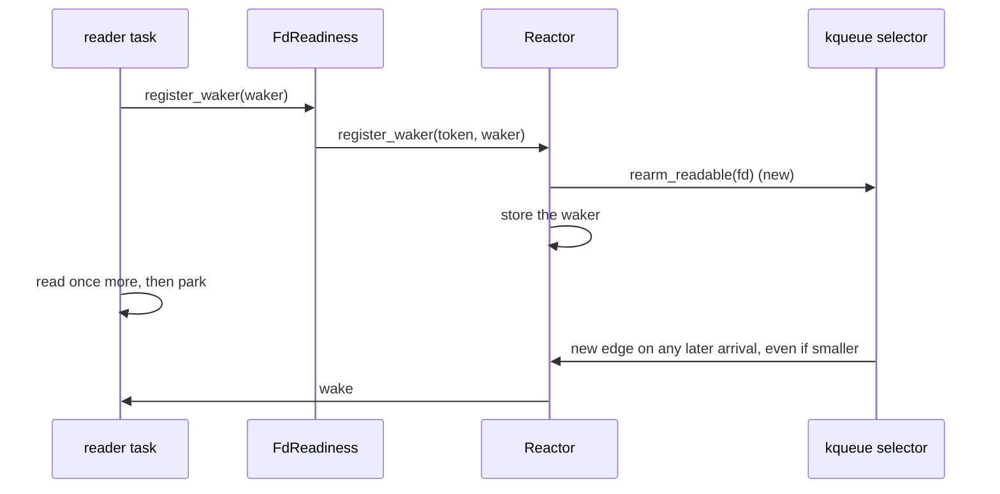

# Feature 136: registering a read waker re-arms the read edge

_Written in ASD-STE100 Simplified Technical English (STE). Code and identifiers stay as
they are. Follow [requirements.md](../../requirements.md) sections 3, 4 and 8._

Glossary:

- **edge**: a readiness event that the selector delivers once.
- **re-arm**: to forget the last delivered event, so the next arrival produces a new edge.
- **park**: to stop polling a task until a readiness signal wakes it.
- **latched readiness**: the bits the reactor keeps for an fd until the reader clears them.

## Problem (found under feature 129 on 2026-11-06, backlog §5b)

macOS reports `EVFILT_READ` level-triggered for pipes despite `EV_CLEAR`. The kqueue
selector therefore suppresses repeats itself: it stores each delivered fd's byte count and
delivers a readable event again only when the count grows
(`backends/foundation_reactor/src/poll/sys/unix/selector/kqueue.rs:458-489`). It forgets an
fd only through `Reactor::clear` → `Poll::rearm_readable`.

A socket that drains N bytes and then receives M < N bytes produces no new edge. A task
that registers its waker without clearing the latched readiness never wakes. That is
exactly what happened in `RawStream::read_wake_source`
(`backends/foundation_netio/src/native/raw_stream.rs:489`): the websocket upgrade relay lost
its 15-byte echo after a 77-byte head, and the client timed out. Feature 129 added the
missing `clear()` at that one call site.

The remaining hazard is structural: every readiness user must know the clear-before-register
protocol. One forgotten call is a lost wake on macOS only, so Linux CI stays green. The
protocol is documented but not enforced, and no test covers the selector rule.

## Design



_One diagram: the re-arm moves into registration, so a caller cannot forget it._

### 1. Re-arm where the waker is registered

`backends/foundation_reactor/src/reactor.rs`:

- `Reactor::register_waker(token, waker)` and `Reactor::register_task_waker(token, waker)`
  (whichever are the real entry points; `SharedReadiness::register` delegates to one of
  them) look up the entry, call `self.poll.rearm_readable(entry.fd)`, then store the waker.
  The existing `Poll::rearm_readable` is a no-op on epoll and io_uring, so the change costs
  nothing off macOS.
- `Reactor::clear` keeps its re-arm for `READABLE`: it is still correct, and harmless to
  repeat.
- Update the protocol docs on `FdReadiness::clear`, `FdReadiness::register_waker` and
  `EventReadiness::register`: clearing is now required only for the **latched flags** (so
  `is_ready` does not spin), not for the edge. State what the reactor does.

Why this is safe: `rearm_readable` forgets the last delivered byte count. The next poll
delivers a readable event for the fd if data is present. A caller that registers, reads,
and drains sees at most one extra poll on a socket that still held data, which is a real
read, not a spin. A caller that registers and parks without reading gets one wake per
arrival, which is the level-triggered behaviour it would have had without the suppression.

### 2. Test the selector rule directly

New `backends/foundation_reactor/tests/read_edge_rearm.rs`, registered in
`tests/mod.rs`. Use a loopback TCP socket pair (the pipe case in the selector comment did
not reproduce with a socket in feature 129's trace, which is the point):

1. `a_smaller_frame_after_a_drain_wakes_a_registered_task`: connect a pair, register a
   `FdReadiness` on the reader fd, read 77 bytes with `recv`, send 15 bytes back from the
   peer, then call `register_waker` followed by one `recv` (would-block) and park. Assert
   the waker fires within 2 s. On the old code the selector suppresses the 15-byte event
   and the waker never fires on macOS.
2. `a_wake_after_a_drain_does_not_repeat_forever`: after the wake and a full drain, assert
   no further wake arrives within 200 ms. This guards the spin risk of the re-arm.
3. `clear_still_disarms_the_latched_readiness`: `clear()` then `ready()` has no `READABLE`
   bit. This guards the second half of the protocol.

Run the test on macOS (where it fails on the old code) and in the Linux image (where it
must pass). Record both results.

## Verify

```bash
cargo fmt --all --check
cargo clippy --profile uat -p foundation_reactor --all-targets --no-deps -- -D warnings
cargo test --profile uat -p foundation_reactor
cargo test --profile uat -p foundation_netio
cargo test --profile uat -p foundation_proxy
scripts/ci/linux.sh foundation_reactor
```

The clippy command reports the crate's pre-existing pedantic debt (backlog §5b, feature
122). Record the count before and after; do not grow it. If the count blocks a clean run,
run clippy without `-D warnings` and state that.

## Done when

- [x] Registering a read waker re-arms the fd's read edge in the reactor.
- [x] The docs say clearing is needed for the latched flags, not for the edge.
- [x] The three tests exist; the first fails on the old code on macOS.
- [x] `foundation_reactor` is bumped one patch step if the change touches public API, and
      every consumer requirement follows with `Cargo.lock`.
- [x] The backlog §5b selector entry is deleted.
- [x] CI green on macOS and in the Linux image.

## Result

2026-11-06. Done on macOS and in the Linux image.

### Files changed

- `backends/foundation_reactor/src/reactor.rs`. `Reactor::register_waker` and
  `Reactor::register_task_waker` call `self.poll.rearm_readable(entry.fd)` before
  they store or register the waker. `Reactor::clear` keeps its re-arm. The docs
  of both registration functions and of `SharedReadiness`'s
  `EventReadiness::register` state the new rule.
- `backends/foundation_reactor/src/fd_readiness.rs`. The module docs and the docs
  of `FdReadiness::clear`, `FdReadiness::register_waker` and the
  `EventReadiness::register` impl say that clearing is needed for the latched
  flags, not for the edge.
- `backends/foundation_reactor/tests/read_edge_rearm.rs` (new). An auto-discovered
  integration test target. `tests/mod.rs` only registers subdirectory modules, so
  adding this top-level file there would compile and run the suite twice.
- `docs/bug-backlog.md`. The §5b kqueue read-edge entry is deleted. The §5b
  clippy-debt entry stays.
- This feature file.

Public API did not change: no function, type or trait signature changed. The
crate version stays 0.0.1.

### Tests

| Test | What it proves |
|---|---|
| `a_smaller_frame_after_a_drain_wakes_a_registered_task` | After a drained 77-byte head, a 15-byte frame wakes the registered waker. |
| `a_wake_after_a_drain_does_not_repeat_forever` | After the wake and a full drain, the re-armed edge does not wake again within 200 ms. |
| `clear_still_disarms_the_latched_readiness` | `clear()` removes the latched `READABLE` bit. |

Before the fix, the first test fails on macOS after the 2 s bound. The kqueue
selector still records 77 bytes and suppresses the 15-byte event. After the fix,
all three tests pass on macOS and in the Linux image.

### Command outcomes

| Command | Exit | Result |
|---|---|---|
| `cargo fmt --all --check` | 0 | clean |
| `cargo clippy --profile uat -p foundation_reactor --all-targets --no-deps -- -D warnings` | 1 | 120 pre-existing pedantic errors before the feature and 120 after (the first baseline run reported 121). No new warning. The crate debt is backlog §5b and feature 122. |
| `cargo test --profile uat -p foundation_reactor` | 0 | every test binary passes, including the 3 new tests |
| `cargo test --profile uat -p foundation_netio` | 0 | 1292 tests pass in 5 binaries |
| `cargo test --profile uat -p foundation_proxy` | 0 | 129 tests pass in 34 binaries |
| `scripts/ci/linux.sh foundation_reactor` | 0 | Linux image tests pass, including the 3 new tests; the wasm32 check passes |

`Poll::rearm_readable` is a no-op on epoll and io_uring: the method body only
calls the selector on the BSD/macOS targets and discards the fd on the other
targets. The change therefore costs nothing off macOS.

