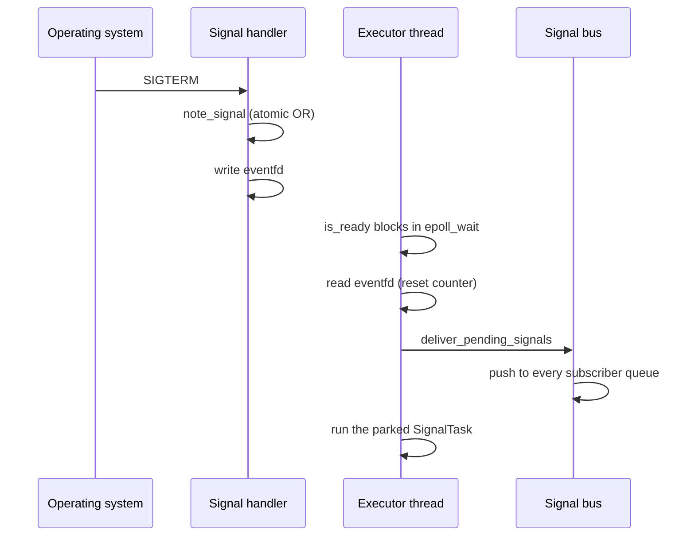

# Feature 145: the signal handler only records, the executor delivers

_Written in ASD-STE100 Simplified Technical English (STE). Code and identifiers stay as
they are. Follow [requirements.md](../../requirements.md) sections 3, 4 and 8._

Glossary:

- **signal**: an asynchronous notice from the operating system to the process, such as
  `SIGTERM`.
- **signal handler**: the function that the operating system calls when the signal
  arrives. It interrupts an arbitrary thread at an arbitrary point.
- **async-signal-safe**: a function that is safe to call from a signal handler. Such a
  function does not lock a mutex, does not allocate memory and does not call another
  unsafe function.
- **eventfd**: a Linux kernel counter that a `read` resets. The signal handler increments
  it with one `write` call.
- **readiness poll**: the `EventReadiness::is_ready` call that the valtron executor makes
  on the thread that drives the task. The call can block for the given timeout.

## Problem

The signal handler calls the bus directly. That call is not async-signal-safe.

1. `signal_handler` (`backends/foundation_nativeapis/src/signal/linux.rs:15`) writes the
   eventfd at line 29, then calls `deliver_signal(kind)` at line 35.
2. `deliver_signal` (`src/signal/mod.rs:31`) reads a global pointer and calls
   `SignalBus::deliver`.
3. `SignalBus::deliver` (`src/signal/bus.rs:66`) locks two `std::sync::Mutex` values and
   pushes an allocated clone into every subscriber queue. `Mutex::lock` and allocation are
   both unsafe in a signal handler. A signal that interrupts a thread that holds the
   subscriber lock deadlocks that thread. An allocation that interrupts the allocator can
   deadlock the allocator.
4. `windows.rs:67` has the same direct call. The Windows console handler runs on its own
   thread, so the call is safe there today. The code still couples the handler to the bus.

Three more defects are in the same code path. Fix them in this feature.

5. The handler tests `if fd >= 0` (`linux.rs:26`). `EVENT_FD` starts at 0, so the test
   passes before registration. The handler then writes 8 bytes to fd 0, which is usually
   the standard input. The test must be `fd > 0`.
6. `SignalHandle::is_ready` maps `None` to `-1` on Linux (`handle.rs:71`), to `INFINITE`
   on Windows (`handle.rs:113`) and to a null timeout on macOS (`handle.rs:84`). The
   trait contract says `None` checks at once and does not block. The executor calls
   `is_ready(None)` on every `TaskStatus::Depends`
   (`backends/foundation_core/src/valtron/executors/local.rs:2023`). On Linux and
   macOS, a task that parks on the handle blocks the executor thread forever.
7. `SignalTask::next_status` (`src/signal/task.rs:31`) parks on the bus queue, never on
   the handle. Nothing polls the handle, so the macOS kqueue path never delivers
   (`handle.rs:105` is the only macOS delivery site and no code calls it).
8. macOS registration installs no signal handler (`src/signal/macos.rs:10`). Measured
   on Darwin 27.2.0: a kqueue `EVFILT_SIGNAL` filter alone does not suppress the default
   action, so `kill(getpid(), SIGTERM)` exits the process with code 143 and the kevent is
   never read. With a no-op `sigaction` handler installed, the process survives and
   `kevent` returns one event with `ident = 15`. A macOS host therefore dies on `SIGTERM`
   and never runs a graceful shutdown. This is issue [#249](https://github.com/ewe-studios/ewe_platform/issues/249),
   severity high.

## Design

Keep one rule: the handler records the signal and wakes the poll. The poll delivers.

### 1. Record the signal in a lock-free mask (`src/signal/mod.rs`)

Add one static `AtomicU32` (a **pending mask**) and two crate-private functions:

```rust
static PENDING: AtomicU32 = AtomicU32::new(0);

pub(crate) fn note_signal(kind: SignalKind) {
    PENDING.fetch_or(kind.bit(), Ordering::Relaxed);
}

pub(crate) fn deliver_pending_signals() {
    let mask = PENDING.swap(0, Ordering::AcqRel);
    for kind in SignalKind::ALL {
        if mask & kind.bit() != 0 {
            deliver_signal(kind);
        }
    }
}
```

- `SignalKind` gets a crate-private `fn bit(self) -> u32` (`Interrupt` = `1`, `Terminate`
  = `2`, `Hangup` = `4`, `Quit` = `8`) and a `const ALL: [Self; 4]`.
- `note_signal` is lock-free and allocation-free. `AtomicU32::fetch_or` is lock-free on
  every Linux, macOS and Windows target this crate builds for, so it is async-signal-safe
  in practice.
- `deliver_signal` stays. Only an executor thread calls it after this change.

### 2. Linux (`src/signal/linux.rs`)

- The handler calls `note_signal(kind)` first, then writes the eventfd. The order matters:
  a poll that sees the eventfd ready must always find a set bit.
- The handler does not call `deliver_signal`.
- The handler tests `fd > 0`.
- The Linux arm of `is_ready` reads the 8 bytes from the eventfd when `epoll_wait` reports
  readiness, then calls `deliver_pending_signals`. The `read` resets the counter, so the
  next poll does not report the same signal again.
- Map `None` to a timeout of 0 milliseconds.

### 3. Windows (`src/signal/windows.rs`)

- The console handler calls `note_signal(kind)`, then `SetEvent`. It does not call
  `deliver_signal`.
- The Windows arm of `is_ready` calls `deliver_pending_signals` when
  `WaitForSingleObject` returns `WAIT_OBJECT_0`.
- Map `None` to a timeout of 0 milliseconds.

### 4. macOS (`src/signal/handle.rs`, `src/signal/macos.rs`)

- Keep the kqueue delivery: the event carries the signal number, so the poll calls
  `deliver_signal(kind)` for the event it read.
- Map `None` to a zero `timespec`, so the poll does not block.
- Install a no-op `sigaction` handler for the four signals in `register_signals`, with a
  full `sa_mask` and `sa_flags = 0`, the same way `linux.rs` does. The handler stops the
  default action. It does nothing, so it is async-signal-safe. kqueue still posts the
  event, and the poll delivers it. Without this handler a real `SIGTERM` terminates the
  process (issue #249).

### 5. Park on the handle (`src/signal/task.rs`)

- `SignalTask` stores `readiness: EventReadinessPtr` instead of `handle`. The
  constructor builds it: `let readiness: EventReadinessPtr = Arc::new(handle.clone());`.
- `next_status` pops the task queue first. When the queue is empty, it returns
  `TaskStatus::Depends(Arc::clone(&self.readiness))`.
- Remove the `#[allow(dead_code)]` attribute and the `let _ = &self.handle;` line.

The sequence becomes:



A handler that records only cannot deadlock on a bus lock or on the allocator.

### 6. Document the contract

- `signal_task` and the `signal` module docs state one rule: a signal is delivered when
  something polls the handle's readiness. `SignalTask` does this. A host that drives the
  handle itself also gets delivery.
- No public signature changes. Do not bump the crate version.

## Tests

New auto-discovered target `backends/foundation_nativeapis/tests/signal_delivery_tests.rs`.
Every test is `#[cfg(unix)]`, and the file has a `#[cfg(unix)]` module around them so the
Windows build compiles an empty target. Keep the tests in their own target: the signal
handlers are process-global, and the target must not disturb another test binary.

1. `a_signal_waits_for_the_readiness_poll` (fails on the old code): call `signal_task`
   with `Arc::new(MonotonicClock::new())`, subscribe one `EventQueue`, call
   `libc::raise(libc::SIGTERM)`, then assert that the subscriber queue is empty. This
   proves that the handler did not deliver. Poll the task: the first `next_status`
   returns `TaskStatus::Depends(readiness)`. Call `readiness.is_ready(None)` and assert
   `true`. The second `next_status` returns `Ready(event)` with
   `event.kind == SignalKind::Terminate`.
2. `a_nonblocking_poll_returns_at_once` (fails on the old code; it hangs): call
   `signal_task`, poll the task once, and call `readiness.is_ready(None)` with no signal
   pending. The call returns `false` in less than 250 ms. Use `foundation_compact::Instant`
   for the measurement.
3. `a_signal_sent_before_the_park_is_not_lost`: raise `SIGTERM` before the first
   `next_status`, then assert `readiness.is_ready(None)` is `true` and the task returns
   `Ready`. The eventfd counter holds the edge, so the second check finds it.

Do not write a test that holds the bus subscriber lock: the lock is not public. Test 1
proves the property instead, because a handler that takes no lock cannot deadlock on it.

Run every new test 20 times in a row with a hard timeout (`requirements.md` section 4).

## Verify

```sh
cargo fmt -p foundation_nativeapis
cargo clippy --profile uat -p foundation_nativeapis --all-targets -- -D warnings
cargo test --profile uat -p foundation_nativeapis --test signal_delivery_tests
cargo test --profile uat -p foundation_nativeapis
```

The Linux, Windows and macOS jobs in the pull request prove that the three platform
modules compile. A local run proves Linux only.

## Done when

- The Linux and Windows handlers contain no call that locks or allocates.
- `grep -n 'deliver_signal' backends/foundation_nativeapis/src/signal/*.rs` finds calls
  only in `mod.rs` (the function), `handle.rs` (the macOS poll) and `mod.rs`
  (`deliver_pending_signals`).
- `SignalTask` parks on the handle, and the three tests pass.
- One GitHub issue records the fd 0 write and is closed by this change (#247, rule 9).
- One GitHub issue records the missing macOS handler and is closed by this change
  (#249, rule 9).
- One GitHub issue records that `register_signals` never closes its descriptors and that
  `set_global_bus` leaks one `Arc` per call (#248). Keep it open with severity low.
- The macOS test sends `SIGTERM` with `kill(getpid(), SIGTERM)`, not `raise`: a
  thread-directed signal does not reach a kqueue filter when a handler is installed.
- `progress.md` and `learnings.md` record the change.
