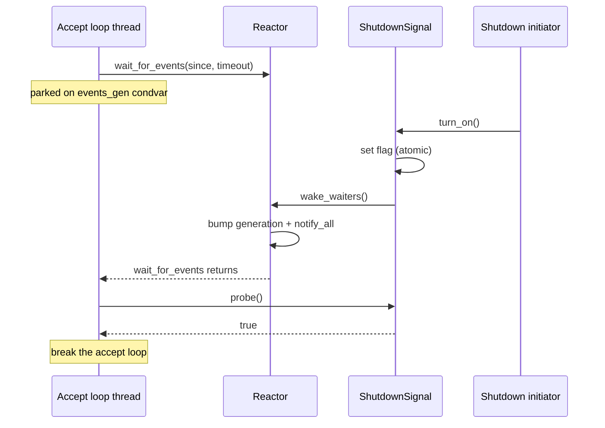

# Feature 31: Wake-capable shutdown signal

_Written in ASD-STE100 Simplified Technical English (STE). Code and identifiers stay as they
are._

**Abbreviations in this file.** pull request (PR); AeroSpace and Defence Industries
Association of Europe (ASD), the owner of the STE standard ASD-STE100.

Use the shared protocol in [`requirements.md`](../../requirements.md) sections 3 and 4.

## 1. Goal

The HTTP accept loop parks on the shared reactor when no connection is pending (feature 05).
It checks the shutdown signal only when that park times out. The signal
`OnSignal` is a passive atomic flag. It has no wake primitive. So a thread
parked in `Reactor::wait_for_events` cannot be woken by `turn_on`. Shutdown is
seen only after the `accept_shutdown_poll` timeout (default 10 ms). This feature
adds a purpose-built, wake-capable shutdown signal. A turn-on wakes a parked
accept loop at once. `OnSignal` stays a passive probe-only atomic. It keeps its
other uses (the valtron kill signal).

## 2. Design

The reactor's `wait_for_events(since, timeout)` parks on a shared condvar
(`events_gen`). The drain thread bumps the generation and notifies when it
latches readiness. This feature reuses that condvar. The new signal, when
turned on, asks the reactor to bump the generation and notify. A parked waiter
then wakes at once. No real file descriptor (fd) event is needed. This is
simpler than an eventfd/pipe and works on every platform that has the reactor.



The signal is cross-platform. Its wake link to the reactor is unix-only, because
the reactor itself is unix-only. On other platforms the accept loop sleeps and
polls the flag, so the signal is a plain flag there (the same as `OnSignal`).

## 3. Items

| # | Item | Where | Do |
|---|---|---|---|
| R1 | `Reactor::wake_waiters()` | `foundation_reactor/src/reactor.rs` | A new public method. It bumps `events_gen` and calls `notify_all`. It wakes every thread parked in `wait_for_events` without a real fd event. Doc: it simulates a synthetic event for a non-task waiter. |
| R2 | `ShutdownSignal` | `foundation_reactor/src/shutdown_signal.rs` (new module) | A purpose-built wake-capable signal. It holds an `AtomicBool` flag (cross-platform) and, on unix, a `OnceLock<Arc<Reactor>>` wake link. API: `new()`, `Default`, `Debug`, `probe()`, `turn_on()` (idempotent; sets the flag and wakes the linked reactor on the false-to-true change), `turn_off()`, `register_wake()` (links the shared reactor; best-effort, `io::Result`). On non-unix `register_wake` is a no-op that returns `Ok`. |
| R3 | Re-export | `foundation_reactor/src/lib.rs`, `foundation_iogate/src/lib.rs` | Export `ShutdownSignal` so `foundation_http` and `foundation_browser` reach it through the public facades. |
| R4 | Migrate the shutdown type | `foundation_http` (src + tests), `foundation_browser/src/test/server.rs`, and every `serve*`/`serve_h3` caller in the workspace | Replace the http server's shutdown signal `OnSignal` with `ShutdownSignal`. The handlers only call `probe`, so the change is a type swap. Changing `serve`/`serve_with_listener`/`serve_with_acceptor`/`serve_tls`/`serve_tls_with_listener`/`serve_h3` signatures cascades to every caller that passes an `Arc<OnSignal>`: `foundation_connectrpc` (examples + tests), `foundation_auth` (tests), `foundation_proxy` (src + tests), `foundation_keychain` (bin + tests), `foundation_deployment_docker` (src + tests), and `foundation_testbed`. `foundation_proxy/src/passthrough.rs` keeps `OnSignal`: its signals never reach `serve*`. `OnSignal` stays in `foundation_core::synca` for the valtron kill signal. |
| R5 | Wire the wake link | `foundation_http/src/native/server/mod.rs` `serve_loop` | After the listener fd is registered, call `shutdown.register_wake()` (unix only, best-effort, log on error). Update the `accept_shutdown_poll` doc: it is now a safety bound only, not the shutdown-detection latency. Default stays 10 ms. |
| R6 | Tests | `foundation_reactor/tests/` | Flag semantics: `probe`/`turn_on` idempotency/`turn_off`. Wake: `register_wake`, then a thread parked in `wait_for_events` with a long timeout returns promptly after `turn_on` from another thread. |

## 4. Tasks

- [x] T1. Branch from `fix/io-01-valtron-parking` (work done directly on that branch).
- [x] T2. R1 + R2 + R3 + R6: add `wake_waiters`, `ShutdownSignal`, the re-exports, and the
      tests. One commit.
- [x] T3. R4 + R5: migrate `foundation_http`, `foundation_browser`, and the workspace
      `serve*`/`serve_h3` callers to `ShutdownSignal`, wire `register_wake`, update the
      `accept_shutdown_poll` doc. One commit.
- [x] T4. Verify (section 5).
- [x] T5. Delete the §4 `OnSignal` backlog entry. Update `progress.md` and `learnings.md`.

## 5. Verification (run exactly)

```bash
export CARGO_PROFILE_DEV_DEBUG=0 CARGO_INCREMENTAL=0
python3 scripts/ci/ci.py run foundation_reactor --profile uat
python3 scripts/ci/ci.py run foundation_http --profile uat
cargo check --workspace --all-targets --profile uat
```

## 6. Done when

- [x] All section 5 commands pass.
- [x] A parked accept loop wakes at once on `turn_on` (tested, not just reasoned).
- [x] `turn_on` stays idempotent (a second call returns `false` and does not re-wake).
- [x] `OnSignal` is unchanged and still used by the valtron kill signal.
- [x] No default value changed.
- [x] CI green.

## 7. Review checklist (main session)

- [x] `wake_waiters` cannot leave the generation unchanged while notifying.
- [x] `turn_on` sets the flag before it wakes the reactor (no missed wake).
- [x] The non-unix path still compiles and behaves like `OnSignal`.
- [x] Every http shutdown consumer that only probed still only probes.
