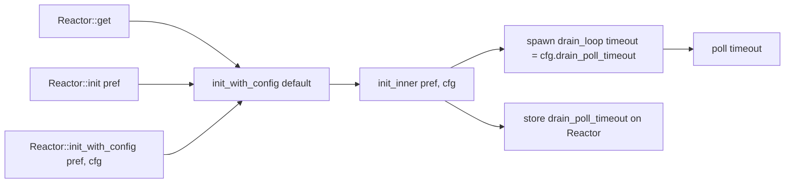

# Feature 32: Reactor drain poll timeout becomes configuration

_Written in ASD-STE100 Simplified Technical English (STE). Code and identifiers stay as they
are._

**Abbreviations in this file.** input/output (I/O); pull request (PR); AeroSpace and Defence
Industries Association of Europe (ASD), the owner of the STE standard ASD-STE100.

Use the shared protocol in [`requirements.md`](../../requirements.md) sections 3 and 4.

## 1. Goal

The reactor drain thread blocks in `poll(timeout)`. The timeout is a hard-coded
constant: `const DRAIN_TIMEOUT_MS: u64 = 100`. `CLAUDE.md` rule 8 says timeouts
are configuration, not constants. This feature moves the timeout onto a reactor
config. The default stays 100 ms.

## 2. Design

The reactor is a process-global singleton. The first call to `get()` or `init()`
builds it. There is no config today. This feature adds `ReactorConfig` with one
field, `drain_poll_timeout`. A new entry point `init_with_config(preference,
config)` threads that config into the drain thread. `get()` and `init()` stay as
they are: they call `init_with_config` with the default config. First call wins,
so a later `init_with_config` returns the existing instance and ignores its
config (the same as `init` today).

The timeout bounds shutdown latency only. A real event returns from `poll()`
immediately. The drain thread still checks the shutdown flag at least once per
timeout when idle.



## 3. Items

| # | Item | Where | Do |
|---|---|---|---|
| R1 | `ReactorConfig` | `foundation_reactor/src/reactor.rs` | A new config struct. One field: `drain_poll_timeout: Duration`. Builder `with_drain_poll_timeout(Duration)`, getter `drain_poll_timeout() -> Duration`, `Default` set to `DEFAULT_DRAIN_POLL_TIMEOUT`. Derives `Debug, Clone, Copy`. |
| R2 | `DEFAULT_DRAIN_POLL_TIMEOUT` | `foundation_reactor/src/reactor.rs` | `pub const DEFAULT_DRAIN_POLL_TIMEOUT: Duration = Duration::from_millis(100)`. Its doc comment names the source. Referenced only by `ReactorConfig::default()` (the rule-8 pattern). Delete `DRAIN_TIMEOUT_MS`. |
| R3 | Thread the config | `foundation_reactor/src/reactor.rs` | `init_inner` takes `config: ReactorConfig`. `drain_loop` takes `timeout: Duration` and uses it in `poll(Some(timeout))`. `Reactor` stores `drain_poll_timeout: Duration`. |
| R4 | Entry point | `foundation_reactor/src/reactor.rs` | New `pub fn init_with_config(preference, config)`. It holds the first-call-wins logic (the backend-match check and the existing-instance early return). `get()` and `init()` delegate to it with `ReactorConfig::default()`. |
| R5 | Getter | `foundation_reactor/src/reactor.rs` | `pub fn drain_poll_timeout(&self) -> Duration` on `Reactor`, for observability and tests. Add the field to the `Debug` impl. |
| R6 | Re-export | `foundation_reactor/src/lib.rs` | `pub use reactor::{..., ReactorConfig}` (unix-gated, like `Reactor`). |
| R7 | Tests | `foundation_reactor/tests/config/` | `default_is_100_ms` (config default), `builder_round_trips` (a non-default value reads back), `init_with_config_stores_the_timeout` (init with a non-default value in a fresh process, then the reactor getter returns it). |

## 4. Tasks

- [x] T1. Branch from `fix/io-01-valtron-parking` (work done directly on that branch).
- [x] T2. R1–R6: add the config, the default, the threading, the entry point, the getter,
      and the re-export. One commit.
- [x] T3. R7: add the tests.
- [x] T4. Verify (section 5).
- [x] T5. Delete the §2 `DRAIN_TIMEOUT_MS` backlog entry. Update `progress.md` and
      `learnings.md`.

## 5. Verification (run exactly)

```bash
export CARGO_PROFILE_DEV_DEBUG=0 CARGO_INCREMENTAL=0
python3 scripts/ci/ci.py run foundation_reactor --profile uat
cargo check --workspace --all-targets --profile uat
```

## 6. Done when

- [x] All section 5 commands pass.
- [x] `DRAIN_TIMEOUT_MS` is gone; the value lives only in `DEFAULT_DRAIN_POLL_TIMEOUT`.
- [x] The default stays 100 ms.
- [x] The code path reads the config field, never the const.
- [x] No other default value changed.

## 7. Review checklist (main session)

- [x] `get()`/`init()` behaviour is unchanged (only their internals moved to
      `init_with_config`).
- [x] `init_with_config` ignores its config when a reactor already exists (first-call-wins).
- [x] The doc comment on `DEFAULT_DRAIN_POLL_TIMEOUT` names a source.
- [x] No `DRAIN_TIMEOUT_MS` reference remains.
