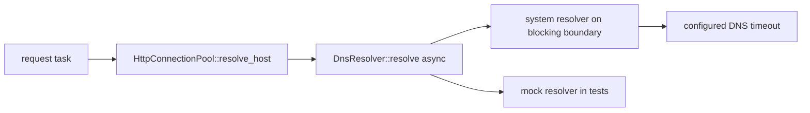

# Feature 36: Async DNS resolution in the HTTP client

_Written in ASD-STE100 Simplified Technical English (STE). Code and identifiers stay as they
are._

**Abbreviations in this file.** Domain Name System (DNS); Hypertext Transfer Protocol
(HTTP); pull request (PR); AeroSpace and Defence Industries Association of Europe (ASD), the
owner of the STE standard ASD-STE100.

Use the shared protocol in [`requirements.md`](../../requirements.md) sections 3 and 4.

## T0. Confirm the backlog entry is still open

- **Where:** `foundation_netio/src/shared/client/dns.rs` `SystemDnsResolver::resolve` (line
  130) calls `to_socket_addrs()` (line 137), a blocking system call. The caller is
  `HttpConnectionPool::resolve_host` (`foundation_netio/src/http/connection.rs` line 692),
  which the request task runs (`foundation_netio/src/http/tasks/request_redirect.rs` line 611)
  before the non-blocking connect (feature 04).
- **Confirm:** read the call chain above and note that `DnsResolver::resolve`
  (`dns.rs` line 38) is synchronous. A slow resolver holds a valtron worker for the whole
  lookup. The entry is still open.

## E1. Make the resolver seam async

- **Where:** `foundation_netio/src/shared/client/dns.rs` `DnsResolver` trait (line 23).
- **Fix:** make `resolve` an async method (`async fn` or a returned boxed future, so the
  trait stays object-safe for `BoxedDnsResolver`). Update the four implementors
  (`SystemDnsResolver`, `StaticSocketAddr`, `CachingDnsResolver`, `MockDnsResolver`) and the
  `Arc<T>` blanket impl (line 48) to match. The `SystemDnsResolver` body below (E2) runs the
  blocking lookup on a blocking boundary; the other resolvers stay cheap and await nothing.
  Record which object-safety technique you use (`async fn` via `async_trait`, or a manual
  `Pin<Box<dyn Future + Send>>` return) in the PR body.
- **Tests:** `foundation_netio/tests/` (registered in `tests/**/mod.rs`):
  `dns_mock_resolver_resolves_async` — `MockDnsResolver::with_response("example.test", …)`
  returns the configured addresses when awaited, with no real network. Keep any existing
  resolver tests updated to the async signature.

## E2. Offload the system lookup with a configured timeout

- **Where:** `foundation_netio/src/shared/client/dns.rs` `SystemDnsResolver::resolve` (line
  130) and the client timeout config `foundation_netio/src/shared/http/timeout.rs` (the
  config behind `TimeoutCalculator`, which already holds `connect_timeout`).
- **Fix:** `to_socket_addrs()` is a blocking system call and standard Rust has no async
  `getaddrinfo`. Run it on a blocking boundary (a bounded worker/offload seam), not on the
  valtron worker. Add a DNS timeout to the client timeout config as a field with a builder
  method and a documented default. Name the source: reuse the existing `connect_timeout` if
  one default is enough, otherwise default to 30 s like nginx's `resolver_timeout`. Per rule
  8, the timeout is configuration, not a constant. The resolver seam stays injectable (rule
  11): tests swap in a mock, and the real system resolver is built only at the host entry
  point.
- **Tests:** `dns_slow_resolver_does_not_block_the_worker` — a resolver whose `resolve`
  returns only after a delay; while a task awaits it, a separate ticker task keeps
  advancing, which proves the worker was not held. `dns_resolution_timeout_is_enforced` — a
  resolver that never returns; the await fails with the configured timeout. Both use the
  deterministic mock seam and no real network.



## Verification (run exactly)

```bash
export CARGO_PROFILE_DEV_DEBUG=0 CARGO_INCREMENTAL=0
python3 scripts/ci/ci.py run foundation_netio --profile dev
cargo check --workspace --all-targets --profile dev
```

## Done when

- [ ] `DnsResolver::resolve` is async and no caller blocks on it.
- [ ] The system lookup runs on a blocking boundary with a configured timeout (rule 8).
- [ ] `dns_mock_resolver_resolves_async`, `dns_slow_resolver_does_not_block_the_worker` and
      `dns_resolution_timeout_is_enforced` pass.
- [ ] The backlog entry is deleted.
- [ ] CI green.

## Review checklist (main session)

- [ ] The resolver seam is injectable and tested with the mock, not real DNS.
- [ ] The DNS timeout default names a source in its doc comment.
- [ ] No `to_socket_addrs()` (or other blocking lookup) remains on the valtron worker.
- [ ] wasm is unaffected (`NoopDnsResolver` and the browser path still work).

## Result

Landed on `fix/io-35-turso-async-trait-overflow`.

**Object safety.** `DnsResolver::resolve` is async through `#[async_trait]`
(`async-trait` 0.1.88, already a dependency). This keeps the trait object-safe:
`BoxedDnsResolver = Arc<dyn DnsResolver>` still works, and the `Arc<T>` blanket
impl uses `?Sized` so a boxed resolver delegates through `as_ref()`. The crate
re-exports the macro (`foundation_netio::shared::client::async_trait`) so tests
and downstream resolvers use the same bridge.

**Sync/async boundary.** The trait gains a synchronous `resolve_blocking` method
(next to the async `resolve`). Its default drives the boxed future on the current
thread with a `std::thread::Thread::unpark` waker (valtron's `block_on_future`
needs a `'static` future and the resolver future borrows the resolver, so it
cannot be used). `SystemDnsResolver` and `CachingDnsResolver` override it to run
`to_socket_addrs()` inline, because the blocking boundary already owns a plain
thread and must not touch the valtron background registry (whose pool may be
uninitialized there — submitting would panic). A free `resolve_blocking`
helper delegates to the trait method so call sites stay unchanged. The request
task instead uses the async `HttpConnectionPool::resolve_host` future, polled by
the new `Resolving` state in `request_redirect.rs`.

**Offload.** `SystemDnsResolver` runs `to_socket_addrs()` on valtron's
background job registry (`run_background_job`) and returns the result through a
`Pipe`, awaited as a future. This path is `#[cfg(not(target_family = "wasm"))]`;
wasm keeps `lookup_blocking` inline (the wasm `DefaultResolver` is
`NoopDnsResolver` and the browser owns resolution). The submit error is
stringified before the await so the future stays `Send`.

**Timeout.** `TimeoutConfig` gains `dns_timeout` (default 30 s, matching nginx's
`resolver_timeout` default), exposed as `ClientConfig::dns_timeout()` and
`ClientConfig::with_dns_timeout(..)`. The `Resolving` state enforces it with
`io_or_deadline`, failing with `HttpClientError::ConnectionTimeout`.

**Tests.** Three new tests in
`foundation_netio/tests/simple_http/dns_async_tests.rs` (registered in
`mod.rs`): `dns_mock_resolver_resolves_async`, `dns_slow_resolver_does_not_block_the_worker`
(a four-lookup saturation plus a ticker canary), and
`dns_resolution_timeout_is_enforced`. Existing resolver tests were updated to
`resolve_blocking`; the six tests that resolve through the system resolver were
moved to `#[valtron_test]`.

**Gates (run exactly, `--profile uat`).**

```bash
cargo check -p foundation_netio --profile uat
cargo clippy -p foundation_netio --profile uat --all-targets --no-deps
cargo test -p foundation_netio --profile uat
cargo check --workspace --all-targets --profile uat
```

All four pass. `foundation_netio` produces no rustc or clippy warnings from this
change. The only warnings are pre-existing manifest "unused dependency" notices
in `foundation_netio` (`flate2`, `rustls-pemfile`, `thiserror`) and other crates,
left alone.

