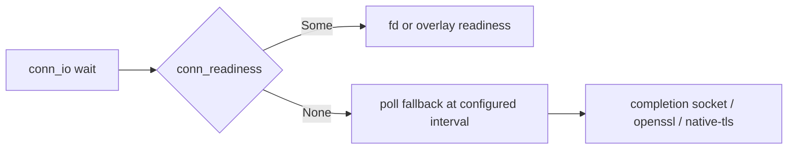

# Feature 37: Readiness for the completion socket and openssl/native-tls

_Written in ASD-STE100 Simplified Technical English (STE). Code and identifiers stay as they
are._

**Abbreviations in this file.** file descriptor (fd); Transport Layer Security (TLS);
remote procedure call (RPC); pull request (PR); AeroSpace and Defence Industries
Association of Europe (ASD), the owner of the STE standard ASD-STE100.

Use the shared protocol in [`requirements.md`](../../requirements.md) sections 3 and 4.

## T0. Confirm the backlog entry is still open

- **Where:** `foundation_netio/src/native/connection.rs` `Connection::conn_readiness` (line
  1421) returns `None` for the openssl/native-tls `Tls` arm (lines 1428–1432, when rustls is
  off) and for `Completion` (line 1433). The driver
  `foundation_connectrpc/src/native/conn_io.rs` then answers `Unsupported`:
  `ready_now` (line 122) and `gone_now` (line 130) return `Err(Self::unsupported())` when
  `readiness`/`fd_ready` is `None`.
- **Confirm:** read both files and note the `conn_readiness` doc comment (lines 1416–1418)
  already promises "the driver then uses a configured poll fallback", but the driver does
  not. The entry is still open.

## E1. Give `conn_io` a configured poll-interval fallback

- **Where:** `foundation_connectrpc/src/native/conn_io.rs` `ready_now` (line 122), `gone_now`
  (line 130), `register` (line 143), `register_hangup` (line 172); and the timeouts config
  `foundation_connectrpc/src/native/server.rs` `ServeTimeouts` (line 65).
- **Fix:** when `conn_readiness()` is `None`, do not error. Poll the transport at a
  configured interval instead: `ready_now` returns "not ready yet" and the wait future
  re-polls through the valtron timer at that interval; `gone_now` polls the underlying fd
  (available through `Connection::as_raw_fd`, `connection.rs` line 1526) for close/error.
  Add a `poll_fallback_interval: Duration` field to `ServeTimeouts` with a builder method and
  a documented default (rule 8). Name the source: the existing `POLL_DELAY` of 10 ms in
  `foundation_connectrpc/src/native/transport/h2.rs` (line 39), or the 1 ms `IDLE_POLL` in
  `foundation_netio/src/quic/quinn_driver.rs` (line 57) — pick one and say which in the doc
  comment. Keep the valtron timer as the re-poll wake (native-only; never a spin).
- **Tests:** `foundation_connectrpc/tests/` (registered in `tests/**/mod.rs`):
  `conn_io_fallback_polls_instead_of_unsupported` — a transport whose `conn_readiness()`
  returns `None`; the `IoReady` wait completes (rather than failing `Unsupported`) once the
  peer sends, within the timeout. `conn_io_fallback_interval_is_config` — the interval reads
  back from a non-default `ServeTimeouts`. Use the deterministic mock transport, no real
  network.

## E2. Decide per transport: wire real readiness or keep the fallback

- **Where:** `foundation_netio/src/native/connection.rs` `conn_readiness` (line 1421).
- **Fix:** record a decision in the PR body for each remaining transport.
  1. **openssl / native-tls** (`SplitOpenSslStream`, `NativeTlsStream`). They expose
     `as_raw_fd()`, but only the rustls stream implements `TlsInterest`
     (`foundation_netio/src/native/ssl/rustls.rs` line 382). Option A: implement
     `TlsInterest` for both and return `Fd(fd, Some(interest))`, restoring the TLS-corrected
     direction. Option B: keep the E1 fallback. Choose A if the TLS state machine exposes
     `want_read`/`want_write` cheaply; otherwise B.
  2. **io_uring completion socket** (`Connection::Completion`,
     `Box<dyn CompletionReadWrite>`). It has an fd, but in completion mode `read` pops the
     inbox and `is_kernel_read()` is true (`foundation_iogate/src/native/completion_socket.rs`
     line 408), so the kernel already drained the socket: polling the fd does not reflect
     inbox contents. Option A: keep the E1 fallback (the documented, correct choice here).
     Option B: a new inbox-driven readiness signal, which is a larger design. Prefer A unless
     the fallback proves too slow in practice.
- **Tests:** for each transport wired in option 1A, add a test that readiness reports the
  corrected direction during a handshake (mirror the rustls tests in
  `foundation_netio/tests/`). If you keep the fallback, the E1 tests cover it.



## Verification (run exactly)

```bash
export CARGO_PROFILE_DEV_DEBUG=0 CARGO_INCREMENTAL=0
python3 scripts/ci/ci.py run foundation_connectrpc --profile dev
python3 scripts/ci/ci.py run foundation_netio --profile dev
python3 scripts/ci/ci.py run foundation_iogate --profile dev
cargo check --workspace --all-targets --profile dev
```

## Done when

- [ ] `conn_io` no longer returns `Unsupported` for the completion socket and the
      openssl/native-tls backends.
- [ ] The poll interval is a config field with a named default (rule 8).
- [ ] The E1 tests pass, and the E2 decision is recorded in the PR body.
- [ ] The backlog entry (and the matching §2 "remaining transports" sub-entry, if it is the
      last one) is deleted.
- [ ] CI green.

## Review checklist (main session)

- [ ] The E2 decision per transport is written in the PR body, with the trade-off.
- [ ] The fallback parks on the valtron timer; it never spins.
- [ ] `is_kernel_read()` was considered for the completion socket (fd poll is wrong for
      inbox reads).
- [ ] No hard-coded poll interval remains in the code path (rule 8).
