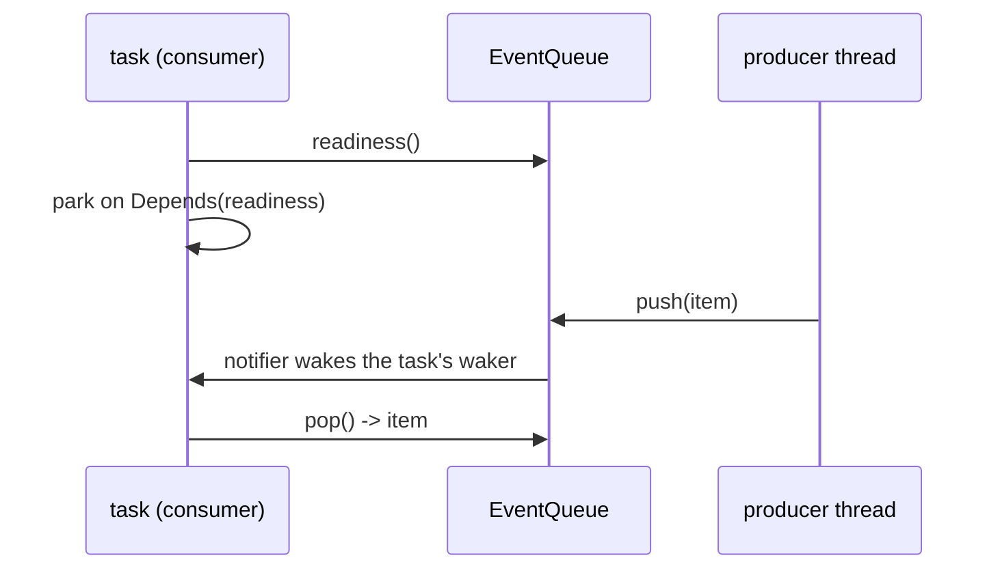

# Feature 81: lane B crates on valtron's wake constructs

_Written in ASD-STE100 Simplified Technical English (STE). Code and identifiers stay as they are. Follow [requirements.md](../../requirements.md) sections 3, 4 and 8._

Depends on feature 80 (lane A), which adds the event queue and makes the executor wake private
to valtron (owner rule 2026-11-04: executor wake does not leak out of valtron).

## Sites (audit 2026-11-04)

Raw queues with `QueueReadiness::new` / `QueueVacancyReadiness::new` or `BoolSignal` raw access:
`foundation_toolings` `src/builder/mod.rs` (2), `src/watcher/mod.rs` (1), `src/runner/mod.rs`
(1); `foundation_ai` `src/agentic/steering.rs` (2); `foundation_wasm` `src/base.rs` (3) and
`integration/module/src/lib.rs` (3); `foundation_wasm_ui` `integration/module/src/lib.rs` (2).
Re-grep at start; convert every site found.

## Re-grep (2026-11-05, main session, branch `fix/io-51-60-lane-b`)

The re-grep found **six** live polling-readiness sites, all in `foundation_toolings` and
`foundation_ai`. The `foundation_wasm` and `foundation_wasm_ui` hits in the 2026-11-04 audit
are gone: `clone_inner()` there returns a DOM handle id, not a `BoolSignal`, and no working
tree contains a raw `BoolSignal` access. Re-run this command to confirm:

```sh
grep -rn "QueueReadiness::new\|QueueVacancyReadiness::new" --include='*.rs' backends
```

| File:line | Today | Change |
|---|---|---|
| `foundation_toolings/src/watcher/mod.rs:63` | `FileChangeEventPump` holds `Arc<ConcurrentQueue<FileChange>>` plus `QueueReadiness::new` | Hold `EventQueue<FileChange>`; `push` calls `EventQueue::push`; `ready` becomes `queue.readiness()` |
| `foundation_toolings/src/runner/mod.rs:83` | `BinaryRunnerTask` holds `build_queue` and `build_ready = QueueReadiness::new(...)` | Hold `EventQueue<()>`; `readiness()` returns `Arc::new(self.build_queue.clone().readiness())` in the `Idle` and `Running` states |
| `foundation_toolings/src/builder/mod.rs:70` | `change_ready: QueueReadiness::new(change_queue)` | `change_queue: EventQueue<FileChange>`; `change_ready` removed, `readiness()` calls `change_queue.readiness()` |
| `foundation_toolings/src/builder/mod.rs:72` | `result_ready: QueueReadiness::new(result_queue)` | Same for `result_queue: EventQueue<BuildResult>` |
| `foundation_ai/src/agentic/steering.rs:169` | `priority_readiness` wraps `QueueReadiness::new(self.priority.clone())` | `priority: EventQueue<Messages>`; `priority_readiness` returns `Arc::new(self.priority.readiness())` |
| `foundation_ai/src/agentic/steering.rs:176` | `followup_readiness` wraps `QueueReadiness::new(self.follow_up.clone())` | Same for `follow_up: EventQueue<Messages>` |

`EventQueue<T>` (feature 80, `foundation_core::valtron::readiness_wake`) has `push`, `pop`,
`close`, `readiness()` and `vacancy()`; each one wakes the parked task, so no caller adds a
wake call.


_One line: the queue wakes the parked consumer; the producer never calls the executor._

### Public API and version bumps

`foundation_ai::agentic::steering::SteeringQueues` exposes `pub priority` and `pub follow_up`
as `Arc<ConcurrentQueue<Messages>>`. The change makes them `EventQueue<Messages>`, so it is a
public API change: bump `foundation_ai`, and every crate whose `Cargo.toml` requires it, in the
same commit. The `foundation_toolings` fields are private, so no bump is needed there.

### Delete the deprecated constructors

`QueueReadiness::new`, `QueueReadiness::event_driven`, `QueueVacancyReadiness::new` and
`QueueVacancyReadiness::event_driven` in `foundation_core/src/valtron/task.rs` are deprecated
(since 0.0.7, feature 80). After the six sites move, the only user is the test
`tests/valtron/event_driven_queue_readiness.rs:147` (`queue_readiness_new_keeps_polling_for_raw_pushers`),
which tests the polling behaviour of the constructor itself. Delete that test together with the
constructors; keep the `with_notifier` paths that `EventQueue` uses.

### Tests

- `foundation_toolings`: one test per converted pump (watcher, builder change queue, builder
  result queue, runner build queue) that parks a task on the readiness with
  `#[valtron_test(threads = 2, timeout = 2_000)]`, pushes from another thread, and asserts the
  task wakes in well under the poll quantum, with a readiness-check count bound of 3 (feature
  77 check-count bound).
- `foundation_ai`: one test that a task parked on `priority_readiness` wakes on
  `push_priority` (same bound), and the same for `followup_readiness`.
- Every existing test of the four crates still passes.

### Verify

```sh
cargo test --profile uat -p foundation_toolings
cargo test --profile uat -p foundation_ai
cargo test --profile uat -p foundation_core --features multi --test mod
cargo fmt -p foundation_toolings -p foundation_ai -p foundation_core --check
```

Then `scripts/ci/linux.sh foundation_toolings` and `scripts/ci/linux.sh foundation_ai`, and the
pull request's GitHub CI.

## Work

- Move each site to valtron's event queue (producer `push`/`close`, consumer `readiness()`)
  or `ResumeSignal`. No site calls the executor wake.
- Then delete the deprecated raw-queue readiness constructors in `foundation_core` if feature
  80 left them for this feature (coordinate through the main session; that file is lane A's).
- Tests: per crate, the existing tests pass; add one test per converted producer that a
  parked consumer wakes promptly (check-count bound from feature 77).

### Result (2026-11-05)

- All six sites use `EventQueue`; the re-grep returns nothing, and no lane B crate calls the
  executor wake. The four deprecated constructors and the test
  `queue_readiness_new_keeps_polling_for_raw_pushers` are deleted.
- `SteeringQueues` fields are `EventQueue<Messages>`, as planned. Both readiness methods also
  change their return type to `EventReadinessPtr`: the old `Arc<dyn EventReadiness>` cannot
  go into `TaskStatus::Depends` under `multi`, so the method did not compile for its caller.
- `foundation_toolings` bumps to 0.0.4, although this plan said no bump was needed. The
  struct fields are private, but `ProjectBuilderTask::new`, `BinaryRunnerTask::new` and the
  public `FileChangeEventPump.queue` field changed type. Both consumers (`bin/platform`,
  `examples/devbinary`) require the new version.
- The readiness check bound is 4, not 3: the executor checks twice before the park (once on
  its own, once after it registers the waker) and twice when the wake releases the task. A
  bound of 3 fails every run. A 1 ms re-check makes about 200 checks over the same park, so
  the bound still separates the two behaviours.
- The wake tests hold the push-to-run delay under 100 ms and log it. The 1 ms figure in this
  plan is not assertable: the first Linux container run measured 19.4 ms with 4 checks, so
  the delay measures thread scheduling. The check count is the proof (see
  [learnings](../../learnings.md)).
- Warnings cleared in `foundation_toolings` (8 clippy lints, one unused import, two unused
  dependencies), because the zero-warning rule applies to every crate the change touches.

## Done when

- [ ] No lane B crate uses a raw queue with polling readiness or touches the executor wake;
  the deprecated constructors are gone; CI green.
