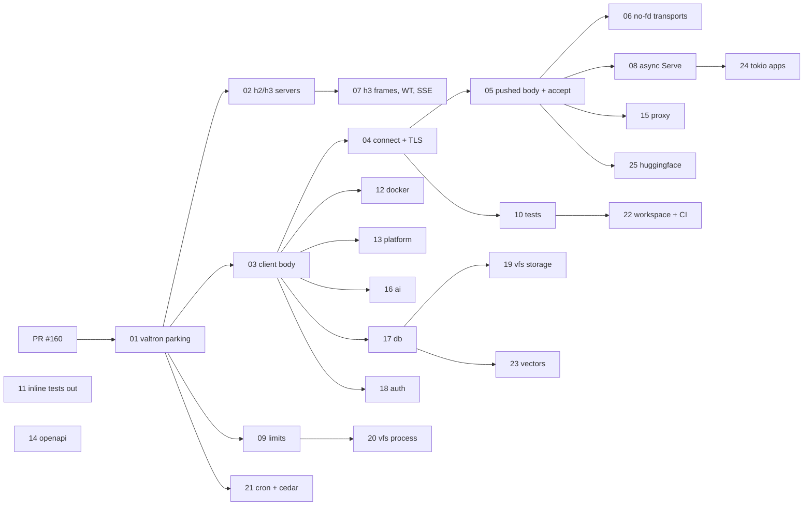

# Spec 70: Foundational I/O hardening

_Written in ASD-STE100 Simplified Technical English (STE). Code and identifiers stay as they
are._

**Abbreviations in this file.** input/output (I/O); file descriptor (fd); Transport Layer
Security (TLS); Hypertext Transfer Protocol version 1.1, 2 and 3 (HTTP/1.1, HTTP/2,
HTTP/3); QUIC, the transport under HTTP/3 (a name, not an abbreviation); WebTransport over
HTTP/3 (WebTransport); Server-Sent Events (SSE); continuous integration (CI); pull request
(PR); AeroSpace and Defence Industries Association of Europe (ASD), the owner of the STE
standard ASD-STE100.

## 1. Why this spec exists

Every service in this workspace sits on five crates: `foundation_core` (valtron),
`foundation_netio`, `foundation_http`, `foundation_connectrpc` and `foundation_iogate`
(plus `foundation_nostd` on wasm). The owner made their open bugs **top priority**: they are
foundational, so everything built on top inherits them.

PR #160 verified every backlog entry in sections 1–5 of `docs/bug-backlog.md` against master
and fixed the correctness bugs. What is left is in three groups:

1. **Readiness.** Code that polls on a timer, spins, or holds a worker thread while it waits
   for a socket, a queue or another thread. Valtron can park a task until something wakes it
   (`TaskStatus::Depends`, wake registries, the shared reactor). The code must use that.
2. **Limits as configuration** (`CLAUDE.md` rule 8). Hard-coded sizes, times and counts.
3. **Tests.** Ignored tests, ignored doc examples, missing test variants, and inline
   `#[cfg(test)]` modules in source files (`CLAUDE.md` rule 7).

Features 01–11 cover those five crates. **Features 12–25 cover every other section of the
backlog (6–21)**, plus four bugs recorded only on unmerged branches: the `TokenSigner`
compare (PR #157's branch), and `BlobStore` whole objects, `QueryStore` batch without
parameters and D1 `read_replication` (PR #158's branch). Each entry has a place in one feature
file. When a feature merges, its entries leave the backlog. No entry is left without a feature.

## 2. How the work is done (delegation model)

The owner asked for this model to manage usage:

- **The main session designs and reviews.** It wrote this spec. For each feature it starts one
  Sonnet 5.5 agent, gives it the feature file, and reviews the result against the feature's
  "Done when" list and "Review checklist" before the PR goes to the owner.
- **A Sonnet 5.5 agent implements one feature at a time.** It follows the feature file exactly:
  the tasks, the tests to write, the commands to run. It does not change the design. If the
  design does not fit the code, it stops and reports why, with the evidence. It does not guess.
- **One agent runs at a time.** Builds share one target directory and the disk is small.

## 3. Rules for every feature

These come from `CLAUDE.md` and `.agents/AGENTS.md`. Read both before you start.

1. **valtron always.** Never tokio. The only exception is valtron's own cross-runtime tests
   (`foundation_core/tests/valtron/cross_runtime.rs`).
2. **Tests live in the crate's `tests/` directory**, registered in its `tests/**/mod.rs`. Never
   add `#[cfg(test)] mod tests` to a source file.
3. **A regression test first.** For every bug fix, write the test, run it, and see it fail
   (or hang until its timeout) on the old code. Then fix. Then see it pass. Write the
   before/after result in the PR body.
4. **Never skip, ignore or disable a test** to get green. Never lower a timeout to hide a hang.
5. **Limits are configuration** with a builder method and a documented default that names its
   source (nginx, Go `net/http`, Caddy, the RFC).
6. **Stream bodies, never buffer them.**
7. **Every bug you notice goes in `docs/bug-backlog.md`** in the same change. Delete an entry
   in the PR that fixes it.
8. **Async all the way.** Blocking only at real boundaries, behind `blocking_boundary!`.

## 4. Deterministic verification protocol

Every feature names its exact commands. These hold for all of them.

```bash
# Build settings that fit the disk. Always set them.
export CARGO_PROFILE_DEV_DEBUG=0 CARGO_INCREMENTAL=0

# Per crate you change: fmt, build, clippy, tests, and wasm where the crate has it.
python3 scripts/ci/ci.py run <crate> --profile dev

# Whole workspace, before every push.
cargo check --workspace --all-targets --profile dev

# Flake check for every NEW or CHANGED test: 20 runs in a row, each with a hard time limit.
for i in $(seq 1 20); do
  timeout 300 cargo test -p <crate> --profile dev --test <test_binary> <test_name> -- --exact \
    || { echo "FAILED on run $i"; exit 1; }
done
```

- A test that can hang must have a time limit inside the test (`#[valtron_test(timeout = …)]`
  or an explicit deadline), so a hang is a failure, not a stuck CI job.
- "Passes 20 runs in a row" is the minimum for any test that involves threads, sockets or
  timing. Report the count in the PR body.
- Run commands one at a time. Check `df -h /home/user` before a large build. Free space only
  with `cargo clean -p <package>`. Never delete hash directories in `target/` by hand.

## 5. Features

| # | Feature | Backlog entries | Depends on | Size |
|---|---|---|---|---|
| 01 | [Valtron parking: `ThreadedIterFuture`, first empty pull](./features/01-valtron-parking/feature.md) | §4 busy-poll, first-pull | PR #160 | M |
| 02 | [HTTP/2 and HTTP/3 servers park on readiness](./features/02-h2-h3-server-readiness/feature.md) | §2 QUIC waker, §3 h2 timer, §3 H3 accept delay | 01 | M |
| 03 | [Client body reads park on readiness](./features/03-client-body-readiness/feature.md) | §2 `AsyncSendSafeBody`, would-block reporting | 01 | M |
| 04 | [Non-blocking connect and TLS handshake](./features/04-nonblocking-connect-tls/feature.md) | §2 task #23 | 03 | L |
| 05 | [Pushed request body and the accept loop park on readiness](./features/05-push-body-and-accept/feature.md) | §2 task #24, §3 accept loop | 04 | M |
| 06 | [Readiness for transports without a pollable fd](./features/06-transports-without-fd/feature.md) | §1 no pollable fd, §2 task #25 | 05 | L |
| 07 | [HTTP/3 frame cap and streaming, WebTransport session, wasm SSE errors](./features/07-http3-webtransport-sse/feature.md) | §2 `FramedRecv`, WebTransport CONNECT, wasm SSE | 02 | M |
| 08 | [Async `Serve` for long-lived HTTP/1.1 handlers](./features/08-async-serve/feature.md) | §1 HTTP/1.1 holds a worker | 05 | L |
| 09 | [Limits as configuration](./features/09-limits-as-config/feature.md) | §4 constants, `BackgroundJobRegistry`, `BytesPool`, `BatchReader` log, §5 `SpinWaiter` | 01 | M |
| 10 | [Hermetic tests, doc examples, 8-thread conformance](./features/10-tests-hermetic/feature.md) | §1 conformance, §2 ignored tests and doc examples | 04 | M |
| 11 | [Inline tests out of source files](./features/11-inline-tests-out/feature.md) | `CLAUDE.md` rule 7 (24 files) | — | M |
| 12 | [Docker deployment: generated types, JSON cap, CI, log decoder](./features/12-docker-deployment/feature.md) | §6 (4) | 03 | M |
| 13 | [Deployment platform: stdout wait, daemon ping, Vagrant client](./features/13-deployment-platform/feature.md) | §7, §9 Docker helper | 03 | M |
| 14 | [OpenAPI codegen: query params, D1 read replication](./features/14-openapi-codegen/feature.md) | §8, PR #158 D1 `read_replication` | — | M |
| 15 | [Proxy: health probes, state race, ACME, redirects](./features/15-proxy/feature.md) | §9 (6) | 05 | L |
| 16 | [AI: async generate and embed, capped error bodies, flush](./features/16-ai/feature.md) | §10 (9) | 03 | L |
| 17 | [DB: StateStore keys, typed R2, streamed blobs, batches](./features/17-db/feature.md) | §11 (9), PR #158 `BlobStore` and batch, §16 db warnings | 03 | L |
| 18 | [Auth: proof of work, constant-time tags, streamed bodies](./features/18-auth/feature.md) | §12 (10), PR #157 `TokenSigner` | 03 | L |
| 19 | [VFS storage: blob deltas, Turso delta, lazy scans, NFS](./features/19-vfs-storage/feature.md) | §13 (10 of 18), #142 | 17 | L |
| 20 | [VFS process side: preload shim, FUSE CI, async IPC, searchers](./features/20-vfs-process-ipc/feature.md) | §13 (8 of 18) | 09 | L |
| 21 | [Cron jobs run on their expression; cedar loads in one query](./features/21-cronjobs-cedar/feature.md) | §14, §15 | 01 | M |
| 22 | [Workspace and CI: target dirs, ewe_deployables, crate split, wasm tests in CI](./features/22-workspace-ci/feature.md) | §16 (8), §21, #28 | 10 | L |
| 23 | [Vectors: fjall off the worker, sqlite-vec, TurboPuffer retry](./features/23-vectors/feature.md) | §17 (8) | 01, 17 | M |
| 24 | [Last tokio runtimes: testbed JS runner and apps](./features/24-tokio-boundaries-apps/feature.md) | §18, §19, #137 | 08 | L |
| 25 | [Hugging Face: async Hub client, streamed uploads, pagination](./features/25-huggingface/feature.md) | §20 (3) | 03, 05 | M |

Order: 01 → 02 → 03 → 04 → 05 → 06, and 07, 08, 09, 10 after their dependencies. 11 has no
dependency and can run whenever no other agent is building.

Priority for 12–25: **18 (auth) first**, because E1 and E2 are security bugs. Then 17, 15, 21,
22 and 16. Then the rest in number order, after their dependencies. One agent at a time.



_The diagram shows which feature must finish before another starts._

## 6. Branches and pull requests

- One branch and one PR per feature: `fix/io-NN-<slug>` (for example `fix/io-01-valtron-parking`).
- Base: `master` once PR #160 is merged. Until then, base on `fix/foundational-backlog` and say
  so in the PR body.
- Features 01 and 02 start from commits that already exist on `fix/foundational-readiness`
  (see each feature file). Bring them in with `git cherry-pick`, then finish them.
- Merge `master` in with a merge commit when needed. Never rebase a pushed branch. Never
  force-push.
- Commit messages end with the two attribution lines from the session instructions.

## 7. Done for the whole spec

- [ ] Every entry in `docs/bug-backlog.md` sections 1–21 (and the four branch-only bugs in §1)
      is fixed and deleted, or rewritten with a reason and a follow-up feature.
- [ ] Issues #28, #137 and #142 can be closed.
- [ ] `rg -n 'thread::sleep|yield_now|spin_loop' backends/foundation_{core,netio,http,connectrpc,iogate}/src`
      returns only waits that sit behind `blocking_boundary!` or that the feature files name as
      allowed, each with a comment that says why.
- [ ] No `#[ignore]` in `foundation_netio/tests` without a written reason and a backlog entry.
- [ ] No `#[cfg(test)]` module in the source files of these crates.
- [ ] CI green on every feature PR.
