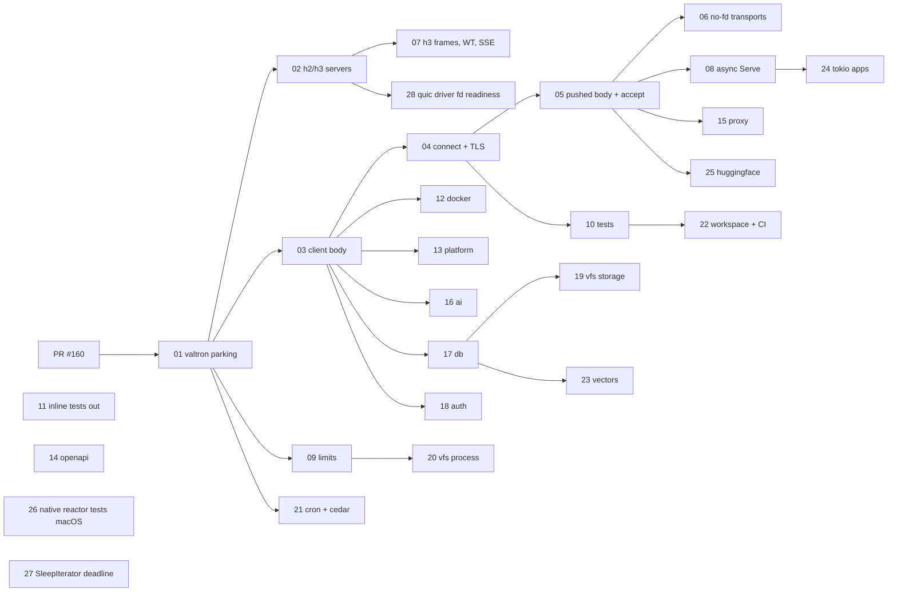

# Spec 70: Foundational I/O hardening

_Written in ASD-STE100 Simplified Technical English (STE). Code and identifiers stay as they
are._

**Abbreviations in this file.** input/output (I/O); file descriptor (fd); Transport Layer
Security (TLS); Hypertext Transfer Protocol version 1.1, 2 and 3 (HTTP/1.1, HTTP/2,
HTTP/3); QUIC, the transport under HTTP/3 (a name, not an abbreviation); WebTransport over
HTTP/3 (WebTransport); Server-Sent Events (SSE); continuous integration (CI); pull request
(PR); AeroSpace and Defence Industries Association of Europe (ASD), the owner of the STE
standard ASD-STE100.

## 1. Why this spec exists

Every service in this workspace sits on five crates: `foundation_core` (valtron),
`foundation_netio`, `foundation_http`, `foundation_connectrpc` and `foundation_iogate`
(plus `foundation_nostd` on wasm). The owner made their open bugs **top priority**: they are
foundational, so everything built on top inherits them.

PR #160 verified every backlog entry in sections 1–5 of `docs/bug-backlog.md` against master
and fixed the correctness bugs. What is left is in three groups:

1. **Readiness.** Code that polls on a timer, spins, or holds a worker thread while it waits
   for a socket, a queue or another thread. Valtron can park a task until something wakes it
   (`TaskStatus::Depends`, wake registries, the shared reactor). The code must use that.
2. **Limits as configuration** (`CLAUDE.md` rule 8). Hard-coded sizes, times and counts.
3. **Tests.** Ignored tests, ignored doc examples, missing test variants, and inline
   `#[cfg(test)]` modules in source files (`CLAUDE.md` rule 7).

Features 01–11 cover those five crates. **Features 12–25 cover every other section of the
backlog (6–21)**, plus four bugs recorded only on unmerged branches: the `TokenSigner`
compare (PR #157's branch), and `BlobStore` whole objects, `QueryStore` batch without
parameters and D1 `read_replication` (PR #158's branch). Each entry has a place in one feature
file. When a feature merges, its entries leave the backlog. No entry is left without a feature.

## 2. How the work is done (delegation model)

The owner asked for this model to manage usage:

- **The main session designs and reviews.** It wrote this spec. For each feature it starts one
  Sonnet 5.5 agent, gives it the feature file, and reviews the result against the feature's
  "Done when" list and "Review checklist" before the PR goes to the owner.
- **A Sonnet 5.5 agent implements one feature at a time.** It follows the feature file exactly:
  the tasks, the tests to write, the commands to run. It does not change the design. If the
  design does not fit the code, it stops and reports why, with the evidence. It does not guess.
- **One agent runs at a time.** Builds share one target directory and the disk is small.

## 3. Rules for every feature

These come from `CLAUDE.md` and `.agents/AGENTS.md`. Read both before you start.

1. **valtron always.** Never tokio. The only exception is valtron's own cross-runtime tests
   (`foundation_core/tests/valtron/cross_runtime.rs`).
2. **Tests live in the crate's `tests/` directory**, registered in its `tests/**/mod.rs`. Never
   add `#[cfg(test)] mod tests` to a source file.
3. **A regression test first.** For every bug fix, write the test, run it, and see it fail
   (or hang until its timeout) on the old code. Then fix. Then see it pass. Write the
   before/after result in the PR body.
4. **Never skip, ignore or disable a test** to get green. Never lower a timeout to hide a hang.
5. **Limits are configuration** with a builder method and a documented default that names its
   source (nginx, Go `net/http`, Caddy, the RFC).
6. **Stream bodies, never buffer them.**
7. **Every bug you notice goes in `docs/bug-backlog.md`** in the same change. Delete an entry
   in the PR that fixes it.
8. **Async all the way.** Blocking only at real boundaries, behind `blocking_boundary!`.

## 4. Deterministic verification protocol

Every feature names its exact commands. These hold for all of them.

```bash
# Build settings that fit the disk. Always set them.
export CARGO_PROFILE_DEV_DEBUG=0 CARGO_INCREMENTAL=0

# Per crate you change: fmt, build, clippy, tests, and wasm where the crate has it.
python3 scripts/ci/ci.py run <crate> --profile dev

# Whole workspace, before every push.
cargo check --workspace --all-targets --profile dev

# Flake check for every NEW or CHANGED test: 20 runs in a row, each with a hard time limit.
for i in $(seq 1 20); do
  timeout 300 cargo test -p <crate> --profile dev --test <test_binary> <test_name> -- --exact \
    || { echo "FAILED on run $i"; exit 1; }
done
```

- A test that can hang must have a time limit inside the test (`#[valtron_test(timeout = …)]`
  or an explicit deadline), so a hang is a failure, not a stuck CI job.
- "Passes 20 runs in a row" is the minimum for any test that involves threads, sockets or
  timing. Report the count in the PR body.
- Run commands one at a time. Check `df -h /home/user` before a large build. Free space only
  with `cargo clean -p <package>`. Never delete hash directories in `target/` by hand.

## 5. Features

| # | Feature | Backlog entries | Depends on | Size |
|---|---|---|---|---|
| 01 | [Valtron parking: `ThreadedIterFuture`, first empty pull](./features/01-valtron-parking/feature.md) | §4 busy-poll, first-pull | PR #160 | M |
| 02 | [HTTP/2 and HTTP/3 servers park on readiness](./features/02-h2-h3-server-readiness/feature.md) | §2 QUIC waker, §3 h2 timer, §3 H3 accept delay | 01 | M |
| 03 | [Client body reads park on readiness](./features/03-client-body-readiness/feature.md) | §2 `AsyncSendSafeBody`, would-block reporting | 01 | M |
| 04 | [Non-blocking connect and TLS handshake](./features/04-nonblocking-connect-tls/feature.md) | §2 task #23 | 03 | L |
| 05 | [Pushed request body and the accept loop park on readiness](./features/05-push-body-and-accept/feature.md) | §2 task #24, §3 accept loop | 04 | M |
| 06 | [Readiness for transports without a pollable fd](./features/06-transports-without-fd/feature.md) | §1 no pollable fd, §2 task #25 | 05 | L |
| 07 | [HTTP/3 frame cap and streaming, WebTransport session, wasm SSE errors](./features/07-http3-webtransport-sse/feature.md) | §2 `FramedRecv`, WebTransport CONNECT, wasm SSE | 02 | M |
| 08 | [Async `Serve` for long-lived HTTP/1.1 handlers](./features/08-async-serve/feature.md) | §1 HTTP/1.1 holds a worker | 05 | L |
| 09 | [Limits as configuration](./features/09-limits-as-config/feature.md) | §4 constants, `BackgroundJobRegistry`, `BytesPool`, `BatchReader` log, §5 `SpinWaiter` | 01 | M |
| 10 | [Hermetic tests, doc examples, 8-thread conformance](./features/10-tests-hermetic/feature.md) | §1 conformance, §2 ignored tests and doc examples | 04 | M |
| 11 | [Inline tests out of source files](./features/11-inline-tests-out/feature.md) | `CLAUDE.md` rule 7 (24 files) | — | M |
| 12 | [Docker deployment: generated types, JSON cap, CI, log decoder](./features/12-docker-deployment/feature.md) | §6 (4) | 03 | M |
| 13 | [Deployment platform: stdout wait, daemon ping, Vagrant client](./features/13-deployment-platform/feature.md) | §7, §9 Docker helper | 03 | M |
| 14 | [OpenAPI codegen: query params, D1 read replication](./features/14-openapi-codegen/feature.md) | §8, PR #158 D1 `read_replication` | — | M |
| 15 | [Proxy: health probes, state race, ACME, redirects](./features/15-proxy/feature.md) | §9 (6) | 05 | L |
| 16 | [AI: async generate and embed, capped error bodies, flush](./features/16-ai/feature.md) | §10 (9) | 03 | L |
| 17 | [DB: StateStore keys, typed R2, streamed blobs, batches](./features/17-db/feature.md) | §11 (9), PR #158 `BlobStore` and batch, §16 db warnings | 03 | L |
| 18 | [Auth: proof of work, constant-time tags, streamed bodies](./features/18-auth/feature.md) | §12 (10), PR #157 `TokenSigner` | 03 | L |
| 19 | [VFS storage: blob deltas, Turso delta, lazy scans, NFS](./features/19-vfs-storage/feature.md) | §13 (10 of 18), #142 | 17 | L |
| 20 | [VFS process side: preload shim, FUSE CI, async IPC, searchers](./features/20-vfs-process-ipc/feature.md) | §13 (8 of 18) | 09 | L |
| 21 | [Cron jobs run on their expression; cedar loads in one query](./features/21-cronjobs-cedar/feature.md) | §14, §15 | 01 | M |
| 22 | [Workspace and CI: target dirs, ewe_deployables, crate split, wasm tests in CI](./features/22-workspace-ci/feature.md) | §16 (8), §21, #28 | 10 | L |
| 23 | [Vectors: fjall off the worker, sqlite-vec, TurboPuffer retry](./features/23-vectors/feature.md) | §17 (8) | 01, 17 | M |
| 24 | [Last tokio runtimes: testbed JS runner and apps](./features/24-tokio-boundaries-apps/feature.md) | §18, §19, #137 | 08 | L |
| 25 | [Hugging Face: async Hub client, streamed uploads, pagination](./features/25-huggingface/feature.md) | §20 (3) | 03, 05 | M |
| 26 | [Native reactor tests compile and run on macOS](./features/26-native-reactor-test-portability/feature.md) | §13 macOS `pipe2`/`/proc` | — | S |
| 27 | [`SleepIterator` returns `Done` for a reached deadline](./features/27-valtron-sleep-iterator/feature.md) | §4 zero-duration deadline | — | S |
| 28 | [QUIC driver parks on its UDP socket](./features/28-quic-driver-fd-readiness/feature.md) | §2 QUIC driver 1 ms poll | 02 | M |
| 29 | [Client body reader reaches a Waker-capable readiness source](./features/29-client-reactor-bridge/feature.md) | §2 client body reader cannot reach the reactor | 02 | M |
| 30 | [Remaining valtron limits become configuration](./features/30-remaining-valtron-limits/feature.md) | §4 limits | — | S |
| 31 | [Wake-capable shutdown signal](./features/31-wake-capable-shutdown-signal/feature.md) | §3 accept loop | — | S |
| 32 | [Reactor drain poll timeout becomes configuration](./features/32-reactor-drain-timeout-config/feature.md) | §2 reactor | — | S |
| 33 | [QUIC driver wakes on outgoing stream data](./features/33-quic-driver-wake-on-outgoing/feature.md) | §2 QUIC | — | S |
| 34 | [`valtron_test` recursion-depth limit](./features/34-valtron-test-recursion-limit/feature.md) | §4 | — | S |
| 35 | [`TursoStorage::set` async-trait overflow](./features/35-turso-async-trait-overflow/feature.md) | §11 | — | S |
| 36 | [DNS resolution no longer blocks the client task](./features/36-netio-async-dns/feature.md) | §2 | — | S |
| 37 | [Completion sockets stop answering Unsupported](./features/37-completion-socket-readiness/feature.md) | §1 | — | S |
| 38 | [Delete the dead `tls_verification` module](./features/38-netio-tls-verification-dead-module/feature.md) | §2 | — | S |
| 39 | [Pin rustfmt to the CI version](./features/39-rustfmt-version-pin/feature.md) | §16 | — | S |
| 40 | [`OverlayStream.owner` is never read](./features/40-nativeapis-dead-owner/feature.md) | §13 | — | S |
| 41 | [Static file handler: async, streamed, byte-exact](./features/41-static-file-streamed-write/feature.md) | §8 catalogue row 1 (sonnet) | — | M |
| 42 | [Remove netio dead code that spins or sleeps](./features/42-netio-dead-wait-loops/feature.md) | §8 catalogue row 2, 3 (haiku) | — | S |
| 43 | [Docker POST `100 Continue` 2-minute stall](./features/43-docker-expect-continue-stall/feature.md) | §8 catalogue row 4 (sonnet) | — | M |
| 44 | [keychain handlers run as `ConnectionResult::Async`](./features/44-keychain-async-serve/feature.md) | §8 catalogue row 5, 6 (sonnet) | — | M |
| 45 | [proxy relay async; cross-process state; unused feature dep](./features/45-proxy-async-relay/feature.md) | §8 catalogue row 7–9 (sonnet) | — | M |
| 46 | [`DrivenStreamIterator` can park an async consumer](./features/46-driven-stream-async-wake/feature.md) | §8 catalogue row 10 (sonnet) | — | M |
| 47 | [Seven ignored ptrace tests run again](./features/47-ptrace-ignored-tests/feature.md) | §8 catalogue row 11 (sonnet) | — | M |
| 48 | [Two ignored condvar tests run](./features/48-nostd-condvar-ignored-tests/feature.md) | §8 catalogue row 12 (sonnet) | — | M |
| 49 | [Reactor/testbed warnings; docker clippy debt](./features/49-warnings-and-docker-clippy/feature.md) | §8 catalogue row 13–15 (haiku) | — | S |
| 50 | [Inline tests out of lane A crates](./features/50-lane-a-inline-tests/feature.md) | §8 catalogue row 16 (haiku) | — | S |
| 51 | [libsql/Turso: one connection per store, lock for batches](./features/51-sql-batch-lock/feature.md) | §8 catalogue row 17 (sonnet) | — | M |
| 52 | [D1 batch request; generated D1/R2 types](./features/52-d1-batch-and-generated-types/feature.md) | §8 catalogue row 18 (sonnet) | — | M |
| 53 | [Auth leftovers and key rotation](./features/53-auth-leftovers/feature.md) | §8 catalogue row 19 (sonnet) | — | M |
| 54 | [Vendored patches reach published users; fp16](./features/54-vendored-patches-and-fp16/feature.md) | §8 catalogue row 20, 21 (sonnet) | — | M |
| 55 | [Generator rustfmt, clippy debt, Cloudflare wasm deps](./features/55-generator-hygiene/feature.md) | §8 catalogue row 22–24 (haiku) | — | S |
| 56 | [db and vectors leftovers](./features/56-db-vectors-leftovers/feature.md) | §8 catalogue row 25, 26 (haiku) | — | S |
| 57 | [channels and domain fixes](./features/57-channels-domain/feature.md) | §8 catalogue row 27 (haiku) | — | S |
| 58 | [todo example, web-app template, vms lint](./features/58-examples-templates-ci/feature.md) | §8 catalogue row 28 (haiku) | — | S |
| 59 | [Inline tests out of lane B crates](./features/59-lane-b-inline-tests/feature.md) | §8 catalogue row 29 (haiku) | — | S |
| 60 | [Stale backlog entries and bookkeeping](./features/60-backlog-and-spec-bookkeeping/feature.md) | §8 catalogue row 30 (haiku) | — | S |
| 61 | [Shared response writer; idle send timeout](./features/61-http-shared-response-writer/feature.md) | §8 catalogue rows 32, 33 (sonnet) | 41 | M |
| 62 | [Idle HTTP/2 CPU test is reliable](./features/62-h2-idle-cpu-test/feature.md) | §8 catalogue row 34 (sonnet) | — | S |
| 63 | [Retire the truncating sync `respond::*` path](./features/63-respond-async-migration/feature.md) | §8 catalogue rows 35, 36 (sonnet) | 61, both lanes merged | M |
| 64 | [keychain reads the request body as a bounded stream](./features/64-keychain-streamed-request-body/feature.md) | §8 catalogue row 37 (sonnet) | 44 | S |
| 65 | [Proxy: no thread per connection, no sleep-poll loops](./features/65-proxy-remaining-threads/feature.md) | §8 catalogue rows 43–48 (sonnet) | 45 | L |
| 66 | [Auth: no security stubs; direct session lookup](./features/66-auth-stubs-and-session-lookup/feature.md) | §8 catalogue rows 51–53 (sonnet) | 53 | M |
| 67 | [One error standard: `foundation_errstacks`, no `thiserror`](./features/67-errstacks-error-standard/feature.md) | §8 catalogue rows 54, 55 (sonnet) | both lanes merged | L |
| 68 | [ToS gate at login; bound single-use code; no body user id](./features/68-tos-login-gate/feature.md) | §8 catalogue rows 57, 58 (sonnet) | 66 | M |
| 69 | [Unsolicited 1xx interim responses are skipped](./features/69-unsolicited-interim-responses/feature.md) | §8 catalogue row 59 (haiku) | 43 | S |
| 70 | [Proxy: no polling splice, async io_uring dial, streamed H3 body](./features/70-proxy-completion-and-h3-body/feature.md) | §8 catalogue rows 60–62 (sonnet) | 65 | M |
| 71 | [Cloudflare wasm build, CI clippy enforcement, faster genapi](./features/71-cloudflare-wasm-and-ci-clippy/feature.md) | §8 catalogue rows 64–67 (sonnet) | 55 | M |
| 72 | [H3 request body streamed; io_uring tests fail loudly in CI](./features/72-h3-request-body-and-uring-tests/feature.md) | §8 catalogue rows 68, 69 (sonnet) | 70 | M |
| 73 | [Auth security follow-ups](./features/73-auth-security-followups/feature.md) | §8 catalogue rows 71–76 (sonnet) | 68 | L |
| 74 | [Auth correctness follow-ups; vectors migration](./features/74-auth-correctness-followups/feature.md) | §8 catalogue rows 77–81 (sonnet) | 68 | M |

Order: 01 → 02 → 03 → 04 → 05 → 06, and 07, 08, 09, 10 after their dependencies. 11 has no
dependency and can run whenever no other agent is building.

Priority for 12–25: **18 (auth) first**, because E1 and E2 are security bugs. Then 17, 15, 21,
22 and 16. Then the rest in number order, after their dependencies. One agent at a time.
26 and 27 have no dependency and can run whenever no other agent is building.



_The diagram shows which feature must finish before another starts._

## 6. Branches and pull requests

- One branch and one PR per feature: `fix/io-NN-<slug>` (for example `fix/io-01-valtron-parking`).
- Base: `master` once PR #160 is merged. Until then, base on `fix/foundational-backlog` and say
  so in the PR body.
- Features 01 and 02 start from commits that already exist on `fix/foundational-readiness`
  (see each feature file). Bring them in with `git cherry-pick`, then finish them.
- Merge `master` in with a merge commit when needed. Never rebase a pushed branch. Never
  force-push.
- Commit messages end with the two attribution lines from the session instructions.

## 7. Done for the whole spec

- [ ] Every entry in `docs/bug-backlog.md` sections 1–21 (and the four branch-only bugs in §1)
      is fixed and deleted, or rewritten with a reason and a follow-up feature.
- [ ] Issues #28, #137 and #142 can be closed.
- [ ] `rg -n 'thread::sleep|yield_now|spin_loop' backends/foundation_{core,netio,http,connectrpc,iogate}/src`
      returns only waits that sit behind `blocking_boundary!` or that the feature files name as
      allowed, each with a comment that says why.
- [ ] No `#[ignore]` in `foundation_netio/tests` without a written reason and a backlog entry.
- [ ] No `#[cfg(test)]` module in the source files of these crates.
- [ ] CI green on every feature PR.

## 8. Post-merge features 41–60 (after PR #172)

Spec 70 merged in PR #172. Its review found bugs that were not in `docs/bug-backlog.md`; the
backlog also kept open entries, and entries that are fixed but were never deleted. Features
41–60 cover all of them. Source: R = PR #172 review; B = open backlog entry; S = backlog entry
fixed in code but not deleted.

| # | Bug | Source | Feature |
|---|---|---|---|
| 1 | Static file handler duplicates bytes after a partial write, sleeps on a worker, reads the whole file | R | 41 |
| 2 | `collect_exchange` / `drain_exchange_head` spin on `yield_now` (no callers) | R | 42 |
| 3 | `QuicListener::accept_timeout` polls with 1 ms sleeps; 30 s constant (no callers) | R | 42 |
| 4 | Docker POST with a body stalls 2 minutes on `100 Continue` | B §6 | 43 |
| 5 | keychain `poll_ready` polls once with a no-op waker and panics on `Pending` | B §22 | 44 |
| 6 | keychain bin recursion-depth lint | B §22 | 44 |
| 7 | proxy `forward_http` relays on a throwaway thread and returns `Take` | B §9 | 45 |
| 8 | proxy state lock is per process; two proxies on one store race | R | 45 |
| 9 | proxy `cloudflare` feature has an unused dependency | B §9 | 45 |
| 10 | single-thread `DrivenStreamIterator` cannot park an async consumer | B §4 | 46 |
| 11 | seven ptrace tests ignored for a CI-kernel deadlock, not in the backlog | R | 47 |
| 12 | two `foundation_nostd` condvar tests ignored with a wrong reason | R | 48 |
| 13 | `foundation_reactor` wasm dead code `rearm_readable` | B §16 | 49 |
| 14 | `foundation_testbed` unused `deno_v8` lint | B §16 | 49 |
| 15 | `foundation_deployment_docker` clippy debt | B §8 | 49 |
| 16 | inline `#[cfg(test)]` in lane A crates | R | 50 |
| 17 | libsql and Turso batches share the store's one connection with other operations | R | 51 |
| 18 | D1 batch joins statements into one string; atomicity unproven; hand-written D1/R2 types | R | 52 |
| 19 | auth: dead wasm `session.rs`, `_async` OAuth names, no key id in `TokenSigner`, server clippy not in CI | R, B §12 | 53 |
| 20 | `[patch.crates-io]` does not reach users of published crates | R | 54 |
| 21 | `fullfp16` is an unstable target feature name | B §10 | 54 |
| 22 | Cloudflare per-group shims are not rustfmt-clean | B §8 | 55 |
| 23 | `foundation_openapi` / `foundation_codegentools` clippy debt | B §8 | 55 |
| 24 | `foundation_deployment_cloudflare` wasm unused dependencies | B §21 | 55 |
| 25 | db timestamp units; rate-limit dead code | B §11, §16 | 56 |
| 26 | vectors recursion lint; `code-graph` clippy deny | B §17 | 56 |
| 27 | channels `println!`, constant capacities, `is_closed`; domain capacity | B §18, §19 | 57 |
| 28 | todo example dead code and deps; web-app template dead code; `vms` not linted | B §23, §24, §7 | 58 |
| 29 | inline `#[cfg(test)]` in lane B crates | R | 59 |
| 30 | stale backlog entries (§11 ×4, §16 publish note) | S | 60 |
| 31 | `foundation_connectrpc` clippy debt | B §1 | 49 |
| 32 | `StaticAssetHandler` and `respond::*` truncate responses after a partial write | found in 41 | 61 |
| 33 | feature 41 `write_timeout` is a total deadline; nginx `send_timeout` is idle time | review of 41 | 61 |
| 34 | `idle_h2_connection_uses_no_cpu` flaky (measures the whole process) | found in 41 | 62 |
| 35 | sync `respond::*` still truncates for its remaining callers (proxy, templates, wello, server internals) | found in 61 | 63 |
| 36 | `ResponseWriter::flush` does not restart the idle timer when the stream buffer drains | review of 61 | 63 |
| 37 | keychain `ServeAdapter` reads the whole request body synchronously before the async part | found in 44 | 64 |
| 38 | keychain clippy debt (174) | found in 44 | 49 |
| 39 | D1 non-finite REAL silently stored as NULL | found in 52 | 56 |
| 40 | D1 `/query` response read whole with no cap | found in 52 | 56 |
| 41 | Cloudflare wire-type check takes ~160 s | found in 52 | 55 |
| 42 | hosted D1 REST acceptance of number/null params unproven (needs the owner's Cloudflare account) | found in 52 | 56 E8 (owner decision: local wrangler is the check) |
| 43 | proxy upgrade, TCP tunnel, gRPC-Web/Connect relays still use a thread per connection | found in 45 | 65 |
| 44 | `TcpPassthrough` thread per client; poll sleeps | found in 45 | 65 |
| 45 | proxy thread sleeps in production polling loops | found in 45 | 65 |
| 46 | proxy control socket thread per connection | found in 45 | 65 |
| 47 | proxy upstream request body pulled on a pool worker (unmeasured) | found in 45 | 65 |
| 48 | proxy plain `load` not under the cross-process lock | review of 45 | 65 |
| 49 | proxy clippy and test warnings | found in 45 | 49 |
| 50 | `FileStateStore::set` not atomic | found in 45 | 56 |
| 51 | `TosService::verify_tos_code` always returns true; codes not bound to the user | found in 53 | 66 |
| 52 | `dev_register` has no dev-mode check | found in 53 | 66 |
| 53 | `SessionManager::get_session` scans every session key (stub cache) | found in 53 | 66 |
| 54 | crates declare `foundation_errstacks` but do not use it (wireguard, proxy, shell, html, arrow, sshkit, toolings) | owner rule, found in 54 | 67 |
| 55 | crates still declare `thiserror` (9) | owner rule | 67 |
| 56 | `foundation_boringtun` library still named `boringtun` | owner decision | 54 E4 |
| 57 | login has no ToS gate (spec 48 F02 step 7 / F07 never built) | owner decision, review of 66 | 68 |
| 58 | `tos/accept` records acceptance for any `user_id` in the body, unauthenticated (security) | review of 66 | 68 |
| 59 | no end-to-end test that an unsolicited 1xx is skipped with Expect off (Docker client) | owner question on 43 | 69 |
| 60 | proxy `splice_bidirectional` polling splice used only by a test | found in 65 | 70 |
| 61 | proxy io_uring upstream dial is a blocking connect | found in 65 | 70 |
| 62 | proxy H3 forward collects the whole response body | found in 65 | 70 |
| 63 | `ResponseWriter` idle timer starts at creation | found in 65 | 63 |
| 64 | Cloudflare crates fail the default-feature wasm32 build (native-only deps on wasm) | found in 55 | 71 |
| 65 | `chrono`, `foundation_core` unused on wasm32 (cloudflare) | found in 55 | 71 |
| 66 | clippy warnings do not fail CI | found in 55 | 71 |
| 67 | `genapi generate` runs `cargo fix` on the whole crate (~5 min) | found in 55 | 71 |
| 68 | proxy H3 `read_body` buffers the whole request body; `read_headers`/`read_body` poll on a 1 ms timer | found in 70 | 72 |
| 69 | io_uring tests skip silently when io_uring is missing | found in 70 | 72 |
| 70 | `foundation_iogate` clippy (doc_markdown) | found in 70 | 49 |
| 71 | auth: no atomic take for single-use codes/challenges (security) | found in 68 | 73 |
| 72 | auth: cache has no TTL | found in 68 | 73 |
| 73 | auth: TOTP no enrollment, plain-text secret, replayable codes (security) | found in 68 | 73 |
| 74 | auth: social login open redirect (security) | found in 68 | 73 |
| 75 | auth: logout does not revoke the session | found in 68 | 73 |
| 76 | auth: failed attempts not reset after login | found in 68 | 73 |
| 77 | auth: second user without username gets 500 | found in 68 | 74 |
| 78 | auth: sessions in memory and per route | found in 68 | 74 |
| 79 | auth: dispatch by suffix match in fixed order | found in 68 | 74 |
| 80 | auth: social ToS 206 on a GET redirect | found in 68 | 74 |
| 81 | db: `023_create_vectors.sql` not registered | found in 68 | 74 |

### 8.1 Lanes, branches and models

Two lanes run at the same time. Each lane runs **one agent at a time**, one feature per agent,
in feature order. The model per feature follows its complexity: **Sonnet 5.5** where the work
needs diagnosis or design (concurrency, async control flow, protocol behaviour, security,
generators); **Haiku 5.5** where it is mechanical (deleting dead code, clippy and warning
fixes, moving tests, small config changes). The `model` field in each feature's frontmatter is
the choice.

| Lane | Branch (from `claude/friendly-ritchie-7acn6p`, which is `master` plus these feature files) | Features | Crates the lane owns |
|---|---|---|---|
| A — I/O and runtime | `fix/io-41-50-lane-a` | 41 → 61 → 42 → 43 → 44 → 64 → 45 → 65 → 69 → 70 → 72 → 46 → … → 50 → 62 | foundation_core, foundation_netio, foundation_http, foundation_reactor, foundation_nostd, foundation_nativeapis, foundation_keychain, foundation_proxy, foundation_testbed, foundation_deployment_docker, foundation_deployment, foundation_wireguard, foundation_compact, foundation_iogate, foundation_connectrpc |
| B — data, auth and hygiene | `fix/io-51-60-lane-b` | 60 (first, small) → 51 → 52 → 53 → 66 → 54 → 55 → 68 → 73 → 54 E4 → 71 → 56 → 74 → … → 59, then 60 again | every other crate and directory, the root `Cargo.toml` and `patches/` |

- A lane never edits a crate the other lane owns. If a fix needs that, the agent stops and
  reports to the main session. (Feature 54 may change only the boringtun line of
  `foundation_wireguard/Cargo.toml`.)
- Shared files (`Cargo.lock`, `docs/bug-backlog.md`, `progress.md`, `learnings.md`): on a
  conflict keep both sides.
- One commit or more per feature. One PR per lane at the end, base `master`.
- Features 63 and 67 run after both lane PRs merge, each on its own branch, because they edit
  crates of both lanes.

### 8.2 Rules added for features 41–60

1. **Check first (T0).** Confirm the bug is still open on `master`; write one line in the PR
   body (`open` / `already fixed by <commit>`). If already fixed, delete its backlog entry and
   stop.
2. **Disk.** Two lanes build on one disk (about 14 GB free). Always
   `export CARGO_PROFILE_DEV_DEBUG=0 CARGO_INCREMENTAL=0`; build only the crates you change;
   run `cargo check --workspace --all-targets --profile dev` once, before the PR. If
   `df -h /home/user` shows under 3 GB, `cargo clean -p` crates you finished, then report.
3. **Report** to the main session after each feature: what changed, before/after test results,
   commands and results. The main session reviews against the feature's "Done when" list
   before the next feature starts.
