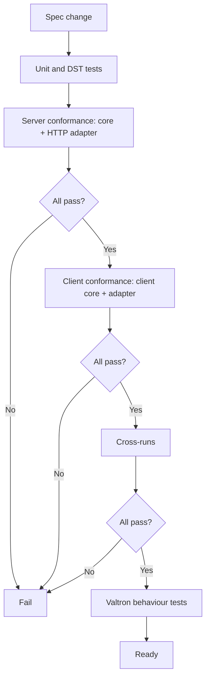

# Feature 08: Conformance

_Written in ASD-STE100 Simplified Technical English (STE). Code and identifiers stay as they
are._

**Abbreviations in this file.** Continuous Integration (CI); Hypertext Transfer Protocol (HTTP);
JavaScript Object Notation (JSON); AeroSpace and Defence Industries Association of Europe (ASD),
the owner of the STE standard ASD-STE100.

## 1. Goal

Prove the core against the reference suites. The server suite runs against the HTTP adapter. The
client suite runs with the Rust adapter. Neither run needs valtron. A failing suite blocks the
merge.

## 2. Requirements

1. **Server suite.** Run the reference server suite against `HttpAdapter` on port 4437, with the
   valtron layer disabled.
2. **Client suite.** Run the reference client suite with the Rust adapter. The adapter drives the
   client core.
3. **Cross-runs.** Run our client against our server. Run the reference client against our
   server.
4. **Skip register.** Record every skipped test and its reason. A skip needs owner approval.
5. **Feature report.** Each run records the suite commit, the pass count and the failure list.
6. **CI.** A Linux job runs the server suite and the client suite. The job fails on any
   non-skipped failure.
7. **Conformance spike.** Before feature 06 is complete, a minimal in-memory server runs the
   server suite to find real failures early.
8. **No valtron in the gate.** The conformance jobs do not enable the valtron layer.
9. **Valtron suite.** A separate job runs the valtron layer behaviour tests.
10. **Runtime matrix.** The core and the client core run in a local embedded process, a DO, a
    Worker, a WebSocket server, wasm32 and the `foundation_ai` Session. Each target has a test.
11. **Surface neutrality.** A test calls `DurableService` with no HTTP adapter.
12. **BDD scenarios.** The behaviour suite is Given/When/Then. It calls the business API and runs
    on every driver.
13. **Driver matrix.** The same scenario runs on the embedded, HTTP, WebSocket, DO and Session
    drivers. Do not copy a scenario for each driver.
14. **Oracle coverage.** Every scenario names its primary oracle and its supporting oracles.
15. **Derived oracle.** Every protocol rule has a model, differential or metamorphic oracle.
16. **Property tests.** Use `proptest` for random operation sequences.
17. **VFS conformance and coverage.** Every VFS crate runs the shared conformance scenarios and
    its own coverage tests.

## 3. Design

Paths follow the repository layout:

| Item | Path |
|---|---|
| VFS testkit | `foundation_core/src/durable/shared/testkit.rs` |
| Conformance harness | `tests/conformance/` |
| Per-crate VFS tests | each VFS crate's `tests/` directory |



_Caption: Conformance gates the merge. Valtron tests are separate._

## 4. Tasks

- [ ] **T1 — server suite harness.** Start the in-memory server and run the reference suite.
      Record every failure with a finding ID.
- [ ] **T2 — client suite harness.** Build the adapter and run the client suite against the
      reference server.
- [ ] **T3 — cross-runs.** Our client to our server. Reference client to our server.
- [ ] **T4 — CI.** Add the Linux jobs. Fail on a non-skipped failure.
- [ ] **T5 — skip register.** Record every skip and its reason. Get owner approval for each.
- [ ] **T6 — valtron suite.** Run the reader, writer, wait and wake tests separately.
- [ ] **T7 — report.** Publish the counts and the reference commit with each run.
- [ ] **T8 — runtime matrix.** Run the core in a local embedded process, a DO, a Worker, a
      WebSocket server and wasm32. Tests: `embedded_core_roundtrip`, `do_core_roundtrip`,
      `worker_core_roundtrip`, `websocket_core_roundtrip`, `wasm_core_roundtrip`.
- [ ] **T9 — `foundation_ai` Session.** Back a Session with the core. Test: `session_uses_core`.
- [ ] **T10 — surface neutrality.** Call `DurableService` with no HTTP adapter. Test:
      `service_runs_without_http`.
- [ ] **T11 — BDD suite.** Write the Given/When/Then scenarios for create, append, read, close,
      producer, `Stream-Seq`, fork and TTL.
- [ ] **T12 — driver matrix.** Run every scenario on the embedded, HTTP, WebSocket, DO and
      Session drivers. Test: `same_scenario_every_driver`.
- [ ] **T13 — model oracle.** Build a small independent state model. Test:
      `model_matches_driver`.
- [ ] **T14 — differential oracle.** Compare drivers and transports. Test: `drivers_agree`.
- [ ] **T15 — metamorphic oracle.** Check append concat, suffix read and fork prefix plus tail.
      Tests: `append_concat`, `read_from_offset_is_suffix`, `fork_is_prefix_plus_tail`.
- [ ] **T16 — property oracle.** Use `proptest` for random operation sequences. Tests:
      `append_read_is_byte_exact`, `offsets_are_strictly_increasing`,
      `producer_dedup_is_stable`, `stream_seq_is_monotonic`.
- [ ] **T17 — failure injection and fuzz.** Inject faults and malformed input. Tests:
      `injected_error_is_typed`, `malformed_input_never_panics`.
- [ ] **T18 — crash and resource oracles.** Restart and bounded-memory tests. Tests:
      `restart_preserves_stream`, `read_is_bounded`.
- [ ] **T19 — timing and readiness oracle.** Test wait and wake. Tests:
      `wait_wakes_on_append`, `no_lost_wake`, `closed_stream_does_not_wait`.
- [ ] **T20 — VFS testkit.** Export the shared VFS conformance scenarios. Wire them into every
      VFS crate. Test: `every_vfs_runs_the_same_scenarios`.
- [ ] **T21 — VFS coverage.** Add coverage tests for each VFS native path. Tests:
      `memory_vfs_coverage`, `file_vfs_coverage`, `r2_s3_vfs_coverage`, `do_d1_vfs_coverage`.

## 5. Success criteria

- [ ] The server suite passes against `HttpAdapter` with valtron disabled.
- [ ] The client suite passes with the Rust adapter.
- [ ] Both cross-runs pass.
- [ ] Every skip has a recorded reason and owner approval.
- [ ] The runtime matrix passes: embedded, DO, Worker, WebSocket, wasm32 and Session.
- [ ] Every protocol rule has a derived oracle.
- [ ] Property tests cover append and read, producer, `Stream-Seq`, fork and TTL.
- [ ] Every VFS crate runs the shared conformance suite and its own coverage tests.
- [ ] The valtron layer tests pass separately.
- [ ] CI fails on any non-skipped conformance failure.

## 6. Verified commands (2026-11-27)

These commands pass on the branch `spec-durable-streams`. The harness uses the same
commands.

```text
cargo build -p foundation_http --features multi --example durable_server
cargo build -p foundation_netio --features multi --example durable_client_adapter
```

Server suite, against the example server on `127.0.0.1:4437`:

```text
npx @durable-streams/server-conformance-tests@0.3.7 --run http://127.0.0.1:4437
```

The suite starts its own runner. Its default direct run fails to find the test file.
Run it from a temporary project with a `vitest` file that calls `runConformanceTests`.
Result: 332 pass, 6 skip, 0 fail.

Client suite, against the adapter binary. The runner starts the reference server:

```text
npx @durable-streams/client-conformance-tests --run <adapter-path>
```

Result: 198 pass, 0 fail, 71 skip. The skips are Server-Sent Events (SSE), auto mode,
dynamic headers and streaming. The adapter announces each as unsupported.

The harness must set the long-poll timeout to 3 s for the server example. The suite
waits for a timeout inside a 5 s test limit.
