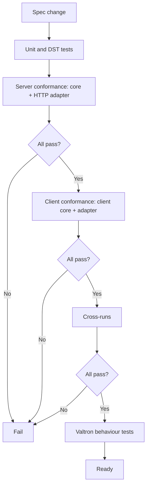

# Feature 08: Conformance

_Written in ASD-STE100 Simplified Technical English (STE). Code and identifiers stay as they
are._

**Abbreviations in this file.** Continuous Integration (CI); Hypertext Transfer Protocol (HTTP);
JavaScript Object Notation (JSON); AeroSpace and Defence Industries Association of Europe (ASD),
the owner of the STE standard ASD-STE100.

## 1. Goal

Prove the core against the reference suites. The server suite runs against the HTTP adapter. The
client suite runs with the Rust adapter. Neither run needs valtron. A failing suite blocks the
merge.

## 2. Requirements

1. **Server suite.** Run the reference server suite against `HttpAdapter` on port 4437. The
   server uses the valtron executor for its socket surface. It does not use the valtron protocol
   layer.
2. **Client suite.** Run the reference client suite with the Rust adapter. The adapter drives the
   client core.
3. **Cross-runs.** Run our client against our server. Run the reference client against our
   server.
4. **Skip register.** Record every skipped test and its reason. A skip needs owner approval.
5. **Feature report.** Each run records the suite commit, the pass count and the failure list.
6. **CI.** A Linux job runs the server suite and the client suite. The job fails on any
   non-skipped failure.
7. **Conformance spike.** Before feature 06 is complete, a minimal in-memory server runs the
   server suite to find real failures early.
8. **No valtron on the protocol path.** The protocol core conformance runs with
   `foundation_core` `default-features = false, features = ["std", "alloc"]`. The integration
   crate `durable_core_no_valtron` runs it, and it never enables `valtron`, `test-clock`, `multi`
   or `vfs-testkit`. The HTTP gate server needs the valtron executor for its socket surface. That
   executor is not on the protocol path: the server calls `DurableService`, not
   `DurableStreamReader`, `DurableStreamWriter` or `producer_task`. A no-valtron HTTP server is
   not feasible with the current crates. The `foundation_http` native server submits each
   connection with `foundation_core::valtron::send`, its durable adapter waits with
   `foundation_core::valtron::timer::sleep_for`, and `foundation_netio` native readiness returns
   `foundation_core::valtron::EventReadinessPtr`. `foundation_http` depends on `foundation_core`
   with its default features on, and that default set includes `valtron`. See #1081.
9. **Valtron suite.** A separate job runs the valtron layer behaviour tests.
10. **Runtime matrix.** The core and the client core run in a local embedded process, a DO, a
    Worker, a WebSocket server, wasm32 and the `foundation_ai` Session. Each target has a test.
11. **Surface neutrality.** A test calls `DurableService` with no HTTP adapter.
12. **BDD scenarios.** The behaviour suite is Given/When/Then. It calls the business API and runs
    on every driver.
13. **Driver matrix.** The same scenario runs on the embedded, HTTP, WebSocket, DO and Session
    drivers. Do not copy a scenario for each driver.
14. **Oracle coverage.** Every scenario names its primary oracle and its supporting oracles.
15. **Derived oracle.** Every protocol rule has a model, differential or metamorphic oracle.
16. **Property tests.** Use `proptest` for random operation sequences.
17. **VFS conformance and coverage.** Every VFS crate runs the shared conformance scenarios and
    its own coverage tests.

## 3. Design

Paths follow the repository layout:

| Item | Path |
|---|---|
| VFS testkit | `foundation_core/src/durable/shared/testkit.rs` |
| Conformance harness | `tests/conformance/` |
| Per-crate VFS tests | each VFS crate's `tests/` directory |



_Caption: Conformance gates the merge. Valtron tests are separate._

## 4. Tasks

- [x] **T1 — server suite harness.** `ci/durable_conformance.sh` starts the example server on
      `127.0.0.1:4437` and runs the reference server suite with `subscriptions: true`. The gate
      fails on a non-skipped failure. The recorded run has no failure. See
      `features/08-conformance/report.md`.
- [x] **T2 — client suite harness.** `ci/durable_conformance.sh` builds
      `durable_client_adapter` and runs the client suite against the reference server. See
      `features/08-conformance/report.md`.
- [x] **T3 — cross-runs.** Our client to our server, and the reference Rust client to our
      server. Tests: `foundation_http/tests/durable_cross_client.rs` (5 scenarios) and
      `foundation_http/tests/durable_reference_cross_run.rs` (6 scenarios). The scenarios are
      create, append, byte-exact catch-up read, long-poll after an append, base64 Server-Sent
      Events (SSE), close and a read that reports the closure, and fork creation and read. The
      reference client is a pinned public git dependency because the crate is not on crates.io.
      The full category matrix still belongs to the conformance suites (T1, T2 and the CI gate);
      this task proves the two directions on the core scenarios.
- [x] **T4 — CI.** The `durable-conformance` job in `.github/workflows/check.yaml` calls
      `foundation-ci run durable-conformance --step test`. The gate is a first-class entry in
      `ci/packages.toml`, so `foundation-ci affected` selects it from the changed files (owner
      correction 2026-11-27; rule 16). A pull request and a push pass `--if-affected`; the
      nightly schedule and a manual dispatch run the gate in full. The runner has Rust and
      Node 20. The recipe runs `ci/durable_conformance.sh` and the two cross-implementation
      test targets. The script fails on a non-skipped
      failure and on a count other than 338 server passes or 267 client passes with 2
      suite-forced skips. The `foundation_core` test run with `multi,test-clock,vfs-testkit`
      runs the memory VFS conformance test in CI.
- [x] **T5 — skip register and own coverage.** The upstream suite marks two base64 SSE cases
      with `Swift implementation broken` (`read-sse-base64.yaml`). The gate does not patch the
      upstream suite; it requires 267 passed and 2 skipped, both with that reason. Our own client
      tests cover the same behaviours
      (`given_a_multiline_base64_event_when_it_is_read_then_it_decodes_to_the_text`,
      `given_a_large_base64_payload_split_across_lines_when_it_is_read_then_it_decodes_exactly`)
      and the gate runs them. The server suite has no skip. Issue #1082 is closed.
- [x] **T6 — valtron suite.** Run the reader, writer, wait and wake tests separately.
      The `durable-valtron` job in `.github/workflows/check.yaml` runs the four groups as a
      matrix (`reader`, `writer`, `wait`, `wake`). Each job runs
      `foundation-ci run durable-valtron --step test --group <group>`. The gate is a
      first-class entry in `ci/packages.toml` (`[gates.durable-valtron]`), so
      `foundation-ci affected` selects it from a `foundation_core` change. The job sets a
      concurrency group per group and takes `max-parallel` from `[defaults]`
      `max-parallel-linux`. The recipe is `GateRecipe::DurableValtron` in
      `backends/foundation_ci/src/execution/recipes.rs`. It runs the `mod` test target with the
      `multi` executor, because the wake test is gated on that feature. Seven tests run: four
      reader tests (`valtron_reader.rs`), one writer test (`valtron_producer.rs`), the
      `now_live_waits` wait test and the `wake_callback_fires_on_append` wake test. A failing
      group fails its job and `checks-passed`. Measured 2026-11-28: all seven pass.
- [x] **T7 — report.** `features/08-conformance/report.md` holds the gate command, the suite
      versions and commit, the recorded counts, the four-direction matrix and the runtime matrix.
- [x] **T8 — runtime matrix.** Run the core in a local embedded process, a DO, a Worker, a
      WebSocket server and wasm32. Proofs: `embedded_core_roundtrip` and
      `service_runs_without_http` (`tests/durable/runtime_matrix.rs`);
      `durable_core_roundtrip_over_memory_vfs` (`integration/wasm_tests`, `js-foundation-wasm`);
      `websocket_core_roundtrip` (`foundation_http/tests/durable_websocket.rs`); the Worker
      route `/run-d1` and the DO route `/run` (`integration/do_sql`); and the Session document
      suite (`foundation_ai/tests/agentic/durable_store_scenario_tests.rs`). Issue #1080 is
      closed by the wasm32 runtime test. Issue #1077 is closed.
- [x] **T9 — `foundation_ai` Session.** Back a Session with the core. Test:
      `session_uses_core` in `backends/foundation_ai/tests/durable_session_store_tests.rs`.
      The store is `DurableDocumentStore` in
      `backends/foundation_ai/src/agentic/durable_store.rs`.
- [x] **T10 — surface neutrality.** Call `DurableService` with no HTTP adapter. Test:
      `service_runs_without_http` in
      `backends/foundation_core/tests/durable/runtime_matrix.rs`.
- [x] **T11 — BDD suite.** The Given/When/Then scenarios for create, append, read, close,
      producer, `Stream-Seq`, fork and TTL live in `integration/durable_transport_matrix`.
      `Scenario::all()` lists eight scenarios. One test function per scenario runs the same
      steps on every driver. The list test proves the count and the names. The `Stream-Seq`
      scenario follows requirement 3.5 and the reference server: a repeat and a regression are
      both `409 StreamSeqConflict`, and a larger sequence is accepted. A repeat is not a
      duplicate.
- [x] **T12 — driver matrix.** Five drivers pass every scenario: embedded (`DurableService`
      over `DurableStream` and `MemoryVfs`), HTTP, WebSocket, ConnectRPC and the Durable Object
      (DO) worker. Evidence: `integration/durable_transport_matrix/tests/transport_matrix.rs`
      runs the eight scenarios on the four native drivers and compares each with the model;
      `tests/do_driver.rs` runs them on the DO. Each test asserts the driver equals the model
      oracle, then that the drivers agree. The DO driver is
      `GET /matrix?scenario=...` in `backends/foundation_db/integration/do_sql`. It runs the
      same eight scenarios over `SqlVfs<DoSqlExecutor>` with an in-memory block store. Its wait
      is a JavaScript `setTimeout`, so the TTL scenario runs. The native test starts
      `wrangler dev --local` and compares the reply with the model and the embedded driver. The
      run lives in `ci/durable_conformance.sh`. It starts the pinned wrangler with
      `npx --yes wrangler@4.156.2` (`WRANGLER_VERSION` in `mise.toml`), installs
      `worker-build` 0.8.7 with `cargo binstall` when present and `cargo install` otherwise, and
      adds the wasm32 target (#1091 is closed). The full gate measured 231.91 s (3 min 52 s) on
      this host, under the 20-minute job limit. Command:
      `cargo test --profile uat -p durable_transport_matrix --features do-driver --test do_driver`.
      Session (replaced by a document scenario suite). The stream `Driver` trait is not used.
      `DurableDocumentStore` is a document store over a stream, not the stream operations. A
      `Driver` mapping would encode the bytes again, move the chunk boundaries and hide the
      create status, the time to live and the `Stream-Seq` outcome, so it would be a fake. The
      Session proof is the document-level Given/When/Then suite in
      `backends/foundation_ai/tests/agentic/durable_store_scenario_tests.rs`. The thin top-level
      target `backends/foundation_ai/tests/durable_store_scenario_tests.rs` runs it with the
      default features, because the `agentic_tests` target needs the `testing` feature. The
      suite runs over `MemoryVfs` with an independent document model and asserts the model
      first, then the store. The five scenarios are:
      - Given a session, when a document is written and read, then the document round trips.
      - Given several documents, when the session replays from an offset, then it returns
        exactly the later documents in order.
      - Given a parent session at its tail, when a branch forks and writes, then the branch
        reads the prefix and its own document, and the parent does not change.
      - Given a session, when the tail offset is read, then a replay from that offset returns
        nothing and a subsequent write is read from it.
      - Given a missing session, when a document is read, then the store reports no document.

      Issue #1092 is closed.
- [x] **T13 — model oracle.** Build a small independent state model. Test:
      `model_matches_driver` (`tests/durable/reader.rs`). The transport matrix also compares
      every driver with `model_scenario` (`integration/durable_transport_matrix`).
- [x] **T14 — differential oracle.** Compare drivers and transports. Test: `drivers_agree`
      (`tests/durable/producer.rs`). The transport matrix compares each driver with the model
      and with the other drivers.
- [x] **T15 — metamorphic oracle.** Check append concat, suffix read and fork prefix plus tail.
      Tests: `append_read_is_byte_exact` (append concat), `read_from_offset_is_suffix` and
      `fork_read_is_source_prefix_plus_tail` (`tests/durable/property.rs`).
- [x] **T16 — property oracle.** Use `proptest` for random operation sequences. Tests:
      `append_read_is_byte_exact`, `producer_retries_store_each_chunk_once`,
      `stream_seq_accepts_increasing_values_only`, `fork_read_is_source_prefix_plus_tail`
      (`tests/durable/property.rs`) and `ttl_model_matches` (`tests/durable/ttl.rs`).
- [x] **T17 — failure injection and fuzz.** Inject faults and malformed input. Tests:
      `injected_error_is_typed` (`tests/durable/fault_injection.rs`) and
      `malformed_input_never_panics` (`tests/durable/fuzz_harness.rs`).
      The fault test wraps `MemoryVfs` in a VFS that fails one armed operation (`append`,
      `read`, `head`, `close`, `fork`) and returns `VfsError::Io` with a typed cause. It
      asserts the cause survives the `DurableStream` boundary as `StoreError::Storage`, and
      that a failed operation leaves no state: the tail, closure, data, openness and fork
      target all stay as before. The fuzz test uses `proptest` over random offset bytes,
      `Stream-Seq` values, JSON bodies and header and field combinations. It asserts a typed
      `StoreError` and no panic.
- [x] **T18 — crash and resource oracles.** Restart and bounded-memory tests. Tests:
      `restart_preserves_stream` and `read_is_bounded`
      (`foundation_nativeapis/tests/durable_file_vfs/oracle.rs`); `sql_vfs_range_read_is_bounded`
      (`tests/durable/sql.rs`).
- [x] **T19 — timing and readiness oracle.** Test wait and wake. Tests:
      `given_a_live_reader_when_data_appends_then_it_yields_the_data`,
      `wake_callback_fires_on_append` and
      `given_a_closed_stream_when_the_valtron_reader_catches_up_then_it_yields_the_chunks`
      (`tests/durable/valtron_reader.rs`).
- [x] **T20 — VFS testkit.** Export the shared VFS conformance scenarios. Wire them into every
      VFS crate. Test: `every_vfs_runs_the_same_scenarios`
      (`tests/durable/vfs_conformance.rs`). The kit also runs on file, S3, R2, libsql, DO and
      D1.
- [x] **T21 — VFS coverage.** Add coverage tests for each VFS native path. Tests:
      `memory_vfs_covers_every_method`, `sql_vfs_covers_every_method`,
      `file_vfs_covers_every_method`, `s3_vfs_coverage` and `r2_vfs_coverage`. The DO and D1
      executor paths run through the `integration/do_sql` routes.

## 5. Success criteria

- [x] The protocol core passes conformance without valtron.
      `cargo test -p durable_core_no_valtron` runs 11 scenarios with no HTTP and no socket. The
      server suite passes against `HttpAdapter`. The HTTP server uses the valtron executor for
      its socket surface; the executor is not on the protocol path. A no-valtron server is not
      feasible with the current crates. See requirement 8 and #1081.
- [x] The client suite passes with the Rust adapter.
- [x] Both cross-runs pass. Our client to our server runs 5 scenarios; the reference Rust
      client to our server runs 6. The categories are create, append, catch-up read, long-poll,
      SSE, close and fork. See T3.
- [x] Every skip names an open GitHub issue with a severity. A skip without an issue fails review.
      Issue #1082 covers the two suite-forced client skips. The server suite has no skip.
- [x] The runtime matrix passes: embedded, DO, Worker, WebSocket, wasm32 and Session.
      Embedded, Worker, DO, WebSocket, wasm32 and the Session now have proofs. See T8. Issues
      #1077, #1079 and #1080 are closed.
- [x] Every protocol rule has a derived oracle. T17 adds the protocol-level fault-injection
      oracle (`injected_error_is_typed`) and the malformed-input fuzz oracle
      (`malformed_input_never_panics`). See T13 to T17.
- [x] Property tests cover append and read, producer, `Stream-Seq`, fork and TTL. Tests:
      `append_read_is_byte_exact`, `producer_retries_store_each_chunk_once`,
      `stream_seq_accepts_increasing_values_only`, `fork_read_is_source_prefix_plus_tail`
      (`tests/durable/property.rs`) and `ttl_model_matches` (`tests/durable/ttl.rs`).
- [x] Every VFS crate runs the shared conformance suite and its own coverage tests. See T20
      and T21. The kit runs on memory, file, S3, R2, libsql, DO and D1, and each VFS has a
      coverage test.
- [x] The valtron layer tests pass separately. The `durable-valtron` job runs the four groups
      (`reader`, `writer`, `wait`, `wake`) in their own matrix jobs. All seven tests pass. See
      T6.
- [x] CI fails on any non-skipped conformance failure.

## 5.1 Owner acceptance bar (2026-11-27)

- The server suite runs with `subscriptions: true` and reports 338 of 338.
- The client suite reports every runnable test. Every feature is announced. The suite forces two
  skips for all clients (`read-sse-base64.yaml`, `Swift implementation broken`); the target is 267
  passed and those 2 skips. No skip comes from our client.
- A skip that the reference suite forces is named with its reason; it is not a pass.
- A fresh zero-context agent verifies the claims against the code.

## 5.2 Cross-implementation conformance (owner matrix, 2026-11-27)

A suite that runs our server and our client only is not enough. The `durable-conformance` job in
`.github/workflows/check.yaml` requires four directions. When the job runs, it runs all four:

| Direction | Our side | Reference side | Status |
|---|---|---|---|
| 1 | Our server | TypeScript server suite | passes (338 of 338) |
| 2 | Our client | TypeScript client suite, which starts the TypeScript reference server | passes (267 of 269, with the 2 suite-forced Swift skips) |
| 3 | Our server | TypeScript `fetch` client (inside direction 1), and the reference Rust client, `packages/client-rust` | passes (6 cross-run scenarios; `foundation_http/tests/durable_reference_cross_run.rs`) |
| 4 | Our server | Our client | passes (5 cross-run scenarios; `foundation_http/tests/durable_cross_client.rs`) |

Direction 3 names two reference clients. The TypeScript `fetch` client is the one that the
upstream server suite uses, so direction 1 already covers it. The reference Rust client has its
own test target, which the job runs in the same step as direction 4.

- The gate is a first-class entry of the CI schema. `ci/packages.toml` holds
  `[gates.durable-conformance]` with `recipe = "durable-conformance"`, the packages that carry
  the protocol, and the `integration/` path prefix. `foundation-ci run durable-conformance
  --step test` runs `ci/durable_conformance.sh` for directions 1 and 2, then
  `cargo test -p foundation_http --features multi --test durable_cross_client --test
  durable_reference_cross_run` for directions 3 and 4. A failing test fails the job.
- **When the job runs (owner correction, 2026-11-27).** The gate follows rule 16: it runs when
  the Durable Streams source changes, not on every change. The job passes `--if-affected` on a
  pull request and on a push, so `foundation-ci affected` selects the gate from the changed
  files: a file under `foundation_core`, `foundation_http`, `foundation_netio`,
  `foundation_event_stream`, `foundation_nativeapis`, `foundation_connectrpc` or
  `foundation_db`, or a file under `integration/`. A change to a global file selects every
  entry, the gate included. A push that changes none of these files reports the gate as not
  affected and runs none of its commands. A base that git cannot compare runs the gate. The
  nightly schedule and a manual dispatch pass no flag, so the driver runs the gate in full.
- `foundation-ci plan` lists a selected gate and keeps it out of the package matrices: the gate
  runs in the `durable-conformance` job, not in a package job of the CI image.

- The reference Rust client runs on the tokio runtime. The cross-run test therefore takes
  `tokio` as a **dev-dependency**, declared once in `[workspace.dependencies]`. Our client core,
  our server and our VFS never use tokio; valtron remains the only runtime in shipped code.
- The reference Rust client exists at
  `/Volumes/Outside/GitSources/src.Electric/durable-streams/packages/client-rust` and ships a
  conformance adapter (`run-conformance-adapter.sh`).
- The cross-run pins the public commit `461b40267aabd644558f9b19dbb9507dd5f691cf` of
  `https://github.com/durable-streams/durable-streams`. The Rust client is not published on
  crates.io, so the pin is the only reproducible form. The commit is the checkout HEAD on
  2026-11-27.
- The cross-run found issue #1065 (severity medium). Our SSE control event sends `streamCursor`
  as a JSON number, and the reference client reads a string, so it ignores the collapsing
  cursor. Reads still pass. The fix changes the field to a string in the server and in the
  client core.
- This checkout has no Rust server package. Direction 2 therefore uses the TypeScript reference
  server, which the client suite starts. If a Rust server exists on another branch or
  repository, the owner supplies its path.
- The runnable harness lives in `foundation_event_stream` (owner instruction) as a
  `conformance` module or binary. Feature 08 owns the rules and the acceptance; feature 10 owns
  the crate.
- Every category runs: basic, append, read, long-poll, HTTP, headers, TTL, content type, HEAD,
  offsets, edge cases, caching, chunking, read-your-writes, SSE, JSON, property, producer,
  closure, forks and subscriptions. No skip caused by our code.

## 6. Verified commands (2026-11-27)

`ci/durable_conformance.sh` runs both suites. It builds the examples, starts the server,
installs the suites in a temporary directory and fails on any test failure. A clean run takes
about 90 seconds.


These commands pass on the branch `spec-durable-streams`. The harness uses the same
commands.

```text
cargo build -p foundation_http --features multi --example durable_server
cargo build -p foundation_netio --features multi --example durable_client_adapter
```

Server suite, against the example server on `127.0.0.1:4437`:

```text
npx @durable-streams/server-conformance-tests@0.3.7 --run http://127.0.0.1:4437
```

The suite starts its own runner. Its default direct run fails to find the test file.
Run it from a temporary project with a `vitest` file that calls `runConformanceTests`.
Result: 338 pass, 0 skip, 0 fail (the counts that `ci/durable_conformance.sh` requires).

Client suite, against the adapter binary. The runner starts the reference server:

```text
npx @durable-streams/client-conformance-tests --run <adapter-path>
```

Result: 267 pass, 0 fail, 2 skip (the counts that `ci/durable_conformance.sh` requires). Both
skips are suite-forced (`Swift implementation broken`).

The harness must set the long-poll timeout to 3 s for the server example. The suite
waits for a timeout inside a 5 s test limit.

A skip that no suite forces names an open issue. A skip without an issue fails the review.

## 7. Open items

None for T6 and T17. T11 of feature 06 (the golden oracle) stays open.
