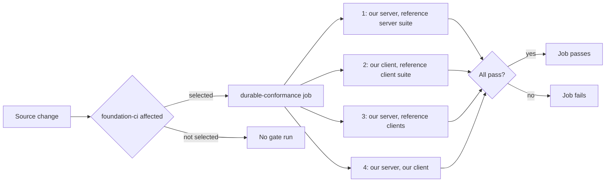

# Feature 08: Conformance report

_Date: 2026-11-27. Branch: `spec-durable-streams`. Pull request: #1025 (draft)._

**Abbreviations.** Continuous Integration (CI); Durable Object (DO); Hypertext Transfer Protocol
(HTTP); JavaScript Object Notation (JSON); Server-Sent Events (SSE); virtual file system (VFS);
WebAssembly (wasm).

**Terms.**

- **Gate.** The `durable-conformance` CI entry that runs both reference suites and the two
  cross-runs.
- **Direction.** One pairing of our side and the reference side in the four-direction matrix.
- **Runtime row.** One target in the runtime matrix: embedded, wasm32, Worker, DO, WebSocket or
  `foundation_ai` Session.
- **Proof.** A command or a recorded real-service run that shows the same core works in a row.

## 1. Result

| Item | Result | Evidence |
|---|---|---|
| Server suite | 338 passed (338), 0 skipped, 0 failed | Recorded. |
| Client suite | 267 passed, 0 failed, 2 skipped of 269 | Recorded. |
| Direction 3 cross-run | 6 scenarios pass | Recorded test target. |
| Direction 4 cross-run | 5 scenarios pass | Recorded test target. |
| Runtime matrix | 5 rows have a runtime proof, 1 row has a build proof, 0 rows are gaps | Section 5. |
| Protocol core without valtron | 11 passed (11) | `cargo test -p durable_core_no_valtron`, re-run in this change. |
| Clock parameter guard | 0 violations | Re-run in this change. |
| Time source guard | 0 violations | Re-run in this change. |

The two suite counts are recorded evidence. This change did not re-run the strict gate. The host
is shared and loaded; the strict gate result is recorded separately. Section 3 lists the sources.

## 2. Gate command

```text
cargo run --locked --profile uat -p foundation_ci -- run durable-conformance --step test
```

The `durable-conformance` job in `.github/workflows/check.yaml` runs this command. The job uses
`ubuntu-latest`, Rust and Node 20, and has a 20-minute timeout. It sets a concurrency group. A
new push cancels a superseded pull request run. Full runs queue.

The gate is a first-class entry in `ci/packages.toml`:

```toml
[gates.durable-conformance]
recipe = "durable-conformance"
packages = [
  "foundation_core", "foundation_http", "foundation_netio",
  "foundation_event_stream", "foundation_nativeapis",
  "foundation_connectrpc", "foundation_db",
]
paths = ["integration/"]
```

A pull request and a push pass `--if-affected`. `foundation-ci affected` selects the gate from
the changed files. The nightly schedule and a manual dispatch run the gate in full.

The recipe runs `ci/durable_conformance.sh` for directions 1 and 2. It then runs the two
cross-run test targets for directions 3 and 4.

The `multi` feature links the valtron executor for the server's socket surface. The protocol
path does not use the valtron protocol layer. Section 5.7 gives the boundary and the evidence.



_Caption: The gate selects from the change and runs all four directions in one job._

## 3. Recorded numbers

The numbers come from these recorded entries:

- `specifications/71-durable-streams-in-valtron/progress.md`, entry "2026-11-27: feature 07
  Server-Sent Events (SSE) landed": server 338 pass, 0 skip; client 267 pass, 2 suite-forced
  skips, 0 fail.
- `specifications/71-durable-streams-in-valtron/progress.md`, entry "2026-11-27: feature 08 CI
  wiring landed": the gate bar is 338 passed (338) and 267 passed with 2 suite-forced skips.
- `specifications/71-durable-streams-in-valtron/handoff.md`, section 4.4: the same gate passed
  338 of 338 and 267 of 269 runnable on a quiet host.
- `ci/durable_conformance.sh`: the script fails on any other count.

| Suite | Package | Runnable | Passed | Failed | Skipped |
|---|---|---|---|---|---|
| Server | `@durable-streams/server-conformance-tests` 0.3.7 | 338 | 338 | 0 | 0 |
| Client | `@durable-streams/client-conformance-tests` 0.2.13 | 269 | 267 | 0 | 2 |

The server suite runs with `subscriptions: true`. The reference repository pin for the Rust
client is
`461b40267aabd644558f9b19dbb9507dd5f691cf` of
`https://github.com/durable-streams/durable-streams`.

## 4. Four-direction matrix

| Direction | Our side | Reference side | Command | CI path |
|---|---|---|---|---|
| 1 | Our server | TypeScript server suite | `ci/durable_conformance.sh` (server section) | `foundation-ci run durable-conformance --step test` |
| 2 | Our client | TypeScript client suite; it starts the TypeScript reference server | `ci/durable_conformance.sh` (client section) | The same gate step |
| 3 | Our server | TypeScript `fetch` client (inside direction 1) and the reference Rust client | `cargo test -p foundation_http --features multi --test durable_reference_cross_run` | The same gate step |
| 4 | Our server | Our client | `cargo test -p foundation_http --features multi --test durable_cross_client` | The same gate step |

Direction 3 covers the TypeScript `fetch` client through direction 1. Its Rust part has 6
scenarios. Direction 4 has 5 scenarios. A failing test fails the job.

## 5. Runtime matrix

The core takes `Ctx` and a store. It has no global runtime, socket, HTTP type or executor of its
own. The rows below show how the same core runs in each target.

| Row | How the core runs | Proof | Status |
|---|---|---|---|
| Local embedded | Direct async calls | `durable_core_no_valtron` (11 tests) and `durable::runtime_matrix` (2 tests) | Runtime proof. |
| wasm32 | The core compiles for the wasm32 target | Six `cargo check` commands pass | Build proof only. Issue #1080. |
| Cloudflare Worker | The Worker fetch handler calls the core | `foundation_event_stream` wasm build, and `/run-d1` in the DO fixture | Runtime proof. |
| Durable Object | DO SQLite storage and one fetch handler | `/run` in the DO fixture | Runtime proof. |
| WebSocket server | The adapter maps JSON text frames to `DurableService` | `durable_websocket` (5 tests) | Runtime proof. |
| `foundation_ai` Session | The core as the session log | `durable_session_store_tests` (6 tests) | Runtime proof. |

### 5.1 Local embedded

The embedded proof makes no HTTP call and uses no socket.

```text
cargo test -p durable_core_no_valtron
```

Result: 11 passed. The crate depends on `foundation_core` with `default-features = false` and the
features `std` and `alloc`. It never enables `valtron`, `test-clock`, `multi` or `vfs-testkit`.
It runs over `MemoryVfs` with `futures-lite`, no HTTP adapter and no socket. The scenarios are:

- create, and an idempotent re-create;
- append and a byte-exact read;
- bounded pages with a byte limit;
- close, and the refusal of a later append;
- fork prefix and branch divergence;
- producer dedup, fencing and a sequence gap;
- `Stream-Seq` ordering;
- time-to-live expiry, with a hand-written `Clock` that has no valtron type;
- soft-delete, cascade, and a fork that keeps reading a soft-deleted source.

```text
cargo test -p foundation_core --test mod -- durable::runtime_matrix
```

Result: 2 passed. `embedded_core_roundtrip` runs create, two appends, a byte-exact read, close
and a read that reports the closure. `service_runs_without_http` calls `DurableService` with no
HTTP adapter.

### 5.2 wasm32

The core compiles for `wasm32-unknown-unknown`. These commands pass on this branch:

```text
cargo check -p foundation_core --target wasm32-unknown-unknown --no-default-features --features std
cargo check -p foundation_core --target wasm32-unknown-unknown --no-default-features --features std,multi
cargo check -p foundation_core --target wasm32-unknown-unknown --no-default-features --features std,js-foundation-wasm
cargo check -p foundation_event_stream --lib --target wasm32-unknown-unknown
cargo check -p foundation_db --target wasm32-unknown-unknown --no-default-features --features do-sql
cargo check -p foundation_db --target wasm32-unknown-unknown --no-default-features --features wasm-bindgen-storage
```

Result: all six commands pass. The `foundation_core` checks print the known warning for the
unused `scoped::*` re-export, issue #1063. The CI wasm gate also runs these sets.

The row has no runtime test. `wasm_core_roundtrip` does not exist. Issue #1080 records the gap.
The `backends/foundation_core/integration/wasm_tests` crate runs valtron executor tests on the
Deno host. It does not run the durable core.

### 5.3 Cloudflare Worker

Build proof:

```text
cargo check -p foundation_event_stream --lib --target wasm32-unknown-unknown
cargo check -p foundation_http --target wasm32-unknown-unknown --no-default-features --features wasm
```

Both pass. `foundation_event_stream::cf` exposes the shared subscription core to a Worker host.
`foundation_http/src/wasm/bridge/cf.rs` is the Worker HTTP bridge.

Runtime proof: `backends/foundation_db/integration/do_sql/` is a standalone Worker outside the
workspace. Its top-level `#[event(fetch)]` handler serves `GET /run-d1`. That route calls
`run_d1`, which runs the shared VFS conformance kit over `D1Executor` and the real local D1
binding. The recorded result is `{"ok":true,"backend":"d1","scenarios":[...]}` with all nine
scenarios: `create`, `append`, `read_byte_exact`, `bounded_pages`, `fork_prefix`, `fork_append`,
`soft_delete_cascade`, `ttl_slide` and `version_conflict`.

The run uses `wrangler dev --local`. The result is recorded in `progress.md`, entry "feature 05
T6 done". This change did not re-run it. The fixture is outside the workspace and outside the CI
gate.

### 5.4 Durable Object

Build proof:

```text
cargo check -p foundation_db --target wasm32-unknown-unknown --no-default-features --features do-sql
```

Runtime proof: `DoSqlObject` in the same fixture runs the kit over `DoSqlExecutor` and the real
DO SQLite storage. `GET /run` reaches it through the Worker. The migration declares
`new_sqlite_classes = ["DoSqlObject"]`. The recorded result is `{"ok":true,...}` with the same
nine scenarios. `GET /rollback` returns `{"failed":true,"ok":true,"remaining":0}`: a failing
second statement rolls the first insert back.

The same recorded run and the same caveat as section 5.3 apply.

### 5.5 WebSocket server

The transport lives above the core, in `foundation_http`, the crate that owns the WebSocket
upgrade. `foundation_http/src/native/durable_ws/` holds the JSON message schema and
`DurableWsHandler`. The handler upgrades a GET request with
`foundation_http::native::upgrade::accept_websocket`, then serves `create`, `append`, `close`,
`head`, `delete`, `fork` and `read` over JSON text frames through `DurableService`. A live `read`
pushes a `read` frame for its first page, a `data` frame for each later page and an `end` frame
when the client sends `cancel` or the stream closes. The frame size cap is
`DurableWsConfig::max_frame_bytes`, default 8 MiB. The core has no WebSocket type.

```text
cargo test -p foundation_http --features multi --test durable_websocket
```

Result: 5 passed. The tests start an in-process `HttpServer` with the handler on `GET /ws` and
drive it with the platform WebSocket client:

- `websocket_core_roundtrip`: create, two appends, a byte-exact read, head, fork, delete, close,
  a read that reports the closure, and a typed `closed` refusal after the close.
- `live_read_receives_an_append_after_open`: a second connection appends while the first is live;
  the live read receives the page; `cancel` ends it with `cancelled`.
- `live_read_ends_when_the_stream_closes`: a final append closes the stream; the live read sends
  its data frame, then `end` with `closed`.
- `frame_cap_is_configuration`: a 64-byte cap refuses an oversized request with WebSocket code
  1009.
- `schema_round_trips`: the public request and reply types parse and render as JSON.

The behaviour-driven development (BDD) driver matrix entry (T12) stays open with
`same_scenario_every_driver`, which has no test yet.

### 5.6 `foundation_ai` Session

The session's ordered record log is a `DocumentStore`. `DurableDocumentStore` in
`backends/foundation_ai/src/agentic/durable_store.rs` maps one collection key (a session id) to
one durable stream. It stores one `SessionRecord` per JSON chunk. The stream offset is the log
position. A read replays the chunks in append order. A branch uses
`DurableDocumentStore::fork`, which creates a stream fork at the parent tail. The store takes
`DurableStreams<DurableStream>` and `Ctx` from the host. It has no global and makes no HTTP call.

```text
cargo test -p foundation_ai --no-default-features --test durable_session_store_tests
```

Result: 6 passed. The tests prove:

- append and replay round trip, and order preserved;
- replay from a document id (`scan_from`);
- a fork branch reads the parent prefix, then diverges; the parent stays unchanged;
- a reopened store over the same VFS replays the session;
- `session_uses_core`: `AgentSession` builds over the store with `with_doc_store`, and its
  message API replays the log.

The Wasm (wasm32) build is clean:

```text
cargo check -p foundation_ai --target wasm32-unknown-unknown --no-default-features
```

The store's compaction path is a one-document delete. It rewrites the stream and refuses when a
fork still shares its history. The session has no automatic compaction or time-to-live (TTL)
path, so the store adds none. The memory-tier cache stays the key-value `KvMemoryStore`; it is a
cache, not the transcript. On a cold cache, `MemoryCoordinator` rebuilds the tiers from this
durable audit log.

### 5.7 No-valtron protocol core and the runtime boundary

The protocol core conforms without valtron. The evidence is the integration crate:

```text
cargo test -p durable_core_no_valtron
```

Result: 11 passed. `integration/durable_core_no_valtron/Cargo.toml` takes `foundation_core` with
`default-features = false` and the features `std` and `alloc`. `valtron`, `test-clock`, `multi`
and `vfs-testkit` stay off. The build fails if the protocol core reaches for a valtron type,
trait or executor. The long-poll path, the notifier and the producer task are not in this suite.

The HTTP gate server needs a socket runtime. A no-valtron HTTP server is not feasible with the
current crates, because these calls force the valtron executor:

| Crate | Dependency | Evidence |
|---|---|---|
| `foundation_http` | Native server submits connections to the valtron executor. | `src/native/server/mod.rs` line 4 and `foundation_core::valtron::send` in the accept loop. |
| `foundation_http` | The durable adapter waits with the valtron timer. | `src/native/durable.rs` line 25, `foundation_core::valtron::timer::sleep_for`. |
| `foundation_netio` | Native readiness returns a valtron type. | `src/native/connection.rs`, `foundation_core::valtron::EventReadinessPtr`, and `ResumeSignal`. |
| `foundation_http` | It leaves the `foundation_core` default features on. | `Cargo.toml` line 14. The `foundation_core` default set includes `valtron`. |

The valtron layer is not on the protocol path. The server calls `DurableService`. It does not call
`DurableStreamReader`, `DurableStreamWriter` or `producer_task`. The gate therefore builds the
server with `multi` for its socket runtime, and the no-valtron claim is proven by the separate
protocol core suite. Requirement 8 and issue #1081 record this contract.

## 6. Skip register

| Suite | Test | File | Reason | Forced by | Author and commit |
|---|---|---|---|---|---|
| Server | None | - | - | - | - |
| Client | `sse-base64-data-integrity-multiline` | `read-sse-base64.yaml` | `Swift implementation broken` | `@durable-streams/client-conformance-tests` 0.2.13 | Valter Balegas, `82a566ace620b1b8d0d43cdf181356e6a6f6f4aa` |
| Client | `sse-base64-large-payload-4kb` | `read-sse-base64.yaml` | `Swift implementation broken` | `@durable-streams/client-conformance-tests` 0.2.13 | Valter Balegas, `82a566ace620b1b8d0d43cdf181356e6a6f6f4aa` |

The server suite has no skip. The two client skips are in the suite file, not in our adapter. The
suite marks them for every client. No skip comes from our code. Our client-core tests cover
multiline and large base64 payloads. Issue #1082 tracks the two upstream skips. The owner
acceptance bar in `feature.md` section 5.1 approves these two skips.

The skip lines are present at the pinned reference commit
`461b40267aabd644558f9b19dbb9507dd5f691cf`, in
`packages/client-conformance-tests/test-cases/consumer/read-sse-base64.yaml` at lines 55 and
367.

## 7. Open issues

| Issue | Severity | Subject | Matrix row |
|---|---|---|---|
| #1080 | low | No wasm32 runtime roundtrip test | wasm32 |
| #1082 | low | Two suite-forced client skips (`Swift implementation broken`) | Skip register |
| #1063 | low | The wasm check warns on the unused `scoped::*` re-export | wasm32 build |

## 8. Environment caveat

The strict gate needs a quiet host. On 2026-11-27 a shared machine ran an Android emulator and a
headless browser at high load. Under that load, the property tests were interrupted by the test
timeout, not by an assertion, and the server suite reported 337 of 338. The same gate passed 338
of 338 and 267 of 269 runnable on a quiet host.

At the time of this report the host load average was 169. This change did not run the strict
gate. Run `ci/durable_conformance.sh` on a quiet host before the pull request becomes ready. The
script keeps a 30-second vitest timeout. Do not weaken a test for a loaded host. Record the load
and run the gate again.

## 9. What remains

- **T6 — valtron suite.** Run the reader, writer, wait and wake tests as a separate step.
- **T8 — runtime matrix.** Done: the WebSocket row has a runtime proof (section 5.5). Add the
  wasm32 runtime test (#1080).
- **T9 — `foundation_ai` Session.** Done: the Session row has a runtime proof (section 5.6).
- **T11 to T21.** The behaviour-driven development (BDD) suite, the driver matrix, the model,
  differential, metamorphic, property, fault, crash, timing and VFS oracles.

The runtime matrix success criterion stays unticked until the wasm32 runtime row passes.
