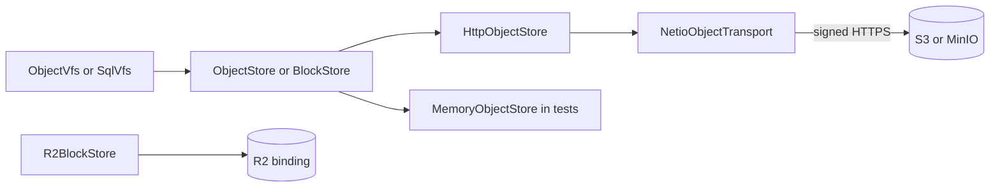

# Feature 11: Hosted object-store transports

_Written in ASD-STE100 Simplified Technical English (STE). Code and identifiers stay as they
are._

**Abbreviations in this file.** Amazon Simple Storage Service (S3); Cloudflare R2 (R2, a product
name); compare and swap (CAS); virtual file system (VFS); Hypertext Transfer Protocol (HTTP);
Transport Layer Security (TLS); Structured Query Language (SQL); Durable Object (DO);
Cloudflare Workers (Workers); JavaScript Object Notation (JSON); Entity Tag (ETag); continuous
integration (CI); operating system (OS).

## 1. Goal

Feature 09 built the S3 and R2 VFS against an in-memory object store. The VFS logic works. A real
host still has no transport to a real object store. This feature adds the transports and proves
them against a live service.

**User story.** As an operator, I want a durable stream on a real S3 or R2 bucket, so that the
data is durable in the service and not only in a test.

**BDD scenarios.**

- Given a live bucket, when a writer appends to a durable stream, then the bytes are in the
  bucket after the head compare and swap (CAS).
- Given a live bucket and two writers, when both update the head, then one CAS wins and one
  retries.
- Given a live bucket, when the process restarts, then the spool replay loses no acknowledged
  data.
- Given the native transport, when it sends a signed request, then the service returns the
  status, headers and bounded body.
- Given a Worker with an R2 binding, when the SQL VFS flushes a block, then the block is in R2
  and a range read returns the exact bytes.
- Given a live MinIO service, when the same VFS scenarios run, then the results match the
  in-memory store.

## 2. Requirements

1. **Native transport.** A `NetioObjectTransport` implements `ObjectTransport` over the
   `foundation_netio` client. It sends the method, the full URL, the headers and the body.
2. **Bounded body.** The transport reads at most `max_response_bytes`. It streams the body and
   never reads a whole object into memory beyond the bound.
3. **TLS.** The client uses TLS for an `https` endpoint and plain HTTP for a local service.
4. **Errors.** A transport failure is a typed error. A non-2xx status is not a transport error;
   the store maps it.
5. **Feature gate.** The native transport is an optional feature, `vfs-object-netio`, on native
   OSes only.
6. **Live S3 run.** A test runs the shared VFS conformance kit against a live S3-compatible
   service. It reads `EWE_S3_ENDPOINT`, `EWE_S3_ACCESS_KEY`, `EWE_S3_SECRET_KEY` and
   `EWE_S3_BUCKET`.
7. **No silent skip in CI.** CI sets `EWE_REQUIRE_LIVE_S3=1`. When it is set and an endpoint
   variable is missing, the test fails. A local run without the variables prints one reason line
   and returns.
8. **MinIO in CI.** The durable gate job starts a MinIO service container on Linux. The service
   is pinned to an exact release tag. The job sets the four variables and the require flag.
9. **Block tier transport.** An `S3BlockStore` implements `foundation_core::durable::sql::BlockStore`
   over the object store, so `SqlVfs` flushes blocks to S3.
10. **Wasm R2 binding.** The R2 binding gains conditional put, range get, `httpEtag`, size,
    key and list decoding. The binding uses the generated Cloudflare types.
11. **Wasm R2 block store.** An `R2BlockStore` implements `BlockStore` over the binding on
    `wasm32`. A block put with the same key and bytes is safe to retry.
12. **Same semantics.** The transport never changes a protocol outcome. The live run and the
    in-memory run return the same scenario observations.

## 3. Design



The paths follow the repository layout:

| Item | Path |
|---|---|
| Native transport | `foundation_nativeapis/src/native/vfs/object_netio.rs` |
| S3 block store | `foundation_nativeapis/src/native/vfs/s3_blocks.rs` |
| R2 binding extension | `foundation_db/src/wasm/bindgen/cf/r2.rs` |
| R2 block store | `foundation_nativeapis/src/wasm/vfs/r2_blocks.rs` |
| Live S3 tests | `foundation_nativeapis/tests/durable_object_vfs/live.rs` |
| CI service and variables | `.github/workflows/check.yaml`, `ci/durable_conformance.sh` |

The transport:

```rust
pub struct NetioObjectTransport { client: DynNetClient, max_response_bytes: usize }

impl ObjectTransport for NetioObjectTransport {
    fn send(&self, request: ObjectRequest) -> ObjectFuture<'_, ObjectResponse>;
}
```

The transport builds a request from `request.method`, `request.full_url()`, the headers and the
body. It calls `send_async`. It reads the body with the netio body reader up to the bound. It
returns the status, the headers and the bytes.

The block store:

```rust
pub struct S3BlockStore { store: HttpObjectStore<NetioObjectTransport> }

impl BlockStore for S3BlockStore {
    fn put(&self, key: &str, bytes: Vec<u8>) -> BlockFuture<'_, ()>;
    fn get_range(&self, key: &str, start: u64, len: usize) -> BlockFuture<'_, Vec<u8>>;
}
```

## 4. Tasks

- [x] **T1 — native transport.** Add `NetioObjectTransport` and the `vfs-object-netio` feature.
      Tests: `netio_transport_sends_a_signed_request`, `netio_transport_bounds_the_body`,
      `netio_transport_returns_a_non_2xx_status`, `netio_transport_reads_no_head_body`.
      Use a local `TcpListener` server in the test; no live service is needed.
- [x] **T2 — live S3 conformance.** Add `live.rs`. Run `run_all` against a live bucket. Add a
      two-writer CAS race and a restart replay. Tests: `live_s3_conformance`,
      `live_s3_two_writers_one_cas_wins`, `live_s3_restart_replays_the_spool`.
      The VFS uses a simulated clock for the TTL scenario. The store uses the host clock for
      the request signature. The live run passes against MinIO
      `RELEASE.2025-10-15T17-29-55Z`.
- [x] **T3 — S3 block store.** Add `S3BlockStore` for `SqlVfs`. Tests:
      `sql_vfs_flushes_to_s3`, `sql_vfs_reads_a_block_range_from_s3`, and the live variant
      `live_sql_vfs_flushes_to_s3`. The live run passes against MinIO.
- [x] **T4 — R2 binding.** Add conditional put, range get, `httpEtag`, bare `etag`, size, key
      and list decoding. Do not hand-write a JSON shape that a generated type covers. The
      owner changed the proof (2026-11-27): a Worker route under `integration/r2_blocks`
      asserts the conditional put with the bare etag on a real local R2 binding. The test is
      `r2_block_store_round_trips_under_local_r2`.
- [x] **T5 — R2 block store.** Add `R2BlockStore` on `wasm32`. Test: the same Worker route
      runs a put, an idempotent retry, an exact range read, and the SQL VFS flush and
      vacuumed read against local R2 and D1. The wasm32 build check passes for
      `vfs-object-wasm`.
- [x] **T6 — CI MinIO.** Add the MinIO service to the durable job. Set the variables and the
      require flag. Run the live tests in `ci/durable_conformance.sh` when the endpoint is set.
      The gate timeout is 30 minutes (owner approved).
- [x] **T7 — records.** Update feature 09 T11 and T12, `progress.md`, `learnings.md` and the
      handoff. Close #1064.

## 5. Verify commands

```bash
cargo test --profile uat -p foundation_nativeapis --features vfs-object-netio --test durable_object_vfs
cargo clippy --profile uat -p foundation_nativeapis --features vfs-object-netio,r2-wrangler --all-targets --no-deps -- -D warnings
cargo check --profile uat --target wasm32-unknown-unknown -p foundation_nativeapis --no-default-features --features vfs-object-wasm
cargo test --profile uat -p foundation_nativeapis --features r2-wrangler --test r2_wrangler
cargo run --profile uat -p foundation_ci -- plan
bash ci/durable_conformance.sh
```

Set `EWE_S3_ENDPOINT`, `EWE_S3_ACCESS_KEY`, `EWE_S3_SECRET_KEY` and `EWE_S3_BUCKET`
for the live run. Set `EWE_REQUIRE_LIVE_S3=1` to turn a missing variable into a failure.

## 6. Success criteria

- [x] A live MinIO run passes every shared VFS scenario. The run is green on this host
      (macOS, 53 tests, 4.56 s). The CI job runs the same test on Linux.
- [x] Two writers never lose a batch; one CAS wins and one retries.
- [x] A restart loses no acknowledged data.
- [x] The native transport reads a bounded body and uses TLS for an `https` endpoint.
- [x] The SQL VFS flushes blocks to S3 and reads an exact range back.
- [x] The wasm R2 block store builds on `wasm32` and passes the local-R2 Worker route.
- [x] CI runs the live test with a pinned MinIO service and fails when a variable is missing.
- [x] No test skips without a printed reason and an owner.

## 7. Notes and limits

- R2 on wasm has no local file system. The durable edge path is the SQL VFS on DO SQLite, with
  R2 as the block tier. The object VFS with a local spool stays a native path.
- The live R2 proof uses `wrangler dev --local`, which gives a real local R2 binding through
  Miniflare. The `integration/r2_blocks` fixture adds an `r2_buckets` binding and a route that
  runs the block scenarios. It does not use a mock bucket. The native test
  `r2_block_store_round_trips_under_local_r2` starts wrangler and checks the route JSON.
- The official `minio/minio` Docker image is no longer public. The live S3 run uses
  `alpine/minio` with the same MinIO release tag, `RELEASE.2025-10-15T17-29-55Z`. The image
  runs as root because the anonymous `/data` volume is not writable by its default user.
- LocalStack is not a substitute for the CAS proof. Its community edition accepts only
  `If-None-Match: *`; it does not accept `If-Match: <etag>`, so it cannot prove the head update.
- The transport skips the body of a HEAD, 204, 304 or 1xx response. A read waited for bytes
  that never come and held the request to the 30 s DNS deadline.
- The owner approved a 30-minute timeout for the durable conformance job.
