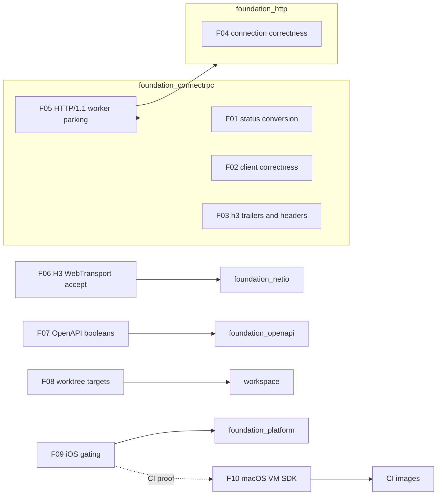

# Spec 73: High-severity defect fixes

_Written in ASD-STE100 Simplified Technical English (STE). Code and identifiers stay as they
are._

**Abbreviations in this file.**

- ahead-of-time (AOT): a compiler that translates code before the program runs.
- application programming interface (API).
- continuous integration (CI).
- file descriptor (fd).
- Google Remote Procedure Call (gRPC).
- input/output (I/O).
- just-in-time (JIT): a compiler that translates code while the program runs.
- pull request (PR).
- software development kit (SDK).
- undefined behaviour (UB): a program state where the language standard gives no rule, so any
  result is possible.
- virtual machine (VM).
- WebAssembly (Wasm).
- WebTransport: a bidirectional transport protocol over HTTP/3.
- write-or-execute (W^X): a memory rule that a page is writable or executable, but never both.
- AeroSpace and Defence Industries Association of Europe (ASD), the owner of the STE standard
  ASD-STE100.

## 1. Why this spec exists

Spec 72 fixed the `severity: medium` issues left after spec 70. When spec 72 started, the
retired umbrella backlog was split into individual issues. Twelve of them carried
`severity: high`. Later work found more high issues, so 14 are open on 2026-11-07. The owner
gave this rule: all high-severity issues are priority work. This spec schedules and fixes
all 14.

None of the 14 is a new feature. Each one is a defect with a measured cause in the issue body.

## 2. Scope

The scope is the 14 open `severity: high` issues on 2026-11-07. Do not add a low- or
medium-severity issue to this spec. A new finding becomes a GitHub issue with a severity label
(root rule 9); it does not become a feature here.

**Re-verification (2026-11-07).** The main session measured every issue against master before
handoff. Six are already fixed and still open. Those features verify the fix and close the
issue with evidence. Eight are real defects.

| Issue | Title (short) | Crate | Feature | State on master |
| --- | --- | --- | --- | --- |
| #265 | `parse_grpc_error_trailer` transmutes the status code | foundation_connectrpc | 01 | real (latent soundness) |
| #259 | clients never decompress a compressed response | foundation_connectrpc | 02 | real |
| #261 | `bidi_stream` ignores its requests argument | foundation_connectrpc | 02 | real |
| #260 | client deadlines are sent but never enforced locally | foundation_connectrpc | 02 | fixed (`0ada43f20`, `b79503f24`) |
| #258 | the server never sends handler streaming headers | foundation_connectrpc | 03 | real |
| #253 | gRPC over h3 sends no `grpc-status` | foundation_connectrpc | 03 | fixed (`h3_serve.rs:573`, h3 tests) |
| #288 | `ConnectionHandler::idle_timeout` is a size-based read timeout | foundation_http, foundation_netio | 04 | real (WS site is 100 ms) |
| #284 | middleware and 404 paths ignore errors and desync keep-alive | foundation_http | 04 | fixed (`51e61098b`) |
| #254 | an HTTP/1.1 RPC holds a valtron worker for its whole life | foundation_http | 05 | fixed (`ConnectionResult::Async`) |
| #273 | `H3Connection::poll_accept_webtransport` drops accepted streams | foundation_netio | 06 | fixed (`pending_accept`) |
| #317 | boolean query parameters are generated as `Option<String>` | foundation_openapi | 07 | fixed (`Option<bool>` in generated args) |
| #324 | parallel worktrees clobber the shared `CARGO_TARGET_DIR` | workspace | 08 | fixed (per-worktree target, `ci.py:38`) |
| #354 | `examples/platform_ios` cannot build: wasmtime has no iOS support | foundation_platform | 09 | real |
| #355 | macOS VM image has no iOS SDK | CI images | 10 | real |

The count is 14 issues in 10 features. Each issue maps to exactly one feature. One agent owns
one feature.

## 3. Priority order

The owner wants every high issue fixed. The order below lands the small, high-risk fixes
first, then the verification-only features, then the platform work.

| Order | Feature | Work | Why this position |
| --- | --- | --- | --- |
| 1 | 01 gRPC status conversion | code | Small change; removes an `unsafe` block from an input path. |
| 2 | 02 client correctness | code | Wrong results and a lost request stream in every client. |
| 3 | 03 handler streaming headers | code | Protocol non-conformance on three transports. |
| 4 | 04 connection correctness | code | A 100 ms WebSocket read timeout closes quiet connections. |
| 5 | 05 HTTP/1.1 worker parking | verify | Already fixed; pin it with a test. |
| 6 | 06 H3 WebTransport accept | verify | Already fixed; pin it with a test. |
| 7 | 07 OpenAPI booleans | verify | Already fixed; pin it with a test. |
| 8 | 08 worktree targets | verify | Already fixed; document the rule. |
| 9 | 09 iOS wasmtime gating | code | A platform target cannot build. |
| 10 | 10 macOS VM iOS SDK | CI | Proves feature 09 in CI. |

Feature 09 can start before feature 10. Its local check runs on a Mac with full Xcode. The
GitHub CI proof waits for feature 10.

## 4. Rules

These come from `CLAUDE.md`, `.agents/AGENTS.md` and `specifications/CLAUDE.md`. Read all
three before you start.

1. **Tests live in `tests/`**, registered in `tests/**/mod.rs`. No inline `#[cfg(test)]`
   module (root rule 7). If a file you touch has one, move it in the same change.
2. **Side effects are injected, never global** (root rule 11). A clock, an RNG, a transport
   or a storage handle comes from the `Ctx` bundle. No `SystemTime::now()`, no
   `Instant::now()` and no `thread_rng()` in core logic. A missing bundle is a typed error.
3. **Limits are configuration** (root rule 8). A size cap, a timeout or a batch size is a
   configured field with a builder method and a documented default that names its source.
   Never a `const` in the code path.
4. **Stream bodies, never buffer them** (root rule 4). Check the status before you touch a
   body. On error, read only a bounded amount for the message.
5. **Async all the way** (root rule 6). A public API that waits is `async` or a valtron
   readiness. Never a synchronous loop that `continue`s on `Wait`.
6. **Use the generated types** (root rule 5). If a generated type is wrong, fix the
   generator and regenerate. Do not work around it.
7. **Every bug found becomes a GitHub issue with a severity label** (root rule 9), in the
   same change. Close the issue in the change that fixes it. A finding that blocks a feature
   or is high or critical is fixed now.
8. **Never skip, ignore or disable a test** to get green. Never lower a timeout to hide a
   hang.
9. **No AI attribution** in a commit message or a PR description.

## 5. Verification protocol

Set these first. They keep the build inside the disk budget.

```bash
export CARGO_PROFILE_DEV_DEBUG=0 CARGO_INCREMENTAL=0
```

For each feature:

```bash
cargo fmt -p <crate>
cargo clippy --profile uat -p <crate> --no-deps --all-targets -- -D warnings
cargo test --profile uat -p <crate>
```

Rules for the checks:

1. `--profile uat` is the validation profile. A `dev` build is for local iteration only.
2. `--no-deps` is required. Issues #330 and #336 are known dependency lint stops.
3. Run the tests of each workspace crate that depends on the changed API:
   `cargo tree -i <crate> --workspace --depth 1`.
4. After a crate version bump, run `cargo metadata --locked --format-version 1` in the
   workspace, `examples/devbinary`, `examples/web/wello` and
   `examples/platform_android/src-tauri`.
5. The full run is the GitHub CI of the PR. A run cancelled by a newer push is not a
   failure.

## 6. Done when

- All 14 issues are closed by merged changes.
- Each regression test failed on the old code and passes on the new code. Where behaviour
  cannot differ by test (feature 01), the feature file names the source gate that proves the
  change.
- No new `severity: high` or `severity: critical` issue is open.
- `progress.md` and `learnings.md` record every feature.

## 7. Structure



_One-line caption: the 10 features and the crates they change; feature 09 needs feature 10
only for the CI proof._

## 8. Risks

| Risk | Feature | Control |
| --- | --- | --- |
| An API change to `Serve` breaks every handler. | 05 | Design the additive form first. Keep the old trait working. |
| A decompressor that buffers a whole body. | 02 | Stream through the envelope reader; add a bounded test. |
| The h3 trailer frame has no accepted shape. | 03 | Follow the h2 and h1 paths; use one shared trailer writer. |
| The iOS dependency cannot be target-cfg'd because another crate enables it. | 09 | Prefer a target cfg over a feature; check `cargo tree -e features`. |
| Regenerating providers changes many files. | 07 | One generator change; regenerate with the project tool; check every provider builds. |
| A worktree target change fills the disk. | 08 | One target per worktree, cleaned per crate after each feature. |
