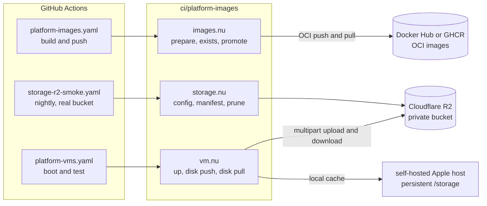
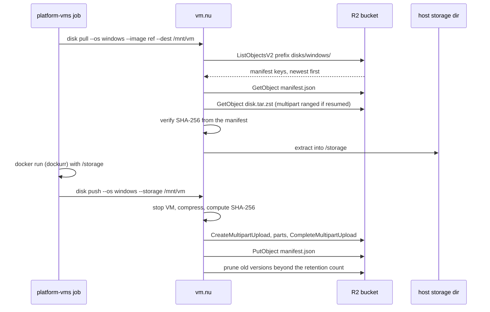
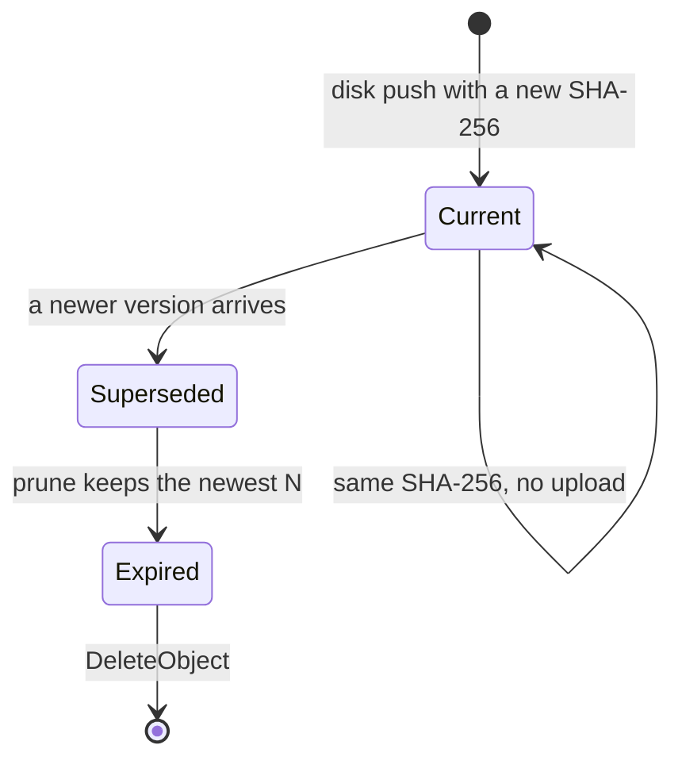

# Spec 74: Low-cost storage for CI images and VM disks

_Written in ASD-STE100 Simplified Technical English (STE). Code and identifiers stay as they
are._

**Abbreviations in this file.**

- application programming interface (API).
- central processing unit (CPU).
- continuous integration (CI).
- end-user licence agreement (EULA).
- GitHub Actions (GHA).
- GitHub Container Registry (GHCR).
- gibibyte (GiB): 2 to the power 30 bytes.
- Hypertext Transfer Protocol Secure (HTTPS).
- input/output (I/O).
- Open Container Initiative (OCI).
- pull request (PR).
- presigned URL: a URL with a time-limited signature that permits one object operation.
- Representational State Transfer (REST).
- Server Message Block (SMB): not used in this spec.
- SHA-256: a 256-bit cryptographic hash.
- Secure Shell (SSH).
- Simple Storage Service (S3): the object storage protocol of Amazon.
- terabyte (TB).
- uniform resource locator (URL).
- virtual machine (VM).
- zstd: the Zstandard compression format.
- AeroSpace and Defence Industries Association of Europe (ASD), the owner of the STE
  standard ASD-STE100.

## 1. Why this spec exists

The owner wants storage for every CI Docker image and every VM image at low or zero cost. The
images are in Docker Hub today. The owner asked for an investigation of Cloudflare: can
Cloudflare store the images for less, or for free? Can it act as a Docker repository?

This spec answers those questions with measured data and public prices. It then defines the
work to move the large artifacts to a low-cost store and to keep the OCI images in a registry.

This spec does not change application code. It changes the CI image tooling
(`ci/platform-images`), the CI workflows and their documentation.

## 2. Current state

### 2.1 Docker images

The images are in Docker Hub, account `ewestudios`. The workflow
`.github/workflows/platform-images.yaml` builds and pushes them with a token in the repository
secret `DOCKERHUB_EWESTUDIO_TOKEN`. The repository configuration is
`ci/ewe-platform-image/config.toml`.

The Docker Hub API reported these compressed sizes on 2026-11-08. The value is `full_size`,
the sum of the compressed layers of the tag.

| Image | Size (compressed) | Notes |
| --- | --- | --- |
| `ewestudios/ci-base` | 1.40 GiB | Layer 1, default flavor (Ubuntu 24.04, browsers). |
| `ewestudios/ci-base-cuda` | 6.57 GiB | Layer 1, CUDA 12.9 flavor. |
| `ewestudios/ewe-platform-ci` | 2.72 GiB | Layer 2, default flavor; `buildcache` tag is the same size. |
| `ewestudios/ewe-platform-ci-cuda` | 7.89 GiB | Layer 2, CUDA flavor. |
| `ewestudios/ci-macos` | 0.12 GiB | dockurr macOS layer 1. No macOS bits. |
| `ewestudios/ewe-platform-ci-macos` | 0.12 GiB | macOS layer 2. |
| `ewestudios/ci-windows` | 0.16 GiB | dockurr Windows layer 1. No Windows bits. |
| `ewestudios/ewe-platform-ci-windows` | 0.16 GiB | Windows layer 2. |
| **Total, one tag of each** | **19.14 GiB** | |

Each build also pushes a content-addressed `hash-<hash>` tag, a moving `sha-<commit>` tag on
master, `latest`, and a `buildcache` tag (`mode=max`). The stored total is larger than
19.14 GiB. Use 40–60 GiB as the expected range.

The account has 18 repositories. Ten of them are unrelated old images from 2021 (`campip`,
`localmail`, `firebase-tools`, and others). They are not used by this repository.

### 2.2 VM disks

The VM images are OCI images that contain scripts, not operating system bits. dockurr
downloads Windows or macOS from the vendor on first boot. A provisioned disk is a different
artifact:

| OS | Raw disk size | Compressed size (estimate) | Stored today |
| --- | --- | --- | --- |
| Windows Server 2022 evaluation | 40–50 GB | 15–20 GB | Not stored. A self-hosted host keeps a persistent `/storage` directory. |
| macOS | 30–60 GB | 15–25 GB | Not stored. A self-hosted host keeps a persistent `/storage` directory. |

`ci/platform-images/README.md` gives the reasons that a provisioned disk is not a public
image: the Windows evaluation terms and the Apple EULA forbid redistribution. It also gives
the size problem: 15–20 GB compressed is above the 10 GB GitHub Actions cache limit. The
README names one remaining option: push a provisioned disk to a private registry. That option
is not implemented.

### 2.3 Existing Cloudflare use

The repository already uses Cloudflare in local tests. `wrangler.toml` defines a local D1
database and a local R2 bucket for `wrangler dev --local`. No workflow uses a Cloudflare API
token or an R2 credential today. A Cloudflare account and `wrangler` are therefore already
part of the toolchain, but no production bucket exists.

## 3. Options analysis

The options use these measured or published facts. Each fact is from the source in section
14. Prices are correct on 2026-11-08. Check the price again on the purchase date.

### 3.1 Registry options for OCI images

| Option | Cost | Size limits | Pull limits | Private images | Operations |
| --- | --- | --- | --- | --- | --- |
| Docker Hub, public | $0 | 10 GB per layer (commonly reported; verify before a large push). No published total limit. | 100 pulls per 6 hours without login; 200 per 6 hours with a free login, per account. | Needs a paid plan. Free plan has 1 private repository. | None. In use today. |
| Docker Hub, paid | Pro about $9 per user per month. | Storage counts against the plan. | No limit, fair use. | Yes. | None. |
| GHCR, public package | $0. Public storage and bandwidth are free. | No published layer limit. | No pull limit. | Public only. | Low. `GITHUB_TOKEN` authenticates pushes and pulls inside GHA. |
| GHCR, private package | Currently free. GitHub says it will give 30 days of notice before billing starts. Not a guaranteed free tier. | No published limit. | No pull limit. | Yes. | Low. |
| Cloudflare Workers OCI registry (`serverless-registry`) | Workers Free plan, or $5 per month for the Paid plan. R2 storage applies. | The proxied request body limit is 100 MB on Free and Pro zones, 200 MB on Business, up to 5 GB on Enterprise. A push needs chunked uploads. The reference project reports more limits above 4–6 GB. | Worker request and CPU limits apply. Free plan has 100,000 requests per day. | Worker code must add it. | High. Reference code, known large-layer defects. |
| Docker Distribution (`registry:2`) with the R2 S3 driver | Needs a host; R2 storage applies. | R2 limits: 5 TiB object, 5 GiB part, 10,000 parts. | The host is the bottleneck. | Token or basic auth. | High. A server to run, secure and monitor. |
| Static OCI layout in R2 | R2 storage only. | Same R2 limits. | No API. Pull-only tools read the layout. | Awkward; signed URLs per object. | Medium. No push API. Good only for a mirror. |

**Conclusion for OCI images.** Cloudflare R2 is not an OCI registry. It stores bytes with
the S3 protocol. A Worker in front of R2 can speak OCI, but the 100 MB request body limit
forces chunked uploads, and the reported large-layer defects make it fragile for our 1.4–7.9
GiB images. Docker Hub already supports the sizes of the current public images, and GHCR does
so at no cost with no pull limit. The registry stays an OCI registry. R2 is for artifacts
that are not OCI images.

### 3.2 Object storage option for VM disks and large artifacts

Cloudflare R2 is a plain object store with the S3 protocol. It fits the disks and the build
artifacts exactly:

| Item | Value |
| --- | --- |
| Storage, Standard class | $0.015 per GiB-month. Free tier: 10 GiB-month each month. |
| Storage, Infrequent Access class | $0.01 per GiB-month. No free tier. Retrieval fee applies. |
| Egress to the Internet | $0. |
| Class A operations (writes, lists) | $4.50 per million. Free tier: 1 million per month. |
| Class B operations (reads) | $0.36 per million. Free tier: 10 million per month. |
| Maximum object | 5 TiB (4.995 TiB). |
| Maximum part | 5 GiB. Minimum part 5 MiB, except the last part. |
| Maximum parts | 10,000 per multipart upload. |
| Incomplete multipart upload | Aborted after 7 days by default. A lifecycle rule can shorten this. |
| At-rest encryption | Always on, with AES-256. |
| Access | Private bucket, authenticated requests, or presigned URLs with an expiry. |

The zero egress fee is the decisive property. CI pulls a 20 GB disk many times; with S3 or
Docker Hub private storage, egress would dominate the cost. R2 charges $0 for it.

### 3.3 Cost estimate

Use these assumptions: 60 GiB of OCI images in the registry; two OS disks, two retained
versions each, 20 GiB compressed per disk.

| Item | Size | Where | Cost per month |
| --- | --- | --- | --- |
| OCI images, public | 60 GiB | Docker Hub or GHCR | $0 |
| VM disks, 2 OS × 2 versions | 80 GiB | R2 | (80 − 10 free) × $0.015 = $1.05 |
| Build artifacts and reports | 1 GiB | R2 | $0.02 |
| Egress | any | R2 | $0 |
| **Total** | | | **about $1.07** |

If the owner keeps one version of each disk, the R2 cost is about $0.45. If the total stays
below 10 GiB, the R2 cost is $0. A monthly report prints the stored bytes and the estimated
cost, so the owner sees the change.

A Workers-based OCI registry would add $5 per month on the Paid plan and put a fragile
component in the critical path. It is not recommended.

## 4. Decision

1. **Keep OCI images in an OCI registry.** Use Docker Hub as today. Add GHCR as a selectable
   backend with one configuration field and native `GITHUB_TOKEN` authentication. Public
   images are free on both. GHCR has no pull limit and is the recommended primary when the
   owner accepts GHCR; Docker Hub stays the fallback.
2. **Store provisioned VM disks and large build artifacts in one private R2 bucket.** Use the
   S3 protocol with multipart upload, SHA-256 manifests, presigned downloads and a retention
   policy. No Worker and no registry server sit in the path.
3. **Never publish an operating system disk.** The bucket is private. The licence position
   from the README applies: internal use only, Windows evaluation terms, macOS on Apple
   hardware only. The owner must accept this position before feature 04 starts.
4. **Do not build an OCI registry on Cloudflare now.** Revisit only if Docker Hub or GHCR
   fails the size or rate test in feature 07.
5. **Keep the choice configurable.** `[storage]` in `ci/ewe-platform-image/config.toml`
   selects the registry and the object store. No workflow hard-codes a host or a bucket.

## 5. Architecture



_One-line caption: OCI images go to a registry; VM disks and large artifacts go to one private
R2 bucket; the CI tooling is the only code that touches either store._



_One-line caption: a job downloads a verified disk before boot, and publishes a new verified
disk after provisioning._



_One-line caption: a disk version stays current until a newer one arrives; prune keeps the
newest configured number of versions._

## 6. Data model

### 6.1 Bucket layout

```
ewe-platform-ci/
  disks/
    windows/
      <base-hash>/
        <sha256>.tar.zst
        <sha256>.tar.zst.sha256
        manifest.json
    macos/
      <base-hash>/
        <sha256>.tar.zst
        <sha256>.tar.zst.sha256
        manifest.json
  reports/
    <YYYY-MM>.json
  tmp/                    lifecycle: abort incomplete multipart after 1 day
```

`<base-hash>` is the `hash-<hash>` value of the VM image tag that produced the disk. A disk
from a different base image is not compatible, so the base hash is part of the path.

### 6.2 Manifest

`manifest.json` is small (below 16 KiB) and is parsed in full. The disk bodies are never
buffered.

```json
{
  "schema": 1,
  "os": "windows",
  "base_hash": "a1b2c3d4e5f6",
  "base_image": "docker.io/ewestudios/ewe-platform-ci-windows:hash-a1b2c3d4e5f6",
  "created_at": "2026-11-08T03:20:00Z",
  "created_by": "github-actions/18300000000/1",
  "raw_bytes": 45097156608,
  "compressed_bytes": 17179869184,
  "sha256": "9f2c...",
  "compression": "zstd",
  "license": "internal-evaluation",
  "previous": "3d4e..."
}
```

Rules:

1. The SHA-256 is of the compressed file. The downloader verifies it before extraction.
2. `raw_bytes` and `compressed_bytes` are checked against the object size from `HeadObject`.
3. `base_hash` must equal the hash of the image that the job boots. A mismatch is a typed
   error. The job does not boot a disk from a different base.
4. `license` is `internal-evaluation` for Windows and `internal-apple-hardware` for macOS.
   The uploader refuses any other value for a disk prefix.

### 6.3 Retention

1. Keep the newest `retain_versions` disks for each OS and base hash. The default is 2.
2. `vm.nu disk prune` lists the manifests, sorts by `created_at`, and deletes the older
   objects. It prints each deletion. It never deletes the current version.
3. R2 lifecycle rules expire `tmp/` after 1 day and abort incomplete multipart uploads after
   1 day. They never expire `disks/` automatically; the prune command is the only path.

## 7. Configuration, limits and secrets

### 7.1 Configuration

`ci/ewe-platform-image/config.toml` gains this section. Every value is configuration, never a
constant in the code path.

```toml
[storage]
# OCI registry backend: "dockerhub" or "ghcr".
# The dockerhub backend uses the existing [registry] host, namespace and
# username. The ghcr backend uses ghcr.io and the ewe-studios namespace.
backend = "dockerhub"

[storage.r2]
# Empty account_id and endpoint mean "take R2_ACCOUNT_ID from the environment".
account_id = ""
bucket = "ewe-platform-ci"
endpoint = ""
prefix = ""
# aws-cli default is 8 MiB; R2 accepts up to 5 GiB per part.
part_size_mib = 64
# aws-cli default is 10 uploads in flight; 4 keeps memory low on a 16 GB runner.
max_concurrency = 4
max_retries = 3
# R2 accepts up to 7 days. 1 hour is enough for a CI download.
presign_expiry_s = 3600
# zstd default level; a good trade between CPU and size for a disk image.
compression_level = 3
retain_versions = 2
# The monthly report exits 1 above this value.
cost_alert_usd = 5.0
```

Defaults and their sources:

| Field | Default | Source |
| --- | --- | --- |
| `part_size_mib` | 64 | aws-cli default is 8 MiB; R2 docs recommend 100 MiB for Docker registry chunks. 64 MiB gives 10,000 parts up to 625 GiB and fewer requests than 8 MiB. |
| `max_concurrency` | 4 | aws-cli default is 10; 4 keeps the memory and network use low on a 16 GB GHA runner. |
| `max_retries` | 3 | The R2 SDK default is 3 for retryable errors. |
| `presign_expiry_s` | 3600 | R2 maximum is 604,800 s (7 days); 1 hour limits a leaked URL. |
| `compression_level` | 3 | zstd default level; higher levels cost CPU with a small gain on a disk image. |
| `retain_versions` | 2 | Two versions give a rollback disk and the current disk. |
| `cost_alert_usd` | 5.0 | The owner threshold from section 13; the report exits 1 above it. |

### 7.2 Secrets

| Secret | Used by | Scope |
| --- | --- | --- |
| `DOCKERHUB_EWESTUDIO_TOKEN` | Docker Hub push | Existing. |
| `GITHUB_TOKEN` | GHCR push and pull | Built in. No secret. |
| `R2_ACCOUNT_ID` | Object store | Account identifier. Not a secret, keep it as a repository variable if the owner prefers. |
| `R2_ACCESS_KEY_ID` | Object store | Token with object read and write on the one bucket. |
| `R2_SECRET_ACCESS_KEY` | Object store | Same token. |
| `R2_READ_ONLY_ACCESS_KEY_ID` and `R2_READ_ONLY_SECRET_ACCESS_KEY` | Self-hosted host disk download | Read-only token on `disks/`. |

Rules:

1. A credential never enters the VM guest or an image layer. The host downloads the disk
   before `docker run`.
2. A fork PR has no secrets. It pulls images anonymously and builds without pushing, as
   today.
3. `mise run storage:r2-smoke` prints a clear message and exits 0 when the secrets are
   absent, because a local developer cannot test the real bucket. The nightly workflow fails
   when the secrets are absent on the main repository.

## 8. Features

| Feature | Work | Area | Model |
| --- | --- | --- | --- |
| 01 storage configuration and manifest | Config schema, loader, manifest type, prune rules. | `ci/ewe-platform-image`, `ci/platform-images/scripts/storage.nu` | sonnet |
| 02 R2 object client | Multipart upload, verified download, presigned URL, retries. | `ci/platform-images/scripts/r2.nu` | sonnet |
| 03 registry backend | Docker Hub and GHCR selection and authentication. | `images.nu`, `platform-images.yaml` | sonnet |
| 04 VM disk store | Publish, fetch, verify and prune provisioned disks. | `vm.nu`, `actions/boot-vm` | sonnet |
| 05 CI wiring and documentation | Secrets, variables, workflow inputs, README. | `.github/workflows`, `ci/platform-images/README.md` | haiku |
| 06 cost report and lifecycle | Monthly byte and cost report, R2 lifecycle rules, prune schedule. | `r2.nu`, docs | haiku |
| 07 verification and migration | Local S3 tests, real-R2 smoke workflow, rate-limit measurement, Docker Hub cleanup list. | tests, `.github/workflows` | sonnet |

### 8.1 Lane order

| Order | Feature | Why this position |
| --- | --- | --- |
| 1 | 01 storage configuration and manifest | Every other feature reads the config and the manifest. |
| 2 | 02 R2 object client | Feature 04 needs the client. |
| 3 | 03 registry backend | Independent of R2; can run in parallel with 02. |
| 4 | 04 VM disk store | Uses 01 and 02. |
| 5 | 05 CI wiring and documentation | Uses 03 and 04. |
| 6 | 06 cost report and lifecycle | Uses 02. Can run in parallel with 05. |
| 7 | 07 verification and migration | Runs last; measures the full path. |

At most three agents run at once. Features 01 and 02 own the same directory; feature 02 waits
until 01 merges.

## 9. Rules

These rules apply in addition to `CLAUDE.md`, `.agents/AGENTS.md` and
`specifications/CLAUDE.md`.

1. **Credentials never enter a guest or an image.** A VM disk download happens on the host.
   No workflow passes a secret into a `docker run` environment for the guest.
2. **Verify before use.** A downloaded disk is rejected when the SHA-256 or the size differs
   from the manifest. The code prints the expected and the actual value. It does not fall back
   to the previous version.
3. **Stream, never buffer.** A disk body is streamed with multipart upload or a ranged read.
   Only a manifest (below 16 KiB) is parsed in full.
4. **Licensed disks stay private and internal.** The bucket is private. No public custom
   domain, no public bucket, no link in a public document. The uploader records the licence
   value. macOS disks are created and used on Apple hardware only.
5. **Limits are configuration** (root rule 8). Part size, concurrency, retries, presign
   expiry and retention are config fields with documented defaults.
6. **Tests.** Nushell code is tested by `ci/platform-images/tests/*.nu`, run by
   `mise run test:ci-storage`. Rust code, if any is added, follows root rule 7 and puts tests
   in the crate's `tests/`. Local tests use MinIO over the S3 protocol, because Cloudflare
   publishes no local R2 emulator that speaks S3. A gated workflow tests the real bucket; the
   real service is the proof of compatibility.
7. **No secrets in logs.** The client masks `R2_SECRET_ACCESS_KEY`, `R2_ACCESS_KEY_ID` and
   presigned URLs in output and in error messages.
8. **Every bug found becomes a GitHub issue with a severity label** (root rule 9). Close it
   in the change that fixes it.
9. **No AI attribution** in a commit message or a PR description.
10. **Write in STE.** Documents, comments, commit messages and PR descriptions.

## 10. Verification protocol

### 10.1 Local checks

```bash
# Nushell tests against a local MinIO server (real S3 protocol).
mise run test:ci-storage

# Configuration and plan, no network.
nu ci/platform-images/scripts/images.nu prepare \
  --config ci/ewe-platform-image/config.toml \
  --layer base --flavor default --out /tmp/pi-base

# Disk round trip with 1 GiB, a forced abort, a resume and a checksum mismatch.
mise run test:ci-storage -- --case disk-round-trip
```

### 10.2 Real-service checks

```bash
# Needs R2_ACCOUNT_ID, R2_ACCESS_KEY_ID, R2_SECRET_ACCESS_KEY and R2_BUCKET.
mise run storage:r2-smoke
```

The workflow `.github/workflows/storage-r2-smoke.yaml` runs the same check on a manual or
nightly trigger. It uses a random 64 MiB object, verifies the SHA-256, deletes the object and
prints the request count.

### 10.3 Registry checks

```bash
# Pull each image of one full set with and without a login; record the pull count.
python3 scripts/ci/ci.py run foundation_jsonschema --profile uat
```

The full `check.yaml` matrix on the PR proves that a fork-style anonymous pull and an
authenticated pull both work.

### 10.4 Full run

The full run is the GitHub CI of the PR. A run cancelled by a newer push is not a failure.

## 11. Done when

1. A provisioned disk uploads to the private R2 bucket and downloads with a matching
   SHA-256, in the real-service workflow.
2. A job boots a VM from the downloaded disk without the 45–75 minute install, on a fresh
   GitHub-hosted runner for Windows and on the self-hosted Apple host for macOS.
3. The CI log for a full `check.yaml` run shows no Docker Hub rate-limit retry that fails the
   job, on the chosen registry.
4. `mise run storage:report` prints the stored bytes, the object count and the estimated
   monthly cost.
5. The bucket has a lifecycle rule for `tmp/` and a documented prune schedule.
6. The documentation (`ci/platform-images/README.md` and
   `ci/ewe-platform-image/README.md`) describes the stores, the secrets, the licence rules
   and the costs.
7. No new `severity: high` or `severity: critical` issue is open.
8. `progress.md` and `learnings.md` record every feature and the measured costs.

## 12. Risks

| Risk | Feature | Control |
| --- | --- | --- |
| An R2 credential leaks through a log or an image layer. | 02, 05 | Mask values; keep credentials on the host; scoped tokens; rotate after a leak. |
| A licensed disk becomes public. | 04, 05 | Private bucket; uploader refuses a wrong licence value; no public domain; review in the PR. |
| A large upload fails after 30 minutes. | 02 | 64 MiB parts; retries; resume from the last completed part; abort and report the part number. |
| R2 changes an S3 behaviour we rely on. | 02, 07 | Use only the calls in section 6.1; the nightly real-R2 smoke test fails on a change. |
| Docker Hub rate limits break a matrix run. | 03, 07 | Authenticated pulls; GHCR backend with native token; measure before a switch. |
| The disk archive grows without limit. | 06 | Retention count; prune command; monthly report; owner threshold $5 per month. |
| A self-hosted host loses its local disk cache. | 04 | The archive is the recovery path. The host downloads and verifies the current disk. |
| The R2 store becomes the only copy of a disk. | 04 | Keep the persistent host copy as a second copy; the manifest records the source. |

## 13. Decisions needed from the owner

1. **Registry:** keep Docker Hub, or move to GHCR? GHCR is free for public packages, has no
   pull limit and uses `GITHUB_TOKEN`. Docker Hub keeps the current dashboard and history.
   The default in this spec is Docker Hub, with GHCR selectable.
2. **Licence position for disks:** accept internal copies of a Windows evaluation install and
   of a macOS disk in a private bucket? The README says this needs an owner decision. Feature
   04 does not start without it.
3. **Retention:** two disk versions per OS and base (default), or one?
4. **Cost threshold:** the spec uses $5 per month as the report threshold. Accept or change
   it.

## 14. Sources

All URLs were read on 2026-11-08.

1. Cloudflare R2 pricing: <https://developers.cloudflare.com/r2/pricing/>. Standard $0.015
   per GiB-month, 10 GiB-month free, Class A and B free tiers, $0 egress.
2. Cloudflare R2 limits: <https://developers.cloudflare.com/r2/platform/limits/>. 5 TiB
   object, 5 GiB part, 10,000 parts, 5 MiB minimum part.
3. Cloudflare R2 upload: <https://developers.cloudflare.com/r2/objects/upload-objects/>.
   Multipart rules and the 7-day incomplete-upload abort.
4. Cloudflare Workers limits:
   <https://developers.cloudflare.com/workers/platform/limits/>. Request body 100 MB
   (Free, Pro), 200 MB (Business), up to 5 GB (Enterprise). Worker memory 128 MB, CPU limits.
5. Cloudflare `serverless-registry`: <https://github.com/cloudflare/serverless-registry> and
   issue 42. Known large-layer push problems and the chunked-upload workaround.
6. Docker Hub usage and rate limits: <https://docs.docker.com/docker-hub/usage/>. 100 pulls
   per 6 hours anonymous, 200 per 6 hours with a free login.
7. Docker Hub pricing: <https://www.docker.com/pricing/>. Public repositories free; private
   repositories on paid plans.
8. GitHub Container Registry billing:
   <https://docs.github.com/en/packages/learn-github-packages/about-github-packages>. Public
   packages free; private packages currently free with advance notice before billing.
9. Docker layer size reports: 10 GB per layer is the commonly reported practical limit. It is
   not in the Docker Hub pricing page. Feature 07 measures the real layer sizes before a
   migration.
10. Repository measurements: `ci/platform-images/README.md`, `ci/platform-images/scripts/`,
    `.github/workflows/platform-images.yaml`, Docker Hub API on 2026-11-08.
