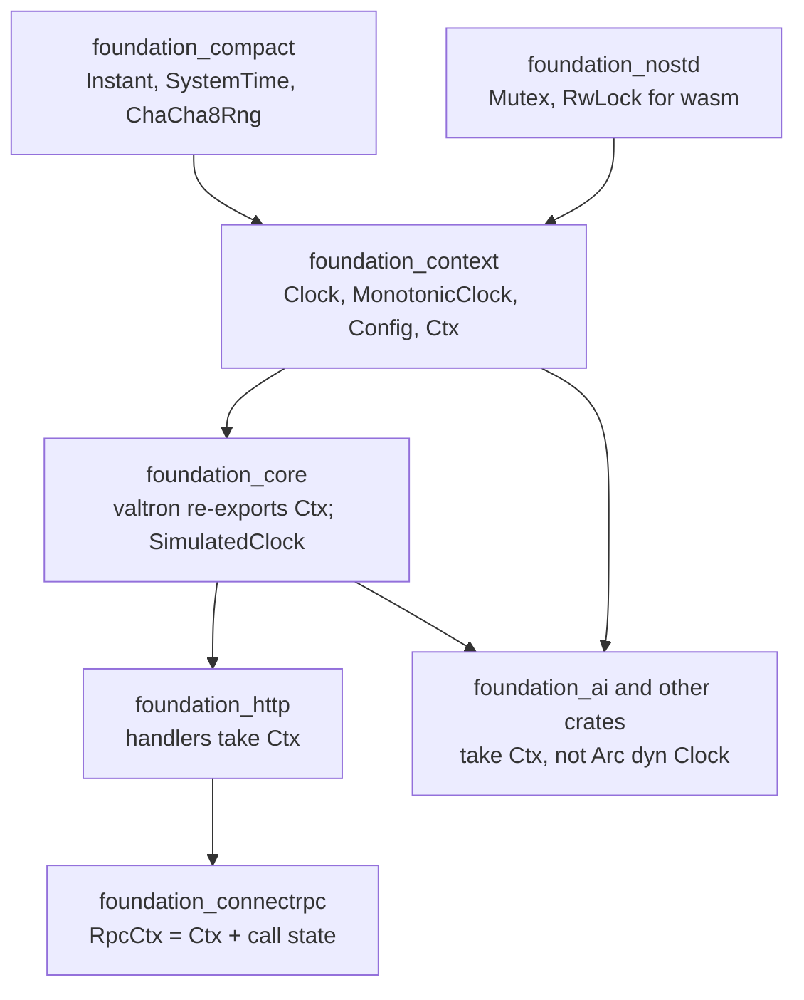
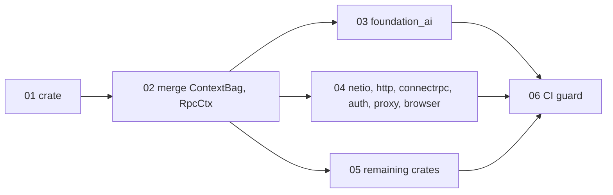

# Spec 76: One shared context (`foundation_context`)

_Written in ASD-STE100 Simplified Technical English (STE). Code and identifiers stay as they
are._

**Abbreviations in this file.** application programming interface (API); deterministic
simulation testing (DST); random number generator (RNG); remote procedure call (RPC);
Hypertext Transfer Protocol (HTTP); continuous integration (CI); pull request (PR);
AeroSpace and Defence Industries Association of Europe (ASD), the owner of the STE standard
ASD-STE100.

## Glossary

| Term | Meaning |
|---|---|
| context | One value that carries the side-effect sources (clock, RNG, config) and a map of shared items. Code reads its time and randomness from it. |
| `Ctx` | The context type. A cheap handle: `clone` shares the same map, `fork` copies the map. |
| type map | A map from a Rust type to one stored value of that type (`TypeId` key, `Arc<dyn Any>` value). |
| engine-minimum element | An element that every `Ctx` must carry: the clock, the config and the RNG. |
| `ContextBag` | The old `foundation_http` type. It is a second copy of the `Ctx` idea. This spec removes it. |
| `RpcCtx` | The new name of the per-call context in `foundation_connectrpc`: a `Ctx` plus per-call state. |
| host entry point | The `main` function, test harness or worker entry that builds the first `Ctx` with real sources. |

## 1. Problem

The owner rule 11 in `CLAUDE.md` says: side effects are injected, and code reads them from one
context bundle. Today the code has three different shapes for this:

1. **valtron `Ctx`** (`foundation_core/src/valtron/ctx.rs`). A type map plus a clock, a
   config and a shared `ChaCha8Rng`. Every valtron task gets one.
2. **`foundation_http::ContextBag`** (`foundation_http/src/shared/context/mod.rs`). A type map
   plus a clock and a `ChaCha8Rng`. HTTP and RPC handlers get one. It has the same job as
   `Ctx`. It also has an `unsafe impl Send` and `unsafe impl Sync` that the compiler does not
   need, so they only hide future mistakes.
3. **A bare `Arc<dyn Clock>` parameter.** There are about 600 of these outside tests, in about
   40 crates. `foundation_ai` alone has more than 100. Each new side effect (for example an ID
   source) would need a new parameter at every one of these sites.

`foundation_connectrpc` also has a type named `Ctx` (`{ bag: Arc<ContextBag>, request }`).
This name clashes with the valtron `Ctx`.

### Comparison of `Ctx` and `ContextBag`

| Property | valtron `Ctx` | `ContextBag` | Result after this spec |
|---|---|---|---|
| Type map | `Mutex<HashMap<TypeId, Arc<dyn Any>>>` | `RwLock<HashMap<..>>` | `RwLock` (read-heavy request path) |
| Clock | yes (`Arc<dyn Clock>`) | yes | yes |
| Config | yes (placeholder) | no | yes |
| RNG | `Arc<Mutex<ChaCha8Rng>>` | same | same |
| Share on clone | yes (`Arc` handle) | no (callers wrap it in `Arc`) | yes |
| `fork` (copy map) | yes | yes | yes |
| Insert | `insert(Arc<T>) -> Option<Arc<T>>` | `store(T)` | both |
| `get_cloned` | no | yes | yes |
| `remove` | returns `Option<Arc<T>>` | returns `Option<Arc<dyn Any>>` | `Option<Arc<T>>` |
| Fresh map, same sources | no | `from_ctx(&ctx)` | `Ctx::with_empty_map` |
| Copy map, other sources | no | `with_ctx(&ctx)` | `Ctx::rebase(&other)` |
| `unsafe impl Send/Sync` | no | yes (not needed) | no |

The two types are the same idea. This spec keeps one: `Ctx`.

## 2. Target design



_Caption: `foundation_context` sits below `foundation_core`, so every crate can use one `Ctx`._

### 2.1 The crate

- Path: `backends/foundation_context`. Dependencies: `foundation_compact` (time and RNG) and
  `foundation_nostd` (the `Mutex` and `RwLock` that the wasm build uses).
- Public items: `Clock`, `MonotonicClock`, `Config`, `Ctx`, `MinimumElement`.
- `foundation_core::valtron` re-exports these items. The old paths
  (`foundation_core::valtron::Ctx`, `foundation_core::valtron::Clock`) keep working, so the
  `#[task]` macro output and current callers do not change.
- **`SimulatedClock` stays in `foundation_core`.** Its `advance` must wake the parked
  executors (GitHub issue #305), and `request_executor_resume` is crate-private (feature 80
  of spec 70, CI guard `scripts/ci/check_executor_wake.py`). A listener hook in
  `foundation_context` would let a caller build a simulated clock that does not wake the
  executors, and that reopens #305. So the wake stays next to the executor.

### 2.2 The `Ctx` API after the merge

```rust
impl Ctx {
    pub fn new(clock: Arc<dyn Clock>) -> Self;            // unchanged
    pub fn host() -> Self;                                 // unchanged: real clock
    pub fn build(clock: Arc<dyn Clock>, f: impl FnOnce(&Ctx)) -> Self; // from ContextBag
    pub fn insert<T: Any + Send + Sync>(&self, value: Arc<T>) -> Option<Arc<T>>;
    pub fn store<T: Any + Send + Sync>(&self, value: T);  // from ContextBag
    pub fn get<T: Any + Send + Sync>(&self) -> Option<Arc<T>>;
    pub fn get_cloned<T: Any + Clone + Send + Sync>(&self) -> Option<T>; // from ContextBag
    pub fn get_or_insert<T: Any + Send + Sync>(&self, value: T) -> Arc<T>;
    pub fn remove<T: Any + Send + Sync>(&self) -> Option<Arc<T>>;
    pub fn contains<T: Any + Send + Sync>(&self) -> bool;
    pub fn clock(&self) -> Arc<dyn Clock>;
    pub fn config(&self) -> Arc<Config>;
    pub fn rng(&self) -> Arc<Mutex<ChaCha8Rng>>;
    pub fn fork(&self) -> Ctx;                             // copy map, share sources
    pub fn with_clock(&self, clock: Arc<dyn Clock>) -> Ctx;
    pub fn with_empty_map(&self) -> Ctx;                   // was ContextBag::from_ctx
    pub fn rebase(&self, sources: &Ctx) -> Ctx;            // was ContextBag::with_ctx
    pub fn assert_minimum(&self);
}
```

### 2.3 How code takes a context

| Before | After |
|---|---|
| `fn new(clock: Arc<dyn Clock>) -> Self` | `fn new(ctx: Ctx) -> Self` |
| struct field `clock: Arc<dyn Clock>` | struct field `ctx: Ctx`; read `self.ctx.clock()` |
| `Arc<ContextBag>` | `Ctx` (it is already a shared handle) |
| `ContextBag::from_ctx(&ctx)` | `ctx.with_empty_map()` |
| `connectrpc::Ctx { bag, request }` | `RpcCtx { ctx, request }` |

A function that only needs the time still takes `Ctx`. One parameter carries every side
effect, so a later source (for example an ID source) needs no signature change.

Exceptions (they keep `Arc<dyn Clock>`):

- `foundation_context` and `foundation_core::valtron` internals that build or hold the
  clock itself (`Ctx::new`, `with_clock`, `SimulatedClock`).
- Crates below `foundation_context` (`foundation_compact`, `foundation_nostd`).

## 3. Features and order



_Caption: features 03, 04 and 05 can run in parallel after feature 02._

| # | Feature | Model | Done when |
|---|---|---|---|
| 01 | [foundation_context crate](features/01-foundation-context-crate/feature.md) | sonnet | The crate exists, valtron re-exports it, and all `foundation_core` tests pass. |
| 02 | [Merge ContextBag into Ctx](features/02-merge-contextbag-into-ctx/feature.md) | sonnet | `ContextBag` is gone, and `connectrpc::Ctx` is `RpcCtx`. |
| 03 | [Ctx in foundation_ai](features/03-ctx-in-foundation-ai/feature.md) | haiku | `foundation_ai` has no `Arc<dyn Clock>` parameter. |
| 04 | [Ctx in the I/O crates](features/04-ctx-in-io-crates/feature.md) | haiku | The same, for netio, http, connectrpc, auth, proxy and browser. |
| 05 | [Ctx in the remaining crates](features/05-ctx-in-remaining-crates/feature.md) | haiku | The same, for every other crate. |
| 06 | [Clock parameter guard](features/06-clock-parameter-guard/feature.md) | haiku | CI fails on a new `Arc<dyn Clock>` parameter outside the allowlist. |

Each feature is one PR, and CI must be green on each one. No feature leaves a stub or a
deprecated shim behind: feature 02 removes `ContextBag` in the same PR that replaces it.

## 4. Rules for every feature

- Tests go in the crate's `tests/` directory (root rule 7).
- `cargo fmt`, clippy (`-D warnings` where `ci/packages.toml` sets it) and the tests of the
  changed crates and their direct dependents pass locally (specifications rule 2).
- A host entry point builds the first `Ctx` (`Ctx::host()`). Library code never calls
  `Ctx::host()` or `MonotonicClock::new()`; it takes the `Ctx` it is given (root rule 11).
- Update `progress.md` and `learnings.md` before the PR (root rule 10).
