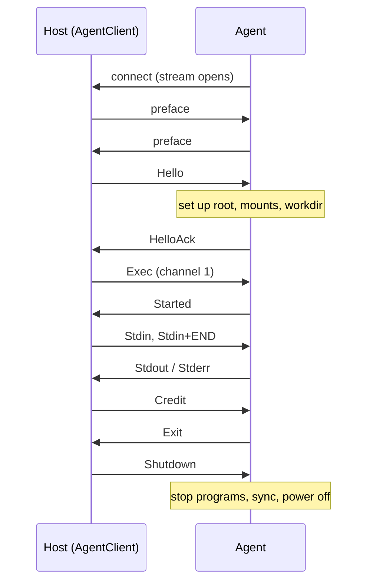

# Feature 00: Protocol and API types

_Written in ASD-STE100 Simplified Technical English (STE). Code and identifiers stay as they
are._

**Abbreviations in this file.** application programming interface (API); JavaScript Object
Notation (JSON); input and output (I/O); process identifier (PID); behaviour-driven development (BDD); continuous integration
(CI); AeroSpace and Defence Industries Association of Europe (ASD), the owner of the STE
standard ASD-STE100.

## 1. Goal

Make two crates:

1. `backends/foundation_platform_sandbox_protocol`: the agent protocol. Frame codec and
   message types. No I/O.
2. `backends/foundation_platform_sandbox`: the public API types, the error type, the limits
   and the traits. No backend yet.

After this feature, features 01, 02, 03 and 05 can start in parallel.

## A. Story

- **S1**: "A host program and a guest agent exchange messages on one byte stream."
- **S2**: "A sender frames a message; a receiver gets the same message back, whatever the
  read sizes are."
- **S3**: "A peer sends a frame that is too large, of an unknown kind, or not valid."
- **S4**: "A caller describes the sandbox that it wants, and gets an error that names the
  wrong field before anything starts."
- **S5**: "A library function asks for the host side effects and none were given."

| # | Use case | Actor | Trigger | Result |
|---|---|---|---|---|
| U1 | Encode a frame | host or agent | a message to send | Header and payload bytes, or `PayloadTooLarge`. |
| U2 | Decode a stream | host or agent | bytes from the transport | Zero or more complete frames, in order. |
| U3 | Reject bad input | host or agent | a bad header or payload | A typed `ProtocolError`; no payload byte stored. |
| U4 | Validate a spec | backend | `SandboxSpec::validate(caps)` | `Ok`, or the first failed rule as a typed error. |
| U5 | Read the host bundle | any library code | `SandboxHost::from_ctx(ctx)` | The bundle, or `HostNotConfigured`. |

## B. Bounded context

**Inside this feature:** the wire format, the message types, the public value types of the
sandbox API, the error type, the limits, and the traits that later features implement.

**Outside:** all I/O. The agent (feature 01) and the client (feature 02) read and write
bytes. The backends (features 04, 06, 09) start guests.

| Entity | Meaning | Owner (the one writer) |
|---|---|---|
| Preface | The 8 bytes that open each direction. | `protocol::frame` |
| Frame | A kind, flags, a channel and a payload. | `protocol::frame` |
| Message | The typed content of a control frame. | `protocol::messages` |
| `FrameDecoder` | The buffer that turns bytes into frames. | `protocol::frame` |
| `SandboxSpec` | What the caller wants. A value; no behaviour except `validate`. | `shared::spec` |
| `SandboxLimits` | Every size and time limit. | `shared::limits` |
| `SandboxError` | Every failure that a caller can see. | `shared::error` |
| `SandboxHost` | The side effects: processes, streams, files, paths. | `shared::host` |
| `Capabilities` | What one backend can do on this host. | each backend (read here) |

| Verb | Kind | Trigger | Effect |
|---|---|---|---|
| encode | entity | a `Frame` | Appends header and payload to a buffer. |
| feed | entity | bytes | Adds bytes to the decoder buffer. |
| next | entity | a decoder | Removes and returns one complete frame, if one is there. |
| validate | entity | a spec and capabilities | Returns the first failed rule. |
| from_ctx | entity | a `Ctx` | Returns the host bundle or a typed error. |

**Words.** *Frame*: one header and its payload. *Control frame*: a frame with a JSON
message. *Data frame*: `Stdin`, `Stdout`, `Stderr`, `FileData`. *Channel*: the number that
ties frames of one conversation. *Window*: the data bytes that a receiver can still take on
a channel. *Credit*: a grant that makes the window larger.

## C. Rules

### Law worksheet

```
Entity: Frame / FrameDecoder
Conserved value:         bytes fed = bytes of the frames returned + bytes still buffered
Bound:                   payload length <= max_frame_payload; buffered bytes <= HEADER_LEN + max_frame_payload
Inverse pairs:           encode / decode (decode(encode(f)) = f)
Idempotent verbs:        next on an empty decoder returns None each time
Ordering pairs:          feed -> next (enabling); frames come out in the order fed
Monotone values:         none
Freeze points:           max_payload at decoder construction
Links to other entities: Hello.max_frame_payload must equal the decoder limit of both peers

Entity: SandboxSpec
Conserved value:         none
Bound:                   vcpus >= 1; memory_mib >= 64; every limit > 0; channel_window >= max_frame_payload
Inverse pairs:           none
Idempotent verbs:        validate (same input, same answer, no change)
Ordering pairs:          the rules run in the fixed order of section 3.3
Monotone values:         none
Freeze points:           a spec does not change after create() takes it
Links to other entities: rootfs kind, network mode and mounts must be in Capabilities

Entity: SandboxHost
Conserved value:         none
Bound:                   none
Inverse pairs:           none
Idempotent verbs:        from_ctx
Ordering pairs:          store in Ctx -> from_ctx (enabling)
Monotone values:         none
Freeze points:           the bundle does not change after the host entry point stores it
Links to other entities: HostConfig paths are read by every backend
```

### Invariants

| # | Invariant |
|---|---|
| I1 | `decode(encode(f)) == f` for every frame `f` whose payload is inside the limit. |
| I2 | The frames that a decoder returns do not depend on how the input bytes were split. |
| I3 | A decoder never buffers more than `HEADER_LEN + max_frame_payload` bytes. |
| I4 | A header that names a payload above the limit is rejected before one payload byte is stored. |
| I5 | An unknown kind or an unknown flag bit is an error, never ignored. |
| I6 | `validate` returns the first failed rule in the order of section 3.3, and it changes nothing. |
| I7 | A missing `SandboxHost` gives `HostNotConfigured`. No code falls back to the real system. |
| I8 | Every limit has a default from `SandboxLimits::default()`, and no code path holds a limit as a `const`. |
| I9 | Two `Ctx` values with the same seed give the same `SandboxId` sequence. |

### Must have

- The protocol crate with no `foundation_*` dependency and no I/O.
- Every `SandboxError` variant that features 01 to 13 use (requirements section 5.3).
- The traits `SandboxBackend`, `SandboxOps`, `ProcessSpawner`, `StreamTransport`, `HostFs`.

### Must do

- Reject, with a typed error, each input that a rule does not allow.
- Document each limit default with its source.

### Must not

- Must not read a clock, a random source, a file or an environment variable.
- Must not add an optional frame kind. Version 1 has a closed set.
- Must not put a backend in this feature.

## D. Acceptance scenarios

```gherkin
Feature: Protocol and API types

  Scenario: A frame survives a round trip
    Given a frame of each kind with a payload of 0, 1 and 65536 bytes
    When it is encoded and the bytes are decoded
    Then the decoded frame equals the first frame

  Scenario: The split of the input does not matter
    Given the bytes of three frames
    When the bytes are fed one at a time
    Then the decoder returns the same three frames as with one feed

  Scenario: A frame that is too large is refused early
    Given a decoder with max_payload 65536
    When a header with length 65537 is fed
    Then next returns PayloadTooLarge { length: 65537, max: 65536 }
    And buffered_len is at most 10

  Scenario: An unknown kind is an error
    When a header with kind 0x7F is fed
    Then next returns UnknownKind(0x7F)

  Scenario: An unknown flag is an error
    When a header with flags 0x02 is fed
    Then next returns BadFlags(0x02)

  Scenario: A spec with a wrong root kind is refused
    Given capabilities with rootfs_directory false
    When a spec with RootFs::Directory is validated
    Then the result is UnsupportedRootFs

  Scenario: The first failed rule wins
    Given a spec with vcpus 0 and a relative workdir
    When it is validated
    Then the result is InvalidSpec { field: "vcpus" }

  Scenario: No host bundle, no fall-back
    Given a Ctx with no SandboxHost
    When SandboxHost::from_ctx is called
    Then the result is HostNotConfigured

  Scenario: A socket path that is too long is refused
    When check_socket_path is called with a path of 104 bytes
    Then the result is SocketPathTooLong
```

| Law | Test | Oracle |
|---|---|---|
| I1 | `frame_roundtrip` (property: any kind, channel, payload up to the limit) | identity |
| I2 | `decoder_split_input` (property: any split points) | identity against the one-feed result |
| I3, I4 | `payload_too_large_is_rejected_before_buffering` | bound |
| I5 | `unknown_kind_and_bad_flags` | expected outcome |
| I6 | `spec_validate`, `spec_validate_first_rule_wins` | expected outcome |
| I7 | `host_not_configured` | expected outcome |
| I8 | `limits_defaults` | example |
| I9 | `sandbox_id_is_deterministic` | identity |

Property tests use the property-test crate that the workspace already has (check
`Cargo.toml` of `foundation_core` `dev-dependencies`); they run with a fixed seed.

## 2. The agent protocol

The protocol runs on one ordered, reliable byte stream. The host and the agent are peers on
it. Each sends a preface, then frames.

### 2.1 Preface

Each side writes 8 bytes first: `45 57 45 53 42 58 00 01` (`EWESBX`, a zero byte, the
protocol version 1). A side that reads a different preface closes the stream with
`ProtocolError::BadPreface`.

### 2.2 Frame

A frame is a 10-byte header and a payload.

| Bytes | Field | Type | Notes |
|---|---|---|---|
| 0 | `kind` | `u8` | Table in section 2.3. |
| 1 | `flags` | `u8` | Bit 0 = `END`: the last data frame of this direction on this channel. Other bits are 0; a frame with another bit set is a protocol error. |
| 2 to 5 | `channel` | `u32`, little-endian | 0 = the connection. The host makes channel numbers; it starts at 1 and adds 1. |
| 6 to 9 | `length` | `u32`, little-endian | Payload length. More than `max_frame_payload` is a protocol error before any payload byte is read. |

### 2.3 Frame kinds

Control payloads are JSON (`serde_json`). Data payloads are raw bytes.

| Kind | Hex | Direction | Channel | Payload |
|---|---|---|---|---|
| `Hello` | `0x01` | host to agent | 0 | `Hello` |
| `HelloAck` | `0x02` | agent to host | 0 | `HelloAck` |
| `Ping` | `0x03` | host to agent | 0 | 8 bytes, opaque |
| `Pong` | `0x04` | agent to host | 0 | the same 8 bytes |
| `Shutdown` | `0x05` | host to agent | 0 | `ShutdownRequest` |
| `Credit` | `0x06` | both | not 0 | `u32`, little-endian: more bytes that the sender of this frame can receive |
| `Error` | `0x07` | agent to host | any | `AgentErrorBody`. On channel 0 it ends the connection. On another channel it ends that channel. |
| `Exec` | `0x10` | host to agent | new | `ExecRequest` |
| `Started` | `0x11` | agent to host | exec | `Started` |
| `Stdin` | `0x12` | host to agent | exec | bytes. `END` closes the standard input of the program. |
| `Stdout` | `0x13` | agent to host | exec | bytes |
| `Stderr` | `0x14` | agent to host | exec | bytes |
| `Signal` | `0x15` | host to agent | exec | `SignalRequest` |
| `Exit` | `0x16` | agent to host | exec | `ExitBody`. Always the last frame of an exec channel. |
| `FileWrite` | `0x20` | host to agent | new | `FileWriteRequest` |
| `FileRead` | `0x21` | host to agent | new | `FileReadRequest` |
| `FileData` | `0x22` | both | file | bytes. `END` marks the last one. |
| `FileDone` | `0x23` | agent to host | file | `FileDone`. Always the last frame of a file channel. |

A frame with an unknown kind is a protocol error. Version 1 has no optional kinds.

### 2.4 Messages

```rust
#[derive(Debug, Clone, PartialEq, Eq, Serialize, Deserialize)]
pub struct Hello {
    pub max_frame_payload: u32,
    pub channel_window: u32,
    pub max_channels: u32,
    pub output_drain_timeout_ms: u32,
    pub root: RootSetup,
    pub workdir: String,
    pub env: Vec<(String, String)>,
    pub mounts: Vec<GuestMount>,
    /// Name server addresses. Empty = the agent does not touch `/etc/resolv.conf`.
    pub dns: Vec<String>,
}

#[derive(Debug, Clone, PartialEq, Eq, Serialize, Deserialize)]
pub struct RootSetup {
    pub source: RootSource,   // where the user root file system is
    pub mode: RootMode,       // Overlay | ReadOnly
}

#[derive(Debug, Clone, PartialEq, Eq, Serialize, Deserialize)]
pub enum RootSource {
    /// A block device to mount, for example "/dev/vda". Firecracker.
    BlockDevice { device: String, fstype: FsType },   // FsType: Ext4 | Squashfs
    /// A virtio-fs device to mount by its tag. libkrun with a root directory.
    VirtioFs { tag: String },
    /// The current root of the agent, used as it is. No mount work. `mode` is
    /// ignored. Cloudflare (the container root is already a private copy) and the
    /// agent process tests.
    Plain,
}

#[derive(Debug, Clone, PartialEq, Eq, Serialize, Deserialize)]
pub struct GuestMount { pub tag: String, pub guest_path: String, pub read_only: bool }

#[derive(Debug, Clone, PartialEq, Eq, Serialize, Deserialize)]
pub struct HelloAck {
    pub agent_version: String,
    pub arch: String,           // "x86_64" | "aarch64"
    pub kernel: String,         // uname release
    pub is_pid1: bool,
    pub root_mode: RootMode,    // the mode in effect
}

#[derive(Debug, Clone, PartialEq, Eq, Serialize, Deserialize)]
pub struct ExecRequest {
    pub argv: Vec<String>,
    pub env: Vec<(String, String)>,   // added over Hello.env; a later key wins
    pub cwd: Option<String>,          // None = Hello.workdir
    pub stdin: bool,                  // false = /dev/null
}

pub struct Started { pub pid: u32 }
pub struct SignalRequest { pub signal: i32 }
pub struct ExitBody { pub code: Option<i32>, pub signal: Option<i32> }   // exactly one is Some
pub struct ShutdownRequest { pub grace_ms: u32 }
pub struct FileWriteRequest { pub path: String, pub mode: u32 }          // path is absolute
pub struct FileReadRequest { pub path: String }
pub struct FileDone { pub size: u64 }
pub struct AgentErrorBody { pub code: AgentErrorCode, pub errno: Option<i32>, pub message: String }

pub enum AgentErrorCode {
    BadRequest, NotFound, PermissionDenied, SpawnFailed, RootSetupFailed,
    MountFailed, Io, TooManyChannels, Protocol, Internal,
}
```

`message` is cut to `max_error_message` bytes by the sender.

### 2.5 Flow control

Data frames are `Stdin`, `Stdout`, `Stderr` and `FileData`. Each channel has one receive
window for each direction.

- The first window is `Hello.channel_window` bytes in both directions.
- A sender does not send more data bytes on a channel than the window that it has left.
  `Stdout` and `Stderr` share the window of the channel.
- A receiver sends `Credit(n)` after its consumer takes `n` bytes. It can group credits; it
  must send one when half of the window is used.
- Control frames do not use the window.

This keeps one slow reader from blocking the other channels and the `Ping` frame. It also
bounds memory: a receiver holds at most one window for each channel.

### 2.6 Sequences



_Caption: the agent connects, both sides send the preface, and one command uses one channel from `Exec` to `Exit`._

### 2.7 Codec API

```rust
pub const PREFACE: [u8; 8] = *b"EWESBX\x00\x01";
pub const HEADER_LEN: usize = 10;

#[derive(Debug, Clone, PartialEq, Eq)]
pub struct Frame { pub kind: FrameKind, pub flags: u8, pub channel: u32, pub payload: Vec<u8> }

/// Writes one frame to `out`. Fails when the payload is larger than `max_payload`.
pub fn encode_frame(frame: &Frame, max_payload: u32, out: &mut Vec<u8>) -> Result<(), ProtocolError>;

/// An incremental decoder. `feed` adds bytes. `next` gives one complete frame, or
/// `Ok(None)` when more bytes are necessary.
pub struct FrameDecoder { /* private */ }
impl FrameDecoder {
    pub fn new(max_payload: u32) -> Self;
    pub fn feed(&mut self, bytes: &[u8]);
    pub fn next(&mut self) -> Result<Option<Frame>, ProtocolError>;
    pub fn buffered_len(&self) -> usize;
}

pub fn encode_control<T: Serialize>(kind: FrameKind, channel: u32, body: &T, max_payload: u32)
    -> Result<Frame, ProtocolError>;
pub fn decode_control<T: DeserializeOwned>(frame: &Frame) -> Result<T, ProtocolError>;

#[derive(Debug, Clone, PartialEq, Eq, derive_more::Display, derive_more::Error)]
pub enum ProtocolError {
    BadPreface, UnknownKind(u8), BadFlags(u8), PayloadTooLarge { length: u32, max: u32 },
    BadJson { kind: u8 }, BadCredit, UnexpectedFrame { kind: u8, channel: u32 },
}
```

The decoder follows `LogFrameDecoder` in
`backends/foundation_deployment_docker/src/streaming/decoder.rs`: it checks the length in
the header before it stores a payload byte.

## 3. The API crate

Files in `backends/foundation_platform_sandbox/src/`:

| File | Content |
|---|---|
| `lib.rs` | Module list and re-exports. |
| `shared/spec.rs` | `SandboxSpec`, `RootFs`, `RootMode`, `NetworkMode`, `HostMount`, `KernelSource`, builder methods, `validate()`. |
| `shared/limits.rs` | `SandboxLimits` with the defaults of requirements section 5.4 and a doc comment that names the source of each default. |
| `shared/command.rs` | `Command`, `StdinMode`, `ExitStatus`, `ExecEvent`, `ExecOutput`. |
| `shared/error.rs` | `SandboxError`, `SandboxResult<T>`. |
| `shared/ids.rs` | `SandboxId` (12 lower-case hex characters from `ctx.rng()`), `BackendId`. |
| `shared/host.rs` | `SandboxHost` and the three traits of section 3.2. |
| `shared/backend.rs` | `SandboxBackend`, `SandboxOps`, `HostReport`, `Capabilities`, `CreateProgress`, `SandboxState`, `ExitReport`. |

Requirements section 5 has the field tables. This section adds what that section does not
have.

### 3.1 Backend traits

```rust
pub type BoxFuture<'a, T> = Pin<Box<dyn Future<Output = T> + Send + 'a>>;

/// Starts sandboxes of one kind.
pub trait SandboxBackend: Send + Sync + 'static {
    fn id(&self) -> BackendId;
    /// Checks the host. Does not start a VM. Does not wait.
    fn probe(&self, ctx: &Ctx) -> HostReport;
    fn create(&self, ctx: Ctx, spec: SandboxSpec) -> BoxFuture<'static, SandboxResult<Sandbox>>;
    fn create_with_progress(&self, ctx: Ctx, spec: SandboxSpec) -> CreateStream;
}

/// What one running sandbox can do. `Sandbox` holds an `Arc<dyn SandboxOps>`.
pub trait SandboxOps: Send + Sync + 'static {
    fn state(&self) -> SandboxState;
    fn exec(&self, command: Command) -> BoxFuture<'_, SandboxResult<ExecHandle>>;
    fn write_file(&self, path: String, mode: u32, data: BoxByteStream)
        -> BoxFuture<'_, SandboxResult<u64>>;
    fn read_file(&self, path: String) -> BoxFuture<'_, SandboxResult<FileStream>>;
    fn stop(&self) -> BoxFuture<'_, SandboxResult<ExitReport>>;
    fn kill(&self) -> BoxFuture<'_, SandboxResult<ExitReport>>;
}

#[derive(Debug, Clone, PartialEq, Eq)]
pub enum CreateProgress {
    Preparing,        // run directory, generated files
    VmmSpawned,       // the VMM or runner process exists
    VmmConfigured,    // Firecracker only: all API calls are done
    Booting,          // the guest is starting
    AgentConnected,   // the stream is open
    AgentReady,       // HelloAck is in
}

pub type CreateStream =
    Box<dyn StreamIterator<D = SandboxResult<Sandbox>, P = CreateProgress> + Send + 'static>;

#[derive(Debug, Clone)]
pub struct HostReport {
    pub backend: BackendId,
    pub usable: bool,
    pub checks: Vec<HostCheck>,          // name, ok, message
    pub capabilities: Capabilities,
}

#[derive(Debug, Clone, Copy, PartialEq, Eq)]
pub struct Capabilities {
    pub rootfs_directory: bool,
    pub rootfs_ext4: bool,
    pub rootfs_squashfs: bool,
    pub rootfs_cloudflare_image: bool,
    pub host_mounts: bool,
    pub network_host: bool,
}

#[derive(Debug, Clone)]
pub struct ExitReport {
    pub vmm_exit_code: Option<i32>,
    pub killed: bool,                    // true when the grace time ended
}
```

`Sandbox`, `ExecHandle` and `FileStream` are structs with the methods of requirements
section 5. In this feature they hold the trait object and delegate. `ExecHandle` gets its
real body in feature 02; this feature defines its public methods and the internal
constructor that feature 02 uses.

### 3.2 `SandboxHost`

```rust
/// The side effects of this crate, carried in `Ctx` (root rule 11).
#[derive(Clone)]
pub struct SandboxHost {
    pub processes: Arc<dyn ProcessSpawner>,
    pub transport: Arc<dyn StreamTransport>,
    pub fs: Arc<dyn HostFs>,
    pub config: Arc<HostConfig>,
}

pub struct HostConfig {
    pub state_dir: PathBuf,              // run directories; must be short (section 3.4)
    pub cache_dir: PathBuf,              // downloaded and built artifacts
    pub agent_path: Option<PathBuf>,     // sandbox-agent for the guest architecture
    pub krun_runner_path: Option<PathBuf>,
    pub firecracker_path: Option<PathBuf>,
    pub libkrun_path: Option<PathBuf>,
}

pub trait ProcessSpawner: Send + Sync + 'static {
    fn spawn(&self, spec: ProcessSpec) -> SandboxResult<Box<dyn ChildProcess>>;
}
pub struct ProcessSpec {
    pub program: PathBuf,
    pub args: Vec<String>,
    pub env: Vec<(String, String)>,      // the full environment; nothing is inherited
    pub cwd: PathBuf,
    pub stdout: PathBuf,                 // a file; opened for append
    pub stderr: PathBuf,
    pub kill_with_parent: bool,
}
pub trait ChildProcess: Send + Sync + 'static {
    fn pid(&self) -> u32;
    fn signal(&self, signal: i32) -> SandboxResult<()>;
    /// Completes when the process exits. Can be called more than once.
    fn wait(&self) -> BoxFuture<'_, SandboxResult<ProcessExit>>;
    fn try_wait(&self) -> SandboxResult<Option<ProcessExit>>;
}
pub struct ProcessExit { pub code: Option<i32>, pub signal: Option<i32> }

pub trait StreamTransport: Send + Sync + 'static {
    /// Binds a listening socket at `path`. The file must not exist.
    fn listen_unix(&self, path: &Path) -> SandboxResult<Box<dyn StreamListener>>;
    fn connect_unix(&self, path: &Path) -> BoxFuture<'_, SandboxResult<Box<dyn ByteDuplex>>>;
}
pub trait StreamListener: Send + Sync + 'static {
    fn accept(&self) -> BoxFuture<'_, SandboxResult<Box<dyn ByteDuplex>>>;
}
/// An async byte stream in both directions.
pub trait ByteDuplex: Send + 'static {
    fn read<'a>(&'a mut self, buf: &'a mut [u8]) -> BoxFuture<'a, SandboxResult<usize>>; // 0 = end
    fn write_all<'a>(&'a mut self, buf: &'a [u8]) -> BoxFuture<'a, SandboxResult<()>>;
    fn shutdown(&mut self) -> BoxFuture<'_, SandboxResult<()>>;
    fn split(self: Box<Self>) -> (Box<dyn ByteRead>, Box<dyn ByteWrite>);
}

pub trait HostFs: Send + Sync + 'static {
    fn create_dir_all(&self, path: &Path) -> SandboxResult<()>;
    fn remove_dir_all(&self, path: &Path) -> SandboxResult<()>;
    fn write(&self, path: &Path, data: &[u8]) -> SandboxResult<()>;
    fn read(&self, path: &Path, max: usize) -> SandboxResult<Vec<u8>>;   // bounded
    fn exists(&self, path: &Path) -> bool;
    fn metadata(&self, path: &Path) -> SandboxResult<FileMeta>;
    fn tail(&self, path: &Path, max: usize) -> SandboxResult<Vec<u8>>;   // last bytes, for log_tail
}
```

This feature defines the traits and the function `SandboxHost::from_ctx(ctx) ->
SandboxResult<SandboxHost>`, which returns `HostNotConfigured` when the entry is missing.
Feature 02 writes `SandboxHost::native()`.

### 3.3 `SandboxSpec::validate`

`validate(&self, caps: &Capabilities) -> SandboxResult<()>` checks, in this order:

1. `vcpus >= 1`; `memory_mib >= 64`.
2. `workdir` and each `HostMount.guest_path` are absolute and have no `..` part.
3. The `rootfs` kind is in `caps`; if not, `UnsupportedRootFs`.
4. `network == Host` needs `caps.network_host`; if not, `UnsupportedNetwork`.
5. `mounts` not empty needs `caps.host_mounts`; if not, `UnsupportedMount`.
6. Each limit is more than zero. `channel_window >= max_frame_payload`.

### 3.4 Socket path length

A UDS path has a limit: 104 bytes on macOS and 108 on Linux, with the end zero byte. The
function `shared::ids::check_socket_path(path) -> SandboxResult<()>` returns
`SocketPathTooLong { path, max }` when the path is longer than 103 bytes. The default
`state_dir` is `$XDG_RUNTIME_DIR/ewe-sbx` when that variable is set, and
`/tmp/ewe-sbx-<uid>` when it is not. The host entry point reads the variable; library code
gets the value from `HostConfig`.

## 4. Work

1. Create `backends/foundation_platform_sandbox_protocol` (version `0.0.1`, workspace
   edition, lints and licence). Dependencies: `serde`, `serde_json`, `derive_more`. Nothing
   else.
2. Write `src/lib.rs`, `src/frame.rs` (header, `FrameKind`, codec) and `src/messages.rs`.
3. Create `backends/foundation_platform_sandbox` (version `0.0.1`). Dependencies:
   `foundation_platform_sandbox_protocol`, `foundation_context`, `foundation_core`,
   `foundation_compact` (`default-features = false`), `foundation_errstacks`, `serde`,
   `derive_more`, `tracing`. Features: `firecracker`, `libkrun`, `cloudflare` (empty for
   now), default `["firecracker", "libkrun"]`.
4. Write the files of section 3.
5. Add both crates to `ci/packages.toml`. Copy the shape of a small native crate entry.
6. Add a `README.md` to each crate with the purpose and a link to this spec.

## 5. Tests

`foundation_platform_sandbox_protocol/tests/`:

- `frame_roundtrip`: each kind encodes and decodes to the same `Frame`.
- `decoder_split_input`: a frame fed one byte at a time gives the same result as one feed.
- `decoder_two_frames_one_feed`: two frames in one buffer give two frames.
- `payload_too_large_is_rejected_before_buffering`: a header with `length = max + 1` gives
  `PayloadTooLarge`, and `buffered_len()` stays at most `HEADER_LEN`.
- `unknown_kind_and_bad_flags`: each gives its error.
- `control_json_roundtrip`: each message type.
- `preface_bytes`: the constant has the value of section 2.1.

`foundation_platform_sandbox/tests/`:

- `spec_validate`: one case for each rule of section 3.3.
- `limits_defaults`: each default has the value of requirements section 5.4.
- `sandbox_id_is_deterministic`: two `Ctx::with_seed` values with the same seed give the
  same `SandboxId`.
- `host_not_configured`: `SandboxHost::from_ctx` on an empty `Ctx` gives
  `HostNotConfigured`.
- `socket_path_limit`: a 104-byte path fails; a 103-byte path passes.

## 6. Verify

```bash
cargo fmt --all --check
cargo clippy -p foundation_platform_sandbox_protocol --all-targets --profile uat --no-deps -- -D warnings
cargo clippy -p foundation_platform_sandbox --all-targets --profile uat --no-deps -- -D warnings
cargo test -p foundation_platform_sandbox_protocol --profile uat
cargo test -p foundation_platform_sandbox --profile uat
cargo check -p foundation_platform_sandbox_protocol --target x86_64-unknown-linux-musl --profile uat
```

## 7. Done when

- Both crates build and are in `ci/packages.toml`.
- The tests of section 5 pass.
- The protocol crate has no `foundation_*` dependency and builds for the musl target.
- No `const` holds a limit in a code path; each limit comes from `SandboxLimits` or `Hello`.
