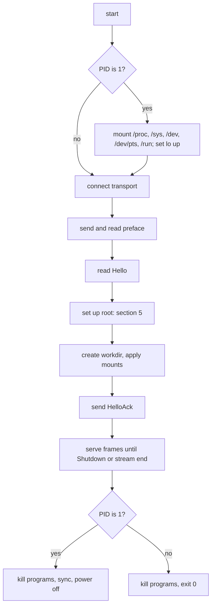

# Feature 01: The guest agent (`sandbox-agent`)

_Written in ASD-STE100 Simplified Technical English (STE). Code and identifiers stay as they
are._

**Abbreviations in this file.** process identifier (PID); Unix domain socket (UDS);
Transmission Control Protocol (TCP); context identifier (CID); input and output (I/O);
virtual machine (VM); continuous integration (CI); AeroSpace and Defence Industries
Association of Europe (ASD), the owner of the STE standard ASD-STE100.

## 1. Goal

Write `bin/sandbox_agent`, the program `sandbox-agent`. It runs in the guest. It connects to
the host, sets up the root file system, and then starts programs and moves bytes as the
agent protocol says (feature 00, section 2).

One program serves three backends. The differences are in its start arguments.

## 2. Constraints

- A static Linux program: targets `x86_64-unknown-linux-musl` and
  `aarch64-unknown-linux-musl`.
- Dependencies: `foundation_platform_sandbox_protocol`, `libc`, `serde`, `serde_json`.
  Nothing else. No `foundation_core`. The program must stay small (target: less than
  1.5 MiB with `opt-level = "s"`, `lto`, `panic = "abort"`, `strip`) and must start in
  milliseconds.
- It uses `std` threads and blocking I/O (requirements question Q4). This is the guest side;
  the host rules for valtron do not apply to it.
- It runs as root in the guest. It never runs on the host in production.

## 3. Start arguments

The agent reads its configuration from two places, in this order:

1. Command-line arguments.
2. The kernel command line (`/proc/cmdline`), keys with the prefix `ewe.`. This is for
   Firecracker, where the agent is `/init` and gets no arguments of ours.

| Argument | Kernel key | Values | Meaning |
|---|---|---|---|
| `--transport <t>` | `ewe.transport=<t>` | `vsock:<cid>:<port>`, `unix:<path>`, `tcp-listen:<port>` | How to reach the host. |
| `--connect-timeout-ms <n>` | `ewe.connect_timeout_ms=<n>` | integer, default 5000 | Time to retry the connect. |

All other settings (root set-up, mounts, limits, environment) arrive in `Hello`. This keeps
the kernel command line short and puts one source of truth on the host.

| Transport | Used by | Behaviour |
|---|---|---|
| `vsock:2:1024` | Firecracker, libkrun | `socket(AF_VSOCK, SOCK_STREAM)`, `connect` to CID 2. Retries every 20 ms until the time-out. |
| `unix:<path>` | tests | `connect` to a UDS. Lets the agent run as a normal process with no VM. |
| `tcp-listen:1024` | Cloudflare | `bind` to `0.0.0.0`, `listen`, accept one connection at a time. When the connection closes, accept the next one. |

When the agent is PID 1 and the connect fails after the time-out, it writes one line to the
console and powers the VM off.

## 4. Start sequence



_Caption: the agent does kernel set-up only when it is PID 1, and it answers `HelloAck` only after the root file system is ready._

PID 1 duties (Firecracker):

- Mount `proc` on `/proc`, `sysfs` on `/sys`, `devtmpfs` on `/dev`, `devpts` on `/dev/pts`,
  `tmpfs` on `/run`. An `EBUSY` result means that the kernel mounted it already
  (`DEVTMPFS_MOUNT`); continue.
- Set the `lo` interface up (`ioctl SIOCSIFFLAGS`).
- Reap every child process (section 7.3).
- At the end: `sync()`, then `reboot(RB_AUTOBOOT)`. With the boot argument `reboot=k`,
  Firecracker stops. PID 1 must never return from `main`; a return makes a kernel panic.

When the agent is not PID 1 (libkrun, Cloudflare, tests), the init of that system did the
mounts. The agent exits with code 0 at the end; on libkrun this stops the VM.

## 5. Root file system set-up

The goal: each program runs in a root that looks like the user image, and the source image
never changes.

`Hello.root` has a `source` and a `mode`.

| Step | `BlockDevice { device, fstype }` (Firecracker) | `Current` (libkrun, Cloudflare, tests) |
|---|---|---|
| 1. Lower layer | `mount(device, "/run/ewe/lower", fstype, MS_RDONLY)` | The lower layer is `/`. |
| 2a. Mode `Overlay` | Mount `tmpfs` on `/run/ewe/rw`. Make `upper` and `work` in it. `mount("overlay", "/run/ewe/root", "overlay", 0, "lowerdir=<lower>,upperdir=...,workdir=...")`. | The same, with `lowerdir=/`. |
| 2b. Mode `ReadOnly` | Bind-mount the lower layer on `/run/ewe/root`, read-only. Mount `tmpfs` on `<root>/tmp`, `<root>/run` and `<root><workdir>`. | The same. |
| 3. Kernel file systems | Bind-mount `/proc`, `/sys` and `/dev` into `/run/ewe/root` (`MS_BIND | MS_REC`). | The same. |
| 4. Result | `exec_root = "/run/ewe/root"` | The same. |

`RootSource::Plain` does none of these steps: `exec_root = "/"`, and `mode` is ignored. The
Cloudflare backend uses it, because a container root is already a private copy of its
image. The agent process tests use it too, because they have no root rights.

Each program does `chroot(exec_root)` and `chdir(cwd)` before `execve` (section 6).

A failed step sends `Error` on channel 0 with `RootSetupFailed`, the `errno` and the step
name, and the agent stops. `ENODEV` from the overlay mount means that the guest kernel has
no overlayfs; the message says so.

**Measure first (libkrun).** Feature 04 runs the agent on the `libkrunfw` kernel. Two facts
are not yet measured: (1) the `libkrunfw` kernel has overlayfs; (2) overlayfs accepts a
virtio-fs lower layer at `/` with a tmpfs upper layer below it. Feature 04 has a step for
this. The agent code does not change with the result; the result decides the default
`root_mode` of the libkrun backend.

Extra mounts (`Hello.mounts`, libkrun only): for each one,
`mount(tag, "<exec_root><guest_path>", "virtiofs", flags, "")`, with `MS_RDONLY` when
`read_only` is true. The agent makes the mount point first.

## 6. Program start (`Exec`)

For an `Exec` frame on a new channel:

1. Check `argv` is not empty. Check the channel count against `Hello.max_channels`
   (`TooManyChannels`).
2. Make three pipes (standard input only when `stdin` is true; if not, open `/dev/null`).
   Set `O_CLOEXEC` on the parent ends.
3. `fork()`. In the child, call only async-signal-safe functions:
   `setsid()`, `dup2` for the three streams, `chroot(exec_root)`, `chdir(cwd)`, reset the
   signal mask, `execve(argv[0], argv, env)`. `argv[0]` without a `/` is looked up in the
   `PATH` of the merged environment, by the parent, before `fork()`, with paths relative
   to `exec_root`. On a failed `execve`, the child writes the `errno` to a close-on-exec
   status pipe and calls `_exit(127)`.
4. The parent reads the status pipe. Data on it means the start failed: send `Error`
   (`SpawnFailed` or `NotFound` with the `errno`) and close the channel. End of file
   means the program started: send `Started { pid }`.
5. Start two reader threads (standard output, standard error) and one writer thread
   (standard input). Each reader reads at most `max_frame_payload` bytes, waits for
   channel credit, and sends a data frame. The writer takes `Stdin` frames from a queue,
   writes them to the pipe, and sends `Credit` for the bytes that it wrote. `Stdin` with
   `END` closes the pipe.
6. The environment of the program is `Hello.env`, then `ExecRequest.env`. When no `PATH`
   is given, the agent adds
   `PATH=/usr/local/sbin:/usr/local/bin:/usr/sbin:/usr/bin:/sbin:/bin`.

`setsid()` makes the program the leader of a new session and process group. A `Signal`
frame sends the signal to the group: `kill(-pid, signal)`. So a signal reaches the children
of the program too.

### 6.1 End of a program

The agent sends `Exit` when both of these are true:

- the reaper has the exit status of the program;
- both output pipes are at end of file, **or** `output_drain_timeout_ms` passed after the
  exit.

The second rule exists because a background child can keep the pipes open after the program
exits. After the time-out the agent closes its ends of the pipes and sends `Exit`. Output
that arrives later is lost; the documentation of `Command` says so.

`ExitBody.code` is the exit code. When a signal stopped the program, `code` is `None` and
`signal` is the signal number.

## 7. Threads and shared state

### 7.1 Threads

| Thread | Count | Blocks on | Work |
|---|---|---|---|
| reader | 1 | the transport read | Decodes frames. Routes them to channel queues. Handles channel 0. |
| writer | 1 | a frame queue | Writes frames to the transport. The only thread that writes to it. |
| reaper | 1 | `waitpid(-1)` | Records each exit status. Section 7.3. |
| exec output | 2 for each program | a pipe read, then credit | Section 6, step 5. |
| exec input | 1 for each program with `stdin` | the channel queue | Section 6, step 5. |
| file | 1 for each transfer | file I/O, then credit | Section 8. |

The frame queue to the writer has a bound (`max_channels * 4` frames). A full queue blocks
the sender thread; this is the back pressure to the pipes.

### 7.2 Credit

Each channel has a send window (`Mutex<u32>` and a `Condvar`). A data sender waits on the
`Condvar` while the window is smaller than the frame. The reader thread adds to the window
when a `Credit` frame arrives and notifies. A `Credit` that makes the window larger than
`2^31` is a protocol error.

### 7.3 Reaper

One thread calls `waitpid(-1, &status, 0)` in a loop. A table maps the PID of each started
program to its channel. For a PID in the table, the reaper stores the status and notifies
the channel. For another PID (an orphan that PID 1 inherited), it drops the status. No other
code calls `waitpid`. This removes the race where two callers wait for the same child.

When `waitpid` returns `ECHILD`, the reaper waits on a `Condvar` that `Exec` notifies after
each `fork()`.

## 8. File transfer

`FileWrite { path, mode }`: the agent opens `<exec_root><path>.ewe-tmp-<channel>` with
`O_CREAT | O_EXCL | O_WRONLY` and `mode`. It writes each `FileData` payload and sends
`Credit`. On `END` it calls `fsync`, renames the file to `<exec_root><path>`, and sends
`FileDone { size }`. On an error it removes the temporary file and sends `Error` with the
`errno`. The parent directory must exist; the agent does not make it (the caller runs
`mkdir -p`).

`FileRead { path }`: the agent opens the file, sends `FileData` frames within the credit,
sets `END` on the last one, and sends `FileDone { size }`.

`path` must be absolute. The agent joins it to `exec_root` with a function that removes
`.` and rejects `..`, so a path cannot leave the root by its text. A symbolic link in the
guest can still point anywhere in the guest; that is inside the sandbox and is allowed.

## 9. `Shutdown` and stream loss

`Shutdown { grace_ms }`:

1. Stop new `Exec` and file requests (`Error` with `BadRequest`).
2. Send `SIGTERM` to each program group. Wait `grace_ms` for them to exit. Then send
   `SIGKILL`.
3. PID 1: `sync()` and power off. Not PID 1: exit with code 0.

Stream end or a protocol error on the transport:

- Transport `vsock` or `unix`: do the same as `Shutdown { grace_ms: 0 }`. A sandbox with no
  host is of no use, and this prevents a VM that runs for ever.
- Transport `tcp-listen`: kill the programs, discard the channels, and accept the next
  connection. The container life cycle belongs to Cloudflare.

## 10. Source layout

| File | Content |
|---|---|
| `src/main.rs` | Argument and kernel command line parse. Start sequence. |
| `src/transport.rs` | The three transports behind one `Read + Write` pair. `AF_VSOCK` with `libc::sockaddr_vm`. |
| `src/conn.rs` | Reader, writer, channel table, credit. |
| `src/pid1.rs` | Mounts, `lo`, power off. |
| `src/root.rs` | Section 5. |
| `src/exec.rs` | Section 6. |
| `src/reaper.rs` | Section 7.3. |
| `src/files.rs` | Section 8. |
| `src/sys.rs` | Thin `libc` wrappers that return `io::Result`. All `unsafe` is here, each block with a `SAFETY` comment. |

`Cargo.toml` has a `[profile]` note: the workspace root sets profiles. Add a profile
`agent` there (`inherits = "release"`, `opt-level = "s"`, `lto = true`, `panic = "abort"`,
`strip = true`, `codegen-units = 1`).

Build task (add to `mise.toml` as `sandbox:agent`):

```bash
rustup target add x86_64-unknown-linux-musl aarch64-unknown-linux-musl
cargo build -p sandbox_agent --profile agent --target x86_64-unknown-linux-musl
cargo build -p sandbox_agent --profile agent --target aarch64-unknown-linux-musl
```

On macOS the musl targets need a linker. Use the bundled one:
`RUSTFLAGS="-C linker=rust-lld -C link-self-contained=yes"`. The task sets this when the
host is macOS. Record the measured result in `learnings.md`; if `rust-lld` fails, the
fall-back is `cargo zigbuild`, and the task must say which one it uses.

## 11. Tests

All tests are in `bin/sandbox_agent/tests/`. They run on Linux only (`#![cfg(target_os =
"linux")]`), as a normal user where possible. They start the built agent with
`--transport unix:<path>` and act as the host with the protocol crate and blocking sockets.

| Test | Proves |
|---|---|
| `handshake` | Preface, `Hello` with `RootSource::Plain`, then the `HelloAck` fields. |
| `exec_echo` | `Exec ["/bin/echo", "hi"]` gives `Started`, `Stdout "hi\n"`, `Exit { code: 0 }`. |
| `exec_exit_code` | `sh -c "exit 7"` gives code 7. |
| `exec_signal` | `sleep 60`, then `Signal 15`, gives `signal: Some(15)`. |
| `exec_signal_reaches_group` | `sh -c "sleep 60 & wait"`; after `Signal 9` no `sleep` process of that group exists. |
| `exec_stdin` | `cat` returns the bytes of `Stdin`; `END` ends it. |
| `exec_not_found` | A missing program gives `Error { NotFound }` and no `Started`. |
| `exec_stderr_is_separate` | `sh -c "echo a; echo b >&2"` gives one `Stdout` and one `Stderr`. |
| `credit_blocks_sender` | With a window of 4 KiB and no `Credit`, `yes` sends at most 4 KiB. After `Credit`, more arrives. |
| `drain_timeout` | `sh -c "sleep 30 & echo x"` gives `Exit` in about `output_drain_timeout_ms`, not 30 s. |
| `file_roundtrip` | A 1 MiB `FileWrite`, then `FileRead`, gives the same bytes and size. |
| `file_write_is_atomic` | A transfer that stops before `END` leaves no file at `path`. |
| `path_escape_rejected` | `FileRead "/../etc/passwd"` gives `BadRequest`. |
| `too_many_channels` | Channel `max_channels + 1` gives `TooManyChannels`. |
| `stream_loss_stops_agent` | Closing the UDS makes the agent exit and kill its programs. |

Root set-up needs root rights. Tests do not have them as a normal user. So each test here
sends `RootSource::Plain`. The real root set-up (`BlockDevice` and `Current`) is tested in
the microVM tests of features 04 and 06. The agent has no test-only code path.

## 12. Verify

```bash
cargo fmt --all --check
cargo clippy -p sandbox_agent --all-targets --profile uat --no-deps -- -D warnings
cargo test -p sandbox_agent --profile uat
cargo build -p sandbox_agent --profile agent --target x86_64-unknown-linux-musl
file target/x86_64-unknown-linux-musl/agent/sandbox-agent   # must say "statically linked"
ls -l target/x86_64-unknown-linux-musl/agent/sandbox-agent  # record the size in progress.md
```

## 13. Done when

- The agent builds for both musl targets, and `file` reports a static program.
- The tests of section 11 pass on Linux.
- All `unsafe` is in `src/sys.rs` and in the `fork` child block of `src/exec.rs`.
- `sandbox_agent` is in `ci/packages.toml` with a Linux-only test run.
- `progress.md` has the program size for each target.
