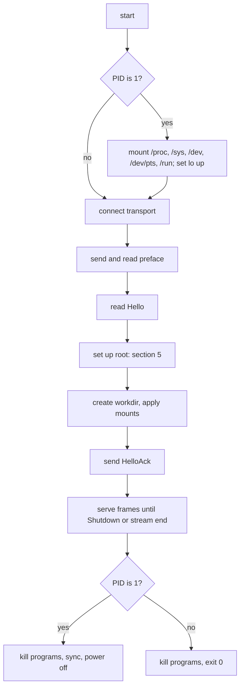

# Feature 01: The guest agent (`sandbox-agent`)

_Written in ASD-STE100 Simplified Technical English (STE). Code and identifiers stay as they
are._

**Abbreviations in this file.** process identifier (PID); Unix domain socket (UDS);
Transmission Control Protocol (TCP); context identifier (CID); input and output (I/O);
virtual machine (VM); file descriptor (fd); behaviour-driven development (BDD); continuous
integration (CI); AeroSpace and Defence Industries Association of Europe (ASD), the owner of
the STE standard ASD-STE100.

## 1. Goal

Write `bin/sandbox_agent`, the program `sandbox-agent`. It runs in the guest. It connects to
the host, sets up the root file system, and then starts programs and moves bytes as the
agent protocol says (feature 00, section 2).

One program serves all backends. The differences are in its start arguments. This feature
gives the two transports of the local backends and the tests. Feature 08 adds the transport
for Cloudflare (`ws-listen`).

## A. Story

**As** the host side of a sandbox, **I want** one small program in the guest that obeys the
agent protocol, **so that** I can run commands and move files in a Firecracker microVM, a
libkrun microVM and a Cloudflare container with the same code.

| # | Use case | Actor | Result |
|---|---|---|---|
| U1 | Start in a Firecracker guest as the first process | kernel | The agent mounts the kernel file systems, connects to the host, and is ready. |
| U2 | Start in a libkrun guest as the program of the built-in init | libkrun init | The agent connects to the host and is ready. |
| U4 | Prepare the program root | host (`Hello`) | Programs see the user image as `/`; the source image does not change. |
| U5 | Run a program | host (`Exec`) | The program runs; its output streams to the host; its exit status arrives last. |
| U6 | Feed and close standard input | host (`Stdin`) | The program reads the bytes, then end of file. |
| U7 | Signal a program | host (`Signal`) | The signal reaches the program and its children. |
| U8 | Write and read a file | host (`FileWrite`, `FileRead`) | The file appears whole or not at all. |
| U9 | Stop | host (`Shutdown`) or stream loss | All programs stop; the guest powers off or the agent waits for the next host. |

## B. Bounded context

**Inside this feature:** the program `sandbox-agent` and everything it does in the guest.

**Outside:** how the guest starts (features 04, 06, 08), the host client (feature 02), the
frame format (feature 00, used as it is).

| Entity | Meaning | Owner |
|---|---|---|
| Transport | The byte stream to the host: vsock or UDS. (Feature 08 adds a WebSocket listener.) | `transport.rs` |
| Connection | The preface, the frame reader, the frame writer and the channel table on one transport. | `conn.rs` |
| Channel | One numbered conversation: one program or one file transfer. | `conn.rs` |
| Send window | The count of data bytes that the agent can still send on a channel. | `conn.rs` |
| Program root (`exec_root`) | The directory that each program gets as `/`. | `root.rs` |
| Program | One child process started for an `Exec` frame, with its process group. | `exec.rs` |
| Child table | The map from a PID to its channel. | `reaper.rs` |
| File transfer | One write or one read of a guest file. | `files.rs` |

| Verb | Trigger | Effect |
|---|---|---|
| connect | start | Opens the transport and exchanges the preface. |
| prepare root | `Hello` | Builds `exec_root`; answers `HelloAck`. |
| spawn | `Exec` | Forks a program in a new session inside `exec_root`. |
| pump | pipe or queue readiness | Moves bytes between a pipe and data frames, inside the credit. |
| reap | `SIGCHLD` | Collects exit statuses; routes each to its channel. |
| signal | `Signal` | Sends a signal to a process group. |
| transfer | `FileWrite`, `FileRead` | Moves a file through data frames. |
| stop | `Shutdown`, stream loss | Kills programs; powers off or waits. |

## C. Rules

### Invariants (always true)

| # | Invariant |
|---|---|
| I1 | The agent sends `HelloAck` only after `exec_root` is complete. |
| I2 | Each program runs with `exec_root` as its root. No program sees the agent's own root. |
| I3 | The agent never writes to the lower layer of the root. Writes go to a tmpfs. |
| I4 | On each channel, the data bytes sent and not yet credited never exceed the channel window. |
| I5 | `Exit` is the last frame of an exec channel. `FileDone` or `Error` is the last frame of a file channel. Exactly one last frame is sent. |
| I6 | Only the reaper task calls `waitpid`. |
| I7 | Only the writer task writes to the transport. |
| I8 | No task blocks an executor thread on I/O. A task that cannot continue parks on a readiness (`TaskStatus::Depends`) or awaits. |
| I9 | When the agent is PID 1, `main` never returns. |
| I10 | The environment of a program is `Hello.env` plus `ExecRequest.env`. Nothing comes from the agent's own environment. |

### Must have

- A static Linux program for `x86_64-unknown-linux-musl` and `aarch64-unknown-linux-musl`.
- Two transports: `vsock`, `unix`. The transport code has one seam (a non-blocking fd with
  read, write and close), so feature 08 can add a third with no change to the rest.
- Three root sources: `BlockDevice`, `VirtioFs`, `Plain`. Two root modes: `Overlay`,
  `ReadOnly`.

### Must do

- Reap every child, also the orphans that PID 1 inherits.
- Kill every program group on `Shutdown` and on stream loss.
- Report each failure with an `AgentErrorCode` and the `errno`.

### Must not

- Must not run a shell unless `argv` names one.
- Must not make the parent directory of a `FileWrite` path.
- Must not accept a path that has a `..` part.
- Must not call a function that is not async-signal-safe between `fork()` and `execve()`.

## D. Acceptance scenarios

Each scenario is one test in section 11. "Host" is the test acting as the host.

```gherkin
Feature: Guest agent

  Background:
    Given a running agent with transport "unix:<path>"
    And the host sent the preface and Hello with RootSource Plain
    And the agent answered HelloAck

  Scenario: Run a program and get its output and exit code
    When the host sends Exec ["/bin/echo", "hi"] on channel 1
    Then the agent sends Started with a PID on channel 1
    And the agent sends Stdout "hi\n" on channel 1
    And the last frame on channel 1 is Exit with code 0

  Scenario: A missing program does not start
    When the host sends Exec ["/no/such/program"] on channel 1
    Then the agent sends Error NotFound with errno 2 on channel 1
    And the agent sends no Started frame on channel 1

  Scenario: Standard output and standard error stay separate
    When the host sends Exec ["sh", "-c", "echo a; echo b >&2"] on channel 1
    Then the Stdout frames on channel 1 hold exactly "a\n"
    And the Stderr frames on channel 1 hold exactly "b\n"

  Scenario: Standard input reaches the program and closes
    When the host sends Exec ["cat"] with stdin true on channel 1
    And the host sends Stdin "abc" then Stdin with END
    Then the Stdout frames on channel 1 hold exactly "abc"
    And the last frame on channel 1 is Exit with code 0

  Scenario: A signal reaches the whole process group
    Given the host sent Exec ["sh", "-c", "sleep 60 & wait"] on channel 1
    When the host sends Signal 9 on channel 1
    Then the last frame on channel 1 is Exit with signal 9
    And no "sleep 60" process of that group exists

  Scenario: The agent obeys the credit window
    Given Hello.channel_window is 4096
    And the host sent Exec ["yes"] on channel 1
    When the host sends no Credit frame
    Then the agent sends at most 4096 data bytes on channel 1
    When the host sends Credit 4096 on channel 1
    Then the agent sends more data, at most 4096 bytes

  Scenario: A background child does not hold the exit
    Given Hello.output_drain_timeout_ms is 500
    When the host sends Exec ["sh", "-c", "sleep 30 & echo x"] on channel 1
    Then the Exit frame arrives in less than 2 seconds

  Scenario: A file write is atomic
    When the host sends FileWrite "/tmp/f" and 1000 bytes of FileData with no END
    And the host closes the stream
    Then no file exists at "/tmp/f"

  Scenario: A path cannot leave the root
    When the host sends FileRead "/../etc/passwd" on channel 1
    Then the agent sends Error BadRequest on channel 1

  Scenario: Too many channels are refused
    Given Hello.max_channels is 2
    And two programs run on channels 1 and 2
    When the host sends Exec on channel 3
    Then the agent sends Error TooManyChannels on channel 3
    And channels 1 and 2 continue

  Scenario: Losing the host stops everything
    Given a program runs on channel 1
    When the host closes the stream
    Then the program is killed
    And the agent process exits with code 0

  Scenario: Shutdown gives programs time to stop
    Given a program that traps SIGTERM and exits after 100 ms runs on channel 1
    When the host sends Shutdown with grace_ms 2000
    Then the program gets SIGTERM and exits by itself
    And the agent process exits with code 0
```

Scenarios that need a real guest (root set-up, PID 1 duties) are in features 04 and 06.

## 2. Constraints

- A static Linux program: targets `x86_64-unknown-linux-musl` and
  `aarch64-unknown-linux-musl`.
- **It uses valtron** (root rule 6, owner decision 2026-11-11). All I/O is non-blocking.
  Each fd is a `foundation_nativeapis::native::fd::RegisteredFd` on the shared
  `Reactor`; a task that waits parks on it with `TaskStatus::Depends`. Long work is
  `async fn` or a `#[task]` state machine, started with `execute(..)`.
- Dependencies: `foundation_platform_sandbox_protocol`, `foundation_core` (valtron, with
  the `multi` feature), `foundation_nativeapis` (`default-features = false`,
  `features = ["fd"]`), `foundation_context`, `libc`, `serde`, `serde_json`. Nothing else.
- It runs as root in the guest. It never runs on the host in production.
- Program size is recorded, not limited. A static valtron program is larger than a
  thread-only one; the initramfs holds it in memory, so `progress.md` records the size for
  each target, and a size above 8 MiB is reported to the main session.

The agent is a host entry point of its own world. It builds its `Ctx` with `Ctx::host()` in
`main` and starts the valtron pool there. All other agent code takes the `Ctx`.

## 3. Start arguments

The agent reads its configuration from two places, in this order:

1. Command-line arguments.
2. The kernel command line (`/proc/cmdline`), keys with the prefix `ewe.`. This is for
   Firecracker, where the agent is `/init` and gets no arguments of ours.

A value on the command line wins over the kernel command line.

| Argument | Kernel key | Values | Meaning |
|---|---|---|---|
| `--transport <t>` | `ewe.transport=<t>` | `vsock:<cid>:<port>`, `unix:<path>` | How to reach the host. Required. |
| `--connect-timeout-ms <n>` | `ewe.connect_timeout_ms=<n>` | integer, default 5000 | Time to retry the connect. |

All other settings (root set-up, mounts, limits, environment) arrive in `Hello`. This keeps
the kernel command line short and puts one source of truth on the host.

| Transport | Used by | Behaviour |
|---|---|---|
| `vsock:2:1024` | Firecracker, libkrun | `socket(AF_VSOCK, SOCK_STREAM | SOCK_NONBLOCK)`, `connect` to CID 2. A refused connect is tried again every 20 ms (a timer from the `Ctx` clock) until the time-out. |
| `unix:<path>` | tests | `connect` to a UDS. Lets the agent run as a normal process with no VM. |

| Failure at start | PID 1 | Not PID 1 |
|---|---|---|
| No `--transport` and no `ewe.transport` | Write `sandbox-agent: no transport` to the console. Power off. | Write the line to standard error. Exit with code 64. |
| A value that does not parse | The same, with the bad value. | Exit with code 64. |
| Connect fails until the time-out | Write `sandbox-agent: connect timeout`. Power off. | Exit with code 69. |

## 4. Start sequence



_Caption: the agent does kernel set-up only when it is PID 1, and it answers `HelloAck` only after the root file system is ready._

PID 1 duties (Firecracker):

- Mount `proc` on `/proc`, `sysfs` on `/sys`, `devtmpfs` on `/dev`, `devpts` on `/dev/pts`,
  `tmpfs` on `/run`. An `EBUSY` result means that the kernel mounted it already
  (`DEVTMPFS_MOUNT`); continue. The initramfs has the mount points `dev`, `proc`, `sys`
  and `run` (feature 03); the agent makes `/dev/pts` after the `devtmpfs` mount.
- Set the `lo` interface up (`ioctl SIOCSIFFLAGS`).
- Reap every child process (section 7.3).
- At the end: `sync()`, then `reboot(RB_AUTOBOOT)`. With the boot argument `reboot=k`,
  Firecracker stops. PID 1 must never return from `main`; a return makes a kernel panic.
  If `reboot()` returns an error, the agent writes it to the console and sleeps for ever
  in `pause()`; the host then stops the VM after its grace time.

When the agent is not PID 1 (libkrun, tests), the init of that system did the
mounts. The agent exits with code 0 at the end; on libkrun this stops the VM.

## 5. Root file system set-up

The goal: each program runs in a root that looks like the user image, and the source image
never changes.

`Hello.root` has a `source` and a `mode`.

First the agent makes sure that `/run/ewe` is on a writable tmpfs: it calls
`mkdir("/run/ewe")`; on `EROFS` it mounts `tmpfs` on `/run` and calls `mkdir` again. (On
libkrun the agent starts on a read-only root.)

| Step | Work |
|---|---|
| 1. Lower layer | `BlockDevice { device, fstype }`: `mount(device, "/run/ewe/lower", fstype, MS_RDONLY)`. `VirtioFs { tag }`: `mount(tag, "/run/ewe/lower", "virtiofs", MS_RDONLY)`. |
| 2a. Mode `Overlay` | Mount `tmpfs` on `/run/ewe/rw`. Make `upper` and `work` in it. `mount("overlay", "/run/ewe/root", "overlay", 0, "lowerdir=/run/ewe/lower,upperdir=/run/ewe/rw/upper,workdir=/run/ewe/rw/work")`. |
| 2b. Mode `ReadOnly` | Bind-mount `/run/ewe/lower` on `/run/ewe/root`, read-only. Mount `tmpfs` on `<root>/tmp`, `<root>/run` and `<root><workdir>`. A mount point that the image does not have gives `RootSetupFailed` with its path. |
| 3. Kernel file systems | Bind-mount `/proc`, `/sys` and `/dev` into `/run/ewe/root` (`MS_BIND | MS_REC`). In mode `Overlay` the agent makes a missing mount point. In mode `ReadOnly` a missing one gives `RootSetupFailed`. |
| 4. Name servers | When `Hello.dns` is not empty: write `/run/ewe/resolv.conf` with one `nameserver <address>` line for each entry, and bind-mount it on `<root>/etc/resolv.conf`. In mode `Overlay` the agent makes the mount point file when it does not exist. In mode `ReadOnly`, a missing `/etc/resolv.conf` in the image gives `RootSetupFailed`. |
| 5. Work directory | `mkdir -p <root><Hello.workdir>` (mode `0755`). In mode `ReadOnly` the tmpfs of step 2b is the work directory. |
| 6. Result | `exec_root = "/run/ewe/root"` |

The lower layer is never `/`. Both the Firecracker CI kernels and the `libkrunfw` kernels
have overlayfs, tmpfs and ext4 built in (`learnings.md` sections 2.5 and 3.8).

`RootSource::Plain` does only steps 4 and 5, on `/`: `exec_root = "/"`, and `mode` is
ignored. `HelloAck.root_mode` then reports `Overlay`. The Cloudflare backend (feature 09) uses it,
because a container root is already a private copy of its image. The agent process tests
use it too, because they have no root rights; in a test that has no right to write
`/etc/resolv.conf` or the work directory, the test sends an empty `dns` list and a work
directory below a temporary directory.

A failed step sends `Error` on channel 0 with `RootSetupFailed`, the `errno` and the step
name, and the agent stops as section 9 says for stream loss. `ENODEV` from the overlay
mount means that the guest kernel has no overlayfs; the message says so.

Extra mounts (`Hello.mounts`, libkrun only): for each one,
`mount(tag, "<exec_root><guest_path>", "virtiofs", flags, "")`, with `MS_RDONLY` when
`read_only` is true. The agent makes the mount point first (`mkdir -p`). In mode
`ReadOnly`, a mount point that the image does not have gives `MountFailed` with its path.

## 6. Program start (`Exec`)

For an `Exec` frame on a new channel:

1. Check `argv` is not empty (`BadRequest`). Check the channel count against
   `Hello.max_channels` (`TooManyChannels`). Check that the channel number is larger than
   each number used before on this connection (`Protocol`).
2. Make three pipes (standard input only when `stdin` is true; if not, open `/dev/null`).
   Set `O_CLOEXEC` and `O_NONBLOCK` on the parent ends.
3. Resolve the program path before `fork()`: `argv[0]` with a `/` is used as it is; without
   one, the agent looks in each directory of `PATH` (from the merged environment), below
   `exec_root`, for a regular file with an execute bit. No match gives `NotFound`.
4. `fork()`. In the child, call only async-signal-safe functions: `setsid()`, `dup2` for
   the three streams, `chroot(exec_root)`, `chdir(cwd)`, reset the signal mask and the
   signal handlers, `execve(path, argv, env)`. On a failed step, the child writes the
   step number and the `errno` (8 bytes) to a close-on-exec status pipe and calls
   `_exit(127)`.
5. The parent awaits the status pipe. Data on it means the start failed: send `Error` and
   close the channel. The code is `NotFound` for `ENOENT` on `execve` or `chdir`,
   `PermissionDenied` for `EACCES`, and `SpawnFailed` for the others. End of file means
   the program started: send `Started { pid }`.
6. Start the pump tasks (section 7.1): one for standard output, one for standard error,
   and one for standard input when it is piped.
7. The environment of the program is `Hello.env`, then `ExecRequest.env`; a later key
   wins. When no `PATH` is given, the agent adds
   `PATH=/usr/local/sbin:/usr/local/bin:/usr/sbin:/usr/bin:/sbin:/bin`.
8. `cwd` is `ExecRequest.cwd`, or `Hello.workdir` when it is `None`. It must be absolute
   (`BadRequest`).

`setsid()` makes the program the leader of a new session and process group. A `Signal`
frame sends the signal to the group: `kill(-pid, signal)`. So a signal reaches the children
of the program too. A `Signal` for a channel whose program already exited is ignored. A
signal number outside 1 to 64 gives `Error BadRequest` on that channel, and the program
continues.

### 6.1 End of a program

The agent sends `Exit` when both of these are true:

- the reaper has the exit status of the program;
- both output pipes are at end of file, **or** `output_drain_timeout_ms` passed after the
  exit.

The second rule exists because a background child can keep the pipes open after the program
exits. After the time-out the agent closes its ends of the pipes and sends `Exit`. Output
that arrives later is lost; the documentation of `Command` says so.

`ExitBody.code` is the exit code. When a signal stopped the program, `code` is `None` and
`signal` is the signal number.

Output that the pump read before the exit is always sent before `Exit`, also when the host
gives credit slowly: the `Exit` frame waits for the pumps to finish or for the drain
time-out, and the drain timer starts only when the pump is not waiting for credit.

## 7. Tasks and shared state

### 7.1 Tasks

All tasks run on the valtron pool. None blocks.

| Task | Count | Parks on | Work |
|---|---|---|---|
| reader | 1 | transport readable | Reads into a buffer, decodes frames, routes them to channel queues, handles channel 0. |
| writer | 1 | out queue has an item; transport writable | Takes frames from the out queue and writes them. The only task that writes to the transport. |
| reaper | 1 | the `SIGCHLD` fd readable | Section 7.3. |
| output pump | 2 for each program | pipe readable; send window has room; out queue has room | Reads at most `min(max_frame_payload, window)` bytes and pushes one data frame. |
| input pump | 1 for each program with piped input | channel queue has an item; pipe writable | Writes `Stdin` payloads to the pipe; pushes `Credit` for the bytes written. `END` closes the pipe. A write that fails with `EPIPE` drops the rest and closes the pipe. |
| exit watch | 1 for each program | the exit status; the pumps; the drain timer | Sends `Exit` (section 6.1) and removes the channel. |
| file | 1 for each transfer | file I/O is done in chunks of `max_frame_payload`; send window; channel queue | Section 8. |

- The out queue is an `EventQueue<Frame>` with a bound of `max_channels * 4` frames. A
  task that finds it full parks on `queue.vacancy()`. This is the back pressure from the
  transport to the pipes.
- Each channel queue is an `EventQueue<Frame>`. The host cannot send more data than the
  credit that the agent gave, so its size is bounded by the channel window.
- Regular file reads and writes do not have readiness. They are short calls on a local
  file system, one chunk at a time, with a yield (`TaskStatus::Ignore` or an `await` point)
  between chunks.

### 7.2 Credit

Each channel has a send window: an atomic counter and a `ResumeSignal`. A pump that finds
the window at 0 parks on the signal. The reader task adds to the window when a `Credit`
frame arrives and sets the signal. A `Credit` that makes the window larger than `2^31 - 1`
is a protocol error.

For data that the agent receives (`Stdin`, `FileData`), the agent gives credit after the
bytes are written to the pipe or the file, in one `Credit` frame for each data frame.

### 7.3 Reaper

At start, before any `fork()`, the agent blocks `SIGCHLD` for the process
(`sigprocmask`) and opens a `signalfd` for it (`SFD_NONBLOCK | SFD_CLOEXEC`). The reaper
task parks on that fd. When it is readable, the task reads it empty, then calls
`waitpid(-1, &status, WNOHANG)` in a loop until the result is 0 or `ECHILD`.

A table maps the PID of each started program to its channel. For a PID in the table, the
reaper stores the status and wakes the exit watch of that channel. For another PID (an
orphan that PID 1 inherited), it drops the status. No other code calls `waitpid`. This
removes the race where two callers wait for the same child.

`fork()` and the insert into the table happen under one lock that the reaper also takes
for its lookup. So a child that exits at once is never looked up before it is in the table.

The child resets the signal mask before `execve` (section 6, step 4), so programs get
`SIGCHLD` in the normal way.

## 8. File transfer

`FileWrite { path, mode }`: the agent opens `<exec_root><path>.ewe-tmp-<channel>` with
`O_CREAT | O_EXCL | O_WRONLY` and `mode`. It writes each `FileData` payload and sends
`Credit`. On `END` it calls `fsync`, renames the file to `<exec_root><path>`, and sends
`FileDone { size }`. On an error it removes the temporary file and sends `Error` with the
`errno`. The parent directory must exist; the agent does not make it (the caller runs
`mkdir -p`). When the stream or the channel ends before `END`, the agent removes the
temporary file. An existing file at `path` is replaced by the rename.

`FileRead { path }`: the agent opens the file, sends `FileData` frames within the credit,
sets `END` on the last one, and sends `FileDone { size }`. A path that is a directory gives
`Error BadRequest` with `EISDIR`. An empty file gives one `FileData` frame with `END` and
no payload.

`path` must be absolute. The agent joins it to `exec_root` with a function that removes
`.` and rejects `..`, so a path cannot leave the root by its text. A symbolic link in the
guest can still point anywhere in the guest; that is inside the sandbox and is allowed.

| Failure | Code | `errno` |
|---|---|---|
| Path not absolute, or has `..` | `BadRequest` | none |
| File or parent does not exist | `NotFound` | `ENOENT` |
| No permission | `PermissionDenied` | `EACCES`, `EPERM` |
| No space, read error, other | `Io` | the real value |

## 9. `Shutdown` and stream loss

`Shutdown { grace_ms }`:

1. Stop new `Exec` and file requests (`Error` with `BadRequest`).
2. Send `SIGTERM` to each program group. Wait up to `grace_ms` (a timer from the `Ctx`
   clock) for them to exit. Then send `SIGKILL` to the groups that remain.
3. Remove the temporary file of each open file transfer.
4. PID 1: `sync()` and power off. Not PID 1: exit with code 0.

A second `Shutdown` while the first runs is ignored.

Stream end or a protocol error on the transport:

- Do the same as `Shutdown { grace_ms: 0 }`. A sandbox with no host is of no use, and this
  prevents a VM that runs for ever.

The code keeps "what to do after the connection ends" as one function with two outcomes,
`Exit` and `AcceptNext`. Both transports of this feature return `Exit`. Feature 08 adds a
listening transport that returns `AcceptNext`: kill the programs, discard the channels,
and wait for the next host; on that transport a `Shutdown` frame does steps 1 to 3 and
then `AcceptNext`.

A protocol error from the host (bad preface, unknown kind, a frame that the state does not
allow) sends `Error` on channel 0 with `Protocol` when the writer can still write, then
does the stream-loss steps.

## 10. Source layout

| File | Content |
|---|---|
| `src/main.rs` | Argument and kernel command line parse. `Ctx::host()`, pool start, start sequence. |
| `src/transport.rs` | The transports as one non-blocking fd in a `RegisteredFd`. `AF_VSOCK` with `libc::sockaddr_vm`. |
| `src/conn.rs` | Reader, writer, channel table, credit. |
| `src/pid1.rs` | Mounts, `lo`, power off. |
| `src/root.rs` | Section 5. |
| `src/exec.rs` | Section 6. |
| `src/reaper.rs` | Section 7.3. |
| `src/files.rs` | Section 8. |
| `src/sys.rs` | Thin `libc` wrappers that return `io::Result`. All `unsafe` is here, each block with a `SAFETY` comment. |

The workspace root sets build profiles. Add a profile `agent` there
(`inherits = "release"`, `opt-level = "s"`, `lto = true`, `panic = "abort"`,
`strip = true`, `codegen-units = 1`).

Build task (add to `mise.toml` as `sandbox:agent`):

```bash
rustup target add x86_64-unknown-linux-musl aarch64-unknown-linux-musl
cargo build -p sandbox_agent --profile agent --target x86_64-unknown-linux-musl
cargo build -p sandbox_agent --profile agent --target aarch64-unknown-linux-musl
```

Cross builds. A Linux x86_64 host builds the aarch64 agent, and a macOS host builds both,
with the linker that the Rust toolchain ships:
`RUSTFLAGS="-C linker=rust-lld -C link-self-contained=yes"`. The task sets this for each
target that is not the host. The agent has no C dependency (`libc` is a binding crate, and
the musl target ships its own C library objects), so no C cross compiler is necessary. If a
dependency adds C code later, the build fails at link time; the fix is to remove that
dependency from the agent, not to change the linker.

A dependency that does not compile for a musl target is a bug in that crate. Fix it in the
same change and file an issue with `severity: high` (it blocks this feature).

## 11. Tests

All tests are in `bin/sandbox_agent/tests/`. They run on Linux only (`#![cfg(target_os =
"linux")]`), as a normal user. They start the built agent with `--transport unix:<path>`
and act as the host with the protocol crate and blocking sockets.

Root set-up needs root rights. Tests do not have them as a normal user. So each test here
sends `RootSource::Plain`, an empty `dns` list and a work directory in a temporary
directory. The real root set-up (`BlockDevice` and `VirtioFs`) is tested in the microVM
tests of features 04 and 06. The agent has no test-only code path.

| Test | Scenario of section D, or what it proves |
|---|---|
| `handshake` | Preface, `Hello`, then the `HelloAck` fields (`is_pid1` false, `arch`, `kernel`). |
| `exec_echo` | "Run a program and get its output and exit code". |
| `exec_exit_code` | `sh -c "exit 7"` gives code 7. |
| `exec_signal` | `sleep 60`, then `Signal 15`, gives `signal: Some(15)`. |
| `exec_signal_reaches_group` | "A signal reaches the whole process group". |
| `exec_signal_bad_number` | `Signal 0` and `Signal 65` give `BadRequest`, and the program continues. |
| `exec_stdin` | "Standard input reaches the program and closes". |
| `exec_stdin_epipe` | `true` with piped input and 1 MiB of `Stdin`: `Exit` code 0 arrives, and the agent stays alive. |
| `exec_not_found` | "A missing program does not start". |
| `exec_not_executable` | A file with no execute bit gives `PermissionDenied`. |
| `exec_path_lookup` | `["echo", "x"]` with no `/` finds the program through `PATH`. |
| `exec_env_is_explicit` | With `AGENT_SECRET=1` in the agent's own environment, `env` in a program does not show it. |
| `exec_cwd` | `pwd` prints `Hello.workdir` with `cwd: None`, and the given directory with `cwd: Some`. |
| `exec_stderr_is_separate` | "Standard output and standard error stay separate". |
| `credit_blocks_sender` | "The agent obeys the credit window". |
| `output_before_exit_with_slow_credit` | 64 KiB of output, a window of 4 KiB, credit given every 100 ms: all 64 KiB arrive before `Exit`. |
| `drain_timeout` | "A background child does not hold the exit". |
| `file_roundtrip` | A 1 MiB `FileWrite`, then `FileRead`, gives the same bytes and size. |
| `file_empty` | A 0-byte file round-trips. |
| `file_write_is_atomic` | "A file write is atomic". |
| `file_write_replaces` | A second write to the same path replaces the content. |
| `file_read_directory` | `FileRead` of a directory gives `BadRequest`. |
| `path_escape_rejected` | "A path cannot leave the root". |
| `too_many_channels` | "Too many channels are refused". |
| `channel_number_must_grow` | `Exec` on a number that was used before gives `Protocol` on channel 0. |
| `stream_loss_stops_agent` | "Losing the host stops everything". |
| `shutdown_grace` | "Shutdown gives programs time to stop". |
| `shutdown_kills_after_grace` | A program that ignores `SIGTERM` is gone after `grace_ms`. |
| `bad_preface` | A wrong preface makes the agent exit; no `HelloAck`. |
| `no_transport_exit_code` | No `--transport` gives exit code 64. |
| `orphans_are_reaped` | `sh -c "(sleep 0.1 &) ; exit 0"` 20 times: afterwards the agent has no zombie child (`/proc/<agent pid>/task/*/children` and `/proc/*/stat`). |

## 12. Verify

```bash
cargo fmt --all --check
cargo clippy -p sandbox_agent --all-targets --profile uat --no-deps -- -D warnings
cargo test -p sandbox_agent --profile uat
cargo build -p sandbox_agent --profile agent --target x86_64-unknown-linux-musl
cargo build -p sandbox_agent --profile agent --target aarch64-unknown-linux-musl
file target/x86_64-unknown-linux-musl/agent/sandbox-agent   # must say "statically linked"
ls -l target/*/agent/sandbox-agent                          # record the sizes in progress.md
python3 scripts/ci/check_executor_wake.py
```

## 13. Done when

- The agent builds for both musl targets, and `file` reports a static program.
- Each scenario of section D and each test of section 11 passes on Linux.
- Each invariant of section C has a test that names it in a comment.
- All `unsafe` is in `src/sys.rs` and in the `fork` child block of `src/exec.rs`.
- No source file has `std::thread::spawn`, a blocking `read` or `write` on a pipe or a
  socket, or a loop that continues on `Wait`.
- `sandbox_agent` is in `ci/packages.toml` with a Linux-only test run.
- `progress.md` has the program size for each target.
