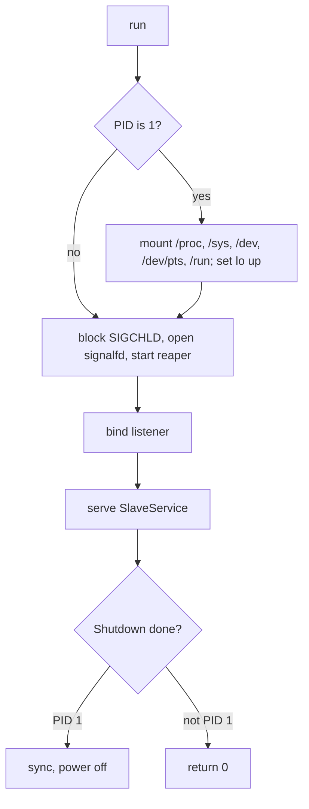

# Feature 01: The slave core

_Written in ASD-STE100 Simplified Technical English (STE). Code and identifiers stay as they
are._

**Abbreviations in this file.** remote procedure call (RPC); process identifier (PID); Unix
domain socket (UDS); Transmission Control Protocol (TCP); Hypertext Transfer Protocol
(HTTP); input and output (I/O); virtual machine (VM); file descriptor (fd);
behaviour-driven development (BDD); continuous integration (CI); AeroSpace and Defence
Industries Association of Europe (ASD), the owner of the STE standard ASD-STE100.

## 1. Goal

Write the slave as library code in `foundation_platform_sandbox` (feature `slave`): the
implementation of `SlaveService`, the engine that starts programs and moves files in the
guest, the root file system set-up, the PID 1 duties, and the function that serves the
service on a listener. The program `agent-slave` (feature 06) is a `main` that calls
`slave::run`.

The same code runs as PID 1 in a microVM, as the main process or a sidecar in a container,
and as a normal process in tests.

## 2. Story

- **S1**: "The control plane asks the slave who it is, and then tells it how to prepare the
  root that programs will see."
- **S2**: "The control plane starts a program and reads its output as it comes; the exit
  status arrives last."
- **S3**: "The control plane sends input to a program, closes its input, and signals it."
- **S4**: "The control plane writes a file in pieces and commits it; it reads a file in
  pieces."
- **S5**: "The control plane tells the slave to stop, and the sandbox ends."
- **S6**: "A call is repeated, arrives out of order, names something that does not exist,
  or comes before `Prepare`."
- **S7**: "The control plane goes away during a command or an upload."
- **S8**: "The slave is the first process of a microVM: it must set the system up, adopt
  orphan processes, and power the machine off."

| # | Use case | Actor | Trigger | Result |
|---|---|---|---|---|
| U1 | Identify | control plane | `Info` | Version, architecture, kernel, PID 1 flag, prepared flag. |
| U2 | Prepare the root | control plane | `Prepare` | Programs see the user image as `/`; the source does not change. |
| U3 | Run a program | control plane | `Exec` | `Started`, output events, one `Exit`. |
| U4 | Feed input | control plane | `ExecInput` | Bytes reach the program in order, one time each. |
| U5 | Signal | control plane | `ExecSignal` | The signal reaches the process group. |
| U6 | Write a file | control plane | `FileWrite*` | The file appears whole, or not at all. |
| U7 | Read a file | control plane | `FileRead` | Chunks in order; the last has `eof`. |
| U8 | Stop | control plane | `Shutdown` | Programs end; the guest powers off or the process exits. |
| U9 | Start up | kernel, init, container runtime, test | process start | The slave listens and answers `Info`. |

## 3. Bounded context

**Inside this feature:** everything the slave does in the guest, and how it serves its RPC.

**Outside:** the message shapes (feature 00); who calls (feature 02); how the guest starts
and how its listener is reached (features 05, 07, 09, 10); the control role inside a slave
(feature 11).

| Entity | Meaning | Owner (the one writer) |
|---|---|---|
| Slave state | `Booted`, `Prepared`, `ShuttingDown`. | `native::slave::state` |
| Program root (`exec_root`) | The directory that each program gets as `/`. | `native::slave::root` |
| Session | One running `Exec`: a program, its process group, its pipes, its input queue. | `native::slave::exec` |
| Session table | `ExecId` to session. | `native::slave::exec` |
| Child table | PID to session. | `native::slave::reaper` |
| Upload | A temporary file, a target path, an offset counter, a last-use time. | `native::slave::files` |
| Listener | The socket that the RPC server accepts on. | `native::slave::serve` |

| Verb | Kind | Trigger | Effect |
|---|---|---|---|
| boot | story | process start | PID 1 duties when PID is 1; bind the listener; serve. |
| prepare | story | `Prepare` | Builds `exec_root`, mounts, name servers, work directory. |
| spawn | entity | `Exec` | Forks a program in a new session inside `exec_root`. |
| pump | entity | pipe readiness | Moves bytes from a pipe to the response stream, or from the input queue to a pipe. |
| reap | entity | `SIGCHLD` | Collects exit statuses; routes each to its session. |
| feed | entity | `ExecInput` | Checks the sequence; queues bytes. |
| signal | entity | `ExecSignal` | Sends a signal to a process group. |
| begin / chunk / commit / abort | entity | `FileWrite*` | Moves an upload through its life. |
| read | entity | `FileRead` | Streams a file. |
| shut down | story | `Shutdown` | Ends sessions and uploads; ends the guest. |

**Words.** *Session*: one `Exec` call and its program. *Prepared*: `Prepare` succeeded.
*Drain*: reading the last output after a program exits.

## 4. Rules

### 4.1 Law worksheet

```
Entity: Slave state
Conserved value:         none
Bound:                   state in {Booted, Prepared, ShuttingDown}
Inverse pairs:           none
Idempotent verbs:        Info; Prepare with the same request (the second returns the same answer);
                         Shutdown (the second is accepted and does nothing)
Ordering pairs:          Prepare -> Exec, FileWrite*, FileRead (enabling); Shutdown / Exec (competing: after Shutdown, Exec is refused)
Monotone values:         state: Booted -> Prepared -> ShuttingDown
Freeze points:           exec_root, workdir, env and limits after Prepare
Links to other entities: SlaveInfo.prepared == (state != Booted)

Entity: Session
Conserved value:         bytes the program wrote to a stream = bytes in the events of that stream (until a drain time-out or a kill)
Bound:                   sessions <= max_exec_sessions; input queue <= input_queue_bytes; one event data <= chunk_bytes
Inverse pairs:           none
Idempotent verbs:        ExecInput with a sequence number that was applied; ExecSignal after the program exited (accepted, no effect)
Ordering pairs:          Exec -> ExecInput, ExecSignal (enabling); events: Started first, Exit last, seq grows by 1;
                         ExecInput(eof) / ExecInput(data) (competing: after eof, data is refused)
Monotone values:         event seq; input seq
Freeze points:           exec_id; argv; env; cwd
Links to other entities: child table PID -> this session; the response stream of the Exec call

Entity: Upload
Conserved value:         bytes in the temporary file = next offset
Bound:                   uploads <= max_exec_sessions; chunk <= chunk_bytes
Inverse pairs:           begin / abort
Idempotent verbs:        chunk at an offset that was applied; abort (a second abort is accepted)
Ordering pairs:          begin -> chunk -> commit (enabling); commit / abort (competing: the first wins)
Monotone values:         next offset
Freeze points:           path and mode at begin
Links to other entities: commit.size must equal next offset

Entity: Program root
Conserved value:         the lower layer never changes
Bound:                   none
Inverse pairs:           none
Idempotent verbs:        none (built one time)
Ordering pairs:          lower mount -> overlay or bind -> kernel file systems -> name servers -> workdir
Monotone values:         none
Freeze points:           the whole structure after Prepare
Links to other entities: every session's root
```

### 4.2 Invariants

| # | Invariant |
|---|---|
| I1 | Before `Prepare` succeeds, every call but `Info`, `Prepare` and `Shutdown` fails with `NotPrepared`. |
| I2 | A second `Prepare` with an equal request returns the first answer; with a different request it fails with `AlreadyExists`, and nothing changes. |
| I3 | Each program runs with `exec_root` as its root. No program sees the slave's own root. |
| I4 | The slave never writes to the lower layer of the root. |
| I5 | Events of a session have `seq` 0, 1, 2 ... with no gap. `Started` is `seq` 0. `Exit` is last, and exactly one `Exit` is sent when the program started. |
| I6 | Within one stream (standard output or standard error), event data in `seq` order is exactly what the program wrote, in order. |
| I7 | `ExecInput`: bytes reach the program in `seq` order, each one time. A repeat changes nothing. A gap fails with `SequenceGap`. After `eof`, more data fails with `BadRequest`. |
| I8 | A session whose response stream ends before `Exit` is killed (`SIGKILL` to the group), and its table entry is removed. |
| I9 | Two sessions with one `exec_id` never run at the same time: the second `Exec` fails with `AlreadyExists`. |
| I10 | A file commit is atomic: the target has its old content or the complete new content. A failed, aborted or expired upload leaves no file at the target and no temporary file. |
| I11 | `FileWriteChunk`: a repeat of an applied span changes nothing; a gap or an overlap fails with `SequenceGap`. |
| I12 | Only the reaper calls `waitpid`. Every child is reaped, also orphans that PID 1 adopts. |
| I13 | The environment of a program is `Prepare.env` plus `ExecRequest.env`. Nothing comes from the slave's own environment. |
| I14 | No task blocks an executor thread on I/O. Every fd is non-blocking on the shared reactor. |
| I15 | When the slave is PID 1, `run` never returns; the guest powers off. |
| I16 | After `Shutdown` is accepted, no new session or upload starts. |
| I17 | A path in a call cannot leave `exec_root` by its text (`..` is refused). |

### 4.3 Must have

- `SlaveService` implemented for the struct `Slave`.
- Root sources `BlockDevice`, `VirtioFs`, `Plain`; root modes `Overlay`, `ReadOnly`.
- Listeners: `AF_VSOCK`, UDS, TCP.
- `slave::run(ctx, SlaveArgs)`.

### 4.4 Must do

- Report each failure as `SlaveError` with a `SlaveErrorCode` and the `errno`.
- Expire an upload that gets no call for `upload_idle_timeout`.
- Kill every session on `Shutdown` and when the listener loop ends.

### 4.5 Must not

- Must not run a shell unless `argv` names one.
- Must not make the parent directory of a file write.
- Must not call a function that is not async-signal-safe between `fork()` and `execve()`.
- Must not hold a file or an output stream whole in memory.

## 5. Acceptance scenarios

"The caller" is the test, with a `SlaveService` client on a UDS.

```gherkin
Feature: Slave core

  Background:
    Given a slave process that listens on a Unix socket
    And the caller sent Prepare with RootSource Plain and a work directory in a temporary directory

  Scenario: The slave says who it is
    When the caller calls Info
    Then the answer has the slave version, the architecture, the kernel release
    And is_pid1 is false and prepared is true

  Scenario: Work before Prepare is refused
    Given a slave that did not get Prepare
    When the caller calls Exec ["/bin/echo", "hi"]
    Then the call fails with SlaveError NotPrepared

  Scenario: Prepare is safe to repeat
    When the caller sends the same Prepare again
    Then the answer equals the first answer
    When the caller sends Prepare with another work directory
    Then the call fails with SlaveError AlreadyExists

  Scenario: Run a program and get its output and exit code
    When the caller calls Exec ["/bin/echo", "hi"]
    Then event 0 is Started with a PID
    And the Stdout events hold exactly "hi\n"
    And the last event is Exit with code 0
    And the event seq values are 0, 1, 2 with no gap

  Scenario: A missing program does not start
    When the caller calls Exec ["/no/such/program"]
    Then the call fails with SlaveError NotFound and errno 2
    And no event arrived

  Scenario: Standard output and standard error stay separate
    When the caller calls Exec ["sh", "-c", "echo a; echo b >&2"]
    Then the Stdout events hold exactly "a\n" and the Stderr events hold exactly "b\n"

  Scenario: Input reaches the program in order, one time
    Given a session that runs ["cat"] with stdin true
    When the caller sends ExecInput seq 0 "ab", then seq 1 "cd", then seq 1 "cd" again, then seq 2 with eof
    Then the answers have next_seq 1, 2, 2, 3
    And the Stdout events hold exactly "abcd"
    And the last event is Exit with code 0

  Scenario: An input gap is refused
    Given a session that runs ["cat"] with stdin true
    When the caller sends ExecInput seq 1 "x"
    Then the call fails with SequenceGap
    And the program got no byte

  Scenario: A full input queue pushes back
    Given input_queue_bytes is 8192 and a session that runs ["sleep", "60"] with stdin true
    When the caller sends ExecInput chunks of 4096 bytes without a stop
    Then one of the calls fails with InputQueueFull
    And the same seq succeeds later, after the queue has room

  Scenario: A signal reaches the whole process group
    Given a session that runs ["sh", "-c", "sleep 60 & wait"]
    When the caller sends ExecSignal 9
    Then the last event is Exit with signal 9
    And no "sleep 60" process of that group exists

  Scenario: A lost caller kills the program
    Given a session that runs ["sleep", "60"]
    When the caller closes the Exec response stream
    Then the program is gone in less than 1 second
    And a new Exec with the same exec_id is accepted

  Scenario: A background child does not hold the exit
    Given output_drain_timeout_ms is 500
    When the caller calls Exec ["sh", "-c", "sleep 30 & echo x"]
    Then the Exit event arrives in less than 2 seconds

  Scenario: A slow reader loses nothing
    Given the caller reads one event every 50 ms
    When the caller calls Exec ["sh", "-c", "head -c 1048576 /dev/zero"]
    Then the Stdout events hold exactly 1048576 bytes
    And the last event is Exit with code 0

  Scenario: A file write is atomic
    Given a file /tmp/f with the content "old"
    When the caller begins a write to /tmp/f and sends one chunk "new" and does not commit
    Then /tmp/f still holds "old"
    When the caller commits with size 3
    Then /tmp/f holds "new"

  Scenario: A chunk is applied one time
    Given a begun upload
    When the caller sends the chunk at offset 0 two times and then commits
    Then the file holds the chunk one time

  Scenario: A wrong commit size is refused
    Given an upload with 10 bytes
    When the caller commits with size 9
    Then the call fails with SlaveError BadRequest
    And no file is at the target and the upload is gone

  Scenario: An idle upload expires
    Given upload_idle_timeout_ms is 200 and a begun upload with one chunk
    When 300 ms pass with no call
    Then a chunk call fails with SlaveError NotFound
    And no temporary file is left

  Scenario: A file is read in order
    Given a file of 200000 bytes
    When the caller calls FileRead
    Then the chunk offsets grow with no gap, the data equals the file, and only the last chunk has eof

  Scenario: A path cannot leave the root
    When the caller calls FileRead "/../etc/passwd"
    Then the call fails with SlaveError BadRequest

  Scenario: Too many sessions are refused
    Given max_exec_sessions is 2 and two running sessions
    When the caller calls Exec a third time
    Then the call fails with TooManySessions
    And the two sessions continue

  Scenario: Shutdown gives programs time to stop
    Given a session whose program traps SIGTERM and exits after 100 ms
    When the caller calls Shutdown with grace_ms 2000
    Then the call returns
    And the program got SIGTERM and exited by itself
    And the slave process exits with code 0

  Scenario: Shutdown kills after the grace time
    Given a session whose program ignores SIGTERM
    When the caller calls Shutdown with grace_ms 200
    Then the program is gone after about 200 ms
    And the slave process exits with code 0

  Scenario: Orphans are reaped
    When the caller runs ["sh", "-c", "(sleep 0.1 &); exit 0"] 20 times
    Then the slave has no zombie child
```

Scenarios that need a real guest (the `BlockDevice` and `VirtioFs` roots, PID 1) are in the
acceptance tests of features 05 and 09.

## 6. Technical breakdown

### 6.1 Constraints

- The slave builds as a static Linux program for `x86_64-unknown-linux-musl` and
  `aarch64-unknown-linux-musl`. So this feature's code has no C dependency: no TLS, no
  compression library with C code.
- It uses valtron. Dependencies of the `slave` feature: `foundation_core` (`multi`),
  `foundation_nativeapis` (`default-features = false`, `features = ["fd"]`),
  `foundation_connectrpc`, `foundation_http` and `foundation_netio` with the features that
  give the HTTP/1.1 server and no TLS, `libc`.
- **Measured (2026-11-11):** `foundation_nativeapis` with `fd` compiles for musl.
  `foundation_deployment_platform` with default features does not: `foundation_netio` with
  `ssl` builds `ring`, which needs a musl C compiler. So the `slave` feature must turn TLS
  off in `foundation_netio` and `foundation_http`. If `foundation_connectrpc` forces a TLS
  feature of those crates, make that feature optional in the same change and record it
  (`severity: high`: it blocks this feature).

### 6.2 Files

`src/native/slave/`, behind `#[cfg(all(target_os = "linux", feature = "slave"))]`:

| File | Content |
|---|---|
| `mod.rs` | `Slave`, `SlaveArgs`, `run`. |
| `serve.rs` | Listeners and the HTTP/1.1 Connect server. |
| `state.rs` | The slave state and the `Prepare` record. |
| `pid1.rs` | Mounts, `lo`, power off. |
| `root.rs` | Section 6.5. |
| `exec.rs` | Sessions: spawn, pumps, input, signal. |
| `reaper.rs` | Section 6.8. |
| `files.rs` | Uploads and reads. |
| `sys.rs` | Thin `libc` wrappers that return `io::Result`. All `unsafe` is here and in the `fork` child block, each block with a `SAFETY` comment. |

`src/shared/host.rs` gets `SlaveHost`:

```rust
/// The guest side effects. The real one is `SlaveHost::native()`; tests give a fake
/// only for the parts that need root rights (mounts, power off).
#[derive(Clone)]
pub struct SlaveHost {
    pub mounts: Arc<dyn GuestMounts>,     // mount, bind, make directories for mount points
    pub power: Arc<dyn GuestPower>,       // sync, reboot
}
pub trait GuestMounts: Send + Sync + 'static {
    fn mount(&self, source: &str, target: &Path, fstype: &str, flags: u64, data: &str) -> io::Result<()>;
    fn mkdir_p(&self, path: &Path, mode: u32) -> io::Result<()>;
    fn write_file(&self, path: &Path, data: &[u8]) -> io::Result<()>;
}
pub trait GuestPower: Send + Sync + 'static {
    fn sync(&self);
    fn power_off(&self) -> io::Result<std::convert::Infallible>;
}
```

Process spawn, pipes and signals are not behind a trait: they are the slave's own job, they
need no root rights, and the tests use the real ones. Mounts and power off are behind a
trait so that the root set-up order (section 6.5) has a test with a recording fake.

### 6.3 Start: `slave::run`

```rust
pub struct SlaveArgs {
    pub listen: ListenAddr,              // Vsock { port } | Unix { path } | Tcp { addr }
    pub control: bool,                   // feature 11; false here
}
pub enum ListenAddr { Vsock { port: u32 }, Unix { path: PathBuf }, Tcp { addr: SocketAddr } }

/// Runs the slave. Returns the process exit code when the slave is not PID 1.
/// Never returns when it is PID 1.
pub fn run(ctx: Ctx, args: SlaveArgs) -> i32;
```

`SlaveArgs` comes from two places, in this order (feature 06 parses them):

1. Command-line arguments: `--listen vsock:<port>` | `unix:<path>` | `tcp:<addr>:<port>`.
2. The kernel command line (`/proc/cmdline`), key `ewe.listen=<same values>`. This is for
   a microVM where the slave is `/init` and gets no arguments.



_Caption: the slave does kernel set-up only as PID 1, then serves RPC until a `Shutdown`._

| Failure at start | PID 1 | Not PID 1 |
|---|---|---|
| No listen address | Write `agent-slave: no listen address` to the console. Power off. | Write to standard error. Return 64. |
| A value that does not parse | The same, with the value. | Return 64. |
| Bind fails | Write the error. Power off. | Return 69. |

PID 1 duties:

- Mount `proc` on `/proc`, `sysfs` on `/sys`, `devtmpfs` on `/dev`, `devpts` on `/dev/pts`,
  `tmpfs` on `/run`. `EBUSY` means that it is mounted already; continue. The initramfs has
  the mount points `dev`, `proc`, `sys`, `run` (feature 03).
- Set `lo` up (`ioctl SIOCSIFFLAGS`).
- At the end: `sync()`, then `reboot(RB_AUTOBOOT)`. With the boot argument `reboot=k`,
  Firecracker stops. If `reboot()` fails, write the error and wait in `pause()` for ever;
  the control plane then forces the stop after its grace time.

### 6.4 Serving

- The server is `ConnectRpcServe` on a `foundation_http` `HttpServer`
  (`backends/foundation_connectrpc/examples/server_streaming/main.rs`), with
  `HttpServer::serve_with_acceptor` and an acceptor for the listener kind
  (`foundation_netio::native::connection::Acceptor`).
- UDS and TCP: the acceptors that `foundation_netio` has.
- `AF_VSOCK`: a new acceptor in `serve.rs`. `socket(AF_VSOCK, SOCK_STREAM | SOCK_NONBLOCK |
  SOCK_CLOEXEC)`, `bind` to `VMADDR_CID_ANY` and the port (`libc::sockaddr_vm`), `listen`.
  Each accepted fd becomes a `foundation_netio` `Connection` from its raw fd. If
  `Connection` has no constructor from a raw stream fd, add one (`Connection::from_unix_fd`
  style) in `foundation_netio` in the same change: a vsock stream socket is a stream fd
  like a UDS.
- HTTP/1.1 only. Each in-flight call uses one connection. The server reads at most
  `max_message_bytes` for a request.
- A UDS listener file has mode `0600`.

### 6.5 `Prepare`: the program root

First the slave makes sure that `/run/ewe` is on a writable tmpfs: `mkdir("/run/ewe")`; on
`EROFS` it mounts `tmpfs` on `/run` and tries again.

| Step | Work |
|---|---|
| 1. Lower layer | `BlockDevice { device, fstype }`: `mount(device, "/run/ewe/lower", fstype, MS_RDONLY)`. `VirtioFs { tag }`: `mount(tag, "/run/ewe/lower", "virtiofs", MS_RDONLY)`. |
| 2a. Mode `Overlay` | Mount `tmpfs` on `/run/ewe/rw`. Make `upper` and `work`. `mount("overlay", "/run/ewe/root", "overlay", 0, "lowerdir=/run/ewe/lower,upperdir=/run/ewe/rw/upper,workdir=/run/ewe/rw/work")`. |
| 2b. Mode `ReadOnly` | Bind-mount `/run/ewe/lower` on `/run/ewe/root`, read-only. Mount `tmpfs` on `<root>/tmp`, `<root>/run` and `<root><workdir>`. A missing mount point gives `RootSetupFailed` with its path. |
| 3. Kernel file systems | Bind-mount `/proc`, `/sys`, `/dev` into the root (`MS_BIND | MS_REC`). `Overlay` makes a missing mount point; `ReadOnly` fails with `RootSetupFailed`. |
| 4. Extra mounts | For each `GuestMount`: make the mount point, `mount(tag, "<root><guest_path>", "virtiofs", MS_RDONLY if read_only, "")`. A failure gives `MountFailed`. |
| 5. Name servers | When `dns` is not empty: write `/run/ewe/resolv.conf` with one `nameserver <address>` line each, and bind-mount it on `<root>/etc/resolv.conf`. `Overlay` makes the file when it is missing; `ReadOnly` fails with `RootSetupFailed`. |
| 6. Work directory | `mkdir -p <root><workdir>`, mode `0755`. |
| 7. Result | `exec_root = "/run/ewe/root"`; state `Prepared`. |

`RootSource::Plain` does only steps 5 and 6 on `/`: `exec_root = "/"`, `mode` is ignored,
and the answer reports `Overlay`. Containers use it (their root is already a private copy
of the image), and so do the process tests.

A failed step returns `SlaveError { code: RootSetupFailed | MountFailed, errno, message }`
with the step name. The slave stays `Booted`; mounts that it made stay (the guest is
thrown away). `ENODEV` from the overlay mount means that the kernel has no overlayfs; the
message says so. The Firecracker CI kernels and the `libkrunfw` kernels have overlayfs,
tmpfs and ext4 built in (`learnings.md` sections 2.5 and 3.8).

### 6.6 `Exec`

1. State `Prepared` (`NotPrepared`). `exec_id` has the `ExecId` shape and `argv` is not
   empty (`BadRequest`). No session has this `exec_id` (`AlreadyExists`). The session count
   is below `max_exec_sessions` (`TooManySessions`).
2. `cwd` is the request value or the workdir; it must be absolute (`BadRequest`).
3. Resolve the program before `fork()`: `argv[0]` with a `/` is used as it is; without
   one, look in each directory of `PATH` (merged environment), below `exec_root`, for a
   regular file with an execute bit. No match gives `NotFound` with `ENOENT`.
4. Make the pipes: standard output and standard error always; standard input when `stdin`
   is true, else `/dev/null`. Parent ends: `O_CLOEXEC | O_NONBLOCK`, registered on the
   reactor.
5. Take the child-table lock. `fork()`. Child, with only async-signal-safe calls:
   `setsid()`, `dup2` the three streams, `chroot(exec_root)`, `chdir(cwd)`, reset the
   signal mask and handlers, `execve(path, argv, env)`. On a failed step it writes the step
   number and the `errno` (8 bytes) to a close-on-exec status pipe and calls `_exit(127)`.
   Parent: insert the PID in the child table, release the lock.
6. Await the status pipe. Data: the start failed; the call fails with `NotFound`
   (`ENOENT`), `PermissionDenied` (`EACCES`) or `SpawnFailed` (others), and no event is
   sent. End of file: the program started.
7. Return the event stream. The stream is fed by a bounded queue of 4 events. The pumps
   push to it and park when it is full, which stops their pipe reads; this is the back
   pressure from the caller to the program.

Environment: `Prepare.env`, then `ExecRequest.env`; a later key wins. With no `PATH`, the
slave adds `PATH=/usr/local/sbin:/usr/local/bin:/usr/sbin:/usr/bin:/sbin:/bin`.

Tasks of one session, all on the valtron pool:

| Task | Parks on | Work |
|---|---|---|
| output pump (2) | pipe readable; event queue has room | Reads up to `chunk_bytes`; pushes `Stdout` or `Stderr` with the next `seq`. One shared `seq` counter under the session lock keeps the order across both pumps. |
| input pump (0 or 1) | input queue has an item; pipe writable | Writes queued bytes to the pipe. `eof` closes the pipe. `EPIPE` drops the queue and closes the pipe. |
| exit watch | exit status; pumps done; drain timer | Sends `Exit`; closes the stream; removes the session. |
| stream watch | the response stream is dropped | Sends `SIGKILL` to the group; lets the exit watch finish; discards events. |

**End of a program.** The exit watch sends `Exit` when the reaper has the status and both
output pipes are at end of file, or `output_drain_timeout_ms` passed after the exit while
no pump waits for queue room. After the time-out it closes the pipes; later output is
lost (the `Command` documentation says so).

**`ExecInput`.** Find the session (`NotFound`). It has piped input and `eof` was not
applied (`BadRequest`). `data.len() <= chunk_bytes` (`BadRequest`). `Sequence::accept(seq)`:
`Gap` fails with `SequenceGap`; `Duplicate` returns `next_seq` with no effect; `Apply`:
if the queue has room for the data, push it (and the `eof` mark) and return `next_seq`; if
not, undo the accept and fail with `ResourceExhausted` (`TooManySessions` is not used here;
the wire code is `ResourceExhausted` with the detail variant `InputQueueFull`). The caller
tries the same `seq` again later.

Add the variant `InputQueueFull` to `SandboxError` in feature 00's enum (code
`ResourceExhausted`).

**`ExecSignal`.** Find the session (`NotFound`). The signal number is 1 to 64
(`BadRequest`). `kill(-pid, signal)`. A session whose program already exited accepts the
call and does nothing.

### 6.7 Files

Paths are absolute. The slave joins a path to `exec_root` with a function that removes `.`
and refuses `..` (`BadRequest`).

| Call | Work | Failures |
|---|---|---|
| `FileWriteBegin { path, mode }` | Open `<root><path>.ewe-up-<upload_id>` with `O_CREAT | O_EXCL | O_WRONLY` and `mode`. Add the upload. | `NotFound` (parent missing), `PermissionDenied`, `Io`, `TooManySessions` |
| `FileWriteChunk { upload_id, offset, data }` | `accept_span(offset, len)`: `Apply` writes the data; `Duplicate` does nothing. Return `next_offset`. | `NotFound` (no such upload), `SequenceGap`, `Io` (the upload is removed) |
| `FileWriteCommit { upload_id, size }` | `size == next offset`; `fsync`; `rename` to the target. | `BadRequest` on a size mismatch (the upload is removed), `Io` |
| `FileWriteAbort { upload_id }` | Remove the temporary file and the upload. An unknown `upload_id` is accepted. | none |
| `FileRead { path }` | Open; stream chunks of `chunk_bytes`; the last has `eof: true`. An empty file gives one chunk with no data and `eof`. | `NotFound`, `PermissionDenied`, `BadRequest` with `EISDIR` |

A timer task checks uploads every `upload_idle_timeout / 2` and removes each one with no
call for `upload_idle_timeout`. Regular file I/O has no readiness; each call does one chunk
and returns, so no task holds a thread.

### 6.8 Reaper

At start, before any `fork()`, the slave blocks `SIGCHLD` (`sigprocmask`) and opens a
`signalfd` (`SFD_NONBLOCK | SFD_CLOEXEC`) on the reactor. The reaper task parks on it. When
it is readable, the task reads it empty and calls `waitpid(-1, &status, WNOHANG)` until the
result is 0 or `ECHILD`. For a PID in the child table it stores the status and wakes that
session's exit watch. For another PID (an orphan) it drops the status. The lookup takes the
same lock as `fork()` plus the insert (section 6.6, step 5), so a child that exits at once
is in the table before the reaper looks.

### 6.9 `Shutdown`

1. Set state `ShuttingDown`. From now, `Exec` and `FileWriteBegin` fail with `BadRequest`.
2. Answer the call (so the caller gets a response before the guest ends).
3. `SIGTERM` to each session group. Wait up to `grace_ms` (the `Ctx` clock). `SIGKILL` to
   the groups that remain. Remove every upload's temporary file.
4. Stop the server. PID 1: `sync()` and power off. Not PID 1: `run` returns 0.

A second `Shutdown` is accepted and does nothing.

The slave does not stop when its last connection closes. A control plane reaches it with
one connection for each call, so "no connection" is normal. A sandbox with no control plane
is ended by its substrate (the VMM process dies with its parent, feature 05; a container
has an idle time-out, feature 07).

### 6.10 Fault table: `Exec`

| Step that fails | What the slave does | What the caller sees | What is left behind |
|---|---|---|---|
| Checks (state, id, count) | Nothing. | `NotPrepared`, `BadRequest`, `AlreadyExists`, `TooManySessions` | nothing |
| Program lookup | Nothing. | `NotFound` | nothing |
| Pipe or `fork` fails | Closes the pipes it made. | `SpawnFailed` with the `errno` | nothing |
| `chroot`, `chdir` or `execve` fails in the child | Reaps the child; closes the pipes. | `NotFound`, `PermissionDenied` or `SpawnFailed` | nothing |
| The caller's stream ends | `SIGKILL` to the group; reaps; removes the session. | (gone) | nothing |
| A pipe read fails | Treats that stream as ended. | the events so far, then `Exit` | nothing |

## 7. Tests

`backends/foundation_platform_sandbox/tests/slave_*.rs`, Linux only, as a normal user, with
the feature `slave`. A test helper starts `slave::run` in a child process (a small test
program in `tests/support/slave_main.rs`, built as a test binary) on a UDS in a temporary
directory, and talks to it with the generated `SlaveService` client over
`H1Transport` on that UDS. Every test sends `RootSource::Plain`.

| Law or scenario | Test | Oracle |
|---|---|---|
| "The slave says who it is" | `info` | example |
| I1, "Work before Prepare is refused" | `not_prepared` (each call that needs it) | expected outcome |
| I2, "Prepare is safe to repeat" | `prepare_idempotent` | expected outcome |
| I5, I6, "Run a program ..." | `exec_echo`; `exec_output_is_exact` (property: a program that prints N generated bytes to each stream; compare by hash) | identity |
| "A missing program does not start" | `exec_not_found`, `exec_not_executable` | expected outcome |
| "Standard output and standard error stay separate" | `exec_stderr_is_separate` | example |
| I7, the input scenarios | `input_in_order`, `input_duplicate`, `input_gap`, `input_after_eof`; `input_model` (stateful: random series of seq, data, eof calls against a model that appends on Apply) | stateful model |
| "A full input queue pushes back" | `input_queue_full_then_retry` | expected outcome |
| "A signal reaches the whole process group" | `signal_group`, `signal_bad_number`, `signal_after_exit` | expected outcome |
| I8, I9, "A lost caller kills the program" | `stream_drop_kills`, `exec_id_reuse_after_end`, `exec_id_conflict` | fault |
| "A background child does not hold the exit" | `drain_timeout` | bound |
| "A slow reader loses nothing" | `slow_reader_exact` | identity |
| I10, I11, the file scenarios | `file_atomic`, `file_chunk_duplicate`, `file_chunk_gap`, `file_commit_wrong_size`, `file_abort`, `file_expire`; `upload_model` (stateful: random begin, chunk, commit, abort against a model map) | stateful model, fault |
| "A file is read in order" | `file_read_roundtrip` (0 bytes, 1 byte, 200000 bytes), `file_read_directory` | identity |
| I17, "A path cannot leave the root" | `path_escape` (examples: `/../x`, `/a/../../x`, relative) | expected outcome |
| "Too many sessions are refused" | `too_many_sessions` | bound |
| I13 | `env_is_explicit` (the slave process has `SLAVE_SECRET=1`; `env` does not show it) | expected outcome |
| I16, the shutdown scenarios | `shutdown_grace`, `shutdown_kill`, `shutdown_twice`, `exec_after_shutdown` | expected outcome |
| I12, "Orphans are reaped" | `orphans_reaped` | bound |
| I3, I4, section 6.5 order | `root_setup_order` (a recording `GuestMounts` fake; one case for each source and mode; compare the call list with section 6.5) and `root_setup_failure` (the fake fails at each step in turn) | example, fault |
| I15 | `pid1_never_returns` (a fake `GuestPower` records `sync` then `power_off`) | example |
| I14 | `no_blocking_calls` (a source scan: no `std::thread::spawn`, no `.read(` or `.write(` on a blocking fd type in `src/native/slave/`, except `sys.rs` wrappers) | example |

## 8. Verify

```bash
cargo fmt --all --check
cargo clippy -p foundation_platform_sandbox --features slave --all-targets --profile uat --no-deps -- -D warnings
cargo test -p foundation_platform_sandbox --features slave --profile uat slave_
cargo check -p foundation_platform_sandbox --no-default-features --features slave --target x86_64-unknown-linux-musl --profile uat
cargo check -p foundation_platform_sandbox --no-default-features --features slave --target aarch64-unknown-linux-musl --profile uat
python3 scripts/ci/check_executor_wake.py
```

The two musl checks prove that the slave feature has no C dependency.

## 9. Done when

- Each scenario of section 5 and each row of section 7 passes on Linux.
- The `slave` feature compiles for both musl targets.
- All `unsafe` is in `sys.rs` and the `fork` child block.
- `ci/packages.toml` runs the `slave` tests on Linux, and opts macOS and Windows out with
  the reason "the slave is a Linux guest program".
