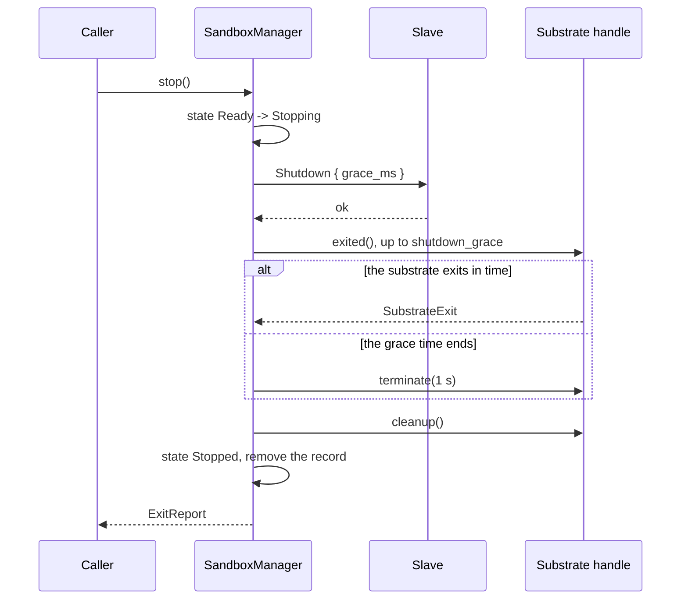

# Feature 02: The control-plane core (`SandboxManager`)

_Written in ASD-STE100 Simplified Technical English (STE). Code and identifiers stay as they
are._

**Abbreviations in this file.** remote procedure call (RPC); Unix domain socket (UDS);
WebAssembly (wasm); deterministic simulation testing (DST); behaviour-driven development
(BDD); continuous integration (CI); AeroSpace and Defence Industries Association of Europe
(ASD), the owner of the STE standard ASD-STE100.

## 1. Goal

Write the control plane as library code in `shared/`: `SandboxManager`, which implements
`SandboxControl`. It holds the registry of sandboxes, runs the create story (driver launch,
slave readiness, `Prepare`), gives callers a `Sandbox` handle that talks to the slave, and
cleans up on every exit path.

It has no substrate code and no operating-system call. It compiles for native targets and
for wasm32. The Firecracker driver (feature 05) and the Cloudflare driver (feature 07) plug
into it.

## 2. Story

- **S1**: "A caller asks for a sandbox; the control plane picks a driver, starts the
  substrate, waits for the slave, prepares the root, and returns a handle."
- **S2**: "A caller runs a command through the handle and reads events as they come."
- **S3**: "A caller runs a command and gets its captured output, with a size limit."
- **S4**: "A caller writes a file from a byte stream and reads a file as a byte stream."
- **S5**: "A caller stops or kills a sandbox; nothing of it stays."
- **S6**: "The start fails at some step: no driver, a driver error, a slave that never
  answers, a `Prepare` error."
- **S7**: "A ready sandbox dies: the substrate exits, or the slave stops answering."
- **S8**: "A caller drops a handle, or a command handle, without a stop."
- **S9**: "A caller asks what sandboxes exist and what this host can run."

| # | Use case | Actor | Trigger | Result |
|---|---|---|---|---|
| U1 | Probe | caller | `probe()` | One `HostReport` for each registered driver. |
| U2 | Create | caller | `create(spec)`, `create_with_progress(spec)` | A `Ready` sandbox, or a typed error and nothing left. |
| U3 | Look up | caller | `get(id)`, `list()` | The handle or the list. |
| U4 | Exec | caller | `Sandbox::exec`, `run` | Events, or bounded output. |
| U5 | Files | caller | `write_file`, `read_file` | Bytes moved; size returned. |
| U6 | Stop | caller | `stop()`, `kill()` | `ExitReport`; state `Stopped`. |
| U7 | Fail | substrate, slave | exit, time-out | State `Failed`, then `Stopped`; handles get errors. |

## 3. Bounded context

**Inside this feature:** the registry, the sandbox state machine, the create and stop
stories, the client side of `SlaveService`, the handles.

**Outside:** the slave (feature 01); the drivers (05, 07, 09, 10), which only start and
stop a substrate; the RPC server for `SandboxService` and the remote client (feature 06);
where sandbox records are stored when the control plane has no long life (feature 07 gives
a store for a DO).

| Entity | Meaning | Owner (the one writer) |
|---|---|---|
| Driver set | The registered drivers, in order. | `SandboxManager` (at construction) |
| Sandbox record | ID, driver, spec, state, substrate handle, slave client, slave info, created time. | `shared::control::manager` |
| Sandbox state | `Creating`, `Ready`, `Stopping`, `Stopped`, `Failed`. | the record's own state machine |
| Registry | `SandboxId` to record. | `SandboxManager` |
| `SlaveClient` | The typed client of `SlaveService` on one transport. | `shared::control::slave_client` |
| Exec session (control side) | An open `Exec` stream, the input sequence counter, the time-out timer. | `ExecHandle` |
| Upload (control side) | The upload ID and the next offset. | `write_file` |
| `RecordStore` | Where records are kept: memory here; DO storage in feature 07. | `SandboxManager` through a trait |

| Verb | Kind | Trigger | Effect |
|---|---|---|---|
| probe | entity | caller | Asks each driver. |
| pick driver | entity | `create` | `spec.driver`, or the first usable in order. |
| create | story | caller | launch, await slave, prepare, register `Ready`; undo on a failed step. |
| await slave | entity | after launch | Calls `Info` with back-off until it answers, the substrate exits, or the deadline. |
| exec | entity | handle | Opens an `Exec` stream; maps events. |
| send input | entity | `ExecStdin::write` | `ExecInput` with the next sequence; retries on `InputQueueFull`. |
| write file | story | handle | begin, chunks, commit; abort on a failed step. |
| stop | story | caller | `Shutdown`, wait, terminate, clean up. |
| kill | story | caller, failure, drop | Kill, clean up. |
| watch | entity | a `Ready` record | Marks the record `Failed` when the substrate exits. |

## 4. Rules

### 4.1 Law worksheet

```
Entity: Sandbox record / state
Conserved value:         one substrate for each record that is Creating, Ready or Stopping; none after Stopped
Bound:                   state in {Creating, Ready, Stopping, Stopped, Failed}; records in Ready <= max_sandboxes
Inverse pairs:           create / stop (a stopped sandbox does not start again)
Idempotent verbs:        stop, kill (later calls return the first ExitReport); get; list; probe
Ordering pairs:          create -> exec, files, stop (enabling); stop / kill (competing: the first decides `killed`);
                         stop / substrate exit (competing: the first decides Stopped or Failed)
Monotone values:         state: Creating -> Ready -> Stopping -> Stopped; Creating or Ready -> Failed -> Stopped
Freeze points:           id, driver and spec at create; ExitReport at the first stop or kill
Links to other entities: state Ready <=> the slave answered Info and Prepare; record.driver = the driver that launched it

Entity: Registry
Conserved value:         every record that create added is listed until it is Stopped and then removed
Bound:                   none more than the record bound
Inverse pairs:           add / remove
Idempotent verbs:        remove of a missing id
Ordering pairs:          add -> get (enabling)
Monotone values:         none
Freeze points:           none
Links to other entities: RecordStore holds the same set

Entity: Exec session (control side)
Conserved value:         the events given to the caller = the events from the slave, in the same order
Bound:                   input chunk <= chunk_bytes; captured output <= max_captured_output per stream
Inverse pairs:           none
Idempotent verbs:        close of standard input
Ordering pairs:          Started -> input and signal (enabling); Exit ends the stream
Monotone values:         input sequence
Freeze points:           exec_id
Links to other entities: the slave session with the same exec_id

Entity: Create (the story)
Conserved value:         after a failed create: 0 substrates, 0 records in Ready, 0 host resources
Bound:                   total time <= boot_timeout (+ clean-up)
Inverse pairs:           none
Idempotent verbs:        none
Ordering pairs:          launch -> Info -> Prepare -> Ready (each enables the next);
                         Info answer / substrate exit / deadline (competing)
Monotone values:         progress values, in the order of CreateProgress
Freeze points:           none
Links to other entities: none
```

### 4.2 Invariants

| # | Invariant |
|---|---|
| I1 | A record is `Ready` only after the slave answered `Info` and `Prepare` succeeded. |
| I2 | The state moves only along the allowed edges of the worksheet. |
| I3 | A failed `create` leaves no substrate (the driver handle got `kill` and `cleanup`) and no record. |
| I4 | After `Stopped`, the driver handle got `cleanup`, and the record is not in `list()`. |
| I5 | `stop` and `kill` return the same `ExitReport` each time after the first. |
| I6 | After `Stopping`, `Stopped` or `Failed`, `exec`, `write_file` and `read_file` fail with `SandboxStopped`. |
| I7 | Progress values arrive in the order of `CreateProgress`, each at most one time, then exactly one result. |
| I8 | Events reach the caller in the order the slave sent them; `Exit` is last; an event `seq` gap ends the stream with `StreamLost`. |
| I9 | `ExecStdin::write` sends chunks of at most `chunk_bytes`, in sequence order, and a chunk is not lost or sent as two when a call is retried. |
| I10 | A failed or dropped `write_file` calls `FileWriteAbort`; the target keeps its old content. |
| I11 | `run` holds at most `max_captured_output` bytes for each stream, and still reads to `Exit`. |
| I12 | Dropping an `ExecHandle` before `Exit` ends the slave session (the response stream closes; the slave kills the program). |
| I13 | A substrate that exits while the record is `Ready` makes the state `Failed`, then `Stopped`, with clean-up. Open handles get `SandboxStopped` or `StreamLost`. |
| I14 | Every wait has a deadline from `ctx.clock()`. No test uses a real sleep. |
| I15 | With one seed and one script, two runs give the same call trace. |
| I16 | This feature's code has no substrate-specific branch and no operating-system call. It compiles for wasm32. |

### 4.3 Must have

- `SandboxManager`, `SlaveClient`, `ExecHandle`, `ExecStdin`, `FileStream`.
- `RecordStore` with the in-memory implementation.
- The public module `testing` (feature `testing`): `SimDriver`, `ScriptedSlave`,
  `in_memory_connector`.

### 4.4 Must do

- Put the driver's log tail (at most `max_error_message` bytes) in a start error.
- Kill and clean up on every path that leaves `Creating` or `Ready` without `Stopping`.
- Retry `ExecInput` on `InputQueueFull` with back-off until the command time-out.

### 4.5 Must not

- Must not retry a call that is not idempotent (`Exec`, `FileWriteBegin`, `FileWriteCommit`).
- Must not hold a stream whole in memory.
- Must not decide a rule that belongs to the slave or to a driver.

## 5. Acceptance scenarios

```gherkin
Feature: Control-plane core

  Background:
    Given a Ctx with a seed and a SimulatedClock
    And a SandboxManager with one simulated driver and a scripted slave

  Scenario: Create returns a ready sandbox
    When the caller creates a sandbox
    Then the progress values are Preparing, SubstrateStarted, SlaveConnected, SlaveReady
    And the sandbox state is Ready
    And the slave got Info, then Prepare with the root that the driver gave

  Scenario: The first usable driver is picked
    Given drivers A (not usable) and B (usable), in that order
    When the caller creates a sandbox with no driver named
    Then driver B launched it

  Scenario: No usable driver is a full answer
    Given every driver is not usable
    When the caller creates a sandbox
    Then the result is NoDriver with one report for each driver
    And no driver was asked to launch

  Scenario: A named driver that is not usable is refused
    Given driver A is not usable
    When the caller creates a sandbox with driver A
    Then the result is DriverUnavailable

  Scenario: A spec that the driver cannot run is refused before launch
    Given a driver with rootfs_directory false
    When the caller creates a sandbox with RootFs::Directory
    Then the result is UnsupportedRootFs
    And the driver was not asked to launch

  Scenario: A slave that never answers times out, and nothing stays
    Given a substrate whose slave never answers Info
    When the clock passes boot_timeout
    Then the result is BootTimeout { stage: "slave" } with the driver log tail
    And the substrate handle got kill and cleanup
    And list() is empty

  Scenario: The readiness wait backs off on the clock
    Given a slave that refuses 4 Info calls and then answers
    When the caller creates a sandbox
    Then the waits between the calls are 5, 10, 20 and 40 ms

  Scenario: A substrate that exits during the start is reported
    Given a substrate that exits with code 1 before the slave answers
    When the caller creates a sandbox
    Then the result is SubstrateExited { code: 1 } with the log tail
    And the substrate handle got cleanup

  Scenario: A Prepare error stops the create
    Given a slave that answers Prepare with RootSetupFailed
    When the caller creates a sandbox
    Then the result is SlaveError { code: RootSetupFailed }
    And the substrate handle got kill and cleanup

  Scenario: Events arrive in order and Exit is last
    Given the slave will send Started, Stdout "a", Stderr "b", Stdout "c", Exit 0
    When the caller runs a command and reads all events
    Then the events are Stdout "a", Stderr "b", Stdout "c", Exit(code 0)

  Scenario: An event gap is stream loss
    Given the slave will send seq 0, 1, 3
    When the caller reads the events
    Then the stream ends with StreamLost after seq 1

  Scenario: Input is sent in order and survives a full queue
    Given the slave answers InputQueueFull two times for seq 1 and then accepts it
    When the caller writes 3 chunks to standard input and closes it
    Then the slave applied seq 0, 1, 2 and eof at seq 3, each one time

  Scenario: A command time-out kills the program
    Given a command with timeout 5 s whose program does not exit
    When the clock moves 5 s
    Then the slave got ExecSignal 9
    And wait returns ExecTimeout

  Scenario: Capture is bounded
    Given max_captured_output is 1024 and a program that prints 1 MiB and exits 0
    When the caller uses run
    Then stdout holds 1024 bytes, stdout_truncated is true, and the status is code 0

  Scenario: A file write that fails is aborted
    Given the slave fails the second FileWriteChunk with Io
    When the caller writes a file of 3 chunks
    Then the result is SlaveError { code: Io }
    And the slave got FileWriteAbort for that upload

  Scenario: Stop is graceful first
    Given a ready sandbox whose substrate exits 100 ms after Shutdown
    When the caller stops it
    Then the slave got Shutdown before the driver got terminate
    And ExitReport.killed is false
    And the state is Stopped and list() does not have it

  Scenario: Stop forces after the grace time
    Given a ready sandbox whose substrate does not exit
    When the caller stops it and the clock moves shutdown_grace
    Then the driver handle got terminate
    And ExitReport.killed is true

  Scenario: Stop two times gives one answer
    When the caller stops a sandbox two times
    Then both calls return the same ExitReport
    And the slave got Shutdown one time

  Scenario: A stopped sandbox refuses work
    Given a stopped sandbox
    When the caller runs a command
    Then the call fails with SandboxStopped

  Scenario: A substrate that dies makes the sandbox Failed
    Given a ready sandbox with one running command
    When the substrate exits with code 137
    Then the command stream ends with StreamLost
    And the state becomes Failed and then Stopped
    And the driver handle got cleanup

  Scenario: Dropping a command handle ends its session
    Given a running command
    When its ExecHandle is dropped
    Then the slave saw the Exec stream close

  Scenario: The same seed gives the same trace
    When one scripted run executes two times with seed 7
    Then the two call traces are equal
```

## 6. Technical breakdown

### 6.1 Files

`src/shared/control/`:

| File | Content |
|---|---|
| `manager.rs` | `SandboxManager`, the registry, driver choice. |
| `create.rs` | The create task (section 6.3). |
| `record.rs` | `SandboxRecord`, the state machine, `RecordStore`, `MemoryRecordStore`. |
| `slave_client.rs` | `SlaveClient`. |
| `handle.rs` | The `SandboxOps` implementation, `ExecHandle`, `ExecStdin`, `FileStream`, `run`. |
| `stop.rs` | The stop and kill stories, the watcher. |
| `testing.rs` | Feature `testing`: `SimDriver`, `ScriptedSlave`, `in_memory_connector`. |

### 6.2 `SandboxManager`

```rust
pub struct SandboxManager { /* Arc<Inner> */ }

pub struct ManagerConfig {
    pub limits: SandboxLimits,           // defaults for a spec that does not set them
    pub max_sandboxes: usize,            // default 64
    pub id_source: IdSource,             // default Random
}
/// `Fixed` is for a control plane that holds one sandbox with a given name (a Cloudflare
/// DO, feature 07). With `Fixed`, a second create while the first exists fails with
/// `TooManySessions`.
pub enum IdSource { Random, Fixed(SandboxId) }

impl SandboxManager {
    /// `drivers` is in preference order. `connector` turns an endpoint into a transport.
    pub fn new(
        ctx: Ctx,
        drivers: Vec<Arc<dyn SandboxDriver>>,
        connector: Arc<dyn SlaveConnector>,
        store: Arc<dyn RecordStore>,
        config: ManagerConfig,
    ) -> Self;
}
impl SandboxControl for SandboxManager { /* section 6 of the requirements */ }

impl SandboxManager {
    /// Loads the stored records and finds their substrates again. Call it one time, before
    /// the first request, in a control plane that can restart while its sandboxes live.
    pub async fn restore(&self) -> SandboxResult<()>;
}
```

`restore`, for each record of `store.list()`:

| Record state | Work |
|---|---|
| `Ready` | `driver.attach(ctx, &record)`. `Ok(Some(substrate))`: connect, call `Info` with `rpc_timeout`; when it answers with `prepared == true`, add the record as `Ready` and start its watcher. In every other case (`Ok(None)`, an attach error, no answer, `prepared == false`): `cleanup()` when a substrate exists, then `store.remove(id)`. |
| `Creating`, `Stopping`, `Failed` | Not finished work. `attach`; `kill` and `cleanup` when a substrate exists; `store.remove(id)`. |
| `Stopped` | `store.remove(id)`. |

`restore` does not start a substrate and does not call `Prepare`. A second call does
nothing.

`max_sandboxes` default 64: a small host limit that a caller raises; the count of `Ready`
and `Creating` records above it gives `TooManySessions`.

Driver choice in `create`:

1. `spec.driver = Some(d)`: the driver with that ID. Not registered: `InvalidSpec
   { field: "driver" }`. `probe` not usable: `DriverUnavailable { driver, reason }` with
   the first failed check.
2. `None`: probe the drivers in order; take the first usable one whose capabilities accept
   the spec (`validate` passes). None usable: `NoDriver { reports }`. Usable drivers exist
   and all reject the spec: the `validate` error of the first usable driver.
3. `spec.validate(caps)` for the chosen driver.

### 6.3 The create task

```rust
pub enum CreateState {
    Choose   { spec: SandboxSpec },
    Launch   { id: SandboxId, spec: SandboxSpec, launch: LaunchStream },
    AwaitSlave { id: SandboxId, spec: SandboxSpec, substrate: Substrate, client: SlaveClient,
                 deadline: foundation_compact::Instant, attempt: u32 },
    Prepare  { id: SandboxId, spec: SandboxSpec, substrate: Substrate, client: SlaveClient,
               info: SlaveInfo, deadline: foundation_compact::Instant },
    Done,
}

#[task]
async fn create_sandbox(ctx: Ctx, state: CreateState)
    -> Option<(CreateState, TaskStatus<SandboxResult<Sandbox>, CreateProgress>)>;
```

The task holds an `Arc` of the manager internals through the state (not shown).

| State | Work | Emits | Next |
|---|---|---|---|
| `Choose` | Driver choice and validation (section 6.2). Check `max_sandboxes`. Generate the ID. Add a record in `Creating`. Call `driver.launch`. | `Pending(Preparing)` | `Launch` |
| `Launch` | Take the next item of the launch stream. A `Pending(p)` passes on. `Next(Ok(substrate))`: build the transport with `connector.connect(endpoint)`, make the `SlaveClient`, set `deadline = now + boot_timeout`. | the driver's progress values | `AwaitSlave` |
| `AwaitSlave` | Await the first of: `client.info()` with the time-out `min(rpc_timeout, time left)`; `substrate.handle.exited()`; the deadline. An `Info` failure that is a transport error or `Unavailable`: await a timer of `min(5 ms * 2^attempt, 100 ms)` and try again. | `Pending(SlaveConnected)` on the answer | `Prepare` |
| `Prepare` | `client.prepare(PrepareRequest { root: substrate.root, workdir, env, mounts, dns, limits })`. `dns` is `spec.dns` when the network mode is `Host`, else empty. On success: record state `Ready`, start the watcher, build the `Sandbox`. | `Pending(SlaveReady)`, then `Ready(Ok(sandbox))` | `Done` |
| `Done` | | `None` | |

`create()` is `execute(create_sandbox::new(..), None)?.into_ready_future().await`.
`create_with_progress()` returns the stream.

### 6.4 Fault table: `create`

| Step that fails | What the control plane does | What the caller sees | What is left behind |
|---|---|---|---|
| Driver choice or validation | Nothing was started. | `InvalidSpec`, `Unsupported*`, `NoDriver`, `DriverUnavailable`, `TooManySessions` | nothing |
| The launch stream gives `Err(e)` | Removes the record. (The driver cleaned up its own partial work; feature 05, section 6.) | `e` | nothing |
| `connector.connect` fails | `kill`, `cleanup`, removes the record. | the error | nothing |
| The substrate exits in `AwaitSlave` or `Prepare` | Reads `log_tail`; `cleanup`; removes the record. | `SubstrateExited { code, log_tail }` | nothing |
| The deadline passes in `AwaitSlave` | `log_tail`; `kill`; `cleanup`; removes the record. | `BootTimeout { stage: "slave" }` | nothing |
| `Prepare` returns an error | `kill`; `cleanup`; removes the record. | the `SlaveError` | nothing |
| The caller drops the create future or stream | `kill`; `cleanup`; removes the record. | (gone) | nothing |

The clean-up for the last row is a guard value in the task state: when the state is dropped
before `Done`, the guard sends the substrate handle to a clean-up task
(`execute(from_future(..))`). A drop cannot await, so the work moves to a task.

### 6.5 `SlaveClient`

A thin wrapper on the generated `SlaveService` client with a `Transport`:

- Every unary call has the time-out `limits.rpc_timeout` from `ctx.clock()`.
- It maps `ConnectError` to `SandboxError` with `SandboxError::from_connect`.
- Idempotent calls (`Info`, `Prepare`, `ExecInput`, `ExecSignal`, `FileWriteChunk`,
  `FileWriteAbort`, `Shutdown`) are retried one time on a transport error. The others are
  not retried.

### 6.6 Handles

The handle code is generic over the calls that it needs, so the remote client of feature
06 uses the same code:

```rust
/// Implemented by SlaveClient here, and by the scoped SandboxService client in feature 06.
pub trait ExecFileCalls: Send + Sync + 'static {
    fn exec(&self, req: ExecRequest) -> BoxFuture<'_, SandboxResult<ExecEventStream>>;
    fn exec_input(&self, req: ExecInputRequest) -> BoxFuture<'_, SandboxResult<ExecInputResponse>>;
    fn exec_signal(&self, req: ExecSignalRequest) -> BoxFuture<'_, SandboxResult<()>>;
    fn file_write_begin(&self, req: FileWriteBeginRequest) -> BoxFuture<'_, SandboxResult<FileWriteBeginResponse>>;
    fn file_write_chunk(&self, req: FileWriteChunkRequest) -> BoxFuture<'_, SandboxResult<FileWriteChunkResponse>>;
    fn file_write_commit(&self, req: FileWriteCommitRequest) -> BoxFuture<'_, SandboxResult<FileWriteCommitResponse>>;
    fn file_write_abort(&self, req: FileWriteAbortRequest) -> BoxFuture<'_, SandboxResult<()>>;
    fn file_read(&self, req: FileReadRequest) -> BoxFuture<'_, SandboxResult<FileChunkStream>>;
}
```

```rust
impl ExecHandle {
    pub fn exec_id(&self) -> &ExecId;
    pub fn pid(&self) -> u32;
    pub fn stdin(&mut self) -> Option<ExecStdin>;          // Some one time, when Command.stdin is Piped
    pub fn events(&mut self) -> ExecEvents;                // futures::Stream<Item = SandboxResult<ExecEvent>>
    pub async fn signal(&self, signal: i32) -> SandboxResult<()>;
    pub async fn wait(mut self) -> SandboxResult<ExitStatus>;   // reads and discards output
}
impl ExecStdin {
    pub async fn write(&mut self, bytes: &[u8]) -> SandboxResult<()>;
    pub async fn close(self) -> SandboxResult<()>;
}
```

`exec(command)`:

1. State `Ready` (`SandboxStopped`).
2. `exec_id = ExecId::generate(ctx)`. Open `client.exec(ExecRequest { .. })`.
3. Read the first event. It must be `Started` with `seq` 0 (`StreamLost` if not). A call
   error passes through.
4. `Command.stdin = Bytes(b)`: write `b` and close, in a task. `Null`: `stdin: false`.
5. `Command.timeout = Some(t)`: a timer task. When it fires before `Exit`: `ExecSignal 9`,
   and the handle remembers "timed out"; `wait()` then returns `ExecTimeout`, and
   `events()` still gives the `Exit` event.

`events()` checks that each `seq` is the last one plus 1; a gap or a stream error before
`Exit` gives one `Err(StreamLost)` and ends.

`ExecStdin::write` cuts the bytes into chunks of `chunk_bytes` and calls `ExecInput` for
each, with the next sequence. On `InputQueueFull` it awaits a timer of
`min(5 ms * 2^attempt, 200 ms)` and sends the same `seq` again. On a transport error it
sends the same `seq` again one time (the call is idempotent). `close` sends `eof: true`
with no data. Dropping `ExecStdin` without `close` starts a task that sends `eof`.

Dropping an `ExecHandle` before `Exit` drops the response stream; the slave then kills the
program (feature 01, invariant I8).

`Sandbox::run(command)`: `exec`, then read events into two buffers up to
`max_captured_output` each; set the `*_truncated` flag and discard more bytes; return at
`Exit`.

`write_file(path, mode, data)`: `FileWriteBegin`; for each chunk of at most `chunk_bytes`
from the stream, `FileWriteChunk` with the offset; `FileWriteCommit` with the total. On any
error, or when the future is dropped, `FileWriteAbort` (in a task when dropped). Returns
the size.

`read_file(path)`: opens `FileRead`; `FileStream` is a `futures::Stream<Item =
SandboxResult<Vec<u8>>>` that checks that offsets grow with no gap (`StreamLost`) and ends
after the chunk with `eof`.

### 6.7 Stop, kill and the watcher



_Caption: stop asks the slave first, forces the substrate only after the grace time, and always cleans up._

- `stop()`: if the state is `Stopped`, return the stored report. If `Stopping`, await the
  stop in progress. `Shutdown` that fails (the slave is gone) is not an error for `stop`:
  go to the wait. `ExitReport.killed` is true when `terminate` was called.
- `kill()`: state `Stopping`; `handle.kill()`; `cleanup()`; `Stopped`. `killed` is true.
- The watcher task of a `Ready` record awaits `handle.exited()`. When it completes and the
  state is `Ready`: state `Failed`; `cleanup()`; state `Stopped`; remove the record.
- Dropping the last `Sandbox` handle does nothing. The record stays in the registry, and
  `get(id)` gives a new handle. A sandbox ends by `stop`, `kill`, its own exit, or when the
  manager is dropped: `SandboxManager::drop` starts a task that kills every record.
- After `Stopping`, `Stopped` or `Failed`, the three work calls return `SandboxStopped`.

### 6.8 `RecordStore`

```rust
/// What survives outside the manager's memory. The in-memory store keeps nothing after
/// the process ends. Feature 07 gives a store on DO storage.
pub trait RecordStore: Send + Sync + 'static {
    fn put(&self, record: StoredRecord) -> BoxFuture<'_, SandboxResult<()>>;
    fn remove(&self, id: &SandboxId) -> BoxFuture<'_, SandboxResult<()>>;
    fn list(&self) -> BoxFuture<'_, SandboxResult<Vec<StoredRecord>>>;
}
```

`StoredRecord` is defined in feature 00 (section 6.8).

The manager calls `put` on each state change and `remove` at `Stopped`. A store error in
`create` fails the create (with clean-up); a store error after that is logged with
`tracing::warn!` and does not change the result of the call.

### 6.9 The simulation helpers (`testing`)

- `SimDriver`: a `SandboxDriver` that a test scripts: probe result, launch progress, launch
  result, when the substrate exits. Its handle records `terminate`, `kill`, `cleanup`.
- `ScriptedSlave`: a `SlaveService` implementation that a test scripts for each call, and
  that records every call.
- `in_memory_connector(slave)`: a `SlaveConnector` whose transport calls a
  `foundation_connectrpc` `Router` in the same process through the pipe connection types
  (`shared/transport/conn.rs`: `PipeClientConn`, `PipeHandlerConn`). So the simulation
  runs the real client, the real codec and the real router, with no socket.

The doc comment of the module says: these give no isolation and are for tests.

## 7. Tests

`backends/foundation_platform_sandbox/tests/`. Each has the valtron test attributes.

Simulation (`control_sim_*.rs`), with `Ctx::with_seed`, `SimulatedClock`, `SimDriver`,
`ScriptedSlave`:

| Law or scenario | Test | Oracle |
|---|---|---|
| I1, I7, "Create returns a ready sandbox" | `create_ok` | example |
| "The first usable driver is picked", "No usable driver ...", "A named driver ..." | `driver_choice`, `no_driver`, `driver_unavailable` | expected outcome |
| "A spec that the driver cannot run ..." | `validate_before_launch` | expected outcome |
| I3, the four create failure scenarios, the fault table of section 6.4 | `create_fault_matrix` (one case for each row; each asserts the error, `kill` or `cleanup` on the handle, and an empty `list()`) | fault |
| I14, "The readiness wait backs off on the clock" | `await_slave_backoff` | example |
| I2, I5, I6 | `state_machine_model` (stateful: random series of create, exec, stop, kill, substrate exit against a model of the state table; after each step, compare the state and each call's outcome) | stateful model |
| I8, the two event scenarios | `events_in_order`, `event_gap` | expected outcome |
| I9, "Input is sent in order ..." | `stdin_retry_on_full`, `stdin_retry_on_transport_error`; `stdin_model` (property: random chunk sizes and injected faults; the slave model's applied bytes equal the bytes written) | identity |
| "A command time-out kills the program" | `command_timeout` | expected outcome |
| I11, "Capture is bounded" | `run_truncates` | bound |
| I10, "A file write that fails is aborted" | `write_file_abort_on_error`, `write_file_abort_on_drop` | fault |
| I4, the stop scenarios | `stop_graceful`, `stop_forced`, `stop_twice`, `stop_when_slave_gone`, `kill` | expected outcome |
| I13, "A substrate that dies ..." | `substrate_exit_fails_sandbox` | fault |
| I12, "Dropping a command handle ..." | `drop_exec_handle` | expected outcome |
| I15, "The same seed gives the same trace" | `same_seed_same_trace` | identity |
| `restore` (section 6.2) | `restore_ready_record`, `restore_dead_substrate`, `restore_unprepared_slave`, `restore_unfinished_record` (one for `Creating`, one for `Stopping`), `restore_twice`; `fixed_id` (the sandbox ID is the configured one; a second create fails with `TooManySessions`) | expected outcome |
| I16 | the wasm check in section 8; `no_os_calls` (a source scan of `src/shared/control/`) | build, example |

Real slave process (`control_slave_process_*.rs`, Linux, features `slave` and `testing`). A
test driver, `ProcessDriver` (in `tests/support/`), starts the slave test program of
feature 01 on a UDS and returns `SlaveEndpoint::Unix` with `RootSource::Plain`. It uses
`SandboxHost::native()` from feature 05 when that exists; until then it uses a small local
spawner in the test support. These tests call the shared acceptance scenarios
(`tests/support/acceptance.rs`, requirements section 8):

| Acceptance scenario | Proves |
|---|---|
| `accept_run_echo` | `run(["echo", "hi"])` gives `hi\n`, code 0. |
| `accept_exit_code` | `sh -c "exit 7"` gives 7. |
| `accept_stdin_roundtrip` | 1 MiB through `cat`. |
| `accept_large_output_streams` | 50 MB through `events()` with flat memory. |
| `accept_files_roundtrip` | `write_file` then `read_file`, 5 MiB; and atomic replace. |
| `accept_two_commands_at_once` | Two commands overlap and both end. |
| `accept_signal_and_timeout` | A signal ends a command; a time-out ends a command. |
| `accept_stop_is_clean` | After `stop()`: `killed` false, the process is gone, `list()` is empty. |

## 8. Verify

```bash
cargo fmt --all --check
cargo clippy -p foundation_platform_sandbox --features testing --all-targets --profile uat --no-deps -- -D warnings
cargo test -p foundation_platform_sandbox --features testing --profile uat control_sim
cargo test -p foundation_platform_sandbox --features "testing slave" --profile uat control_slave_process
cargo check -p foundation_platform_sandbox --no-default-features --features control --target wasm32-unknown-unknown --profile uat
python3 scripts/ci/check_executor_wake.py
```

## 9. Done when

- Each scenario of section 5 and each row of section 7 passes.
- The `control` feature compiles for wasm32.
- `src/shared/control/` has no `std::process`, `std::net`, `std::fs` or `std::time` clock
  call.
- No test uses a real sleep.
