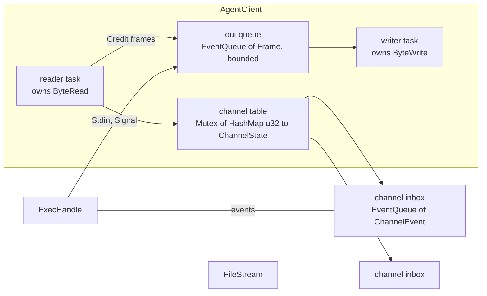
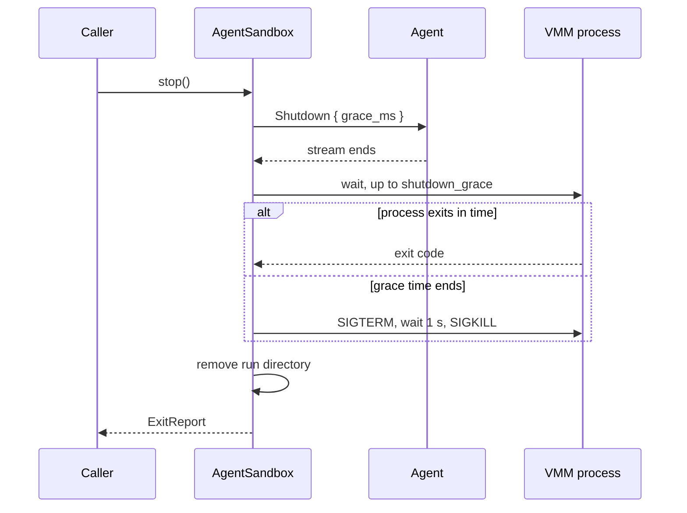

# Feature 02: Host core (`AgentClient`, `AgentSandbox`, `SandboxHost::native`)

_Written in ASD-STE100 Simplified Technical English (STE). Code and identifiers stay as they
are._

**Abbreviations in this file.** virtual machine monitor (VMM); Unix domain socket (UDS);
process identifier (PID); deterministic simulation testing (DST); input and output (I/O);
continuous integration (CI); AeroSpace and Defence Industries Association of Europe (ASD),
the owner of the STE standard ASD-STE100.

## 1. Goal

Write the host side that all backends share:

1. `AgentClient`: speaks the agent protocol on a `ByteDuplex`. It gives channels, credit,
   time-outs and stream-loss handling.
2. `AgentSandbox`: a `SandboxOps` implementation made of an `AgentClient`, an optional VMM
   child process and a run directory.
3. `SandboxHost::native()`: the real `ProcessSpawner`, `StreamTransport` and `HostFs`.
4. An in-memory `SandboxHost` for simulation tests.

After this feature a test can run commands through the public API against a real agent
process on a UDS, with no VM.

## A. Story

- **S1**: "A backend gives the host core a byte stream to a guest agent, and gets back a
  sandbox that a caller can use."
- **S2**: "A caller runs a command and reads its output while it runs."
- **S3**: "A caller runs several commands at once; a slow reader of one does not stop the
  others."
- **S4**: "A caller sends a file in, and reads a file out."
- **S5**: "A caller stops the sandbox, and nothing is left on the host."
- **S6**: "The guest stops answering, the stream breaks, or the VMM process exits."
- **S7**: "A caller drops a handle without a stop."

| # | Use case | Actor | Trigger | Result |
|---|---|---|---|---|
| U1 | Handshake | backend | `AgentClient::handshake` | A client and the `HelloAck`, or `BootTimeout` / `AgentHandshake`. |
| U2 | Run with streams | caller | `Sandbox::exec` | An `ExecHandle`: events in order, `Exit` last. |
| U3 | Run and capture | caller | `Sandbox::run` | Bounded output and the exit status. |
| U4 | Move a file | caller | `write_file`, `read_file` | Bytes moved inside the credit; size returned. |
| U5 | Stop | caller | `stop`, `kill` | The VMM is gone; the run directory is gone; one `ExitReport`. |
| U6 | Fail | guest or VMM | stream end, exit | State `Failed`; every open handle ends with an error; clean-up runs. |

## B. Bounded context

**Inside this feature:** the client side of the agent protocol, the sandbox object that all
agent-based backends share, and the real and simulated host bundles.

**Outside:** the frame format (feature 00); the agent (feature 01); how a guest starts and
which stream reaches it (features 04, 06, 09).

| Entity | Meaning | Owner (the one writer) |
|---|---|---|
| `AgentClient` | One protocol connection: reader task, writer task, channel table. | `shared::client` |
| Channel state | Inbox, send window, received count of one channel. | the reader task (table); the handle (credit counter) |
| Out queue | Frames that wait for the writer. | producers push; only the writer task pops |
| `ExecHandle` | The caller's end of one command. | `shared::client` |
| `FileStream` | The caller's end of one file read. | `shared::client` |
| `AgentSandbox` | Client + VMM child + run directory + state. | `shared::agent_sandbox` |
| Sandbox state | `Ready`, `Stopping`, `Stopped`, `Failed`. | `AgentSandbox` only |
| `SandboxHost::native` | The real processes, sockets and files. | `native::host` |

| Verb | Kind | Trigger | Effect |
|---|---|---|---|
| handshake | story | a stream | Preface, `Hello`, wait for `HelloAck`; starts the two tasks. |
| open channel | entity | `exec`, `write_file`, `read_file` | Takes the next number; adds a table entry; sends the request. |
| deliver | entity | a frame from the agent | Pushes to one inbox, or closes the connection on a rule break. |
| grant credit | entity | the consumer took bytes | Sends `Credit` when half a window was taken. |
| close | story | stream end, protocol error, shutdown | One time: fails every channel, closes the queue. |
| stop | story | caller | Shutdown, wait, signal, remove the run directory. |
| kill | story | caller, drop, failure | `SIGKILL`, wait, remove the run directory. |

## C. Rules

### Law worksheet

```
Entity: AgentClient (connection)
Conserved value:         every channel that was opened ends exactly one time (Exit, FileDone, Error or Closed)
Bound:                   open channels <= max_channels; out queue <= max_channels * 4 frames
Inverse pairs:           none
Idempotent verbs:        close (the second call does nothing)
Ordering pairs:          handshake -> every other verb (enabling); close / deliver (competing: after close nothing is delivered)
Monotone values:         channel numbers grow by 1; state moves open -> closed only
Freeze points:           limits at handshake
Links to other entities: Hello.channel_window = the receive window that the client enforces

Entity: Channel
Conserved value:         bytes received = bytes taken by the consumer + bytes in the inbox
Bound:                   bytes in the inbox <= channel_window; bytes sent and not credited <= channel_window
Inverse pairs:           none
Idempotent verbs:        none
Ordering pairs:          Started before Stdout/Stderr; Exit last; events reach the consumer in wire order
Monotone values:         received count; credit granted
Freeze points:           none
Links to other entities: the agent's send window = credit granted - bytes received

Entity: AgentSandbox
Conserved value:         one VMM process and one run directory for each sandbox, removed exactly one time
Bound:                   state in {Ready, Stopping, Stopped, Failed}
Inverse pairs:           none (a stopped sandbox does not start again)
Idempotent verbs:        stop, kill (later calls return the first ExitReport)
Ordering pairs:          stop / kill (competing: the first decides `killed`); stop -> exec is rejected
Monotone values:         state: Ready -> Stopping -> Stopped, Ready -> Failed -> Stopped
Freeze points:           the ExitReport after the first stop or kill
Links to other entities: state Failed <=> client closed without a caller stop, or VMM exited
```

### Invariants

| # | Invariant |
|---|---|
| I1 | Events of one command reach the consumer in the order that the agent sent them, and `Exit` is last. |
| I2 | An inbox never holds more than `channel_window` data bytes. |
| I3 | The client never sends more data bytes on a channel than the credit that the agent gave. |
| I4 | A consumer that does not read stops only its own channel. Other channels and `ping` continue. |
| I5 | An agent that sends more than the window is a protocol error (`BadCredit`); the connection closes. |
| I6 | When the connection closes, every open handle gets exactly one terminal error, and no handle waits for ever. |
| I7 | After `Stopped`, no VMM process and no run directory of that sandbox exist. |
| I8 | `stop` and `kill` return the same `ExitReport` each time after the first. |
| I9 | Every wait has a deadline from `ctx.clock()`. No test uses a real sleep. |
| I10 | Only `src/native/host.rs` touches the real processes, sockets and files. |
| I11 | `run` holds at most `max_captured_output` bytes for each stream, and still lets the program end. |

### Must have

- `AgentClient`, `ExecHandle`, `ExecStdin`, `FileStream`, `AgentSandbox`.
- `SandboxHost::native()` and `HostConfig::discover`.
- The simulation host and the `ScriptedAgent` for tests.

### Must do

- Kill the VMM and remove the run directory on every path that leaves `Ready`.
- Send `Signal(SIGKILL)` for a command whose handle is dropped before `Exit`.
- Report the reason of a closed connection (`CloseReason`).

### Must not

- Must not block an executor thread. A wait is an `await` or a `Depends`.
- Must not buffer a stream without a bound.
- Must not fall back to the real system when `SandboxHost` is missing.
- Must not send a signal to a PID after its exit is recorded.

## D. Acceptance scenarios

```gherkin
Feature: Host core

  Background:
    Given a Ctx with a seed, a SimulatedClock and the simulation host
    And a scripted agent that answers HelloAck

  Scenario: Events arrive in order and Exit is last
    Given the agent will send Started, Stdout "a", Stderr "b", Stdout "c", Exit 0
    When the caller runs a command and reads all events
    Then the events are Stdout "a", Stderr "b", Stdout "c", Exit(code 0) in that order

  Scenario: A slow reader stops only its own command
    Given command 1 produces output and the caller does not read it
    When the caller runs command 2 and pings the agent
    Then command 2 completes
    And the ping answers
    And the inbox of command 1 holds at most channel_window bytes

  Scenario: Credit is granted at half a window
    Given channel_window is 4096
    When the consumer takes 2047 bytes
    Then no Credit frame was sent
    When the consumer takes 1 more byte
    Then one Credit(2048) frame is sent

  Scenario: An agent that ignores the window is cut off
    Given channel_window is 4096
    When the agent sends 4097 data bytes with no credit
    Then the connection closes with Protocol(BadCredit)
    And the open handle gets ChannelClosed

  Scenario: Standard input waits for credit
    Given channel_window is 4096 and the agent sends no Credit
    When the caller writes 8192 bytes to standard input
    Then exactly 4096 bytes are on the wire
    When the agent sends Credit(4096)
    Then the write completes

  Scenario: The boot deadline is enforced
    Given an agent that never answers Hello
    When the clock moves past the deadline
    Then handshake returns BootTimeout

  Scenario: A command time-out kills the program
    Given a command with timeout 5 s that does not exit
    When the clock moves 5 s
    Then Signal(9) is sent on its channel
    And wait returns ExecTimeout

  Scenario: Losing the stream fails every handle
    Given two running commands and one file read
    When the stream ends
    Then each of the three handles gets ChannelClosed
    And the sandbox state is Failed
    And the VMM got SIGKILL and the run directory is gone

  Scenario: The VMM exits by itself
    Given a ready sandbox
    When the VMM process exits with code 1
    Then the sandbox state is Failed
    And the run directory is gone

  Scenario: Stop is graceful first
    Given a ready sandbox whose VMM exits 100 ms after Shutdown
    When the caller stops it
    Then Shutdown was sent before any signal
    And ExitReport.killed is false

  Scenario: Stop uses force after the grace time
    Given a ready sandbox whose VMM never exits
    When the caller stops it and the clock moves shutdown_grace
    Then SIGTERM is sent, then SIGKILL 1 s later
    And ExitReport.killed is true

  Scenario: Stop two times gives one answer
    When the caller stops a sandbox two times
    Then both calls return the same ExitReport
    And Shutdown was sent one time

  Scenario: A stopped sandbox refuses work
    Given a stopped sandbox
    When the caller runs a command
    Then the call fails with SandboxStopped

  Scenario: Dropping a handle kills its command
    Given a running command
    When its ExecHandle is dropped
    Then Signal(9) is sent on its channel

  Scenario: Capture is bounded
    Given max_captured_output is 1024 and a program that prints 1 MiB and exits 0
    When the caller uses run
    Then stdout holds 1024 bytes, stdout_truncated is true, and the status is code 0

  Scenario: The same seed gives the same trace
    When the same scripted run executes two times with seed 7
    Then the two frame traces are equal
```

## 2. `AgentClient`

File: `src/shared/client.rs`.

```rust
pub struct AgentClient { /* Arc<ClientInner> */ }

impl AgentClient {
    /// Sends the preface and `Hello`, then waits for `HelloAck` until `deadline`.
    pub async fn handshake(
        ctx: Ctx,
        stream: Box<dyn ByteDuplex>,
        hello: Hello,
        limits: SandboxLimits,
        deadline: foundation_compact::Instant,
    ) -> SandboxResult<(AgentClient, HelloAck)>;

    pub async fn exec(&self, request: ExecRequest) -> SandboxResult<ExecHandle>;
    pub async fn write_file(&self, path: String, mode: u32, data: BoxByteStream) -> SandboxResult<u64>;
    pub async fn read_file(&self, path: String) -> SandboxResult<FileStream>;
    pub async fn ping(&self, timeout: Duration) -> SandboxResult<Duration>;
    pub async fn shutdown(&self, grace: Duration) -> SandboxResult<()>;
    /// Completes when the stream ends. Gives the reason.
    pub fn closed(&self) -> BoxFuture<'static, CloseReason>;
    pub fn is_open(&self) -> bool;
}

pub enum CloseReason { Shutdown, StreamEnd, Protocol(ProtocolError), AgentError(AgentErrorBody), Io }
```

### 2.1 Structure



_Caption: one reader task and one writer task own the stream; each handle talks to them through bounded queues._

- The reader and the writer are two async tasks. `handshake` starts each one with
  `foundation_core::valtron::execute(from_future(..), None)` and keeps the returned
  stream handle so the task is not dropped.
- Queues are `foundation_core::valtron::EventQueue<T>`. A task that waits for an item
  awaits `queue.readiness()`; a task that waits for room awaits `queue.vacancy()`. The
  skill `rust-valtron-usage`, section "Waking a Parked Task", has the rules. No task loops
  on `Wait`.
- The out queue has a bound of `max_channels * 4` frames.
- Each channel inbox has no frame count bound. Its byte bound is the channel window: the
  agent cannot send more data than the credit that the client gave.

### 2.2 Reader task

```text
loop:
    n = read.read(buf).await           // parks on socket readiness
    if n == 0: close(StreamEnd); return
    decoder.feed(buf[..n])
    while let Some(frame) = decoder.next()?:
        match (frame.channel, frame.kind):
            (0, HelloAck)      -> complete the handshake
            (0, Pong)          -> complete the ping with this payload
            (0, Error)         -> close(AgentError); return
            (c, Credit)        -> table[c].send_window += n; wake the sender
            (c, Stdout|Stderr|FileData) -> table[c].received += len; push to the inbox of c
            (c, Started|Exit|FileDone|Error) -> push to the inbox of c; on Exit, FileDone
                                               or Error remove c from the table
            other              -> close(Protocol(UnexpectedFrame)); return
```

A data frame for a channel that is not in the table is dropped when the client closed that
channel a short time before (it keeps the last 64 closed numbers); if not, it is a protocol
error. A data frame that makes `received` larger than the window that the client gave is a
protocol error (`BadCredit`).

`close(reason)` does these steps one time only: store the reason, push
`ChannelEvent::Closed(reason)` to each inbox, clear the table, close the out queue, and
complete `closed()`.

### 2.3 Credit on the host side

- **Receive.** When a consumer takes a data event of `n` bytes from an inbox
  (`ExecHandle::events()` or `FileStream`), the handle adds `n` to a counter of that
  channel. When the counter reaches half of `channel_window`, the handle pushes
  `Credit(counter)` to the out queue and sets the counter to 0. So a consumer that does
  not read stops the agent after one window, and only on that channel.
- **Send.** `ExecHandle::stdin().write(bytes)` and `write_file` cut the bytes into frames of
  at most `max_frame_payload`. Before each frame they await the send window of the channel
  (`ResumeSignal` that the reader sets when a `Credit` arrives).

### 2.4 Time-outs

All time comes from `ctx.clock()`. A deadline wait is a race between the event and a timer
future from the clock, so a `SimulatedClock` controls it in tests.

| Operation | Limit | On time-out |
|---|---|---|
| `handshake` | the `deadline` argument | `BootTimeout` |
| `exec` until `Started` | `limits.api_timeout` | `ExecTimeout`, and the channel closes |
| `Command.timeout` | caller value | `Signal(SIGKILL)` to the program, then the events stream ends with `Exit` and `ExecHandle::wait()` returns `ExecTimeout` |
| `ping` | argument | `ExecTimeout` |
| `shutdown` | `grace` + 1 s | returns `Ok`; the caller (`AgentSandbox`) then stops the VMM |

### 2.5 `ExecHandle`

```rust
impl ExecHandle {
    pub fn pid(&self) -> u32;
    pub fn stdin(&mut self) -> Option<ExecStdin>;        // Some one time, when Command.stdin is Piped
    pub fn events(&mut self) -> ExecEvents;              // impl futures_core::Stream<Item = SandboxResult<ExecEvent>>
    pub async fn signal(&self, signal: i32) -> SandboxResult<()>;
    pub async fn wait(mut self) -> SandboxResult<ExitStatus>;   // drains and discards output
}
impl ExecStdin {
    pub async fn write(&mut self, bytes: &[u8]) -> SandboxResult<()>;
    pub async fn close(self) -> SandboxResult<()>;       // sends Stdin with END
}
```

Dropping an `ExecHandle` before `Exit` sends `Signal(SIGKILL)` for that channel and removes
it from the table. Dropping `ExecStdin` without `close()` sends `Stdin` with `END`.

`Sandbox::run(command)` is built on this: it calls `exec`, writes `StdinMode::Bytes` data if
any, reads events into two buffers up to `max_captured_output`, sets the `*_truncated` flags
and keeps reading (and discarding) so that credit flows and the program can end.

## 3. `AgentSandbox`

File: `src/shared/agent_sandbox.rs`.

```rust
pub struct AgentSandbox { /* private */ }

pub struct AgentSandboxParts {
    pub id: SandboxId,
    pub backend: BackendId,
    pub ctx: Ctx,
    pub client: AgentClient,
    pub vmm: Option<Box<dyn ChildProcess>>,   // None for Cloudflare
    pub run_dir: Option<PathBuf>,
    pub limits: SandboxLimits,
    pub base_env: Vec<(String, String)>,
}

impl AgentSandbox {
    pub fn new(parts: AgentSandboxParts) -> Sandbox;
}
```

Each backend builds the parts and calls `new`. `AgentSandbox` implements `SandboxOps`.

### 3.1 State

`state()` reads an atomic value. A watcher task, started in `new`, awaits the first of
`client.closed()` and `vmm.wait()`. When one completes and the state is `Ready`, it sets
`Failed`, kills the VMM if it still runs, and removes the run directory.

### 3.2 `stop()` and `kill()`



_Caption: `stop()` asks the agent first and uses signals only when the grace time ends._

- `stop()` is safe to call more than one time. Later calls return the first `ExitReport`.
- `kill()` sends `SIGKILL` to the VMM at once, waits for the exit, and removes the run
  directory.
- `Drop` for the last `Sandbox` handle: when the state is not `Stopped`, it sends `SIGKILL`
  to the VMM (a call that does not wait) and removes the run directory. It does not block.
  The documentation tells callers to call `stop()`.
- After `Stopped`, each operation returns `SandboxStopped`.

## 4. `SandboxHost::native()`

File: `src/native/host.rs`. This is the only file in the crate that can call
`std::process::Command`, bind a socket or touch the real file system.

### 4.1 `NativeProcessSpawner`

- Builds a `std::process::Command` from `ProcessSpec`: `env_clear()`, then the given
  environment; standard input from `/dev/null`; standard output and standard error to the
  two files (open with append).
- `kill_with_parent`:
  - Linux: `pre_exec` calls `prctl(PR_SET_PDEATHSIG, SIGKILL)`, then checks
    `getppid() != 1` and exits if the parent is gone already.
  - macOS: no such call exists. The spawner makes a pipe and gives the read end to the
    child as file descriptor 3. The parent keeps the write end open for its whole life.
    `bin/sandbox_krun` watches descriptor 3 (feature 04). Firecracker does not run on
    macOS, so this covers every case.
- `wait()`: one thread for each child calls `Child::wait()` and stores the result in a
  shared cell, then sets a `ResumeSignal`. `wait()` awaits that signal. This is a helper
  thread, not an executor thread, so the block is allowed.
- `signal()`: `libc::kill(pid, signal)`. After the exit is stored, it returns `Ok` and
  does nothing, so a reused PID never gets a signal.

### 4.2 `NativeTransport`

Wrap the existing types. Read these first:
`backends/foundation_netio/src/native/connection.rs` (`Listener`, `Connection`,
`connect_unix`, `poll_fd`, `ready_now`, `register_waker`) and
`backends/foundation_nativeapis/src/native/net/unix.rs` (`UnixListener`, `UnixStream`,
`register`).

- `listen_unix(path)`: checks the path length (feature 00, section 3.4), binds, sets the
  socket non-blocking, and sets the file mode to `0600`.
- Each socket is non-blocking and is wrapped in a
  `foundation_nativeapis::native::fd::RegisteredFd` on the shared reactor
  (`Reactor::get()?.registry()`). `RegisteredFd` implements
  `foundation_core::valtron::EventReadiness` (`native/fd/mod.rs`, module documentation).
- `accept()`, `read()`, `write_all()`: try the non-blocking call. On `WouldBlock`, the
  future parks on the `RegisteredFd` readiness and tries again when the reactor wakes it.
  This is the same seam that `foundation_netio` uses for its own sockets; do not add a
  second poller.
- `foundation_nativeapis` is a dependency with `default-features = false` and
  `features = ["fd"]`. This feature set compiles for `x86_64-unknown-linux-musl` (checked
  2026-11-11 with `cargo check`), so the agent (feature 01) uses the same types.

### 4.3 `NativeFs`

Thin calls to `std::fs`. `read(path, max)` and `tail(path, max)` never read more than
`max` bytes.

### 4.4 `HostConfig::discover`

`HostConfig::discover(env: &dyn Fn(&str) -> Option<String>, exe_dir: &Path) -> HostConfig`
fills the paths. The host entry point passes the real environment reader; tests pass a map.

| Field | Order of sources |
|---|---|
| `state_dir` | `EWE_SANDBOX_STATE_DIR`; `$XDG_RUNTIME_DIR/ewe-sbx`; `/tmp/ewe-sbx-<uid>` |
| `cache_dir` | `EWE_SANDBOX_CACHE_DIR`; `$XDG_CACHE_HOME/ewe-sandbox`; `$HOME/.cache/ewe-sandbox` |
| `agent_path` | `EWE_SANDBOX_AGENT`; `<exe_dir>/sandbox-agent-<guest_arch>` |
| `krun_runner_path` | `EWE_SANDBOX_KRUN`; `<exe_dir>/sandbox-krun` |
| `firecracker_path` | `EWE_FIRECRACKER`; `firecracker` on `PATH` |
| `libkrun_path` | `EWE_LIBKRUN`; none (the runner uses the loader search path) |

## 5. The simulation host

File: `tests/support/sim_host.rs` (test code, not public API).

- `SimTransport`: `listen_unix` and `connect_unix` join two in-memory pipes by path name.
  Each pipe is a bounded byte queue on `EventQueue`.
- `SimProcessSpawner`: `spawn` returns a `SimChild` that the test controls (`exit(code)`).
  A test registers a closure for a program name; the closure can connect a scripted agent
  to a `SimTransport` path.
- `SimFs`: a map from path to bytes.
- `ScriptedAgent`: a small in-test agent on the protocol crate. A test tells it what to
  answer. It is not the real agent; it exists so that each client rule has a test with
  exact timing.

## 6. Tests

All in `backends/foundation_platform_sandbox/tests/`. Each has the valtron test attributes.

Simulation tests (`client_sim_*.rs`), with `Ctx::with_seed`, `SimulatedClock` and
`ScriptedAgent`:

| Test | Proves |
|---|---|
| `handshake_ok` | `Hello` goes out with the limits; `HelloAck` returns. |
| `handshake_times_out` | No `HelloAck`; advancing the clock past the deadline gives `BootTimeout`. |
| `bad_preface_closes` | A wrong preface gives `Protocol(BadPreface)`. |
| `exec_events_in_order` | `Started`, `Stdout`, `Stderr`, `Exit` arrive as events in the order sent. |
| `receive_credit_is_sent_at_half_window` | No `Credit` frame before the consumer takes half a window; one after. |
| `slow_consumer_does_not_block_other_channel` | Channel 1 is not read. Channel 2 still completes. `ping` still answers. |
| `agent_overrun_is_protocol_error` | An agent that sends more than the window gives `BadCredit`. |
| `stdin_waits_for_credit` | A write larger than the window completes only after the agent sends `Credit`. |
| `command_timeout_kills` | Advancing the clock past `Command.timeout` sends `Signal(9)`; `wait()` gives `ExecTimeout`. |
| `stream_end_fails_all_handles` | Each open handle gets `ChannelClosed`; `closed()` gives `StreamEnd`. |
| `drop_handle_sends_kill` | Dropping an `ExecHandle` sends `Signal(9)` on its channel. |
| `run_truncates_at_cap` | Output above `max_captured_output` sets the flag, and the program still ends. |
| `stop_is_graceful_then_forced` | `Shutdown` goes first. With a `SimChild` that does not exit, `SIGTERM` then `SIGKILL` follow at the right clock times. |
| `vmm_exit_sets_failed` | `SimChild.exit(1)` in `Ready` sets `Failed` and removes the run directory. |
| `same_seed_same_trace` | Two runs with one seed give the same frame trace. |

Real agent tests (`agent_process_*.rs`, Linux only). They need the agent program as a
normal host build (`cargo build -p sandbox_agent --profile uat`). The test reads its path
from the environment variable `EWE_SANDBOX_AGENT`. When the variable is not set, the test
prints the reason and returns. Each test sends `RootSource::Plain`.

| Test | Proves |
|---|---|
| `run_echo` | `SandboxHost::native()`, a UDS listener, the agent with `--transport unix:`; `Sandbox::run(["echo", "hi"])` gives `hi\n` and code 0. |
| `stream_large_output` | `head -c 50000000 /dev/zero` streams 50 MB through `events()`; the process memory stays flat (the test checks that no inbox holds more than one window). |
| `stdin_roundtrip` | `cat` with 1 MiB of standard input. |
| `file_roundtrip` | `write_file` then `read_file`, 5 MiB. |
| `two_commands_at_once` | Two `exec` calls overlap and both end. |
| `stop_removes_run_dir` | After `stop()` the directory does not exist and the agent process is gone. |

## 7. Verify

```bash
cargo fmt --all --check
cargo clippy -p foundation_platform_sandbox --all-targets --profile uat --no-deps -- -D warnings
cargo test -p foundation_platform_sandbox --profile uat
cargo build -p sandbox_agent --profile uat
EWE_SANDBOX_AGENT=target/uat/sandbox-agent cargo test -p foundation_platform_sandbox --profile uat agent_process
python3 scripts/ci/check_executor_wake.py
```

## 8. Done when

- The simulation tests and the real agent tests pass.
- `grep -rn "process::Command\|UnixListener::bind\|Instant::now\|SystemTime::now" backends/foundation_platform_sandbox/src`
  finds matches only in `src/native/host.rs`.
- No test uses a real sleep; time moves only through the injected clock in simulation tests.
