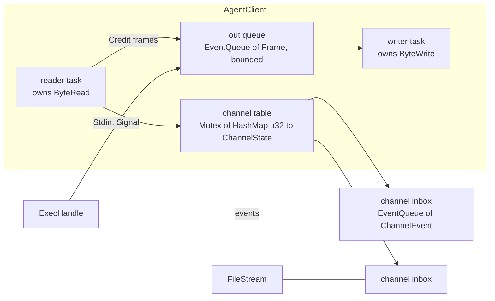
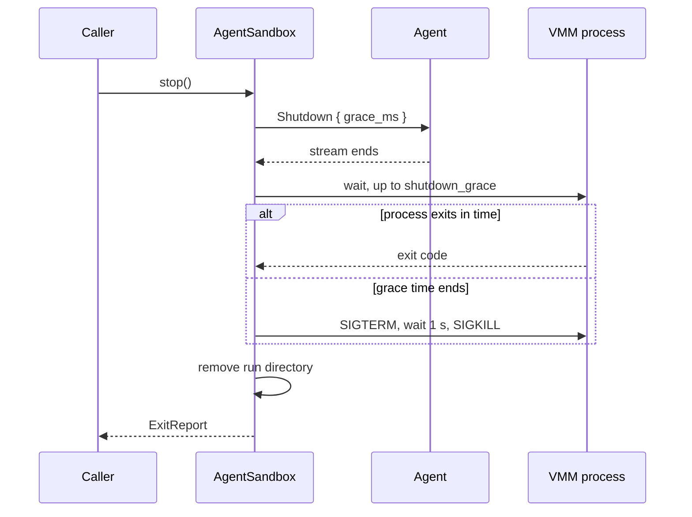

# Feature 02: Host core (`AgentClient`, `AgentSandbox`, `SandboxHost::native`)

_Written in ASD-STE100 Simplified Technical English (STE). Code and identifiers stay as they
are._

**Abbreviations in this file.** virtual machine monitor (VMM); Unix domain socket (UDS);
process identifier (PID); deterministic simulation testing (DST); input and output (I/O);
continuous integration (CI); AeroSpace and Defence Industries Association of Europe (ASD),
the owner of the STE standard ASD-STE100.

## 1. Goal

Write the host side that all backends share:

1. `AgentClient`: speaks the agent protocol on a `ByteDuplex`. It gives channels, credit,
   time-outs and stream-loss handling.
2. `AgentSandbox`: a `SandboxOps` implementation made of an `AgentClient`, an optional VMM
   child process and a run directory.
3. `SandboxHost::native()`: the real `ProcessSpawner`, `StreamTransport` and `HostFs`.
4. An in-memory `SandboxHost` for simulation tests.

After this feature a test can run commands through the public API against a real agent
process on a UDS, with no VM.

## 2. `AgentClient`

File: `src/shared/client.rs`.

```rust
pub struct AgentClient { /* Arc<ClientInner> */ }

impl AgentClient {
    /// Sends the preface and `Hello`, then waits for `HelloAck` until `deadline`.
    pub async fn handshake(
        ctx: Ctx,
        stream: Box<dyn ByteDuplex>,
        hello: Hello,
        limits: SandboxLimits,
        deadline: foundation_compact::Instant,
    ) -> SandboxResult<(AgentClient, HelloAck)>;

    pub async fn exec(&self, request: ExecRequest) -> SandboxResult<ExecHandle>;
    pub async fn write_file(&self, path: String, mode: u32, data: BoxByteStream) -> SandboxResult<u64>;
    pub async fn read_file(&self, path: String) -> SandboxResult<FileStream>;
    pub async fn ping(&self, timeout: Duration) -> SandboxResult<Duration>;
    pub async fn shutdown(&self, grace: Duration) -> SandboxResult<()>;
    /// Completes when the stream ends. Gives the reason.
    pub fn closed(&self) -> BoxFuture<'static, CloseReason>;
    pub fn is_open(&self) -> bool;
}

pub enum CloseReason { Shutdown, StreamEnd, Protocol(ProtocolError), AgentError(AgentErrorBody), Io }
```

### 2.1 Structure



_Caption: one reader task and one writer task own the stream; each handle talks to them through bounded queues._

- The reader and the writer are two async tasks. `handshake` starts each one with
  `foundation_core::valtron::execute(from_future(..), None)` and keeps the returned
  stream handle so the task is not dropped.
- Queues are `foundation_core::valtron::EventQueue<T>`. A task that waits for an item
  awaits `queue.readiness()`; a task that waits for room awaits `queue.vacancy()`. The
  skill `rust-valtron-usage`, section "Waking a Parked Task", has the rules. No task loops
  on `Wait`.
- The out queue has a bound of `max_channels * 4` frames.
- Each channel inbox has no frame count bound. Its byte bound is the channel window: the
  agent cannot send more data than the credit that the client gave.

### 2.2 Reader task

```text
loop:
    n = read.read(buf).await           // parks on socket readiness
    if n == 0: close(StreamEnd); return
    decoder.feed(buf[..n])
    while let Some(frame) = decoder.next()?:
        match (frame.channel, frame.kind):
            (0, HelloAck)      -> complete the handshake
            (0, Pong)          -> complete the ping with this payload
            (0, Error)         -> close(AgentError); return
            (c, Credit)        -> table[c].send_window += n; wake the sender
            (c, Stdout|Stderr|FileData) -> table[c].received += len; push to the inbox of c
            (c, Started|Exit|FileDone|Error) -> push to the inbox of c; on Exit, FileDone
                                               or Error remove c from the table
            other              -> close(Protocol(UnexpectedFrame)); return
```

A data frame for a channel that is not in the table is dropped when the client closed that
channel a short time before (it keeps the last 64 closed numbers); if not, it is a protocol
error. A data frame that makes `received` larger than the window that the client gave is a
protocol error (`BadCredit`).

`close(reason)` does these steps one time only: store the reason, push
`ChannelEvent::Closed(reason)` to each inbox, clear the table, close the out queue, and
complete `closed()`.

### 2.3 Credit on the host side

- **Receive.** When a consumer takes a data event of `n` bytes from an inbox
  (`ExecHandle::events()` or `FileStream`), the handle adds `n` to a counter of that
  channel. When the counter reaches half of `channel_window`, the handle pushes
  `Credit(counter)` to the out queue and sets the counter to 0. So a consumer that does
  not read stops the agent after one window, and only on that channel.
- **Send.** `ExecHandle::stdin().write(bytes)` and `write_file` cut the bytes into frames of
  at most `max_frame_payload`. Before each frame they await the send window of the channel
  (`ResumeSignal` that the reader sets when a `Credit` arrives).

### 2.4 Time-outs

All time comes from `ctx.clock()`. A deadline wait is a race between the event and a timer
future from the clock, so a `SimulatedClock` controls it in tests.

| Operation | Limit | On time-out |
|---|---|---|
| `handshake` | the `deadline` argument | `BootTimeout` |
| `exec` until `Started` | `limits.api_timeout` | `ExecTimeout`, and the channel closes |
| `Command.timeout` | caller value | `Signal(SIGKILL)` to the program, then the events stream ends with `Exit` and `ExecHandle::wait()` returns `ExecTimeout` |
| `ping` | argument | `ExecTimeout` |
| `shutdown` | `grace` + 1 s | returns `Ok`; the caller (`AgentSandbox`) then stops the VMM |

### 2.5 `ExecHandle`

```rust
impl ExecHandle {
    pub fn pid(&self) -> u32;
    pub fn stdin(&mut self) -> Option<ExecStdin>;        // Some one time, when Command.stdin is Piped
    pub fn events(&mut self) -> ExecEvents;              // impl futures_core::Stream<Item = SandboxResult<ExecEvent>>
    pub async fn signal(&self, signal: i32) -> SandboxResult<()>;
    pub async fn wait(mut self) -> SandboxResult<ExitStatus>;   // drains and discards output
}
impl ExecStdin {
    pub async fn write(&mut self, bytes: &[u8]) -> SandboxResult<()>;
    pub async fn close(self) -> SandboxResult<()>;       // sends Stdin with END
}
```

Dropping an `ExecHandle` before `Exit` sends `Signal(SIGKILL)` for that channel and removes
it from the table. Dropping `ExecStdin` without `close()` sends `Stdin` with `END`.

`Sandbox::run(command)` is built on this: it calls `exec`, writes `StdinMode::Bytes` data if
any, reads events into two buffers up to `max_captured_output`, sets the `*_truncated` flags
and keeps reading (and discarding) so that credit flows and the program can end.

## 3. `AgentSandbox`

File: `src/shared/agent_sandbox.rs`.

```rust
pub struct AgentSandbox { /* private */ }

pub struct AgentSandboxParts {
    pub id: SandboxId,
    pub backend: BackendId,
    pub ctx: Ctx,
    pub client: AgentClient,
    pub vmm: Option<Box<dyn ChildProcess>>,   // None for Cloudflare
    pub run_dir: Option<PathBuf>,
    pub limits: SandboxLimits,
    pub base_env: Vec<(String, String)>,
}

impl AgentSandbox {
    pub fn new(parts: AgentSandboxParts) -> Sandbox;
}
```

Each backend builds the parts and calls `new`. `AgentSandbox` implements `SandboxOps`.

### 3.1 State

`state()` reads an atomic value. A watcher task, started in `new`, awaits the first of
`client.closed()` and `vmm.wait()`. When one completes and the state is `Ready`, it sets
`Failed`, kills the VMM if it still runs, and removes the run directory.

### 3.2 `stop()` and `kill()`



_Caption: `stop()` asks the agent first and uses signals only when the grace time ends._

- `stop()` is safe to call more than one time. Later calls return the first `ExitReport`.
- `kill()` sends `SIGKILL` to the VMM at once, waits for the exit, and removes the run
  directory.
- `Drop` for the last `Sandbox` handle: when the state is not `Stopped`, it sends `SIGKILL`
  to the VMM (a call that does not wait) and removes the run directory. It does not block.
  The documentation tells callers to call `stop()`.
- After `Stopped`, each operation returns `SandboxStopped`.

## 4. `SandboxHost::native()`

File: `src/native/host.rs`. This is the only file in the crate that can call
`std::process::Command`, bind a socket or touch the real file system.

### 4.1 `NativeProcessSpawner`

- Builds a `std::process::Command` from `ProcessSpec`: `env_clear()`, then the given
  environment; standard input from `/dev/null`; standard output and standard error to the
  two files (open with append).
- `kill_with_parent`:
  - Linux: `pre_exec` calls `prctl(PR_SET_PDEATHSIG, SIGKILL)`, then checks
    `getppid() != 1` and exits if the parent is gone already.
  - macOS: no such call exists. The spawner makes a pipe and gives the read end to the
    child as file descriptor 3. The parent keeps the write end open for its whole life.
    `bin/sandbox_krun` watches descriptor 3 (feature 04). Firecracker does not run on
    macOS, so this covers every case.
- `wait()`: one thread for each child calls `Child::wait()` and stores the result in a
  shared cell, then sets a `ResumeSignal`. `wait()` awaits that signal. This is a helper
  thread, not an executor thread, so the block is allowed.
- `signal()`: `libc::kill(pid, signal)`. After the exit is stored, it returns `Ok` and
  does nothing, so a reused PID never gets a signal.

### 4.2 `NativeTransport`

Wrap the existing types. Read these first:
`backends/foundation_netio/src/native/connection.rs` (`Listener`, `Connection`,
`connect_unix`, `poll_fd`, `ready_now`, `register_waker`) and
`backends/foundation_nativeapis/src/native/net/unix.rs` (`UnixListener`, `UnixStream`,
`register`).

- `listen_unix(path)`: checks the path length (feature 00, section 3.4), binds, sets the
  socket non-blocking, and sets the file mode to `0600`.
- `accept()`, `read()`, `write_all()`: try the non-blocking call. On `WouldBlock`, register
  the task waker for readiness and return `Pending`. Use the readiness seam that
  `foundation_netio` uses for its own sockets; do not add a second poller.
- **Measure first.** Find how an `async fn` in this repository awaits socket readiness
  today (for example the HTTP client body read in `foundation_netio`). Write the answer in
  `learnings.md` before you write this type. If no async read exists for a raw stream,
  stop and report; the main session decides between a small addition to `foundation_netio`
  and a different design.

### 4.3 `NativeFs`

Thin calls to `std::fs`. `read(path, max)` and `tail(path, max)` never read more than
`max` bytes.

### 4.4 `HostConfig::discover`

`HostConfig::discover(env: &dyn Fn(&str) -> Option<String>, exe_dir: &Path) -> HostConfig`
fills the paths. The host entry point passes the real environment reader; tests pass a map.

| Field | Order of sources |
|---|---|
| `state_dir` | `EWE_SANDBOX_STATE_DIR`; `$XDG_RUNTIME_DIR/ewe-sbx`; `/tmp/ewe-sbx-<uid>` |
| `cache_dir` | `EWE_SANDBOX_CACHE_DIR`; `$XDG_CACHE_HOME/ewe-sandbox`; `$HOME/.cache/ewe-sandbox` |
| `agent_path` | `EWE_SANDBOX_AGENT`; `<exe_dir>/sandbox-agent-<guest_arch>` |
| `krun_runner_path` | `EWE_SANDBOX_KRUN`; `<exe_dir>/sandbox-krun` |
| `firecracker_path` | `EWE_FIRECRACKER`; `firecracker` on `PATH` |
| `libkrun_path` | `EWE_LIBKRUN`; none (the runner uses the loader search path) |

## 5. The simulation host

File: `tests/support/sim_host.rs` (test code, not public API).

- `SimTransport`: `listen_unix` and `connect_unix` join two in-memory pipes by path name.
  Each pipe is a bounded byte queue on `EventQueue`.
- `SimProcessSpawner`: `spawn` returns a `SimChild` that the test controls (`exit(code)`).
  A test registers a closure for a program name; the closure can connect a scripted agent
  to a `SimTransport` path.
- `SimFs`: a map from path to bytes.
- `ScriptedAgent`: a small in-test agent on the protocol crate. A test tells it what to
  answer. It is not the real agent; it exists so that each client rule has a test with
  exact timing.

## 6. Tests

All in `backends/foundation_platform_sandbox/tests/`. Each has the valtron test attributes.

Simulation tests (`client_sim_*.rs`), with `Ctx::with_seed`, `SimulatedClock` and
`ScriptedAgent`:

| Test | Proves |
|---|---|
| `handshake_ok` | `Hello` goes out with the limits; `HelloAck` returns. |
| `handshake_times_out` | No `HelloAck`; advancing the clock past the deadline gives `BootTimeout`. |
| `bad_preface_closes` | A wrong preface gives `Protocol(BadPreface)`. |
| `exec_events_in_order` | `Started`, `Stdout`, `Stderr`, `Exit` arrive as events in the order sent. |
| `receive_credit_is_sent_at_half_window` | No `Credit` frame before the consumer takes half a window; one after. |
| `slow_consumer_does_not_block_other_channel` | Channel 1 is not read. Channel 2 still completes. `ping` still answers. |
| `agent_overrun_is_protocol_error` | An agent that sends more than the window gives `BadCredit`. |
| `stdin_waits_for_credit` | A write larger than the window completes only after the agent sends `Credit`. |
| `command_timeout_kills` | Advancing the clock past `Command.timeout` sends `Signal(9)`; `wait()` gives `ExecTimeout`. |
| `stream_end_fails_all_handles` | Each open handle gets `ChannelClosed`; `closed()` gives `StreamEnd`. |
| `drop_handle_sends_kill` | Dropping an `ExecHandle` sends `Signal(9)` on its channel. |
| `run_truncates_at_cap` | Output above `max_captured_output` sets the flag, and the program still ends. |
| `stop_is_graceful_then_forced` | `Shutdown` goes first. With a `SimChild` that does not exit, `SIGTERM` then `SIGKILL` follow at the right clock times. |
| `vmm_exit_sets_failed` | `SimChild.exit(1)` in `Ready` sets `Failed` and removes the run directory. |
| `same_seed_same_trace` | Two runs with one seed give the same frame trace. |

Real agent tests (`agent_process_*.rs`, Linux only). They need the agent program as a
normal host build (`cargo build -p sandbox_agent --profile uat`). The test reads its path
from the environment variable `EWE_SANDBOX_AGENT`. When the variable is not set, the test
prints the reason and returns. Each test sends `RootSource::Plain`.

| Test | Proves |
|---|---|
| `run_echo` | `SandboxHost::native()`, a UDS listener, the agent with `--transport unix:`; `Sandbox::run(["echo", "hi"])` gives `hi\n` and code 0. |
| `stream_large_output` | `head -c 50000000 /dev/zero` streams 50 MB through `events()`; the process memory stays flat (the test checks that no inbox holds more than one window). |
| `stdin_roundtrip` | `cat` with 1 MiB of standard input. |
| `file_roundtrip` | `write_file` then `read_file`, 5 MiB. |
| `two_commands_at_once` | Two `exec` calls overlap and both end. |
| `stop_removes_run_dir` | After `stop()` the directory does not exist and the agent process is gone. |

## 7. Verify

```bash
cargo fmt --all --check
cargo clippy -p foundation_platform_sandbox --all-targets --profile uat --no-deps -- -D warnings
cargo test -p foundation_platform_sandbox --profile uat
cargo build -p sandbox_agent --profile uat
EWE_SANDBOX_AGENT=target/uat/sandbox-agent cargo test -p foundation_platform_sandbox --profile uat agent_process
python3 scripts/ci/check_executor_wake.py
```

## 8. Done when

- The simulation tests and the real agent tests pass.
- `grep -rn "process::Command\|UnixListener::bind\|Instant::now\|SystemTime::now" backends/foundation_platform_sandbox/src`
  finds matches only in `src/native/host.rs`.
- `learnings.md` has the measured answer of section 4.2.
- No test uses a real sleep; time moves only through the injected clock in simulation tests.
