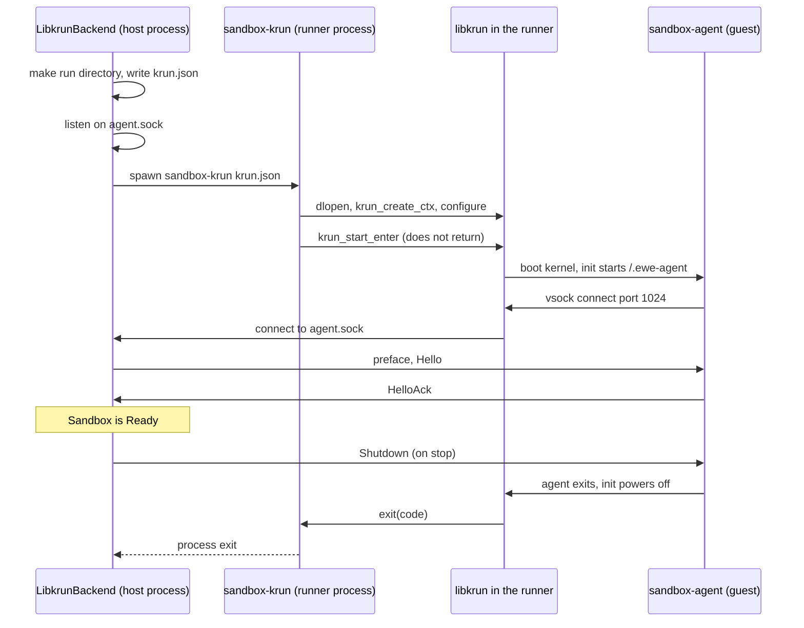

# Feature 04: The libkrun backend (milestone M1)

_Written in ASD-STE100 Simplified Technical English (STE). Code and identifiers stay as they
are._

**Abbreviations in this file.** virtual machine (VM); virtual machine monitor (VMM);
Kernel-based Virtual Machine (KVM); Hypervisor.framework (HVF); foreign function interface
(FFI); Unix domain socket (UDS); Transparent Socket Impersonation (TSI); JavaScript Object
Notation (JSON); process identifier (PID); virtual CPU (vCPU); continuous integration (CI);
AeroSpace and Defence Industries Association of Europe (ASD), the owner of the STE standard
ASD-STE100.

## 1. Goal

Start a libkrun microVM with our agent in it, on Linux and on macOS (Apple silicon). When
this feature lands, this code works on both systems:

```rust
let ctx = Ctx::host();
ctx.store(SandboxHost::native(HostConfig::discover(&env_reader, &exe_dir)));
let store = ArtifactStore::new(ctx.clone(), SandboxHost::from_ctx(&ctx)?);
let rootfs = store.alpine_rootfs_dir(GuestArch::host()).await?;

let sandbox = LibkrunBackend::new()
    .create(ctx, SandboxSpec::new(RootFs::Directory(rootfs)))
    .await?;
let out = sandbox.run(Command::new(["echo", "hello"])).await?;
assert_eq!(out.stdout, b"hello\n");
sandbox.stop().await?;
```

## 2. Two parts



_Caption: the backend never calls libkrun; the runner process does, because `krun_start_enter` takes over its process._

## 3. The runner (`bin/sandbox_krun`)

A host program. One run is one VM. It reads a JSON file, calls libkrun, and never returns
from `krun_start_enter`.

### 3.1 Configuration file

The backend writes `<run_dir>/krun.json`. The type is in
`foundation_platform_sandbox::shared::krun_config` so that both sides use one definition.
The runner depends on `foundation_platform_sandbox` with `default-features = false` to get
it; that configuration must not pull the backends.

```rust
#[derive(Debug, Clone, PartialEq, Eq, Serialize, Deserialize)]
pub struct KrunRunnerConfig {
    pub libkrun_path: Option<PathBuf>,     // None = loader search
    pub vcpus: u8,
    pub memory_mib: u32,
    pub root_dir: PathBuf,
    pub agent_path: PathBuf,               // host path of sandbox-agent (guest architecture)
    pub agent_socket: PathBuf,             // host UDS that the backend listens on
    pub agent_port: u32,                   // 1024
    pub tsi_inet: bool,                    // NetworkMode::Host
    pub mounts: Vec<KrunMount>,            // { tag, host_path, read_only }
    pub log_level: u32,                    // KRUN_LOG_LEVEL_*
    pub lifeline_fd: Option<i32>,          // macOS: 3
}
```

### 3.2 FFI

File `bin/sandbox_krun/src/ffi.rs`. It loads the library with `libloading` at run time.
Library names, tried in order when `libkrun_path` is `None`:

| System | Names |
|---|---|
| Linux | `libkrun.so.1`, `libkrun.so` |
| macOS | `libkrun.1.dylib`, `libkrun.dylib`, `/opt/homebrew/lib/libkrun.1.dylib` |

It resolves these symbols. The signatures are from `include/libkrun.h` on `stable-1.19.x`;
`learnings.md` section 3.1 has the line numbers. A missing symbol gives exit code 71 and
the line `sandbox-krun: libkrun has no symbol <name>` on standard error.

```rust
type Ctx = u32;
krun_set_log_level(level: u32) -> i32
krun_create_ctx() -> i32
krun_set_vm_config(ctx: Ctx, num_vcpus: u8, ram_mib: u32) -> i32
krun_add_virtiofs3(ctx: Ctx, tag: *const c_char, path: *const c_char, shm_size: u64, read_only: bool) -> i32
krun_fs_add_overlay_file(ctx: Ctx, fs_tag: *const c_char, path: *const c_char,
                         data: *const u8, data_len: usize, mode: u32, one_shot: bool) -> i32
krun_disable_implicit_vsock(ctx: Ctx) -> i32
krun_add_vsock(ctx: Ctx, tsi_features: u32) -> i32
krun_add_vsock_port(ctx: Ctx, port: u32, filepath: *const c_char) -> i32
krun_set_port_map(ctx: Ctx, port_map: *const *const c_char) -> i32
krun_set_exec(ctx: Ctx, exec_path: *const c_char, argv: *const *const c_char, envp: *const *const c_char) -> i32
krun_start_enter(ctx: Ctx) -> i32
```

Each array argument ends with a null pointer. All `unsafe` is in `ffi.rs`, each block with a
`SAFETY` comment.

### 3.3 Call sequence

The runner makes these calls in this order. A negative return stops it: it prints
`sandbox-krun: <function> failed: errno <n>` and exits with code 70.

| # | Call | Reason |
|---|---|---|
| 1 | `krun_set_log_level(log_level)` | |
| 2 | `krun_create_ctx()` | |
| 3 | `krun_set_vm_config(ctx, vcpus, memory_mib)` | |
| 4 | `krun_add_virtiofs3(ctx, "/dev/root", root_dir, 0, true)` | The root, read-only. The user directory never changes. `shm_size = 0` means no shared memory window. |
| 5 | `krun_fs_add_overlay_file(ctx, "/dev/root", ".ewe-agent", data, len, 0o100755, false)` | The agent appears at `/.ewe-agent` in the guest. `data` is the agent file, read into a `Vec` and leaked with `Box::leak`, because libkrun does not copy it and needs it until the VM stops. |
| 6 | for each mount: `krun_add_virtiofs3(ctx, tag, host_path, 0, read_only)` | Extra host directories. The agent mounts each tag. |
| 7 | `krun_disable_implicit_vsock(ctx)` | We control TSI. |
| 8 | `krun_add_vsock(ctx, if tsi_inet { KRUN_TSI_HIJACK_INET } else { 0 })` | `KRUN_TSI_HIJACK_UNIX` is never set. |
| 9 | `krun_add_vsock_port(ctx, agent_port, agent_socket)` | Guest connect on the port goes to the host UDS. |
| 10 | `krun_set_port_map(ctx, [null])` | An empty list. `NULL` would expose every guest listening port on the host when TSI is on. |
| 11 | `krun_set_exec(ctx, "/.ewe-agent", ["--transport", "vsock:2:1024", null], [null])` | An explicit empty environment. `NULL` would copy the runner environment into the guest. |
| 12 | `krun_start_enter(ctx)` | Does not return on success. |

**Measure first: step 4.** The header says that `krun_set_root` is the normal way to set the
root, and that `krun_add_virtiofs3` with `KRUN_FS_ROOT_TAG` gives more control. Confirm on
1.19 that step 4 with no `krun_set_root` call boots. If the built-in init needs a writable
root, record it in `learnings.md`, use `read_only = false`, and report to the main session:
the "source never changes" rule then needs a different method on libkrun.

**Measure first: step 11.** `argv` in `krun_set_exec` is the argument list after the program
name, or it includes the program name. The header text does not say. `examples/chroot_vm.c`
on `stable-1.19.x` shows the answer; read it and record the result.

### 3.4 The lifeline

On macOS the runner gets `lifeline_fd = 3`. Before step 12 it starts one thread that calls
a blocking `read` on that descriptor. When the read returns 0 (the parent is gone), the
thread calls `libc::_exit(137)`. On Linux the backend sets `kill_with_parent`, and
`lifeline_fd` is `None`.

### 3.5 Exit codes of the runner

| Code | Meaning | Maps to |
|---|---|---|
| 0 | The agent exited with 0 after `Shutdown`. | normal stop |
| 64 | Bad command line or JSON. | `InvalidSpec` |
| 70 | A `krun_*` call failed. | `VmmExited` with the log tail |
| 71 | Library or symbol not found. | `LibraryNotFound` or `LibraryTooOld` |
| 125, 126, 127 | The libkrun init could not start the agent. | `VmmExited` with the log tail |
| 137 | The lifeline closed. | not seen by the backend |
| other | The agent exit code, or a VMM crash. | `VmmExited` |

### 3.6 macOS signing

- Add `bin/sandbox_krun/hvf-entitlements.plist` with the key
  `com.apple.security.hypervisor` set to true.
- Add a `mise` task `sandbox:krun` that builds the runner and, on macOS, runs
  `codesign --entitlements bin/sandbox_krun/hvf-entitlements.plist --force -s - <program>`.
- A runner with no entitlement fails in `krun_start_enter`. The host check (section 5)
  finds this before a start.

## 4. The backend

File `backends/foundation_platform_sandbox/src/libkrun/mod.rs`, behind the feature
`libkrun` and `cfg(any(target_os = "linux", target_os = "macos"))`.

### 4.1 Start state machine

```rust
pub enum KrunLaunch {
    Prepare { ctx: Ctx, spec: SandboxSpec },
    Spawn { ctx: Ctx, spec: SandboxSpec, run: RunDir, listener: Box<dyn StreamListener> },
    AwaitAgent { ctx: Ctx, spec: SandboxSpec, run: RunDir, listener: Box<dyn StreamListener>,
                 vmm: Box<dyn ChildProcess>, deadline: foundation_compact::Instant },
    Handshake { ctx: Ctx, spec: SandboxSpec, run: RunDir, vmm: Box<dyn ChildProcess>,
                stream: Box<dyn ByteDuplex>, deadline: foundation_compact::Instant },
    Done,
}

#[task]
async fn krun_launch(ctx: Ctx, state: KrunLaunch)
    -> Option<(KrunLaunch, TaskStatus<SandboxResult<Sandbox>, CreateProgress>)>;
```

| State | Work | Emits | Next |
|---|---|---|---|
| `Prepare` | `spec.validate(caps)`. Make `SandboxId`. Make the run directory. Check the socket path length. Resolve the agent and runner paths. Write `krun.json`. Bind `agent.sock`. | `Pending(Preparing)` | `Spawn` |
| `Spawn` | Spawn `sandbox-krun <run_dir>/krun.json` with standard output and standard error to `<run_dir>/console.log`, `kill_with_parent = true`, an empty environment and `DYLD_LIBRARY_PATH` or `LD_LIBRARY_PATH` only when `HostConfig.libkrun_path` needs it. Compute `deadline = now + boot_timeout`. | `Pending(VmmSpawned)` | `AwaitAgent` |
| `AwaitAgent` | Await the first of: `listener.accept()`, `vmm.wait()`, the deadline timer. | `Pending(AgentConnected)` on accept | `Handshake` |
| `Handshake` | `AgentClient::handshake` with `RootSource::Current`. Build `AgentSandbox`. | `Ready(Ok(sandbox))` | `Done` |
| `Done` | | returns `None` | |

Each failure emits `Ready(Err(..))` and goes to `Done`. Before it does, it kills the VMM (if
one exists), reads the log tail and removes the run directory. In `AwaitAgent`: a VMM exit
gives `VmmExited { code, log_tail }` (mapped by section 3.5); the timer gives `BootTimeout`
with the log tail.

`create()` is `execute(krun_launch::new(KrunLaunch::Prepare { .. }), None)?.into_ready_future().await`.
`create_with_progress()` returns the stream.

### 4.2 Run directory

`<state_dir>/<sandbox_id>/` with mode `0700`:

| File | Made by | Content |
|---|---|---|
| `krun.json` | backend | Section 3.1. |
| `agent.sock` | backend | The listening UDS. |
| `console.log` | runner output | libkrun log lines and the agent messages. |

### 4.3 Capabilities

`rootfs_directory: true`, `rootfs_ext4: false`, `rootfs_squashfs: false`,
`host_mounts: true`, `network_host: true`.

### 4.4 Guest architecture

The guest architecture is the host architecture. `GuestArch::host()` gives it. On macOS the
guest is Linux on aarch64, so the root directory must hold aarch64 Linux programs, and the
agent is the `aarch64-unknown-linux-musl` build.

## 5. Host check (`probe`)

`LibkrunBackend::probe(ctx)` returns these checks. It starts no VM.

| Check | Linux | macOS |
|---|---|---|
| `hypervisor` | `/dev/kvm` exists and opens for read and write | The architecture is aarch64 and `sysctl kern.hv_support` is 1 |
| `runner` | `sandbox-krun` exists at the resolved path | the same |
| `runner_signed` | not applicable (ok) | `codesign -d --entitlements - <runner>` shows the hypervisor key |
| `libkrun` | `sandbox-krun --probe` exits 0 | the same |
| `agent` | The agent file exists for the guest architecture | the same |

`sandbox-krun --probe [--libkrun <path>]` loads the library, resolves each symbol of
section 3.2, prints one JSON line (`{"library": "<path>", "max_vcpus": <n>}` from
`krun_get_max_vcpus`) and exits 0. On a failure it exits 71. The check runs it through
`host.processes` with a time-out of `limits.api_timeout`.

## 6. Root mode on libkrun

The agent section 5 (feature 01) builds the program root from `RootSource::Current`. Two
facts need a measurement on the `libkrunfw` kernel. Do this before the tests of section 7:

1. Boot a VM. Run `cat /proc/filesystems` through the agent. Is `overlay` in the list?
2. With `RootMode::Overlay`: does the overlay mount with `lowerdir=/` succeed?

| Result | Action |
|---|---|
| Both yes | `LibkrunBackend` default `root_mode` stays `Overlay`. |
| One is no | The backend rejects `Overlay` with `InvalidSpec { field: "root_mode", .. }`, and its default is `ReadOnly`. File a `severity: medium` issue: "libkrun: no overlay root". Record the kernel version and the error in `learnings.md`. |

## 7. Tests

`backends/foundation_platform_sandbox/tests/`:

No VM:

| Test | Proves |
|---|---|
| `krun_config_roundtrip` | `KrunRunnerConfig` JSON round-trip. |
| `krun_launch_sim_ok` | With the simulation host: the state machine emits the progress values in order and returns a sandbox. A registered closure for `sandbox-krun` connects a `ScriptedAgent` to `agent.sock`. |
| `krun_launch_sim_vmm_exit` | The fake runner exits with 71 before a connect: the result is `LibraryNotFound`, and the run directory is gone. |
| `krun_launch_sim_timeout` | No connect: advancing the clock gives `BootTimeout`, and the fake child got `SIGKILL`. |
| `krun_exit_code_mapping` | Each code of section 3.5 maps to its error. |
| `krun_probe_reports_missing_runner` | A path that does not exist gives `usable: false` and names the check. |

Real microVM (`e2e_libkrun.rs`). Each test calls `probe()` first. When `usable` is false it
prints the report and returns.

| Test | Proves |
|---|---|
| `e2e_echo` | The code of section 1. |
| `e2e_exit_code` | `sh -c "exit 3"` gives 3. |
| `e2e_guest_is_isolated` | `uname -r` in the guest differs from the host kernel, or (macOS) `uname -s` is `Linux`. |
| `e2e_rootfs_not_changed` | `touch /marker` in the guest succeeds (mode `Overlay`) or fails (mode `ReadOnly`); in both cases the host directory has no `marker` file after `stop()`. |
| `e2e_no_network_by_default` | `ip addr` or `/sys/class/net` shows only `lo`. |
| `e2e_host_env_not_leaked` | Set `EWE_SECRET_TEST=1` in the test process. `env` in the guest does not have it. |
| `e2e_host_mount` | A host temporary directory mounted read-only at `/data`: the guest reads a file and cannot write. |
| `e2e_write_and_read_file` | `write_file` then `cat`, and `read_file` of a file that a command made. |
| `e2e_stop_is_clean` | After `stop()`: `ExitReport.killed` is false, the runner PID does not exist, the run directory is gone. |
| `e2e_kill_parent_kills_vm` | A helper process starts a sandbox and exits without `stop()`. The runner PID is gone in 2 s. |
| `e2e_boot_time` | Prints the time from `create` to `Ready`. No pass limit; the value goes to `progress.md`. |

## 8. Verify

```bash
cargo fmt --all --check
cargo clippy -p foundation_platform_sandbox -p sandbox_krun --all-targets --profile uat --no-deps -- -D warnings
cargo test -p foundation_platform_sandbox --profile uat krun
mise run sandbox:agent && mise run sandbox:krun
EWE_SANDBOX_AGENT=<agent path> EWE_SANDBOX_KRUN=<runner path> \
  cargo test -p foundation_platform_sandbox --profile uat e2e_libkrun -- --nocapture
```

Run the last command on a Linux host with KVM and on a macOS host with Apple silicon. Paste
both outputs in the report.

## 9. Done when

- The tests with no VM pass in CI.
- The real microVM tests pass on Linux with KVM and on macOS with Apple silicon, and
  `progress.md` has the date, the host and the libkrun version of each run.
- The three "measure first" results are in `learnings.md`.
- `sandbox_krun` is in `ci/packages.toml`.
- No code outside `bin/sandbox_krun` names a `krun_*` symbol.
