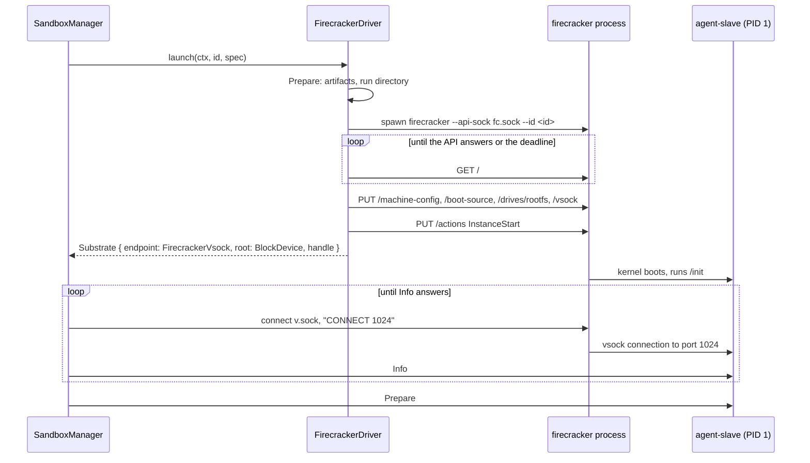

# Feature 05: The Firecracker driver and the native side effects

_Written in ASD-STE100 Simplified Technical English (STE). Code and identifiers stay as they
are._

**Abbreviations in this file.** application programming interface (API); remote procedure
call (RPC); virtual machine (VM); virtual machine monitor (VMM); Kernel-based Virtual
Machine (KVM); Unix domain socket (UDS); process identifier (PID); context identifier (CID);
virtual CPU (vCPU); behaviour-driven development (BDD); continuous integration (CI);
AeroSpace and Defence Industries Association of Europe (ASD), the owner of the STE standard
ASD-STE100.

## 1. Goal

Write the first real driver: `FirecrackerDriver`. It starts one `firecracker` process for
one sandbox, configures the VM through the API client of feature 04, boots it with the
slave as PID 1, and tells the control plane how to reach that slave. It also gives the
native side-effect bundle (`SandboxHost::native()`), because this is the first feature that
needs real processes and sockets.

When this feature lands, this code works on a Linux host with KVM and the `firecracker`
program:

```rust
let ctx = Ctx::host();
let host = SandboxHost::native(HostConfig::discover(&env_reader, &exe_dir));
ctx.store(host.clone());
let store = ArtifactStore::new(ctx.clone(), host.clone());
let rootfs = store.firecracker_ci_rootfs(GuestArch::host()).await?;

let manager = SandboxManager::new(
    ctx.clone(),
    vec![Arc::new(FirecrackerDriver::new())],
    host.connector.clone(),
    Arc::new(MemoryRecordStore::default()),
    ManagerConfig::default(),
);
let sandbox = manager.create(SandboxSpec::new(RootFs::SquashfsImage(rootfs))).await?;
let out = sandbox.run(Command::new(["echo", "hello"])).await?;
assert_eq!(out.stdout, b"hello\n");
sandbox.stop().await?;
```

## 2. Story

- **S1**: "The control plane asks the driver for a Firecracker microVM from a root image,
  and gets back a running substrate and the way to reach its slave."
- **S2**: "Many sandboxes use one image file at the same time, and the file never changes."
- **S3**: "The host is not ready: no KVM access, no `firecracker` program, no slave program."
- **S4**: "The VM does not come up: the process exits, the API does not answer, the API
  rejects a setting."
- **S5**: "The control plane stops, kills or cleans up the substrate."
- **S6**: "The host program dies; the VM does not stay."

| # | Use case | Actor | Trigger | Result |
|---|---|---|---|---|
| U1 | Check the host | control plane | `probe` | A report with checks and capabilities. |
| U2 | Launch | control plane | `launch(ctx, id, spec)` | Progress, then a `Substrate` (endpoint, root set-up, handle), or an error and nothing left. |
| U3 | Reach the slave | control plane | `connector.connect(FirecrackerVsock { .. })` | An RPC transport through the Firecracker vsock UDS. |
| U4 | End | control plane | `terminate`, `kill`, `cleanup` | The process is gone; the run directory is gone. |

## 3. Bounded context

**Inside this feature:** the Firecracker launch state machine, the plan of one VM, the boot
arguments, the substrate handle, the host checks, and the native implementations of
`ProcessSpawner`, `HostFs` and `SlaveConnector`.

**Outside:** the `firecracker` program; the API client (feature 04); the slave as PID 1
(feature 01); the readiness wait, `Prepare` and the registry (feature 02); kernel,
initramfs and image files (feature 03).

| Entity | Meaning | Owner (the one writer) |
|---|---|---|
| `FcPlan` | Every resolved path and value of one VM. | the `Prepare` state; later states only read |
| VMM process | One `firecracker` child. | `ProcessSpawner` (spawn); the handle (signal) |
| Run directory | `<state_dir>/<sandbox_id>/`: sockets and logs. | the driver creates; the handle removes |
| API socket | `fc.sock`. | Firecracker |
| vsock socket | `v.sock`. Host connections to the guest go through it. | Firecracker |
| Root image | The caller's ext4 or squashfs file. Attached read-only. | the caller; nobody writes it |
| `FcHandle` | The `SubstrateHandle` of one VM. | `native::firecracker::handle` |
| Native host bundle | Real processes, files and transports. | `native::host` |

| Verb | Kind | Trigger | Effect |
|---|---|---|---|
| probe | entity | control plane | Reads the host; starts nothing. |
| prepare | entity | `launch` | Resolves files; makes the run directory. |
| spawn | entity | after prepare | Starts `firecracker`. |
| await API | entity | after spawn | Polls `GET /` with back-off. |
| configure | story | the API is up | Five calls in a fixed order; the last starts the VM. |
| launch | story | control plane | All of the above; undoes its work on a failed step. |
| connect | entity | control plane | Dials the vsock UDS and does the `CONNECT` line. |
| terminate / kill / cleanup | entity | control plane | Ends the process; removes the run directory. |

## 4. Rules

### 4.1 Law worksheet

```
Entity: Launch (story)
Conserved value:         a failed launch leaves 0 processes and 0 run directories; a good one leaves exactly 1 of each
Bound:                   API wait <= boot_timeout; one back-off wait <= 100 ms
Inverse pairs:           launch / cleanup
Idempotent verbs:        probe; cleanup
Ordering pairs:          machine-config, boot-source, drive, vsock -> InstanceStart (enabling);
                         API answer / process exit / deadline (competing)
Monotone values:         launch state; ConfigStep; progress values
Freeze points:           FcPlan after Prepare; boot arguments
Links to other entities: endpoint.uds = Vsock.uds_path; drive path = spec image; initramfs = hash of the slave file

Entity: Root image file
Conserved value:         its bytes before launch = its bytes after cleanup
Bound:                   none
Inverse pairs:           none
Idempotent verbs:        none
Ordering pairs:          none
Monotone values:         none
Freeze points:           the whole file, for the life of every sandbox that uses it
Links to other entities: drive "rootfs", is_read_only true, is_root_device false

Entity: FcHandle
Conserved value:         the process exit is reported the same to every waiter
Bound:                   terminate ends in grace + 1 s
Inverse pairs:           none
Idempotent verbs:        kill; cleanup; exited (many waiters)
Ordering pairs:          terminate / kill (competing: both end the process; `forced` is true if a signal ended it)
Monotone values:         alive -> exited
Freeze points:           the SubstrateExit after the first exit
Links to other entities: the run directory exists <=> cleanup did not run
```

### 4.2 Invariants

| # | Invariant |
|---|---|
| I1 | The API calls go in the order machine-config, boot-source, drive, vsock, start. A failed call stops the sequence; no later call is sent. |
| I2 | The root image is attached with `is_read_only: true` and `is_root_device: false`. Its bytes never change. |
| I3 | The default seccomp filter stays on. `--no-seccomp` is never passed. |
| I4 | The `firecracker` process gets an empty environment. |
| I5 | A failed `launch` leaves no `firecracker` process and no run directory. |
| I6 | Every wait uses the injected clock; the API back-off is 5, 10, 20, 40, 80, 100, 100 ... ms. |
| I7 | When the host process dies, the `firecracker` process dies (`PR_SET_PDEATHSIG`). |
| I8 | `cleanup` is safe to call two times and after any failure; after it, the run directory does not exist and the process does not run. |
| I9 | A signal is never sent to a PID after its exit is recorded. |
| I10 | The driver does not call the slave. It returns the endpoint; the control plane does the readiness wait. |
| I11 | Two sandboxes on one image do not see each other's writes (with the slave's `Overlay` mode). |
| I12 | Only `src/native/host.rs` calls `std::process::Command`, connects a socket or touches the real file system for this crate's control side. |

### 4.3 Must have

- `FirecrackerDriver`, `FcPlan`, the boot argument builder, `FcHandle`.
- `SandboxHost::native()`, `HostConfig::discover`, `NativeConnector`.
- In `foundation_netio`: a UDS client that sends a preamble line after it connects.

### 4.4 Must do

- Reject, before any process starts, a spec that Firecracker cannot run.
- Give `log_tail` from `console.log` and `vmm.log`.

### 4.5 Must not

- Must not add `root=` to the boot arguments.
- Must not write to the image, the kernel or the initramfs.
- Must not use the `jailer` or a network device.

## 5. Acceptance scenarios

```gherkin
Feature: Firecracker driver

  Scenario: A command runs in a microVM
    Given a usable Firecracker host and the CI squashfs image
    When the caller creates a sandbox through SandboxManager and runs ["echo", "hello"]
    Then stdout is "hello\n" and the exit code is 0

  Scenario: The slave is the first process
    When the sandbox is Ready
    Then SandboxInfo.slave.is_pid1 is true
    And "cat /proc/1/comm" prints the slave program name

  Scenario: The image never changes
    Given the SHA-256 of the image file
    When a sandbox runs ["sh", "-c", "echo x > /root/f"] and stops
    Then the SHA-256 of the image file is the same

  Scenario: Two sandboxes share one image and not their writes
    Given two sandboxes on one image file
    When the first writes /tmp/a
    Then the second does not see /tmp/a

  Scenario: Read-only mode allows only the named places
    Given a spec with RootMode::ReadOnly
    When the sandbox runs ["sh", "-c", "touch /etc/x"]
    Then the exit code is not 0
    When the sandbox runs ["sh", "-c", "touch /tmp/x && touch x"]
    Then the exit code is 0

  Scenario: The guest has no network
    When the sandbox lists /sys/class/net
    Then the only interface is "lo"

  Scenario: The API calls come in order
    Given a fake API that records calls
    When launch runs
    Then the calls are describe_instance, put_machine_config, put_boot_source, put_drive, put_vsock, instance_start
    And the progress values are Preparing, SubstrateStarted, SubstrateConfigured, Booting

  Scenario: A rejected setting stops the launch
    Given a fake API where put_drive returns 400 "bad drive"
    When launch runs
    Then the result is SubstrateApi { status: 400, message: "bad drive" }
    And instance_start was never called
    And the process got SIGKILL and no run directory is left

  Scenario: The API back-off uses the clock
    Given a fake API that fails to connect 4 times
    When launch runs on a simulated clock
    Then the waits are 5, 10, 20 and 40 ms

  Scenario: An API that never answers times out
    Given a fake API that never answers
    When the clock passes boot_timeout
    Then the result is BootTimeout { stage: "api" }
    And no process and no run directory are left

  Scenario: A process that exits early is reported
    Given a fake process that exits with code 152 before the API answers
    When launch runs
    Then the result is SubstrateExited { code: 152 } with the log tail
    And no run directory is left

  Scenario: A wrong root kind is refused before any process
    When the manager validates a spec with RootFs::Directory for this driver
    Then the result is UnsupportedRootFs
    And no process was spawned

  Scenario: A guest that cannot start is reported with its console
    Given boot arguments with ewe.listen=bad
    When the caller creates a sandbox
    Then the result is BootTimeout { stage: "slave" } or SubstrateExited
    And the error has the console tail with "agent-slave"
    And no process and no run directory are left

  Scenario: Stop powers the guest off
    When the caller stops a ready sandbox
    Then the firecracker process exits with code 0
    And ExitReport.killed is false
    And the run directory is gone

  Scenario: The VM dies with its parent
    Given a helper process that created a sandbox
    When the helper is killed with SIGKILL
    Then the firecracker process is gone in less than 2 seconds

  Scenario: The host check names what is missing
    Given no firecracker program at the resolved path
    When probe runs
    Then usable is false and the check "firecracker" is not ok
```

## 6. Technical breakdown

### 6.1 How the guest is put together

| Part | Source | How Firecracker gets it |
|---|---|---|
| Kernel | `spec.kernel`, or `store.firecracker_kernel(arch)` | `BootSource.kernel_image_path` |
| Init program | `agent-slave`, in an initramfs from `store.agent_initramfs(slave_path)` | `BootSource.initrd_path` |
| User root file system | `RootFs::Ext4Image` or `RootFs::SquashfsImage` | Drive `rootfs`, `is_root_device = false`, `is_read_only = true` |
| Link to the host | vsock | `Vsock { guest_cid, uds_path }` |

`is_root_device` is false because Firecracker rejects a root drive together with an
initramfs (`docs/initrd.md`). The slave finds the drive at `/dev/vda`: it is the first
virtio-block device. The `Substrate.root` that the driver returns is
`RootSetup { source: BlockDevice { device: "/dev/vda", fstype }, mode: spec.root_mode }`.

Boot arguments:

```
console=ttyS0 reboot=k panic=1 quiet ewe.listen=vsock:1024
```

On x86_64 add `pci=off i8042.noaux i8042.nomux i8042.dumbkbd`.

| Argument | Reason |
|---|---|
| `console=ttyS0` | Kernel and slave messages go to the serial port, thus to the standard output of `firecracker`, thus to `console.log`. |
| `reboot=k` | A guest reboot stops the VM. The slave uses this to power off. |
| `panic=1` | A kernel panic reboots after 1 s, which stops the VM. |
| `quiet` | Less console text, a faster boot. |
| `pci=off` | x86_64: no PCI scan. |
| `i8042.*` | x86_64: skips keyboard controller probes and keeps the reset line that `reboot=k` uses. |
| `ewe.listen=vsock:1024` | The slave reads it from `/proc/cmdline` (feature 01, section 6.3). |

### 6.2 The launch state machine

File `src/native/firecracker/mod.rs`, behind the feature `firecracker` and
`cfg(target_os = "linux")`.



_Caption: the driver configures and starts the VM; the control plane then reaches the slave through the Firecracker vsock socket._

```rust
pub enum FcLaunch {
    Prepare   { ctx: Ctx, id: SandboxId, spec: SandboxSpec },
    Spawn     { ctx: Ctx, plan: FcPlan },
    AwaitApi  { ctx: Ctx, plan: FcPlan, vmm: Arc<dyn ChildProcess>, api: Arc<dyn FirecrackerApi>,
                deadline: foundation_compact::Instant, attempt: u32 },
    Configure { ctx: Ctx, plan: FcPlan, vmm: Arc<dyn ChildProcess>, api: Arc<dyn FirecrackerApi>,
                step: ConfigStep },
    Done,
}
pub enum ConfigStep { MachineConfig, BootSource, Drive, Vsock, Start }

pub struct FcPlan {
    pub id: SandboxId,
    pub run_dir: PathBuf,
    pub firecracker: PathBuf,
    pub kernel: PathBuf,
    pub initramfs: PathBuf,
    pub rootfs: PathBuf,
    pub rootfs_type: FsType,
    pub root_mode: RootMode,
    pub vcpus: u8,
    pub memory_mib: u32,
    pub guest_cid: u32,
    pub boot_args: String,
    pub limits: SandboxLimits,
}

#[task]
async fn fc_launch(ctx: Ctx, state: FcLaunch)
    -> Option<(FcLaunch, TaskStatus<SandboxResult<Substrate>, CreateProgress>)>;
```

| State | Work | Emits | Next |
|---|---|---|---|
| `Prepare` | Resolve the `firecracker` path, the slave path, the kernel, the initramfs and the image (await the artifact store). Make the run directory (mode `0700`). Check the socket path length for `v.sock`. Create an empty `vmm.log`. Pick `guest_cid` from `ctx.rng()` in 3 to `2^31 - 1`. Build the boot arguments. | `Pending(Preparing)` | `Spawn` |
| `Spawn` | Spawn `firecracker` (section 6.4). `deadline = now + boot_timeout`. | `Pending(SubstrateStarted)` | `AwaitApi` |
| `AwaitApi` | `vmm.try_wait()`: an exit ends the launch. If `fc.sock` does not exist, or `describe_instance()` fails to connect: await a timer of `min(5 ms * 2^attempt, 100 ms)`, then the same state with `attempt + 1`. A good answer with state `Not started`: go on. Past the deadline: fail. | `Ignore` while it waits | `Configure { MachineConfig }` |
| `Configure` | One API call for each step (section 6.5). | `Pending(SubstrateConfigured)` after `Vsock`; `Pending(Booting)` after `Start`, then `Ready(Ok(substrate))` | the next step, then `Done` |
| `Done` | | `None` | |

`FirecrackerDriver::launch` returns `execute(fc_launch::new(..), None)` as the
`LaunchStream`.

### 6.3 Fault table: `launch`

Each failure does the same undo before it emits `Ready(Err(..))`: kill the process if one
exists and wait for its exit, read the log tail, remove the run directory.

| Step that fails | What the caller sees | What is left behind |
|---|---|---|
| `Prepare`: a program or artifact is missing | `BinaryNotFound`, or the artifact error | nothing |
| `Prepare`: the socket path is too long | `SocketPathTooLong` | nothing |
| `Spawn` fails | `Io { op: "spawn firecracker" }` | nothing |
| The process exits in `AwaitApi` or `Configure` | `SubstrateExited { code, log_tail }` | nothing |
| The deadline passes in `AwaitApi` | `BootTimeout { stage: "api" }` | nothing |
| An API call returns a status that is not 2xx | `SubstrateApi { status, message }` | nothing |
| An API call times out | `BootTimeout { stage: "api" }` | nothing |
| The launch stream is dropped before `Done` | (gone) | nothing: a guard in the state starts a clean-up task |

After `Ready(Ok(substrate))`, the control plane owns the handle and calls `kill` and
`cleanup` on its own failures (feature 02, section 6.4).

### 6.4 The `firecracker` process and the run directory

```
firecracker --api-sock <run_dir>/fc.sock --id <sandbox_id> --log-path <run_dir>/vmm.log --level Warning
```

- Standard output and standard error go to `<run_dir>/console.log`. Standard input is
  `/dev/null`. The environment is empty. The work directory is the run directory.
- `kill_with_parent = true`.
- `--log-path` needs a file that exists; `Prepare` creates it.

| File in `<state_dir>/<sandbox_id>/` | Made by | Content |
|---|---|---|
| `fc.sock` | Firecracker | The API socket. |
| `v.sock` | Firecracker, at `InstanceStart` | The vsock socket. The path must not exist before. |
| `console.log` | Firecracker output | Serial console. |
| `vmm.log` | Firecracker | VMM log. |

### 6.5 API bodies

The body types are the generated types of feature 04.

| Step | Call | Body |
|---|---|---|
| `MachineConfig` | `put_machine_config` | `vcpu_count`, `mem_size_mib`, `smt = false`. Other fields `None`. |
| `BootSource` | `put_boot_source` | `kernel_image_path`, `initrd_path`, `boot_args`. |
| `Drive` | `put_drive` | `drive_id = "rootfs"`, `path_on_host`, `is_root_device = false`, `is_read_only = true`. Other fields `None`. |
| `Vsock` | `put_vsock` | `guest_cid`, `uds_path = <run_dir>/v.sock`. |
| `Start` | `instance_start` | |

The driver calls the API through a trait so that tests can replace it:

```rust
pub trait FirecrackerApi: Send + Sync + 'static {
    fn describe_instance(&self) -> BoxFuture<'_, SandboxResult<InstanceInfo>>;
    fn put_machine_config<'a>(&'a self, body: &'a MachineConfiguration) -> BoxFuture<'a, SandboxResult<()>>;
    fn put_boot_source<'a>(&'a self, body: &'a BootSource) -> BoxFuture<'a, SandboxResult<()>>;
    fn put_drive<'a>(&'a self, body: &'a Drive) -> BoxFuture<'a, SandboxResult<()>>;
    fn put_vsock<'a>(&'a self, body: &'a Vsock) -> BoxFuture<'a, SandboxResult<()>>;
    fn instance_start(&self) -> BoxFuture<'_, SandboxResult<()>>;
}
pub type FirecrackerApiFactory =
    Arc<dyn Fn(&Ctx, &Path, &SandboxLimits) -> SandboxResult<Arc<dyn FirecrackerApi>> + Send + Sync>;

impl FirecrackerDriver {
    pub fn new() -> Self;                                    // the real client of feature 04
    pub fn with_api_factory(factory: FirecrackerApiFactory) -> Self;   // tests
}
```

### 6.6 Capabilities and extra validation

`rootfs_directory: false`, `rootfs_ext4: true`, `rootfs_squashfs: true`,
`rootfs_container_image: false`, `root_modes: [Overlay, ReadOnly]`, `host_mounts: false`,
`network_host: false`, `max_vcpus: 32`.

Firecracker accepts 1 vCPU or an even number. `probe` reports this in the check
`vcpu_rule`, and `launch` returns `InvalidSpec { field: "vcpus" }` in `Prepare` for an odd
count above 1. (The manager's `validate` knows only `max_vcpus`.)

### 6.7 `FcHandle`

| Method | Work |
|---|---|
| `exited()` | Awaits `vmm.wait()`; maps to `SubstrateExit { code, signal, forced: false }`. |
| `terminate(grace)` | Awaits the first of the exit and a timer of `grace`. On the timer: `SIGTERM`; wait up to 1 s; `SIGKILL`; wait for the exit. `forced` is true when a signal was sent. |
| `kill()` | `SIGKILL`; wait for the exit; `forced: true`. On a process that already exited: returns the stored exit. |
| `log_tail(max)` | The last `max / 2` bytes of `console.log` and of `vmm.log`, joined with a line `--- vmm.log ---`. |
| `cleanup()` | If the process runs: `kill()`. Remove the run directory. A missing directory is `Ok`. |

`FirecrackerDriver::attach(ctx, record)` returns `Ok(None)`: a `firecracker` process dies
with the control plane's process (`kill_with_parent`). Before it returns, it removes the
run directory `<state_dir>/<record.id>/` if that still exists.

Stop needs no API call: the control plane sends `Shutdown` to the slave, the slave calls
`reboot()`, and Firecracker exits with code 0.

### 6.8 Host check (`probe`)

| Check | How | Needed for `usable` |
|---|---|---|
| `kvm` | `/dev/kvm` exists and opens for read and write. On a permission error the message says: join the `kvm` group, or `setfacl -m u:$USER:rw /dev/kvm`. | yes |
| `firecracker` | The program exists at the resolved path, and `firecracker --version` prints a version in `rpc_timeout`. The message has the version. | yes |
| `firecracker_version` | The version is 1.10 or newer. (The `Vsock` and `Drive` fields that this feature sends are in the API since before 1.0; 1.10 is the oldest release line that upstream supports at the time of this spec. A CI run on an older version changes this number.) | yes |
| `slave` | The slave program exists for the guest architecture. | yes |
| `vcpu_rule` | Always ok; the message says "1 vCPU or an even number". | no |

### 6.9 The native side effects (`src/native/host.rs`)

This is the only file of the control side that calls `std::process::Command`, connects a
socket or touches the real file system.

**`NativeProcessSpawner`.** Builds a `std::process::Command` from `ProcessSpec`:
`env_clear()`, then the given environment; standard input from `/dev/null`; standard output
and standard error to the two files (append). `kill_with_parent` on Linux: `pre_exec` calls
`prctl(PR_SET_PDEATHSIG, SIGKILL)`, then exits if `getppid()` is 1. (macOS has no such
call; feature 09 adds a lifeline pipe for the libkrun runner.) `wait()`: one helper thread
for each child calls `Child::wait()`, stores the result, and sets a `ResumeSignal`; `wait()`
awaits that signal. A helper thread is not an executor thread, so the block is allowed.
`signal()` after the exit is stored returns `Ok` and does nothing.

**`NativeFs`.** Thin calls to `std::fs`. `read` and `tail` never read more than `max`.

**`NativeConnector`.** Builds a `foundation_connectrpc` transport for an endpoint:

| Endpoint | Transport |
|---|---|
| `Unix { path }` | `H1Transport::new(HttpClientBuilder::new().unix_socket(path).build())` |
| `Tcp { host, port }` | `H1Transport` on a TCP client; the base URL is `http://<host>:<port>` |
| `FirecrackerVsock { uds, port }` | `H1Transport` on a UDS client with the preamble `CONNECT <port>\n` (below) |
| `CloudflarePort` | `InvalidSpec { field: "endpoint" }`: not reachable from a native host |

Each client gets `read_timeout = limits.rpc_timeout` for unary calls; a streaming call has
no read time-out (the stream ends when the slave or the substrate ends).

**The UDS preamble (`foundation_netio`).** Firecracker forwards a host connection to a
guest port only after the host writes `CONNECT <port>\n` and reads `OK <number>\n`
(`docs/vsock.md`). Add to `foundation_netio`:

```rust
impl HttpClientBuilder {
    /// After each new connection to the Unix socket, write `preamble`, then read one
    /// line of at most `max_reply` bytes. The line must start with `expect`. If not,
    /// or on end of stream, the connection fails with a connect error.
    pub fn unix_socket_preamble(self, preamble: Vec<u8>, expect: Vec<u8>, max_reply: usize) -> Self;
}
```

The driver passes `preamble = "CONNECT 1024\n"`, `expect = "OK "`, `max_reply = 32` (the
longest answer is `OK 2147483647\n`, 14 bytes). The preamble runs one time for each new
connection, before the first HTTP byte; a pooled connection is not handshaken again. When
no guest program listens yet, Firecracker closes the connection, the read gives end of
stream, and the call fails with a transport error. The control plane's readiness wait
treats that as "not ready" and tries again (feature 02, section 6.3).

The code that connects is in
`backends/foundation_netio/src/http/connection.rs` (the UDS path near line 1217) and
`native/connection.rs` (`Connection::connect_unix`). Bump the `foundation_netio` version
and its consumers (`.agents` reminder 12).

**`HostConfig::discover(env, exe_dir)`.** `env` is a function from a name to an optional
value; the boundary passes the real environment reader, tests pass a map.

| Field | Order of sources |
|---|---|
| `state_dir` | `EWE_SANDBOX_STATE_DIR`; `$XDG_RUNTIME_DIR/ewe-sbx`; `/tmp/ewe-sbx-<uid>` |
| `cache_dir` | `EWE_SANDBOX_CACHE_DIR`; `$XDG_CACHE_HOME/ewe-sandbox`; `$HOME/.cache/ewe-sandbox` |
| `slave_path` | `EWE_SANDBOX_SLAVE`; `<exe_dir>/agent-slave-<guest_arch>` |
| `firecracker_path` | `EWE_FIRECRACKER`; `firecracker` on `PATH` |
| `krun_runner_path` | `EWE_SANDBOX_KRUN`; `<exe_dir>/sandbox-krun` |
| `libkrun_path` | `EWE_LIBKRUN`; none |
| `driver_order` | `EWE_SANDBOX_DRIVERS` (comma list); `firecracker, libkrun, docker` |

## 7. Tests

`backends/foundation_platform_sandbox/tests/`. Each scenario of section 5 is one test.

No VM (`firecracker_sim_*.rs`): `SimulatedClock`, a fake `ProcessSpawner` and `HostFs` from
the `testing` module, a `FakeFirecrackerApi` that records calls.

| Law or scenario | Test | Oracle |
|---|---|---|
| I1, "The API calls come in order" | `launch_ok` (also asserts each body of section 6.5) | example |
| `fc_boot_args_x86_64`, `fc_boot_args_aarch64` | the strings of section 6.1 | example |
| I5, the fault table of section 6.3 | `launch_fault_matrix` (one case for each row: the error, `SIGKILL` on the fake child, no run directory) | fault |
| I6, "The API back-off uses the clock" | `await_api_backoff` | example |
| "An API that never answers times out" | `api_timeout` | expected outcome |
| "A process that exits early is reported" | `vmm_exit_early` | expected outcome |
| "A rejected setting stops the launch" | `api_error_stops` | expected outcome |
| "A wrong root kind ..." | `rejects_directory_rootfs`, `rejects_odd_vcpus`, `rejects_host_network`, `rejects_host_mounts` | expected outcome |
| I8, I9 | `handle_model` (stateful: random series of terminate, kill, cleanup, exit against a model; no signal after exit; cleanup idempotent) | stateful model |
| I3, I4 | `process_spec` (the recorded `ProcessSpec` has no `--no-seccomp` and an empty environment) | example |
| "The host check names what is missing" | `probe_missing_binary`, `probe_no_kvm` (fake `HostFs`) | expected outcome |
| `attach` | `attach_returns_none_and_removes_run_dir` | expected outcome |
| I12 | `no_os_calls_outside_host` (a source scan of `src/native/firecracker/`) | example |

Native side effects (`native_host_*.rs`, Linux and macOS, no VM):

| Test | Proves |
|---|---|
| `spawn_env_is_empty` | A child started through `NativeProcessSpawner` sees only the given environment. |
| `spawn_wait_and_signal` | `wait` gives the exit code; a signal ends a child; a signal after the exit is a no-op. |
| `spawn_kill_with_parent` (Linux) | A helper process spawns `sleep 60` with the flag and is killed; the `sleep` is gone in 2 s. |
| `connector_unix` | A `SlaveService` call works through `Unix`. |
| `connector_preamble_ok` | A fake UDS server expects `CONNECT 1024\n`, answers `OK 1073741824\n`, then serves HTTP: the call works, and the server saw the preamble one time for one connection. |
| `connector_preamble_closed` | The server closes after the preamble: the call fails with a transport error. |
| `connector_preamble_bad_reply` | The server answers `NO\n`: transport error. |
| `discover_order` | Each `HostConfig` field follows its source order, with a map as the environment. |

`foundation_netio` gets its own tests for `unix_socket_preamble` in its `tests/`.

Real microVM (`e2e_firecracker.rs`). Each test calls `probe()` first and returns with the
report when `usable` is false. It runs the shared acceptance scenarios of
`tests/support/acceptance.rs` (feature 02, section 7) with a manager that has this driver,
plus:

| Scenario of section 5 | Test |
|---|---|
| "The slave is the first process" | `e2e_slave_is_pid1` |
| I2, "The image never changes" | `e2e_image_not_changed` |
| I11, "Two sandboxes share one image ..." | `e2e_two_sandboxes_one_image` |
| "Read-only mode ..." | `e2e_readonly_mode` |
| "The guest has no network" | `e2e_no_network` |
| ext4 mount path | `e2e_ext4_root`: an image made with `mkfs.ext4 -q -F -d <Alpine directory> <file> 64M`; returns with a message when that program is not found. File owners in this image are the host user's (feature 03, section 4.2); the test proves only the ext4 path. |
| "A guest that cannot start ..." | `e2e_bad_listen_arg` |
| "Stop powers the guest off" | `e2e_stop_is_clean` |
| I7, "The VM dies with its parent" | `e2e_kill_parent_kills_vm` |
| boot time | `e2e_boot_time` prints the time from `create` to `Ready`; the value goes to `progress.md`. |

## 8. Verify

```bash
cargo fmt --all --check
cargo clippy -p foundation_platform_sandbox -p foundation_netio --all-targets --profile uat --no-deps -- -D warnings
cargo test -p foundation_netio --profile uat unix_socket_preamble
cargo test -p foundation_platform_sandbox --features testing --profile uat firecracker_sim native_host
cargo build -p agent_slave --profile agent --target x86_64-unknown-linux-musl   # the program of feature 06
EWE_SANDBOX_SLAVE=<slave path> EWE_FIRECRACKER=<firecracker path> \
  cargo test -p foundation_platform_sandbox --features testing --profile uat e2e_firecracker -- --nocapture
```

The slave program of feature 06 is a three-line `main`. Until feature 06 lands, build the
test program `tests/support/slave_main.rs` of feature 01 for the musl target and use it as
the slave: it calls the same `slave::run`.

The CI job of feature 06 runs the last command on `ubuntu-latest` (x86_64, with
`/dev/kvm`). aarch64 has no CI runner with KVM: the driver compiles and runs its tests with
no VM there; the README lists aarch64 Firecracker as "built, not verified" until a person
with an aarch64 KVM host runs the real tests and records the result in `progress.md`.

## 9. Done when

- Each scenario of section 5 and each row of section 7 passes; the real microVM tests pass
  on a Linux x86_64 host with KVM, and `progress.md` has the date, the host, the
  Firecracker version and the boot time.
- A failed launch leaves no `firecracker` process and no run directory.
- `foundation_netio` has `unix_socket_preamble` with tests, and its version and consumers
  are bumped.
- The source scan of I12 passes.
