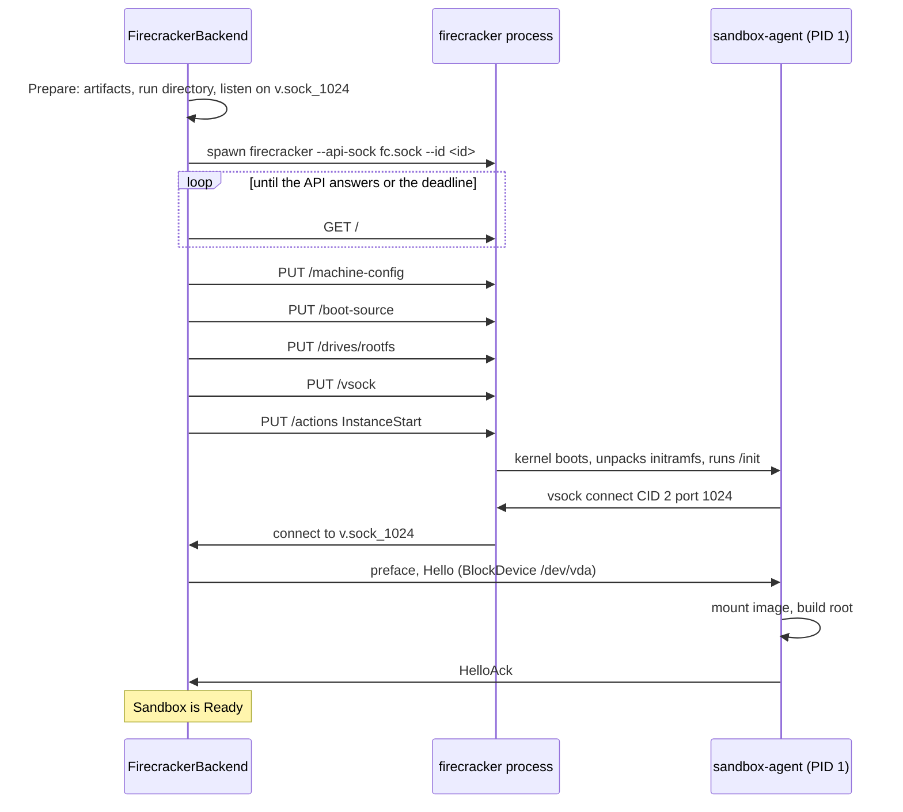

# Feature 06: The Firecracker backend (milestone M2)

_Written in ASD-STE100 Simplified Technical English (STE). Code and identifiers stay as they
are._

**Abbreviations in this file.** application programming interface (API); virtual machine
(VM); virtual machine monitor (VMM); Kernel-based Virtual Machine (KVM); Unix domain socket
(UDS); process identifier (PID); context identifier (CID); virtual CPU (vCPU); continuous
integration (CI); AeroSpace and Defence Industries Association of Europe (ASD), the owner of
the STE standard ASD-STE100.

## 1. Goal

Start a Firecracker microVM with our agent as its init program, on Linux. When this feature
lands, this code works on a Linux host with KVM and the `firecracker` program:

```rust
let store = ArtifactStore::new(ctx.clone(), SandboxHost::from_ctx(&ctx)?);
let rootfs = store.alpine_rootfs_ext4(GuestArch::host(), 256).await?;

let sandbox = FirecrackerBackend::new()
    .create(ctx, SandboxSpec::new(RootFs::Ext4Image(rootfs)))
    .await?;
let out = sandbox.run(Command::new(["echo", "hello"])).await?;
assert_eq!(out.stdout, b"hello\n");
sandbox.stop().await?;
```

The kernel and the agent initramfs come from the artifact store by default.

## 2. How the guest is put together

| Part | Source | How Firecracker gets it |
|---|---|---|
| Kernel | `spec.kernel`, or `store.firecracker_kernel(arch)` | `BootSource.kernel_image_path` |
| Init program | The agent, in an initramfs from `store.agent_initramfs(agent_path)` | `BootSource.initrd_path` |
| User root file system | `RootFs::Ext4Image` or `RootFs::SquashfsImage` | A drive with `drive_id = "rootfs"`, `is_root_device = false`, `is_read_only = true` |
| Host link | vsock | `Vsock { guest_cid, uds_path }` |

The user image is always attached read-only. The agent mounts it as the lower layer and
gives programs a root as `RootMode` says (feature 01, section 5). So many sandboxes can use
one image file at the same time, and no copy is made.

`is_root_device` is false because Firecracker rejects a root drive together with an
initramfs (`docs/initrd.md`). The agent finds the drive at `/dev/vda`: it is the first
virtio-block device.

### 2.1 Boot arguments

```
console=ttyS0 reboot=k panic=1 quiet ewe.transport=vsock:2:1024
```

On x86_64 add `pci=off i8042.noaux i8042.nomux i8042.dumbkbd`.

| Argument | Reason |
|---|---|
| `console=ttyS0` | Kernel and agent messages go to the serial port, thus to the standard output of `firecracker`, thus to `console.log`. |
| `reboot=k` | A guest reboot stops the VM. The agent uses this to power off. |
| `panic=1` | A kernel panic reboots after 1 s, which stops the VM. A hung guest does not stay. |
| `quiet` | Less console text, a faster boot. |
| `pci=off` | x86_64: no PCI scan. The devices are on the MMIO bus. |
| `i8042.*` | x86_64: skips keyboard controller probes, and keeps the reset line that `reboot=k` uses. |
| `ewe.transport=...` | The agent reads it from `/proc/cmdline` (feature 01, section 3). |

Do not add `root=`. The kernel uses the initramfs as its root and starts `/init`.

## 3. Start state machine

File `backends/foundation_platform_sandbox/src/firecracker/mod.rs`, behind the feature
`firecracker` and `cfg(target_os = "linux")`.



_Caption: the backend configures the VM with five API calls, starts it, and waits for the agent to connect to a socket that already listens._

```rust
pub enum FcLaunch {
    Prepare    { ctx: Ctx, spec: SandboxSpec },
    Spawn      { ctx: Ctx, spec: SandboxSpec, plan: FcPlan, listener: Box<dyn StreamListener> },
    AwaitApi   { ctx: Ctx, spec: SandboxSpec, plan: FcPlan, listener: Box<dyn StreamListener>,
                 vmm: Box<dyn ChildProcess>, api: Arc<dyn FirecrackerApi>,
                 deadline: foundation_compact::Instant, attempt: u32 },
    Configure  { /* the same fields */ step: ConfigStep },
    AwaitAgent { ctx: Ctx, spec: SandboxSpec, plan: FcPlan, listener: Box<dyn StreamListener>,
                 vmm: Box<dyn ChildProcess>, deadline: foundation_compact::Instant },
    Handshake  { ctx: Ctx, spec: SandboxSpec, plan: FcPlan, vmm: Box<dyn ChildProcess>,
                 stream: Box<dyn ByteDuplex>, deadline: foundation_compact::Instant },
    Done,
}

pub enum ConfigStep { MachineConfig, BootSource, Drive, Vsock, Start }

/// Everything that `Prepare` resolved.
pub struct FcPlan {
    pub id: SandboxId,
    pub run: RunDir,
    pub firecracker: PathBuf,
    pub kernel: PathBuf,
    pub initramfs: PathBuf,
    pub rootfs: PathBuf,
    pub rootfs_type: FsType,
    pub guest_cid: u32,
    pub boot_args: String,
}

#[task]
async fn fc_launch(ctx: Ctx, state: FcLaunch)
    -> Option<(FcLaunch, TaskStatus<SandboxResult<Sandbox>, CreateProgress>)>;
```

| State | Work | Emits | Next |
|---|---|---|---|
| `Prepare` | Validate the spec. Resolve the `firecracker` path, the kernel, the initramfs and the image (await the artifact store). Make the ID and the run directory. Check the socket path length for `v.sock_1024`, the longest one. Create an empty `vmm.log`. Pick `guest_cid` (section 4.2). Bind the listener at `<run_dir>/v.sock_1024`. | `Pending(Preparing)` | `Spawn` |
| `Spawn` | Spawn `firecracker` (section 4.1). Set `deadline = now + boot_timeout`. | `Pending(VmmSpawned)` | `AwaitApi` |
| `AwaitApi` | If `fc.sock` does not exist yet, or `describe_instance()` fails to connect: await a timer of `min(5 ms * 2^attempt, 100 ms)` from the clock, then the same state with `attempt + 1`. Also check `vmm.try_wait()`. On a good answer with state `Not started`, go on. | nothing (`Ignore`) while it waits | `Configure { MachineConfig }` |
| `Configure` | One API call for each step, in the order of `ConfigStep`. Section 4.3 has the bodies. | `Pending(VmmConfigured)` after `Vsock`; `Pending(Booting)` after `Start` | the next step, then `AwaitAgent` |
| `AwaitAgent` | Await the first of: `listener.accept()`, `vmm.wait()`, the deadline timer. | `Pending(AgentConnected)` | `Handshake` |
| `Handshake` | `AgentClient::handshake` with `RootSource::BlockDevice { device: "/dev/vda", fstype }`. Build `AgentSandbox`. | `Ready(Ok(sandbox))` | `Done` |
| `Done` | | `None` | |

Failure handling is the same as for libkrun (feature 04, section 4.1): kill the VMM, read
the tail of `console.log` and `vmm.log` (at most `max_error_message` bytes together),
remove the run directory, emit `Ready(Err(..))`, go to `Done`.

| Failure | Error |
|---|---|
| The `firecracker` process exits in `AwaitApi`, `Configure` or `AwaitAgent` | `VmmExited { code, log_tail }` |
| An API call returns a status that is not 2xx | `VmmApi { status, fault_message }` |
| The deadline passes in `AwaitApi` | `BootTimeout` with the stage `api` |
| The deadline passes in `AwaitAgent` | `BootTimeout` with the stage `agent` and the console tail. The usual causes are a kernel with no vsock, or a kernel panic. |
| `Hello` set-up fails in the guest | `AgentError { code: RootSetupFailed, .. }` |

### 3.1 `FirecrackerApi`

The state machine calls the API through a trait, so the simulation tests can replace it:

```rust
pub trait FirecrackerApi: Send + Sync + 'static {
    fn describe_instance(&self) -> BoxFuture<'_, SandboxResult<InstanceInfo>>;
    fn put_machine_config<'a>(&'a self, body: &'a MachineConfiguration) -> BoxFuture<'a, SandboxResult<()>>;
    fn put_boot_source<'a>(&'a self, body: &'a BootSource) -> BoxFuture<'a, SandboxResult<()>>;
    fn put_drive<'a>(&'a self, body: &'a Drive) -> BoxFuture<'a, SandboxResult<()>>;
    fn put_vsock<'a>(&'a self, body: &'a Vsock) -> BoxFuture<'a, SandboxResult<()>>;
    fn instance_start(&self) -> BoxFuture<'_, SandboxResult<()>>;
}
impl FirecrackerApi for FirecrackerClient { /* delegates */ }
```

`SandboxHost` gets one more field for this: `firecracker_api: Arc<dyn Fn(&Ctx, &Path, &SandboxLimits) -> SandboxResult<Arc<dyn FirecrackerApi>> + Send + Sync>`.
`SandboxHost::native()` sets it to the real client. The body types are the generated types
of feature 05.

## 4. Details

### 4.1 The `firecracker` process

```
firecracker --api-sock <run_dir>/fc.sock --id <sandbox_id> --log-path <run_dir>/vmm.log --level Warning
```

- Standard output and standard error go to `<run_dir>/console.log`. Standard input is
  `/dev/null`.
- The environment is empty. The work directory is the run directory.
- `kill_with_parent = true`.
- The default seccomp filter stays on. Never pass `--no-seccomp`.
- `--log-path` needs a file that exists; `Prepare` creates it.

### 4.2 Run directory and the guest CID

`<state_dir>/<sandbox_id>/`, mode `0700`:

| File | Made by | Content |
|---|---|---|
| `fc.sock` | Firecracker | The API socket. |
| `v.sock` | Firecracker, at `InstanceStart` | The vsock socket for host-started connections. We do not use it, but Firecracker makes it. The path must not exist before. |
| `v.sock_1024` | backend | The listening socket for the agent. |
| `console.log` | Firecracker output | Serial console. |
| `vmm.log` | Firecracker | VMM log. |

`guest_cid`: each Firecracker process has its own vsock device in user space, so two VMs can
use the same CID with no conflict. Still, pick a value from `ctx.rng()` in the range 3 to
`2^31 - 1`, so that logs show which VM a line is from.

### 4.3 API bodies

| Step | Call | Body |
|---|---|---|
| `MachineConfig` | `put_machine_config` | `vcpu_count = spec.vcpus`, `mem_size_mib = spec.memory_mib`, `smt = false`. Other fields `None`. |
| `BootSource` | `put_boot_source` | `kernel_image_path`, `initrd_path`, `boot_args` from the plan. |
| `Drive` | `put_drive` | `drive_id = "rootfs"`, `path_on_host`, `is_root_device = false`, `is_read_only = true`. Other fields `None`. |
| `Vsock` | `put_vsock` | `guest_cid`, `uds_path = <run_dir>/v.sock`. |
| `Start` | `instance_start` | |

`spec.vcpus` must be 1 or an even number. `FirecrackerBackend` adds this check to
`validate` and returns `InvalidSpec { field: "vcpus", .. }`.

### 4.4 Stop

`AgentSandbox::stop()` does the work (feature 02, section 3.2): `Shutdown` to the agent, the
agent calls `reboot()`, Firecracker exits with code 0. No API call is necessary. On x86_64
`SendCtrlAltDel` exists, but it needs a guest that handles it, and aarch64 does not have it;
we do not use it.

### 4.5 Capabilities

`rootfs_directory: false`, `rootfs_ext4: true`, `rootfs_squashfs: true`,
`host_mounts: false`, `network_host: false`.

`RootMode::Overlay` is the default. The Firecracker CI kernels have overlayfs and tmpfs
(`learnings.md` section 2.5). A user kernel with no overlayfs gets the agent error
`RootSetupFailed` with a message that names overlayfs; the user then picks `ReadOnly`.

## 5. Host check (`probe`)

| Check | How |
|---|---|
| `kvm` | `/dev/kvm` exists and opens for read and write. The message for a permission error tells the user to join the `kvm` group or to set an access control entry (`setfacl -m u:$USER:rw /dev/kvm`). |
| `firecracker` | The program exists at the resolved path. `firecracker --version` runs and prints a version. Report the version. |
| `firecracker_version` | The version is 1.10 or newer. Record in `learnings.md` the oldest version that the real test passed on, and set the check to that. |
| `agent` | The agent file exists for the guest architecture. |
| `mkfs.ext4` | Exists. Not required: `usable` stays true without it, and the message says that `alpine_rootfs_ext4` needs it. |

## 6. Tests

`backends/foundation_platform_sandbox/tests/`:

No VM (simulation host, `SimulatedClock`, a `FakeFirecrackerApi` that records calls):

| Test | Proves |
|---|---|
| `fc_launch_sim_ok` | The calls arrive in the order of section 4.3 with the bodies of section 4.3, and the progress values arrive in order. |
| `fc_boot_args_x86_64`, `fc_boot_args_aarch64` | The string of section 2.1 for each architecture. |
| `fc_await_api_backs_off` | `describe_instance` fails 4 times, then answers. The timer waits are 5, 10, 20, 40 ms on the simulated clock. No real sleep. |
| `fc_api_timeout` | The API never answers: `BootTimeout` with the stage `api`. |
| `fc_api_error_stops_launch` | `put_drive` returns 400: the result is `VmmApi`, `instance_start` is never called, the fake child got `SIGKILL`, the run directory is gone. |
| `fc_vmm_exit_during_boot` | The fake child exits with 152 before a connect: `VmmExited { code: 152 }` with the log tail. |
| `fc_agent_timeout` | No connect: `BootTimeout` with the stage `agent`. |
| `fc_rejects_directory_rootfs` | `RootFs::Directory` gives `UnsupportedRootFs`. |
| `fc_rejects_odd_vcpus` | `vcpus = 3` gives `InvalidSpec`. |
| `fc_rejects_host_network` | `NetworkMode::Host` gives `UnsupportedNetwork`. |
| `fc_listener_bound_before_start` | The fake API checks in `instance_start` that `v.sock_1024` exists. |

Real microVM (`e2e_firecracker.rs`). Each test calls `probe()` first and returns with the
report when `usable` is false.

| Test | Proves |
|---|---|
| `e2e_echo` | The code of section 1, with the Alpine ext4 image. |
| `e2e_squashfs_root` | The same with a squashfs image made from the Alpine directory (`mksquashfs`; the test returns with a message when that program is not found). |
| `e2e_exit_code`, `e2e_write_and_read_file`, `e2e_no_network_by_default`, `e2e_stop_is_clean`, `e2e_kill_parent_kills_vm` | The same as the libkrun tests of feature 04. Put the shared body in `tests/support/e2e_cases.rs` and call it from both files. |
| `e2e_image_not_changed` | The SHA-256 of the image file is the same before `create` and after `stop`, after a command that wrote to `/`. |
| `e2e_two_sandboxes_one_image` | Two sandboxes from one image file run at the same time. A file that one writes is not in the other. |
| `e2e_readonly_mode` | With `RootMode::ReadOnly`: a write to `/etc` fails, a write to `/tmp` and to the work directory succeeds. |
| `e2e_agent_is_pid1` | `HelloAck.is_pid1` is true, and `cat /proc/1/comm` in the guest shows the agent. |
| `e2e_orphans_are_reaped` | `sh -c "sleep 0.1 & exit 0"` 50 times; then no zombie process is in `ps` output. |
| `e2e_kernel_panic_is_reported` | Boot with a kernel command line that makes `init` fail (a test-only extra boot argument `ewe.transport=bad`): the result is `BootTimeout` or `VmmExited` with the console tail in the error, in less than `boot_timeout` + 2 s. |
| `e2e_boot_time` | Prints the time from `create` to `Ready`. The value goes to `progress.md`. |

## 7. Verify

```bash
cargo fmt --all --check
cargo clippy -p foundation_platform_sandbox --all-targets --profile uat --no-deps -- -D warnings
cargo test -p foundation_platform_sandbox --profile uat fc_
mise run sandbox:agent
EWE_SANDBOX_AGENT=<agent path> EWE_FIRECRACKER=<firecracker path> \
  cargo test -p foundation_platform_sandbox --profile uat e2e_firecracker -- --nocapture
```

Run the last command on a Linux host with KVM, on x86_64. Run it on aarch64 too when a host
is available; if none is, say so in the report and file a `severity: medium` issue
"Firecracker backend is not verified on aarch64".

## 8. Done when

- The tests with no VM pass in CI.
- The real microVM tests pass on a Linux x86_64 host with KVM, and `progress.md` has the
  date, the host, the Firecracker version and the boot time.
- The agent is PID 1 in the guest, mounts the image read-only, and powers the VM off on
  `Shutdown`.
- A failed start leaves no `firecracker` process and no run directory.
