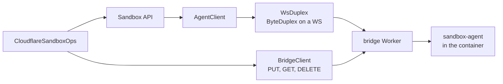

# Feature 09: The Cloudflare backend and providers (version 0.2)

_Written in ASD-STE100 Simplified Technical English (STE). Code and identifiers stay as they
are._

**Abbreviations in this file.** application programming interface (API); WebSocket (WS);
Hypertext Transfer Protocol (HTTP); Uniform Resource Locator (URL); JavaScript Object
Notation (JSON); Durable Object (DO); continuous integration (CI); AeroSpace and Defence
Industries Association of Europe (ASD), the owner of the STE standard ASD-STE100.

## 1. Goal

Two things on top of the bridge Worker of feature 08:

1. **Cloudflare Sandbox**: a `SandboxBackend` that gives the same `Sandbox` API as the local
   backends. Commands run in a Cloudflare container through our agent.
2. **Cloudflare Containers**: a `Provider` that starts a container that runs a service, and
   gives the URL that reaches its port.

```rust
let backend = CloudflareBackend::new(CloudflareConfig {
    bridge_url: "https://ewe-sandbox-bridge.example.workers.dev".into(),
    token: SecretString::from_env_value(token),
});
let sandbox = backend
    .create(ctx, SandboxSpec::new(RootFs::CloudflareImage("sandbox".into())))
    .await?;
let out = sandbox.run(Command::new(["echo", "hello"])).await?;
```

## 2. Design



_Caption: the Cloudflare backend uses the same `AgentClient` as the local backends; only the byte stream and the life-cycle calls differ._

| Part | File | Purpose |
|---|---|---|
| `BridgeClient` | `src/cloudflare/bridge.rs` | The HTTP calls of feature 08, section 4. |
| `WsDuplex` | `src/cloudflare/ws.rs` | A `ByteDuplex` on a WS connection. |
| `CloudflareBackend` | `src/cloudflare/mod.rs` | The start state machine and `probe`. |
| `CloudflareSandboxOps` | `src/cloudflare/mod.rs` | `SandboxOps`: delegates commands and files to `AgentClient`; `stop` and `kill` call `DELETE`. |

All behind the feature `cloudflare`. No target gate: this backend has no local VMM, so it
builds on every host.

## 3. Measured facts and measure first

- `foundation_netio` gives the HTTP client (`HttpClientBuilder`, `DynNetClient`,
  `PreparedRequestBuilder`).
- **Measure first.** Find the WS client in this repository
  (`grep -rn "websocket\|WebSocket" backends/foundation_netio/src backends/foundation_http/src -il`).
  Record in `learnings.md`: the type, how it sends and receives binary messages as async
  calls, and how it applies back pressure. If no WS client exists, stop and report. The
  main session then decides: add one to `foundation_netio` as its own issue, or change the
  bridge pipe to a different transport.
- The bridge sends agent bytes as binary messages with no relation to frame boundaries
  (feature 08, section 5).

## 4. `BridgeClient`

```rust
pub struct CloudflareConfig {
    pub bridge_url: String,
    pub token: SecretString,          // never in Debug output or logs
}

impl BridgeClient {
    pub fn new(ctx: &Ctx, config: &CloudflareConfig, limits: &SandboxLimits) -> SandboxResult<Self>;
    pub async fn health(&self) -> SandboxResult<BridgeHealth>;
    pub async fn start(&self, name: &str, request: &StartRequest) -> SandboxResult<SandboxInfo>;
    pub async fn info(&self, name: &str) -> SandboxResult<SandboxInfo>;
    pub async fn destroy(&self, name: &str) -> SandboxResult<()>;
    pub async fn open_agent(&self, name: &str) -> SandboxResult<Box<dyn ByteDuplex>>;
    pub fn port_url(&self, name: &str, port: u16) -> String;
}
```

- `StartRequest`, `SandboxInfo` and `ErrorBody` are Rust types with `serde`, in
  `src/cloudflare/types.rs`. They are hand-written, because the bridge is our own API and
  has no OpenAPI file. Keep one JSON fixture for each type in
  `infrastructure/sandbox_bridge/test/fixtures/`; a Rust test and a bridge test both read
  it, so the two sides cannot drift.
- Each call checks the status first. A status that is not 2xx reads at most
  `limits.max_error_message` bytes and maps `ErrorBody.error.code` to `SandboxError`:
  `unauthorized` to `BridgeUnauthorized`, `not_running` to `SandboxStopped`,
  `unknown_image` to `UnsupportedRootFs`, others to `Bridge { status, code, message }`.
- Each call has the time-out `limits.api_timeout`. `start` uses `limits.boot_timeout`,
  because a cold container start takes seconds.
- `SecretString` is the secret type that the workspace already has. Find it
  (`grep -rn "struct Secret" backends/*/src | head`); do not write a new one.
- The token is an injected value. The host entry point reads it from the environment or a
  key store; the library never reads the environment.

## 5. `WsDuplex`

Implements `ByteDuplex` (feature 00, section 3.2) on the WS client:

- `write_all(buf)`: sends `buf` as binary messages of at most `max_frame_payload` bytes
  each.
- `read(buf)`: holds the rest of the last message. Copies up to `buf.len()` bytes from it.
  When it is empty, awaits the next binary message. A close message returns 0. A text
  message is an error (`Protocol`).
- `shutdown()`: sends a close message.
- Memory is bounded: at most one message is held, and the WS client must have a message
  size limit set to `max_frame_payload + HEADER_LEN` at least and to 1 MiB at most.

## 6. Start state machine

```rust
pub enum CfLaunch {
    Prepare    { ctx: Ctx, spec: SandboxSpec },
    Start      { ctx: Ctx, spec: SandboxSpec, name: String, deadline: foundation_compact::Instant },
    OpenAgent  { ctx: Ctx, spec: SandboxSpec, name: String, deadline: foundation_compact::Instant, attempt: u32 },
    Handshake  { ctx: Ctx, spec: SandboxSpec, name: String, stream: Box<dyn ByteDuplex>,
                 deadline: foundation_compact::Instant },
    Done,
}
```

| State | Work | Emits | Next |
|---|---|---|---|
| `Prepare` | Validate the spec. The sandbox name is `sbx-<SandboxId>`. | `Pending(Preparing)` | `Start` |
| `Start` | `bridge.start(name, StartRequest { image, enable_internet, env: None, agent: true })`. | `Pending(VmmSpawned)` | `OpenAgent` |
| `OpenAgent` | `bridge.open_agent(name)`. On `not_running` or a connect failure: await a timer of `min(50 ms * 2^attempt, 1 s)`, then retry until the deadline. The answer to M2 of feature 08 can remove this retry. | `Pending(AgentConnected)` | `Handshake` |
| `Handshake` | `AgentClient::handshake` with `RootSource::Plain`. Build the sandbox. | `Ready(Ok(sandbox))` | `Done` |

A failure after `Start` calls `bridge.destroy(name)` before it emits the error, so a failed
create leaves no container.

Spec mapping:

| `SandboxSpec` field | Cloudflare |
|---|---|
| `rootfs` | Must be `CloudflareImage(key)`. Other kinds give `UnsupportedRootFs`. |
| `vcpus`, `memory_mib` | Set by the instance type in `wrangler.jsonc`, not at run time. A value that is not the default gives `InvalidSpec` with a message that says where to set it. |
| `network` | `None` to `enable_internet: false`; `Host` to `true`. |
| `root_mode` | Ignored. The container root is always a private, writable copy of the image. `HelloAck.root_mode` reports `Overlay`. |
| `mounts` | `UnsupportedMount`. |
| `env`, `workdir` | In `Hello`, as on the local backends. |

Capabilities: `rootfs_cloudflare_image: true`, the other `rootfs_*` false,
`host_mounts: false`, `network_host: true`.

`probe(ctx)` cannot wait, so it reports only what it has: the URL parses, and a token is
present. A new async function `CloudflareBackend::check(&self, ctx) -> SandboxResult<BridgeHealth>`
calls `/v1/health` and one authorised `GET` to prove the token.

### 6.1 Stop

| Call | Work |
|---|---|
| `stop()` | `client.shutdown(grace)` (the agent kills its programs and waits for the next connection), then `bridge.destroy(name)`. |
| `kill()` | `bridge.destroy(name)`. |
| `Drop` | Cannot block and has no process to signal. It logs a warning with the name when the state is not `Stopped`. The README says that a caller must call `stop()`, and that the bridge inactivity time-out (M3 of feature 08) is the back-stop. |

## 7. The providers

In `foundation_deployment_platform`, feature `sandbox`, module `providers/sandbox/`:

- `ProviderId` gets `CloudflareSandbox` and `CloudflareContainer` (`cloudflare-sandbox`,
  `cloudflare-container`).
- `CloudflareSandboxProvider`: the same generic helper as feature 07, with
  `CloudflareBackend`.
- `CloudflareContainerProvider`: the service style.

```rust
pub struct CloudflareContainerConfig {
    pub name: String,            // the bridge sandbox name; the caller picks it
    pub image: String,           // a key of the bridge images
    pub enable_internet: bool,
    pub port: u16,               // the service port in the container
}
pub struct CloudflareContainerHandle {
    pub name: String,
    pub port: u16,
    pub url: String,             // bridge.port_url(name, port)
}
```

| Method | Body |
|---|---|
| `launch(config)` | `bridge.start(name, StartRequest { agent: false, .. })`. Returns the handle. Does not wait for the port. |
| `stop(handle)` | `bridge.destroy(name)`. |
| `is_running(handle)` | `bridge.info(name)` gives `running`. An error gives false. |
| `resolved_ports(handle)` | All zero and `None`. The handle `url` is the way in; a Cloudflare container has no host port. |
| `host_health()` | The checks of `probe` and `check`. |

A caller reaches the service with an HTTP request to `handle.url` and the bearer token.

## 8. Tests

No network:

| Test | Proves |
|---|---|
| `bridge_types_match_fixtures` | Each type round-trips the shared JSON fixture. |
| `bridge_error_mapping` | Each error code maps to its `SandboxError`, with a mock HTTP server. |
| `bridge_error_body_is_bounded` | A 500 answer with a 10 MiB body gives a bounded message. |
| `token_not_in_debug` | `format!("{config:?}")` does not contain the token. |
| `ws_duplex_reassembles` | Three WS messages that cut two agent frames at odd places decode to the two frames. |
| `ws_duplex_close_is_eof` | A close message gives `read() == 0`. |
| `cf_launch_sim_ok` | With a fake bridge and a `ScriptedAgent`: the calls and the progress values arrive in order. |
| `cf_launch_failure_destroys` | A failed handshake calls `destroy`. |
| `cf_rejects_local_rootfs` | `RootFs::Directory` gives `UnsupportedRootFs`. |

With `wrangler dev` and Docker (`e2e_cloudflare.rs`; returns with a message when
`EWE_SANDBOX_BRIDGE_URL` is not set):

| Test | Proves |
|---|---|
| `e2e_echo` | The code of section 1. |
| `e2e_exit_code`, `e2e_write_and_read_file` | The shared cases of `tests/support/e2e_cases.rs`. |
| `e2e_large_output_streams` | 20 MB of output arrives through the WS with flat memory. |
| `e2e_stop_destroys` | After `stop()`, `bridge.info(name)` shows `running: false`. |
| `e2e_container_provider` | `CloudflareContainerProvider` starts the HTTP test image, and a `GET` to `handle.url` returns its body. |

A deploy to the real Cloudflare network is a manual step before the 0.2 release. Record the
date and the result in `progress.md`.

## 9. Verify

```bash
cargo fmt --all --check
cargo clippy -p foundation_platform_sandbox --features cloudflare --all-targets --profile uat --no-deps -- -D warnings
cargo test -p foundation_platform_sandbox --features cloudflare --profile uat cf_ bridge_ ws_
cargo check -p foundation_platform_sandbox --no-default-features --features cloudflare --target wasm32-unknown-unknown --profile uat || true   # record the result; not a gate
( cd infrastructure/sandbox_bridge && ./test/run.sh --keep-running ) &   # save the PID
EWE_SANDBOX_BRIDGE_URL=http://127.0.0.1:8787 EWE_SANDBOX_BRIDGE_TOKEN=test \
  cargo test -p foundation_platform_sandbox --features cloudflare --profile uat e2e_cloudflare -- --nocapture
```

## 10. Done when

- The tests of section 8 pass, with the `wrangler dev` tests run on a machine with Docker.
- The same `Sandbox` calls work on Firecracker, libkrun and Cloudflare: the shared cases in
  `tests/support/e2e_cases.rs` run for all three.
- Both Cloudflare providers implement `Provider`.
- The token never appears in a log line or a `Debug` output.
- `progress.md` records 0.2 and the manual deploy result.
