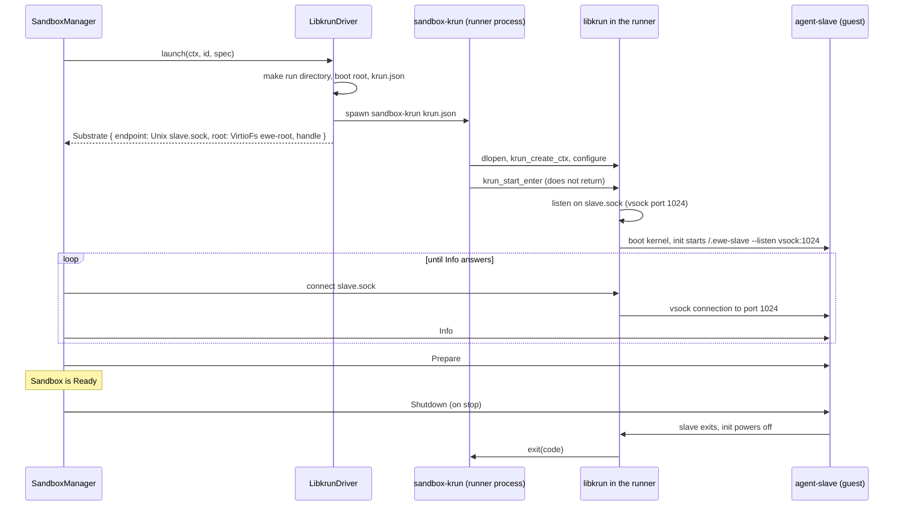

# Feature 09: The libkrun driver

_Written in ASD-STE100 Simplified Technical English (STE). Code and identifiers stay as they
are._

**Abbreviations in this file.** remote procedure call (RPC); virtual machine (VM); virtual
machine monitor (VMM); Kernel-based Virtual Machine (KVM); Hypervisor.framework (HVF);
foreign function interface (FFI); Unix domain socket (UDS); Transparent Socket
Impersonation (TSI); JavaScript Object Notation (JSON); process identifier (PID); virtual
CPU (vCPU); behaviour-driven development (BDD); continuous integration (CI); AeroSpace and
Defence Industries Association of Europe (ASD), the owner of the STE standard ASD-STE100.

## 1. Goal

Add a second microVM driver, `LibkrunDriver`, for Linux and for macOS on Apple silicon. It
plugs into the same `SandboxManager` as the Firecracker driver, with no change to the core.
libkrun needs no kernel file, and its root can be a host directory.

```rust
let manager = SandboxManager::new(ctx.clone(), vec![Arc::new(LibkrunDriver::new())],
    host.connector.clone(), Arc::new(MemoryRecordStore::default()), ManagerConfig::default());
let rootfs = store.alpine_rootfs_dir(GuestArch::host()).await?;
let sandbox = manager.create(SandboxSpec::new(RootFs::Directory(rootfs))).await?;
let out = sandbox.run(Command::new(["echo", "hello"])).await?;
```

## A. Story

- **S1**: "A caller on Linux or macOS starts a sandbox from a root directory and runs a
  command in it."
- **S2**: "The caller's root directory is the same after the sandbox as before it."
- **S3**: "The host is not ready: no hypervisor, no library, a runner with no signature."
- **S4**: "The VM does not come up: the runner exits, or the slave never answers."
- **S5**: "The host program dies; the VM does not stay."

| # | Use case | Actor | Trigger | Result |
|---|---|---|---|---|
| U1 | Check the host | caller, doctor | `LibkrunDriver::probe` | A report: each check, and the capabilities. |
| U2 | Create | caller | `launch(ctx, id, spec)` | A `Substrate` (endpoint, root set-up, handle), or a typed error and no leftovers. |
| U3 | Watch progress | caller | the launch stream | `Preparing`, `SubstrateStarted`, then the result. |
| U4 | Become the VM | driver (spawns) | `sandbox-krun <krun.json>` | The runner process turns into the VM and exits with the slave's code. |

## B. Bounded context

**Inside this feature:** the libkrun start state machine, the runner program, the runner
configuration, the libkrun host checks.

**Outside:** libkrun and `libkrunfw` (installed libraries); the slave (feature 01); the
readiness wait, `Prepare` and the registry (feature 02); the artifact store (feature 03);
the native side effects (feature 05).

| Entity | Meaning | Owner (the one writer) |
|---|---|---|
| `KrunRunnerConfig` | The full VM description for one run, as JSON. | driver writes; runner only reads |
| Boot root | `<run_dir>/root`: four empty directories. The guest's first root. | driver |
| User root | The caller's directory. Shared read-only with the tag `ewe-root`. | the caller; nobody writes it |
| Runner process | The child that calls libkrun and becomes the VM. | `ProcessSpawner` (spawn); the handle (signal) |
| Run directory | Sockets, logs and generated files of one sandbox. | the driver creates; the handle removes |
| Launch state | The enum `KrunLaunch`. | the `krun_launch` task |

| Verb | Kind | Trigger | Effect |
|---|---|---|---|
| probe | entity | caller | Reads the host; starts nothing. |
| prepare | entity | `launch` | Makes the run directory, boot root and `krun.json`. |
| spawn | entity | after prepare | Starts the runner. |
| launch | story | control plane | prepare, spawn; cleans up on a failed step. |
| configure and enter | story (in the runner) | runner start | The 12 libkrun calls of section 3.3. |

## C. Rules

### Law worksheet

```
Entity: Launch (story)
Conserved value:         a failed launch leaves 0 processes and 0 run directories; a good one leaves exactly 1 of each
Bound:                   none of its own (the control plane holds the boot deadline)
Inverse pairs:           launch / cleanup
Idempotent verbs:        probe
Ordering pairs:          write krun.json -> spawn (enabling)
Monotone values:         launch state moves forward only; progress values come in a fixed order
Freeze points:           krun.json after it is written
Links to other entities: krun.json.slave_socket = endpoint.path; guest architecture = host architecture

Entity: User root directory
Conserved value:         its content before create = its content after stop
Bound:                   none
Inverse pairs:           none
Idempotent verbs:        none
Ordering pairs:          none
Monotone values:         none
Freeze points:           the whole directory, for the life of the sandbox
Links to other entities: shared as virtio-fs tag "ewe-root", read-only
```

### Invariants

| # | Invariant |
|---|---|
| I1 | The driver never calls a `krun_*` function. Only `bin/sandbox_krun` does. |
| I2 | The driver does not call the slave. It returns `SlaveEndpoint::Unix { path: <run_dir>/slave.sock }`; libkrun makes that socket, and the control plane does the readiness wait. |
| I3 | The user root is shared read-only. No file in it is made, changed or removed by a sandbox. |
| I4 | The guest gets no host environment variable: `krun_set_exec` always gets an explicit list. |
| I5 | With `NetworkMode::None` the guest has only `lo`. TSI is on only with `NetworkMode::Host`, and `KRUN_TSI_HIJACK_UNIX` is never set. |
| I6 | The port map is an empty list, so no guest port is open on the host. |
| I7 | A failed `launch` leaves no runner process and no run directory. |
| I8 | When the host process dies, the runner dies in less than 2 s. |
| I9 | `probe` starts no VM and does not wait longer than `rpc_timeout`. |
| I10 | The progress values come in the order `Preparing`, `SubstrateStarted`, then one result. |

### Must have

- `LibkrunDriver`, `KrunRunnerConfig`, the program `sandbox-krun` with `--probe`.
- The entitlement file and the `mise` task that signs the runner on macOS.

### Must do

- Map each runner exit code to its `SandboxError` (section 3.5).
- Put the last bytes of `console.log` in each start error.
- Check that the user root directory exists before a process starts.

### Must not

- Must not pass `NULL` as `envp` or as the port map.
- Must not link libkrun at build time. The runner loads it at run time.
- Must not treat a root directory as a way to keep file owners (section 6).

## D. Acceptance scenarios

```gherkin
Feature: libkrun driver

  Scenario: A command runs in a microVM
    Given a usable libkrun host and the Alpine root directory
    When the caller creates a sandbox through SandboxManager and runs ["echo", "hello"]
    Then stdout is "hello\n" and the exit code is 0
    And "uname -s" in the sandbox prints "Linux"

  Scenario: The root directory does not change
    Given a root directory with a known file list and hashes
    When a sandbox runs ["sh", "-c", "touch /marker; rm -f /etc/hostname"] and stops
    Then the file list and the hashes of the root directory are the same

  Scenario: The host environment does not leak
    Given the host process has EWE_SECRET_TEST=1
    When the sandbox runs ["env"]
    Then the output does not contain "EWE_SECRET_TEST"

  Scenario: No network unless asked
    Given a spec with NetworkMode::None
    When the sandbox lists /sys/class/net
    Then the only interface is "lo"

  Scenario: A host directory can be mounted read-only
    Given a spec that mounts a host directory at /data read-only
    When the sandbox runs ["sh", "-c", "cat /data/f && touch /data/g"]
    Then the output has the content of f
    And the exit code is not 0
    And the host directory has no file g

  Scenario: A missing library is a clear error
    Given a runner that exits with code 71
    When the caller creates a sandbox
    Then the result is LibraryNotFound
    And no run directory is left

  Scenario: A slave that never answers times out
    Given a runner that starts and whose slave never answers
    When the clock passes boot_timeout
    Then the result is BootTimeout { stage: "slave" } with the console tail
    And the runner got SIGKILL
    And no run directory is left

  Scenario: The VM dies with its parent
    Given a helper process that created a sandbox
    When the helper is killed with SIGKILL
    Then the runner process is gone in less than 2 seconds

  Scenario: The host check names what is missing
    Given no sandbox-krun at the resolved path
    When probe runs
    Then usable is false and the check "runner" is not ok
```

## 2. Two parts



_Caption: the driver never calls libkrun; the runner process does, because `krun_start_enter` takes over its process; the control plane reaches the slave through a socket that libkrun makes._

## 3. The runner (`bin/sandbox_krun`)

A host program. One run is one VM. It reads a JSON file, calls libkrun, and never returns
from `krun_start_enter`.

### 3.1 Configuration file

The driver writes `<run_dir>/krun.json`. The type is in
`foundation_platform_sandbox::shared::krun_config` so that both sides use one definition.
The runner depends on `foundation_platform_sandbox` with `default-features = false` to get
it; that configuration must not pull the drivers.

```rust
#[derive(Debug, Clone, PartialEq, Eq, Serialize, Deserialize)]
pub struct KrunRunnerConfig {
    pub libkrun_path: Option<PathBuf>,     // None = loader search
    pub vcpus: u8,
    pub memory_mib: u32,
    pub boot_root: PathBuf,                // <run_dir>/root: a private directory, section 4.2
    pub user_root: Option<KrunMount>,      // RootFs::Directory, tag "ewe-root", always read-only
    pub slave_path: PathBuf,               // host path of agent-slave (guest architecture)
    pub slave_socket: PathBuf,             // host UDS that libkrun makes for the slave port
    pub slave_port: u32,                   // 1024
    pub tsi_inet: bool,                    // NetworkMode::Host
    pub mounts: Vec<KrunMount>,            // { tag, host_path, read_only }
    pub log_level: u32,                    // KRUN_LOG_LEVEL_*
    pub lifeline_fd: Option<i32>,          // macOS: 3
}
```

### 3.2 FFI

File `bin/sandbox_krun/src/ffi.rs`. It loads the library with `libloading` at run time.
Library names, tried in order when `libkrun_path` is `None`:

| System | Names |
|---|---|
| Linux | `libkrun.so.1`, `libkrun.so` |
| macOS | `libkrun.1.dylib`, `libkrun.dylib`, `/opt/homebrew/lib/libkrun.1.dylib` |

It resolves these symbols. The signatures are from `include/libkrun.h` on `stable-1.19.x`;
`learnings.md` section 3.1 has the line numbers. A missing symbol gives exit code 71 and
the line `sandbox-krun: libkrun has no symbol <name>` on standard error.

```rust
type Ctx = u32;
krun_set_log_level(level: u32) -> i32
krun_create_ctx() -> i32
krun_set_vm_config(ctx: Ctx, num_vcpus: u8, ram_mib: u32) -> i32
krun_add_virtiofs3(ctx: Ctx, tag: *const c_char, path: *const c_char, shm_size: u64, read_only: bool) -> i32
krun_fs_add_overlay_file(ctx: Ctx, fs_tag: *const c_char, path: *const c_char,
                         data: *const u8, data_len: usize, mode: u32, one_shot: bool) -> i32
krun_disable_implicit_vsock(ctx: Ctx) -> i32
krun_add_vsock(ctx: Ctx, tsi_features: u32) -> i32
krun_add_vsock_port2(ctx: Ctx, port: u32, filepath: *const c_char, listen: bool) -> i32
krun_set_port_map(ctx: Ctx, port_map: *const *const c_char) -> i32
krun_set_exec(ctx: Ctx, exec_path: *const c_char, argv: *const *const c_char, envp: *const *const c_char) -> i32
krun_start_enter(ctx: Ctx) -> i32
```

Each array argument ends with a null pointer. All `unsafe` is in `ffi.rs`, each block with a
`SAFETY` comment.

### 3.3 Call sequence

The runner makes these calls in this order. A negative return stops it: it prints
`sandbox-krun: <function> failed: errno <n>` and exits with code 70.

| # | Call | Reason |
|---|---|---|
| 1 | `krun_set_log_level(log_level)` | |
| 2 | `krun_create_ctx()` | |
| 3 | `krun_set_vm_config(ctx, vcpus, memory_mib)` | |
| 4 | `krun_add_virtiofs3(ctx, "/dev/root", boot_root, 0, true)` | The boot root, read-only. It is a private directory of this sandbox with only the empty directories `dev`, `proc`, `sys` and `run`. `shm_size = 0` means no shared memory window. |
| 5 | `krun_fs_add_overlay_file(ctx, "/dev/root", ".ewe-slave", data, len, 0o100755, false)` | The slave appears at `/.ewe-slave` in the guest. `data` is the slave file, read into a `Vec` and leaked with `Box::leak`, because libkrun does not copy it and needs it until the VM stops. |
| 6 | `user_root`, then each mount: `krun_add_virtiofs3(ctx, tag, host_path, 0, read_only)` | The user root directory (tag `ewe-root`, read-only) and the extra host directories. The slave mounts each tag. |
| 7 | `krun_disable_implicit_vsock(ctx)` | We control TSI. |
| 8 | `krun_add_vsock(ctx, if tsi_inet { KRUN_TSI_HIJACK_INET } else { 0 })` | `KRUN_TSI_HIJACK_UNIX` is never set. |
| 9 | `krun_add_vsock_port2(ctx, slave_port, slave_socket, true)` | `listen = true`: the VMM listens on the host UDS `slave_socket`, and a host connection to it goes to the guest port, where the slave listens. No text handshake (`learnings.md` section 3.3). |
| 10 | `krun_set_port_map(ctx, [null])` | An empty list. `NULL` would expose every guest listening port on the host when TSI is on. |
| 11 | `krun_set_exec(ctx, "/.ewe-slave", ["--listen", "vsock:1024", null], [null])` | An explicit empty environment. `NULL` would copy the runner environment into the guest. |
| 12 | `krun_start_enter(ctx)` | Does not return on success. |

Facts from the libkrun source that this sequence uses (`learnings.md` section 3.8):

- Step 4: the header comment of `KRUN_FS_ROOT_TAG` says that `krun_add_virtiofs3` with that
  tag replaces `krun_set_root`. The built-in init (`src/init_blob/init/init.c`,
  `mount_filesystems`) calls `mkdir` for `/dev`, `/proc` and `/sys` and accepts `EEXIST`.
  It makes `/dev/pts` and `/dev/shm` inside the `devtmpfs` mount. So a read-only root
  boots when the three directories exist. The driver makes them in the boot root.
- Step 11: `argv` does **not** include the program name. `examples/chroot_vm.c` line 316
  passes `guest_argv[0]` as `exec_path` and `&guest_argv[1]` as `argv`.

Why the user directory is not the root: the user directory must not change, the slave
needs a lower layer that is not `/`, and a later feature (12) boots a disk image with the
same boot root. So each libkrun sandbox has the same small boot root, and the user root
arrives as a second device.

### 3.4 The lifeline

On macOS the runner gets `lifeline_fd = 3`: the driver makes a pipe, passes the read end as
file descriptor 3 (an addition to `ProcessSpec`: `extra_fds: Vec<(i32, OwnedFd)>`, used
only here), and keeps the write end in the handle. Before step 12 it starts one thread that calls
a blocking `read` on that descriptor. When the read returns 0 (the parent is gone), the
thread calls `libc::_exit(137)`. On Linux the driver sets `kill_with_parent`, and
`lifeline_fd` is `None`.

### 3.5 Exit codes of the runner

| Code | Meaning | Maps to |
|---|---|---|
| 0 | The slave exited with 0 after `Shutdown`. | normal stop |
| 64 | Bad command line or JSON. | `InvalidSpec` |
| 70 | A `krun_*` call failed. | `SubstrateExited` with the log tail |
| 71 | Library or symbol not found. | `LibraryNotFound` or `LibraryTooOld` |
| 125, 126, 127 | The libkrun init could not start the slave. | `SubstrateExited` with the log tail |
| 137 | The lifeline closed. | not seen by the driver |
| other | The slave exit code, or a VMM crash. | `SubstrateExited` |

### 3.6 macOS signing

- Add `bin/sandbox_krun/hvf-entitlements.plist` with the key
  `com.apple.security.hypervisor` set to true.
- Add a `mise` task `sandbox:krun` that builds the runner and, on macOS, runs
  `codesign --entitlements bin/sandbox_krun/hvf-entitlements.plist --force -s - <program>`.
- A runner with no entitlement fails in `krun_start_enter`. The host check (section 5)
  finds this before a start.

## 4. The driver

File `backends/foundation_platform_sandbox/src/native/libkrun/mod.rs`, behind the feature
`libkrun` and `cfg(any(target_os = "linux", target_os = "macos"))`.

### 4.1 Launch state machine

```rust
pub enum KrunLaunch {
    Prepare { ctx: Ctx, id: SandboxId, spec: SandboxSpec },
    Spawn   { ctx: Ctx, plan: KrunPlan },
    Done,
}
#[task]
async fn krun_launch(ctx: Ctx, state: KrunLaunch)
    -> Option<(KrunLaunch, TaskStatus<SandboxResult<Substrate>, CreateProgress>)>;
```

| State | Work | Emits | Next |
|---|---|---|---|
| `Prepare` | Check that the root directory exists (`InvalidSpec { field: "rootfs" }`). Make the run directory (mode `0700`) and the boot root (`root/dev`, `root/proc`, `root/sys`, `root/run`). Check the socket path length for `slave.sock`. Resolve the slave and runner paths. Write `krun.json`. | `Pending(Preparing)` | `Spawn` |
| `Spawn` | Spawn `sandbox-krun <run_dir>/krun.json` with standard output and standard error to `<run_dir>/console.log`, an empty environment (plus `LD_LIBRARY_PATH` or `DYLD_LIBRARY_PATH` with the directory of `HostConfig.libkrun_path` when that is set), `kill_with_parent = true` on Linux, the lifeline on macOS. | `Pending(SubstrateStarted)`, then `Ready(Ok(substrate))` | `Done` |

The substrate: `endpoint: Unix { path: <run_dir>/slave.sock }`,
`root: RootSetup { source: VirtioFs { tag: "ewe-root" }, mode: spec.root_mode }`,
`mounts`: one `GuestMount` for each `HostMount` with the tag `ewe-m<index>`, and the handle.

The socket `slave.sock` does not exist until libkrun starts the VM. A connect before that
fails; the control plane's readiness wait tries again (feature 02, section 6.3). A runner
that exits early is seen by the same wait through `handle.exited()`, and the error is
mapped by section 3.5.

A failure in `Prepare` or `Spawn` removes the run directory and emits `Ready(Err(..))`.

### 4.2 The handle

The same behaviour as `FcHandle` (feature 05, section 6.7), on the runner process:
`exited`, `terminate`, `kill`, `log_tail` (from `console.log`), `cleanup` (kill if it runs;
remove the run directory). `exited()` maps the exit code with section 3.5 when the
control plane asks for an error (`SubstrateExit.code` carries the raw code; the mapping
function `krun_exit_error(code, log_tail) -> SandboxError` is used by the manager through
a method `SubstrateHandle::exit_error(&self, exit: &SubstrateExit, log_tail: Vec<u8>) ->
SandboxError`, which has a default body that returns `SubstrateExited`; this driver
overrides it. Add that method to the trait in feature 00.)

`attach` returns `Ok(None)` and removes a stale run directory, as for Firecracker.

### 4.3 Run directory

`<state_dir>/<sandbox_id>/` with mode `0700`:

| File | Made by | Content |
|---|---|---|
| `krun.json` | driver | Section 3.1. |
| `root/` | driver | The boot root: four empty directories. |
| `slave.sock` | libkrun | The UDS for the slave port. |
| `console.log` | runner output | libkrun log lines and the slave messages. |

### 4.4 Capabilities

`rootfs_directory: true`, `rootfs_ext4: false`, `rootfs_squashfs: false`,
`rootfs_container_image: false`, `root_modes: [Overlay, ReadOnly]`, `host_mounts: true`,
`network_host: true`, `max_vcpus`: the value of `krun_get_max_vcpus` from the probe.
(Feature 12 turns `rootfs_ext4` on when the installed libkrun has block support.)

`NetworkMode::Host` means TSI: the guest uses the network of the runner process.

### 4.5 Guest architecture

The guest architecture is the host architecture. On macOS the guest is Linux on aarch64,
so the root directory must hold aarch64 Linux programs, and the slave is the
`aarch64-unknown-linux-musl` build.

## 5. Host check (`probe`)

`LibkrunDriver::probe(ctx)` returns these checks. It starts no VM.

| Check | Linux | macOS |
|---|---|---|
| `hypervisor` | `/dev/kvm` exists and opens for read and write | The architecture is aarch64 and `sysctl kern.hv_support` is 1 |
| `runner` | `sandbox-krun` exists at the resolved path | the same |
| `runner_signed` | not applicable (ok) | `codesign -d --entitlements - <runner>` shows the hypervisor key |
| `libkrun` | `sandbox-krun --probe` exits 0 | the same |
| `slave` | The slave file exists for the guest architecture | the same |

`sandbox-krun --probe [--libkrun <path>]` loads the library, resolves each symbol of
section 3.2, prints one JSON line (`{"library": "<path>", "max_vcpus": <n>}` from
`krun_get_max_vcpus`) and exits 0. On a failure it exits 71. The check runs it through
`host.processes` with a time-out of `limits.rpc_timeout`.

## 6. Root mode and file ownership on libkrun

- Both root modes work. The `libkrunfw` kernel (6.12) has `CONFIG_OVERLAY_FS=y`,
  `CONFIG_TMPFS=y` and `CONFIG_VIRTIO_FS=y` on x86_64 and aarch64
  (`config-libkrunfw_x86_64`, `config-libkrunfw_aarch64`). The lower layer is the
  virtio-fs mount at `/run/ewe/lower`, and the upper layer is a tmpfs.
- File ownership in a root directory differs between hosts. On Linux the virtio-fs device
  shows the real host owner of each file. On macOS it reads the owner and the mode from
  the extended attribute `user.containers.override_stat`, and shows the host owner when
  the attribute does not exist. So a directory that a normal user unpacked shows that
  user as the owner of each file in the guest. Programs still run, because each command
  runs as root in the guest. A root file system with correct owners is a sandbox image
  (feature 10), not a directory. The README says this.

## 7. Tests

`backends/foundation_platform_sandbox/tests/`. Each scenario of section D is one test.

No VM (`libkrun_sim_*.rs`), with the fakes of the `testing` module:

| Law or scenario | Test | Oracle |
|---|---|---|
| `KrunRunnerConfig` | `krun_config_roundtrip` | identity |
| I10 | `launch_ok` (progress order; the recorded `ProcessSpec`; the content of `krun.json`; the boot root directories) | example |
| I7 | `launch_fault_matrix` (missing root directory, missing runner, spawn failure, socket path too long: the error and no run directory) | fault |
| section 3.5 | `exit_code_mapping` (each row) | example |
| "A missing library is a clear error" | `create_runner_exit_71` (through `SandboxManager` with a fake child that exits with 71) | expected outcome |
| "A slave that never answers times out" | `create_slave_timeout` | expected outcome |
| "The host check names what is missing" | `probe_missing_runner` | expected outcome |
| I1 | `no_krun_symbols_outside_runner` (a source scan) | example |

The runner (`bin/sandbox_krun/tests/`): `config_parse_error_exit_64`,
`probe_without_library_exit_71` (with `--libkrun /nonexistent`).

Real microVM (`e2e_libkrun.rs`). Each test calls `probe()` first and returns with the
report when `usable` is false. It runs the shared acceptance scenarios
(`tests/support/acceptance.rs`) with a manager that has this driver, plus:

| Scenario of section D | Test |
|---|---|
| I3, "The root directory does not change" | `e2e_rootfs_not_changed` |
| I4, "The host environment does not leak" | `e2e_host_env_not_leaked` |
| I5, "No network unless asked" | `e2e_no_network`, and `e2e_host_network` (`NetworkMode::Host`: `wget` of a local test server on the host succeeds) |
| "A host directory can be mounted read-only" | `e2e_host_mount` |
| I8, "The VM dies with its parent" | `e2e_kill_parent_kills_vm` |
| boot time | `e2e_boot_time` (the value goes to `progress.md`) |

## 8. Verify

```bash
cargo fmt --all --check
cargo clippy -p foundation_platform_sandbox -p sandbox_krun --features "libkrun testing" --all-targets --profile uat --no-deps -- -D warnings
cargo test -p foundation_platform_sandbox --features "libkrun testing" --profile uat libkrun_sim
cargo test -p sandbox_krun --profile uat
mise run sandbox:slave && mise run sandbox:krun
EWE_SANDBOX_SLAVE=<slave path> EWE_SANDBOX_KRUN=<runner path> \
  cargo test -p foundation_platform_sandbox --features "libkrun testing" --profile uat e2e_libkrun -- --nocapture
```

Run the last command on a Linux host with KVM and on a macOS host with Apple silicon.
macOS has no CI runner that can run HVF guests (a hosted macOS runner is itself a VM), so
the macOS run is done on a developer machine before each release, and `progress.md`
records the date, the host and the libkrun version. The Linux run is added to the CI job
`sandbox-e2e` with libkrun installed from the distribution package or built from the
`stable-1.19.x` branch (the job caches the build).

`ci/packages.toml`: `sandbox_krun` builds and runs its tests on Linux and macOS;
`windows-tests = "none"` with the reason "libkrun has no stable Windows backend".

## 9. Done when

- Each scenario of section D and each row of section 7 passes; the real microVM tests pass
  on Linux with KVM and on macOS with Apple silicon, and `progress.md` records both runs.
- `ProviderId::Libkrun` and `SandboxProvider::libkrun(control)` exist
  (`foundation_deployment_platform`), with one test on the simulated manager.
- `agent-sandbox` has the libkrun driver when it is built with the feature, and
  `agent-sandbox doctor` shows its report.
- No code outside `bin/sandbox_krun` names a `krun_*` symbol.
