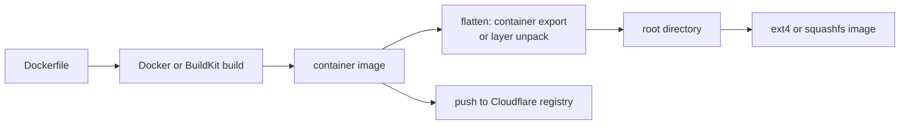
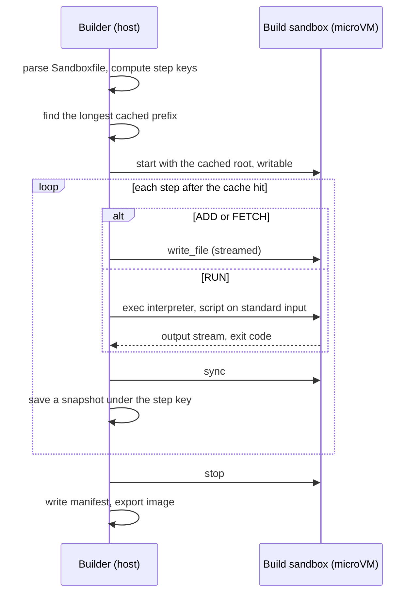

# Feature 10: Image builder (research only)

_Written in ASD-STE100 Simplified Technical English (STE). Code and identifiers stay as they
are._

**Abbreviations in this file.** Open Container Initiative (OCI); virtual machine (VM);
application programming interface (API); Hypertext Transfer Protocol (HTTP); Secure Hash
Algorithm 256 (SHA-256); Unix domain socket (UDS); Transparent Socket Impersonation (TSI);
user identifier (UID); continuous integration (CI); AeroSpace and Defence Industries
Association of Europe (ASD), the owner of the STE standard ASD-STE100.

## Glossary

| Term | Meaning |
|---|---|
| sandbox image | The thing that a sandbox boots: a root file system and a small manifest (start command, environment, kernel reference). |
| build file | A text file with the steps that make a sandbox image. This spec calls it a `Sandboxfile`. |
| step | One line of a build file: `FROM`, `ADD`, `FETCH`, `RUN`, `CMD` and others. |
| base | The root file system that a build starts from. |
| container image | An OCI image: a list of file system layers and a configuration, kept in a registry or in Docker. |
| layer | One set of file changes. A container image is a stack of layers. |
| registry | A server that stores container images (for example Docker Hub). |
| whiteout | A marker in a layer that says "this file is deleted". |
| build sandbox | A sandbox that the builder starts to execute `RUN` steps. Its root is writable. |

## 1. Purpose

The owner wants Rust tooling that puts together a sandbox image the way a Dockerfile does: a
base, local files, remote files, commands that install programs, and a start command.

This feature is research. It writes no product code. It answers one question with
measurements, and it writes the features that follow:

> Do we build sandbox images from containers, with our own small build file, or with both?

The main session did the first analysis. It is in sections 2 to 6. The research agent tests
it (section 7) and writes the result (section 8).

## 2. What a sandbox image must be

Each backend boots a different thing.

| Backend | Root file system form | Who can make it |
|---|---|---|
| libkrun | A host directory (virtio-fs). A raw disk image also works when libkrun is built with block support (`krun_add_disk2`, `krun_set_root_disk_remount`, `krun_has_feature(KRUN_FEATURE_BLK)`). | Any tool that writes files. |
| Firecracker | An ext4 or squashfs image file. | `mkfs.ext4 -d`, `mksquashfs`, or a guest that writes to a block device. |
| Cloudflare | A container image in the Cloudflare registry. | Docker and `wrangler`. |

So "one image for all backends" needs one neutral form and converters. Section 5.4 proposes
that form.

## 3. Option A: build from containers

Write a normal Dockerfile. Build it with Docker. Turn the result into a root file system.



_Caption: a container image is flattened into one directory, and the directory becomes a disk image._

What this repository already has (`backends/foundation_deployment_docker/src/client/images.rs`):
`image_build` (line 349), `image_pull` (446), `image_save` (486), and the generated
`container_export_request` (`src/generated/export/mod.rs`, line 68). BuildKit is behind the
`buildkit` feature.

Two ways to flatten:

| Way | How | Needs Docker | Notes |
|---|---|---|---|
| A1: container export | Create a container from the image (do not start it), call export, unpack the tar stream. | yes | Simple. Docker merges the layers. The stream has the final tree only. |
| A2: registry pull | Read the manifest and the layer blobs from the registry API, unpack each layer in order, apply whiteouts. | no | Pure Rust. About 600 lines: token request, manifest list by architecture, blob download with a digest check, gzip and tar, `.wh.` files and opaque directories. |

| For | Against |
|---|---|
| Every Dockerfile and every public image works. | A1 and each build need a Docker daemon. On macOS that is another VM (Docker Desktop). |
| Docker has a mature layer cache. | `RUN` steps execute in containers, not in our sandbox. A build of code that is not trusted has container isolation only. |
| The Cloudflare backend needs a container image in any case. | A container image has no kernel and no init. Its entry point assumes a container runtime (environment, user, signals). We must map `ENTRYPOINT`, `CMD`, `ENV`, `USER` and `WORKDIR` into our manifest. |
| | The tooling goal "no Docker for a local sandbox" is lost. |

File ownership is the hard detail. A tar unpack as a normal user gives every file the UID of
that user. A root file system needs root-owned files, set-user-ID bits and device nodes.

- For an ext4 image: build a `tar` to image path that keeps the owners with no root rights.
  `mkfs.ext4 -d` reads a directory, so it loses them; it has `-E root_owner=0:0` for the
  root only. Candidates to measure: `mke2fs -d` with a tar file as the source (e2fsprogs
  1.47.1 and newer accept a tar archive), or `fakeroot`, or the method of section 4 (the
  guest unpacks the tar as root onto a block device).
- For a libkrun directory: virtio-fs shows the host owner. `krun_add_virtiofs4` has a
  `semantics` argument for permission emulation (header line 385). Measure what it does.

## 4. Option B: our own build file

A small build file. The builder executes each `RUN` step in a build sandbox, which is one of
our own microVMs. No Docker.

### 4.1 The surface that the owner proposed

```
from <root kernel>
ADD <local file>
FETCH <remote HTTP resource> as <local location>
RUN <code for a shell or python>
CMD <what it starts with>
```

### 4.2 Proposed `Sandboxfile` grammar (draft for the research to test)

```
# One step for each line. A line that starts with # is a comment.
# Keywords are not case-sensitive. A line that ends with \ continues.

FROM alpine:3.22                       # base; section 4.3
KERNEL firecracker-ci:6.1              # optional; default is the backend kernel

ENV PIP_NO_CACHE_DIR=1
WORKDIR /opt/app

ADD ./app /opt/app                     # host path (file or directory), then guest path
ADD --mode 0755 ./tool /usr/local/bin/tool

FETCH https://example.com/t.tar.gz sha256:9f2c... AS /tmp/t.tar.gz

RUN apk add --no-cache python3         # default interpreter: /bin/sh -e
RUN --shell python3 <<EOF              # a here-document goes to the interpreter
import compileall
compileall.compile_dir("/opt/app")
EOF
RUN --network host apk add curl        # network is off unless the step asks for it

CMD ["python3", "/opt/app/main.py"]    # stored in the manifest; runs at sandbox start
```

| Step | Meaning | Executes where |
|---|---|---|
| `FROM <base>` | Start from a base root file system. First step. One only. | host |
| `KERNEL <ref>` | Record the kernel for backends that need one. | host (manifest) |
| `ENV k=v` | Add to the environment of later `RUN` steps and of the final image. | host (manifest) |
| `WORKDIR <path>` | The directory of later `RUN` steps and of the final image. The builder makes it. | guest |
| `ADD [--mode m] <host path> <guest path>` | Copy a file or a directory tree from the build context into the image. | host reads, guest writes |
| `FETCH <url> sha256:<hex> AS <guest path>` | Download on the host, check the hash, write into the image. | host downloads, guest writes |
| `RUN [--shell s] [--network n] <text>` | Run a script in the build sandbox as root. A non-zero exit code stops the build. | guest |
| `CMD [json array]` | The default command of a sandbox made from this image. | host (manifest) |

Points for the owner:

- `ADD` needs a guest path. The proposed surface had one argument.
- `FETCH` needs a hash, so that a build gives the same image each time and a changed
  remote file cannot enter the image. The alternative is a lock file that the first build
  writes. The research recommends one.
- The host downloads for `FETCH`. The build sandbox has no network by default.
- `RUN --network host` is an explicit choice for each step, because most installs
  (`apk add`, `pip install`) need the network. Section 6 has the problem that this opens.

### 4.3 What `FROM` accepts

| Form | Source | Feature that gives it |
|---|---|---|
| `alpine:<version>` | The Alpine minirootfs archive | Feature 03 |
| `dir:<path>` | A host directory | Feature 03 |
| `tar:<path>` | A root file system tar archive | Feature 03 |
| `image:<name>` | A sandbox image that an earlier build made | this work |
| `oci:<registry reference>` | A container image, pulled from a registry (way A2) | this work |
| `docker:<image>` | A container image in the local Docker (way A1) | this work |

This is where the two options meet. A container image is a base, not the build engine.

### 4.4 How a build executes



_Caption: the builder drives one build sandbox through the agent, and saves a snapshot after each step for the cache._

All the build work uses calls that features 00 to 06 already give: `write_file`, `exec` and
`stop`. The new parts are:

1. **A writable root.** Features 01 to 06 never write to the source. A build sandbox must.
   This needs a third root mode, `RootMode::Writable`, in the protocol and the agent: the
   agent mounts the block device read-write and uses it as the program root.
2. **The working form.** The proposal: the builder works on a raw ext4 image file on both
   local backends. Firecracker attaches it as a writable drive. libkrun attaches it with
   `krun_add_disk2` and the agent mounts it. Then files have the right owners (the guest
   writes them as root), and `ADD` needs no host root rights. This depends on block
   support in the installed libkrun; section 7 measures it.
3. **The first fill.** The base arrives as a tar stream (`alpine`, `tar`, `oci`, `docker`).
   The builder makes an empty ext4 image (`mkfs.ext4` with no `-d`), boots a build sandbox
   on it with a small bootstrap root, and streams the tar to an agent-side unpack. The
   bootstrap root is the agent initramfs on Firecracker; on libkrun it is the Alpine
   directory. This needs a new agent request, `Unpack` (a tar stream to a directory, with
   owners, modes, links, device nodes and whiteouts). It removes the ownership problem of
   section 3.
4. **Snapshots and the cache.** The key of a step is the SHA-256 of: the key of the step
   before it, the step text, and the content hash of each input (`ADD` file tree, `FETCH`
   hash). After each step the builder saves the image file under that key. The first
   design is a full copy of a sparse file, with a reflink where the host file system has
   it (`FICLONE` on Linux, `clonefile` on macOS). No layer format, no whiteouts at rest.
5. **The export.** The final ext4 image is the Firecracker form. For squashfs and for a
   libkrun directory, a last sandbox step packs the tree (`Pack`: the reverse of `Unpack`).

| For | Against |
|---|---|
| No Docker. A build works on each host where a sandbox works, macOS too. | We own a build engine: parser, cache, snapshots. |
| `RUN` steps execute in a microVM. A build of code that is not trusted is as isolated as a run. | No Dockerfile compatibility. Users learn a new, small file. |
| Files get root owners with no host root rights. | A full-copy snapshot for each step uses disk space. Reflinks reduce it only on some file systems. |
| One engine makes the image for Firecracker and libkrun. | `RUN` with network needs guest network, which 0.1 does not have on Firecracker (section 6). |
| | Cloudflare still needs a container image; the builder must also emit one, or Cloudflare stays on Dockerfiles. |

## 5. First recommendation: both, in three stages

The main session recommends this. The research confirms it or replaces it.

### 5.1 Stage 1: containers as a source (the fast path)

A converter with no build engine: `docker:<image>` and `tar:<path>` to a sandbox image.
A user writes a Dockerfile, builds it with Docker, and converts the result. This gives real
images (Python, Node) for sandboxes soon, and it needs only way A1 and the `Unpack` agent
request.

### 5.2 Stage 2: the `Sandboxfile` builder

Section 4, with `FROM` forms `alpine`, `dir`, `tar`, `image` and `docker`.

### 5.3 Stage 3: registry pull

Way A2: `oci:<reference>` with no Docker daemon. After it, a local sandbox image needs no
Docker in any path.

### 5.4 The sandbox image form

A directory in the artifact store:

```
<cache_dir>/images/<name>/<digest>/
  manifest.json      # below
  rootfs.ext4        # always
  rootfs.squashfs    # when asked
```

```rust
#[derive(Debug, Clone, PartialEq, Eq, Serialize, Deserialize)]
pub struct ImageManifest {
    pub schema: u32,                       // 1
    pub name: String,
    pub digest: String,                    // SHA-256 of the last step key
    pub arch: GuestArch,
    pub created_unix_ms: u64,              // from ctx.clock()
    pub cmd: Option<Vec<String>>,
    pub env: Vec<(String, String)>,
    pub workdir: String,
    pub kernel: Option<String>,            // a manifest reference, not a path
    pub rootfs: Vec<RootFsFile>,           // { format, file, sha256, size }
    pub steps: Vec<String>,                // the build file lines, for inspection
}
```

`RootFs` gets a variant `Image(PathBuf)`. A backend picks the file that it can boot. `cmd`,
`env` and `workdir` fill the `SandboxSpec` defaults, and `Sandbox` gets
`start_cmd() -> SandboxResult<ExecHandle>` that runs `cmd`.

## 6. The network problem

Most real builds download packages in `RUN`. Version 0.1 gives a guest network only on
libkrun with `NetworkMode::Host` (TSI). Firecracker has none.

| Choice | How | Cost |
|---|---|---|
| N1: build on libkrun only when a step asks for network | TSI. No new code. | Linux users with only Firecracker cannot build with network. The build sandbox gets the full host network. |
| N2: a proxy through the agent | A new protocol channel kind, `Tunnel`. The agent listens on `127.0.0.1:3128` in the guest as an HTTP proxy. Each `CONNECT host:port` becomes a channel. The host opens the real connection, after it checks an allow list. The builder sets `http_proxy` and `https_proxy` for the step. | About 400 lines in the agent and the client. Works on every backend. Gives an egress allow list, which sandboxes need later for run time too. Programs that ignore proxy variables do not work. |
| N3: a real network device | tap on Firecracker, `passt` on libkrun. | Needs root on Firecracker. It is the backlog item of requirements section 2.2. |

The first recommendation is N1 for stage 1 and 2, and N2 as its own feature after that,
because N2 also solves egress control at run time.

## 7. Research tasks

Do each task on a Linux host with KVM. Do tasks 1, 2 and 6 on macOS too. Write each result
in `learnings.md` with the command and its output.

| # | Task | Decides |
|---|---|---|
| 1 | Does the installed libkrun 1.19 have block support (`krun_has_feature(KRUN_FEATURE_BLK)`) in the Fedora package, the Homebrew package and a default source build? Boot with `krun_add_disk2` and `krun_set_root_disk_remount`. | If the working form can be an ext4 image on libkrun. If not: a writable virtio-fs directory, and task 2 becomes critical. |
| 2 | Start libkrun with a writable virtio-fs root. In the guest, as root: `chown 1000:1000 f`, `chmod 4755 f`, `mknod`, a symbolic link. What does the host see, and what does the guest see after a restart? Repeat with each `semantics` value of `krun_add_virtiofs4`. | If a directory can hold a correct root file system. |
| 3 | Make an empty ext4 image. Boot Firecracker with it as a writable second drive. Stream the Alpine tar through a prototype `Unpack` (a shell `tar -x` through `exec` standard input is enough for the measurement). Boot the result as a root. Record the times. | If "the guest fills the image" works, and its speed. |
| 4 | `docker create` and export for `python:3.12-slim` and `node:22-alpine`, through `container_export_request`. Pipe the stream into task 3. Run `python3 -c "print(1)"` in the sandbox. Record the image size and the time. | If stage 1 gives a working image, and what breaks (missing `/etc/resolv.conf`, `/dev` entries, users). |
| 5 | Map the container configuration (`image_inspect`: `Entrypoint`, `Cmd`, `Env`, `WorkingDir`, `User`) to `ImageManifest`. List what has no place (`User`, `Volumes`, `ExposedPorts`, `Healthcheck`). | The manifest fields, and the agent changes for `User`. |
| 6 | Snapshot cost. Copy a 1 GiB sparse ext4 image with 200 MiB used: plain copy, `cp --reflink=auto` on ext4, xfs and btrfs, `clonefile` on APFS. Record time and disk use. | If full-copy snapshots are acceptable, or if the cache needs block-level layers. |
| 7 | Whiteouts. Pull two layers of an image by hand from Docker Hub (`curl`, the token flow, the manifest list). Apply them in order with a 30-line script. List each rule that was necessary. | The size of way A2. |
| 8 | Compare with existing tools, by reading only: `buildah` (rootless build), `umoci` (unpack with no root), `skopeo` (copy from a registry), Kata `osbuilder`, `firecracker-containerd` (device-mapper snapshots), Fly.io `init` and the "Docker without Docker" method. Write for each: what it solves, and what we take from it. | That we do not design what exists. |
| 9 | `RUN apk add python3` in a libkrun build sandbox with TSI. Then test if `http_proxy` alone is enough for `apk`, `pip`, `npm` and `apt` (a host-side proxy on a UDS, forwarded by hand). | Choice N1 or N2. |
| 10 | Ext4 image size. `mkfs.ext4` needs a size before the build. Measure `resize2fs -M` (shrink to minimum) after a build, and a sparse 8 GiB image on disk. | How the builder sizes the image. |

## 8. What the research delivers

1. `learnings.md`: a new section "Image builder" with the result of each task.
2. A decision record in `requirements.md`: a new section "Images" with the chosen option,
   the reasons, and the options that lost.
3. The final `Sandboxfile` grammar, as a table of steps with exact argument rules and five
   example files (a shell tool image, Python, Node, a static program on an empty base, a
   base from a container image).
4. New feature files, each complete enough for a hand-off (specifications rule 1). The
   expected set, to be confirmed:

| Feature | Content |
|---|---|
| 11 Image form and store | `ImageManifest`, `RootFs::Image`, `Sandbox::start_cmd`, store layout. |
| 12 Agent `Unpack`, `Pack` and `RootMode::Writable` | Protocol kinds, agent code, tests. |
| 13 Container source (stage 1) | `docker:` and `tar:` to a sandbox image. |
| 14 `Sandboxfile` builder (stage 2) | Parser, step keys, cache, executor, progress stream, a `sandbox_build` example program. |
| 15 Registry pull (stage 3) | Way A2. |
| 16 Agent tunnel (N2) | Only if task 9 supports it. |

5. A list of GitHub issues for each limit found, with severity labels.

## 9. Not in the scope of the research

- Product code. Prototypes are scripts in a scratch directory. They are not committed,
  except as text in `learnings.md`.
- A multi-stage build (`COPY --from`), build arguments, and `ONBUILD`. Record them as later
  ideas only.
- A change to features 00 to 09. If a task shows that one of them is wrong, report it; the
  main session updates that feature.

## 10. Done when

- Each task of section 7 has a result in `learnings.md`, or a clear statement that the
  agent could not do it and why.
- `requirements.md` has the decision and the final grammar.
- The follow-up feature files exist and pass the specification check of the
  `specifications-management` skill: no hidden detail, no behaviour that is assumed.
- The owner approved the decision.
