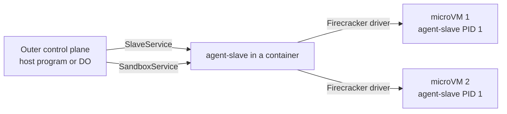

# Feature 11: Nested sandboxes (a slave that is also a control plane)

_Written in ASD-STE100 Simplified Technical English (STE). Code and identifiers stay as they
are._

**Abbreviations in this file.** remote procedure call (RPC); virtual machine (VM);
Kernel-based Virtual Machine (KVM); Durable Object (DO); Unix domain socket (UDS);
behaviour-driven development (BDD); continuous integration (CI); AeroSpace and Defence
Industries Association of Europe (ASD), the owner of the STE standard ASD-STE100.

## 1. Goal

Let one container give many sandboxes. A slave that runs in a container (Docker or
Cloudflare) also serves `SandboxService`, with the same `SandboxManager` and the
Firecracker driver inside it. The outer control plane then creates microVMs in that
container through the slave, and uses them through the same `Sandbox` API.



_Caption: the slave in a container is a slave for its own container and a control plane for the microVMs inside it._

No new sandbox logic. The work is: build the slave with the control feature, serve the
second service, give the container access to KVM, and add a driver that forwards to a
remote control plane.

## 2. Story

- **S1**: "An operator starts one container that can hold many microVM sandboxes."
- **S2**: "A caller creates a sandbox inside that container, and uses it like any other."
- **S3**: "The container has no KVM; the caller gets a clear report."
- **S4**: "The container stops; every microVM in it stops."
- **S5**: "The outer control plane lists and stops the inner sandboxes."

| # | Use case | Actor | Trigger | Result |
|---|---|---|---|---|
| U1 | Start a host container | caller | `create` with `nested_host: true` | A container whose slave reports `can_control: true`. |
| U2 | Create inside | caller | `create` with `driver: Nested`, `parent: <id>` | A microVM in the parent container. |
| U3 | Use | caller | `exec`, files | Calls go outer control plane, parent slave, inner slave. |
| U4 | Stop the parent | caller | `stop` on the parent | The inner sandboxes stop first, then the container. |

## 3. Bounded context

**Inside this feature:** the slave's control role, the `NestedDriver` in the outer control
plane, the parent link, the Docker options for KVM, the lean build of the Firecracker
driver.

**Outside:** `SandboxManager`, the Firecracker driver, `ControlService`,
`SandboxRpcClient` (used as they are); Cloudflare's container platform (section 6.6 says
what it allows).

| Entity | Meaning | Owner (the one writer) |
|---|---|---|
| Inner control plane | A `SandboxManager` in the slave process, with the Firecracker driver. | `native::slave::control` |
| Parent sandbox | A container sandbox whose slave has `can_control: true`. | the outer control plane's record |
| Child sandbox | A microVM in the parent. The outer record has `parent: Some(id)`. | the outer control plane (record); the inner control plane (the real sandbox) |
| `NestedDriver` | A `SandboxDriver` whose `launch` calls `create` on the parent's inner control plane. | `shared::drivers::nested` |

| Verb | Kind | Trigger | Effect |
|---|---|---|---|
| serve control | entity | slave start with `--control` | Adds `SandboxService` to the slave's router. |
| launch child | story | outer `create` | Remote `create` on the parent; returns a substrate whose calls are forwarded. |
| forward | entity | each child call | The scoped `SandboxService` call on the parent. |
| stop parent | story | outer `stop` | Stop each child, then the parent. |

## 4. Rules

### 4.1 Law worksheet

```
Entity: Child sandbox
Conserved value:         outer record exists <=> the inner control plane has the sandbox (after calls settle)
Bound:                   children of one parent <= the inner manager's max_sandboxes
Inverse pairs:           create / stop
Idempotent verbs:        stop, kill (as every sandbox)
Ordering pairs:          parent Ready -> child create (enabling); parent stop / child create (competing: after the parent is Stopping, create fails)
Monotone values:         state, as every sandbox
Freeze points:           parent id
Links to other entities: a child's outcome for each call = the inner sandbox's outcome (law L11 of the requirements, applied two times)

Entity: Parent sandbox
Conserved value:         when the parent is Stopped, it has 0 children
Bound:                   none more
Inverse pairs:           none
Idempotent verbs:        stop
Ordering pairs:          children stop -> parent stop
Monotone values:         state
Freeze points:           can_control at Info
Links to other entities: SlaveInfo.can_control == the slave was started with --control and its probe is usable
```

### 4.2 Invariants

| # | Invariant |
|---|---|
| I1 | A child sandbox passes the shared acceptance scenarios, with the same results as a top-level Firecracker sandbox. |
| I2 | A child's `create` on a parent whose slave has `can_control: false` fails with `DriverUnavailable`, and nothing starts. |
| I3 | When the parent leaves `Ready`, each child record becomes `Failed` then `Stopped`. `stop` on the parent stops the children first. |
| I4 | The slave serves `SandboxService` only when started with `--control`. Without it, those paths answer `NotFound { what: "method" }`. |
| I5 | The inner control plane is the same `SandboxManager` and `FirecrackerDriver` code. The slave adds no sandbox rule. |
| I6 | A container gets `/dev/kvm` only when the spec has `nested_host: true`. It is still not privileged. |
| I7 | `agent-slave` with the control feature is still a static musl program with no C dependency. |

### 4.3 Must have

- `SlaveArgs.control`, `--control`, `SlaveInfo.can_control`.
- `NestedDriver`, `DriverId::Nested`, `SandboxSpec.parent`, `SandboxSpec.nested_host`.
- A crate `foundation_api_common` (section 6.5).

### 4.4 Must do

- Put the `firecracker` program and a kernel in the image of a nested host (section 6.4).

### 4.5 Must not

- Must not let a child name a parent of another control plane.
- Must not nest more than one level: a child's slave is never started with `--control`.

## 5. Acceptance scenarios

```gherkin
Feature: Nested sandboxes

  Scenario: A microVM runs inside a container
    Given a Linux host with KVM and Docker
    And a parent sandbox created with the Docker driver, the nested host image and nested_host true
    When the caller creates a child with driver Nested and that parent, and runs ["echo", "hello"]
    Then stdout is "hello\n" and the exit code is 0
    And the child's SlaveInfo has is_pid1 true

  Scenario: The shared acceptance scenarios pass for a child
    When the shared acceptance scenarios run on a child sandbox
    Then each has the same result as on a top-level Firecracker sandbox

  Scenario: Two children are separate
    Given two children of one parent
    When the first writes /tmp/a
    Then the second does not see /tmp/a

  Scenario: A parent that cannot control is refused
    Given a parent sandbox whose slave was started without --control
    When the caller creates a child of it
    Then the result is DriverUnavailable
    And the parent got no Create call

  Scenario: A container without KVM reports it
    Given a parent created without nested_host
    When the caller calls Probe on the parent's inner control plane
    Then the firecracker report has usable false and the failed check "kvm"

  Scenario: Stopping the parent stops the children
    Given a parent with two children
    When the caller stops the parent
    Then both children are Stopped
    And no firecracker process and no container is left

  Scenario: A parent that dies takes the children with it
    Given a parent with one child and a running command in the child
    When the parent container is killed
    Then the command stream ends with StreamLost
    And the child and the parent become Stopped

  Scenario: The control paths are off by default
    Given a slave started without --control
    When a caller calls SandboxService/List on it
    Then the call fails with NotFound
```

## 6. Technical breakdown

### 6.1 The slave's control role

`cli::slave`: `--control` (and the kernel key `ewe.control=1`) sets `SlaveArgs.control`.
With it, and with the Cargo features `control` and `firecracker` in the build:

- After `Prepare`, the slave builds `SandboxHost::native(HostConfig::discover(..))`, a
  `SandboxManager` with `FirecrackerDriver`, `NativeConnector`, `MemoryRecordStore`, and a
  `ControlService` on it. The slave's router serves both services on the same listener.
- `SlaveInfo.can_control` is `true` when the build has the features, `--control` was
  given, and the Firecracker probe is usable.
- At `Shutdown`, the slave stops every inner sandbox first (`kill` after `grace_ms`).
- The inner sandboxes' files (`firecracker`, the kernel, the slave for the guest) are in
  the container image; `HostConfig::discover` reads `EWE_FIRECRACKER`,
  `EWE_SANDBOX_SLAVE` and the cache directory from the container's environment, which the
  driver sets at container create.

A build without the features ignores `--control` with one warning line and reports
`can_control: false`.

### 6.2 Spec fields and `NestedDriver`

Add to `SandboxSpec` (feature 00): `parent: Option<SandboxId>` (default `None`) and
`nested_host: bool` (default `false`). `validate`: `parent` is `Some` exactly when
`driver == Some(DriverId::Nested)` (`InvalidSpec { field: "parent" }`).

A child's `RootFs` path, and each other path in its spec, is a path **in the parent
container**, because the inner control plane runs there. The nested host image of section
6.4 has the default root image at a fixed path; a caller with its own image puts it in
the parent first (`write_file` on the parent sandbox).

`NestedDriver` is registered in a `SandboxManager` with a handle to that manager's own
registry (to find the parent).

| Method | Work |
|---|---|
| `probe` | Usable. One check, `needs_parent`: "set `parent` to a sandbox whose slave can control". |
| `launch(ctx, id, spec)` | Find the parent record (`NotFound { what: "parent" }`); it must be `Ready` (`SandboxStopped`) with `slave.can_control` (`DriverUnavailable`). Build a `SandboxRpcClient` on the parent's slave transport. Call `create` there with a copy of the spec that has `driver: Some(Firecracker)`, `parent: None`, and pass its progress on. Return a substrate (below). |
| `attach` | `get(inner_id)` on the parent; `Ok(None)` when the parent or the inner sandbox is gone. |

The substrate of a child:

- `endpoint: SlaveEndpoint::Parent { parent: SandboxId, inner: SandboxId }` (a new
  variant). The manager's connector maps it to a transport that sends each
  `SlaveService` call of the child as the scoped `SandboxService` call on the parent's
  transport. This adapter is the remote handle code of feature 06 behind the
  `Transport`-free trait `ExecFileCalls`; so the child's `SlaveClient` is replaced by the
  scoped client. To keep feature 02 unchanged, `Substrate` gets an optional field
  `calls: Option<Arc<dyn ExecFileCalls>>`; when it is `Some`, the manager uses it and does
  not call `Info` or `Prepare` (the inner control plane did both; the launch result
  carries the `SlaveInfo`).
- The handle: `exited()` awaits the first of the inner sandbox reaching `Stopped` (a poll
  of `get` every 1 s on the clock) and the parent's `exited()`; `terminate` and `kill`
  call `stop` and `kill` on the inner sandbox; `cleanup` calls `kill` when it still
  exists; `log_tail` is empty.

`stop` on a parent: the manager first stops each record with `parent == id`, in parallel,
then the parent (a rule in feature 02's stop story: "children first"; add it with a test
in the simulation suite).

### 6.3 Docker options for a nested host

When `spec.nested_host` is true, the Docker driver adds to the create body:
`HostConfig.Devices: [{ PathOnHost: "/dev/kvm", PathInContainer: "/dev/kvm",
CgroupPermissions: "rwm" }]`, the slave argument `--control`, and the environment
`EWE_FIRECRACKER=/usr/local/bin/firecracker`, `EWE_SANDBOX_SLAVE=/.ewe/agent-slave`,
`EWE_SANDBOX_STATE_DIR=/run/ewe-sbx`, `EWE_SANDBOX_CACHE_DIR=/var/cache/ewe-sandbox`.
`Privileged` stays false. The Docker probe gets a check `kvm_for_nested` (not needed for
`usable`): `/dev/kvm` exists on the daemon's host.

### 6.4 The nested host image

`infrastructure/sandbox_nested_image/Dockerfile`: `FROM debian:stable-slim`; the pinned
`firecracker` release program; the pinned kernel and the CI root image in
`/var/cache/ewe-sandbox` at the paths that the artifact store uses (so no download happens
in the container); `CMD ["sleep", "infinity"]`. The slave is injected by the Docker driver
as for any image. A `mise` task `sandbox:nested-image` builds it with the versions of
`ci/sandbox.toml`.

### 6.5 A lean Firecracker driver for the slave

**Measured (2026-11-11):** the generated Firecracker client uses
`foundation_deployment::providers::common`, and `foundation_deployment` depends on
`foundation_db` (`cargo tree -p foundation_deployment --depth 1`). A database crate has C
code, so a slave with the `firecracker` feature could not be a static musl program
(invariant I7).

Fix, in this feature:

1. Make a small crate `backends/foundation_api_common` with the content of
   `foundation_deployment/src/providers/common` (`ApiClient`, `ApiError`, `ApiResponse`,
   `ApiPending`, `BodyLimits`, `Empty`, `Operation`). Dependencies: `foundation_netio`,
   `foundation_core`, `serde`, `serde_json`.
2. `foundation_deployment::providers::common` becomes `pub use foundation_api_common::*`,
   so every current user compiles with no change.
3. The generator (`foundation_openapi` `UnifiedGenerator`) gets an option for the import
   path of the common types; the Firecracker generated code is made again with
   `foundation_api_common`. `foundation_platform_sandbox` drops its dependency on
   `foundation_deployment`.
4. `foundation_netio` in the slave build has TLS off (feature 01, section 6.1); the
   Firecracker API is on a UDS and needs none.

Verify: `cargo check -p agent_slave --features control --target x86_64-unknown-linux-musl`.

### 6.6 Cloudflare

A Cloudflare container has no `/dev/kvm` (the platform does not offer nested
virtualisation; the Cloudflare sources that this spec read show no option for it). So on
Cloudflare the slave reports `can_control: false`, and a child create fails with
`DriverUnavailable` (invariant I2). The code path is the same; only the probe result
differs. If Cloudflare adds the capability, no code changes: the probe turns usable.

One Cloudflare container still gives one sandbox (feature 07). To use one container for
many isolated runs today, a caller runs many commands in one sandbox; they share the
container.

## 7. Tests

| Law or scenario | Test | Where | Oracle |
|---|---|---|---|
| I4, "The control paths are off by default" | `slave_control_off`, `slave_control_on` (both services answer) | `tests/slave_*.rs` | expected outcome |
| I5 | `slave_control_uses_manager` (a source scan: `native/slave/control.rs` has no state check or retry) | `tests/boundary_scan.rs` | example |
| I2, "A parent that cannot control is refused" | `nested_parent_cannot_control`, `nested_parent_missing`, `nested_parent_not_ready` | `tests/control_sim_*.rs` (`ScriptedSlave` as the parent) | expected outcome |
| `validate` | `spec_parent_rule` | `tests/contract_*.rs` | expected outcome |
| I3, the two parent stop scenarios | `stop_parent_stops_children`, `parent_exit_fails_children` | `tests/control_sim_*.rs` | fault |
| I6, section 6.3 | `create_body_nested_host` | `tests/docker_sim_*.rs` | example |
| I7 | the verify command | | build |
| `foundation_api_common` | the existing tests of `foundation_deployment` and of the Docker client still pass; `common_reexport_is_same_type` | those crates | identity |
| I1, the first three scenarios | `e2e_nested_acceptance`, `e2e_nested_two_children` | `tests/e2e_nested.rs` (Linux with KVM and Docker; returns with the probe report when not usable) | the shared scenarios |
| "A container without KVM reports it" | `e2e_nested_no_kvm` | the same | expected outcome |
| "Stopping the parent ..." | `e2e_nested_stop_parent` | the same | conservation |

The `e2e_nested` tests run in the CI job `sandbox-e2e` (it has KVM and Docker).

## 8. Verify

```bash
cargo fmt --all --check
cargo clippy -p foundation_platform_sandbox --features "docker firecracker slave testing" --all-targets --profile uat --no-deps -- -D warnings
cargo test -p foundation_api_common -p foundation_deployment -p foundation_deployment_docker --profile uat
cargo test -p foundation_platform_sandbox --features "docker firecracker slave testing" --profile uat control_sim docker_sim slave_ contract boundary_scan
cargo check -p agent_slave --features control --target x86_64-unknown-linux-musl --profile uat
mise run sandbox:nested-image
cargo test -p foundation_platform_sandbox --features "docker firecracker slave testing" --profile uat e2e_nested -- --nocapture
```

## 9. Done when

- Each scenario of section 5 and each row of section 7 passes.
- A child sandbox passes the shared acceptance scenarios.
- `agent-slave` with the control feature is a static musl program.
- `foundation_api_common` exists, and `foundation_platform_sandbox` does not depend on
  `foundation_deployment`.
