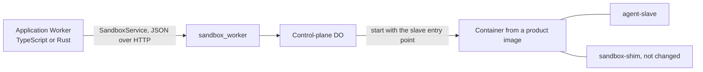

# Feature 17: Support for the Cloudflare Sandbox product

_Written in ASD-STE100 Simplified Technical English (STE). Code and identifiers stay as they
are._

**Abbreviations in this file.** remote procedure call (RPC); Durable Object (DO);
software development kit (SDK); JavaScript Object Notation (JSON); Hypertext Transfer
Protocol (HTTP); TypeScript (TS); continuous integration (CI); behaviour-driven
development (BDD); AeroSpace and Defence Industries Association of Europe (ASD), the owner
of the STE standard ASD-STE100.

## 1. Goal

Cloudflare Sandbox is a Cloudflare product. Since its version 1.0 the product is this: a
sandbox is a DO and the container that the DO starts. The package `@cloudflare/sandbox`
adds file helpers, bucket mounts and directory backups. A small static program,
`sandbox-shim`, is in the container image and does the file work.

Features 07 and 08 already use the same primitive: the control plane is a DO, and it
starts `agent-slave` in its container. So no new driver is necessary. This feature makes
three things true, and proves them:

1. An image made for the Cloudflare Sandbox product runs under our control plane. The
   only change to the image is one `COPY` line.
2. An application of the product (a TS Worker) can call our control plane with plain
   HTTP and JSON.
3. Each function of the product has a named equal in this crate, or a named gap.



_Caption: a product image gets the slave beside the shim; the control-plane DO starts the slave, and any Worker can call the control plane._

## 2. Story

- **S1**: "An operator has an image for the Cloudflare Sandbox product. The operator adds
  one line and deploys it with our Worker."
- **S2**: "A caller runs commands and moves files in that container with the same API as
  on Firecracker."
- **S3**: "A TS application calls `SandboxService` and does not need our Rust client."
- **S4**: "A reader wants to know which product function maps to which call."

| # | Use case | Actor | Trigger | Result |
|---|---|---|---|---|
| U1 | Build the donor image | operator | `mise run sandbox:slave-image` | An image that holds only `/usr/local/bin/agent-slave`. |
| U2 | Build a product image | operator | `mise run sandbox:product-dockerfile`, then `wrangler` builds it | A product image with the shim and the slave. |
| U3 | Run | caller | `SandboxService.Create`, `Exec` | A command runs in the product image. |
| U4 | Call with JSON | application | an HTTP `POST` | The same result as with the Rust client. |

## 3. Bounded context

**Inside this feature:** the donor image, the example product image, the Worker
configuration for it, the JSON wire test, the map of product functions, the README.

**Outside:** the control plane on Cloudflare and its driver (feature 07); the Worker
(feature 08); the package `@cloudflare/sandbox` and `sandbox-shim` (Cloudflare products,
used as they are; this crate does not call them).

| Entity | Meaning | Owner (the one writer) |
|---|---|---|
| Donor image | An image from `scratch` with one file, the static `agent-slave`. Other images copy from it. | `infrastructure/sandbox_worker/images/agent-slave/Dockerfile` |
| Product image | An image made for the Cloudflare Sandbox product: a base system and `sandbox-shim`. | the operator; the example is `infrastructure/sandbox_worker/Dockerfile.product.in` |
| Function map | The table of product functions and their equals. | `docs/sandbox-cloudflare-product.md` |

| Verb | Kind | Trigger | Effect |
|---|---|---|---|
| build the donor image | entity | operator | Makes the image from the built slave. |
| build the product image | entity | operator | Adds the slave to a product image. |
| call with JSON | story | application | One HTTP request for each unary call; one streamed answer for `Exec`. |

## 4. Rules

### 4.1 Law worksheet

```
Entity: Product image
Conserved value:         the image content of the product is not changed: same base, same sandbox-shim file, same CMD
Bound:                   the slave adds one file
Inverse pairs:           none
Idempotent verbs:        a second build with the same inputs gives the same file content
Ordering pairs:          build the slave -> build the donor image -> build the product image -> deploy
Monotone values:         none
Freeze points:           the slave path /usr/local/bin/agent-slave
Links to other entities: the slave path in the image = the slave path in the Worker configuration (feature 07, invariant I2)

Entity: JSON call (story)
Conserved value:         the answer of a JSON call = the answer of the same call through SandboxRpcClient
Bound:                   the limits of feature 02
Inverse pairs:           none
Idempotent verbs:        the ones of SandboxService
Ordering pairs:          none
Monotone values:         none
Freeze points:           the path /ewe.sandbox.control.v1.SandboxService/<Method>; the content types
Links to other entities: the bearer token rule of feature 02 (check_bearer)
```

### 4.2 Invariants

| # | Invariant |
|---|---|
| I1 | The control-plane DO starts the slave with an entry point (feature 07, invariant I2). So the image's own `CMD` and `ENTRYPOINT` have no effect, and a product image with `CMD ["sleep", "infinity"]` works with no change. |
| I2 | The product image keeps `/usr/local/bin/sandbox-shim`, with the same content as in Cloudflare's donor image. |
| I3 | The donor image has one file and no other layer. The file is the static slave for `linux/amd64`, built from the same commit as the Worker (feature 08, invariant I9). |
| I4 | No driver and no `DriverId` is added. The driver is `DriverId::CloudflareContainer`. |
| I5 | This crate does not start `sandbox-shim` and does not depend on `@cloudflare/sandbox`. |
| I6 | A JSON call needs nothing from this repository on the caller's side: a URL, a bearer token and the message shapes of feature 00 are enough. |

### 4.3 Must have

- `infrastructure/sandbox_worker/images/agent-slave/Dockerfile` and the `mise` task
  `sandbox:slave-image`.
- `infrastructure/sandbox_worker/Dockerfile.product.in`, the `mise` task
  `sandbox:product-dockerfile`, and a second Worker configuration, `wrangler.product.toml`.
- `docs/sandbox-cloudflare-product.md` with the function map of section 6.4 and the JSON
  examples of section 6.3.
- The test script `infrastructure/sandbox_worker/test/product.sh`.

### 4.4 Must do

- Pin Cloudflare's donor image by version and digest in `ci/sandbox.toml`.
- Keep the `@cloudflare/sandbox` version note in the README: the shim version must be
  equal to the package version that the application uses (Cloudflare's rule).

### 4.5 Must not

- Must not add TS code to this repository.
- Must not change `sandbox-shim` or wrap it.

## 5. Acceptance scenarios

```gherkin
Feature: Cloudflare Sandbox product support

  Scenario: A product image runs under the control plane
    Given the Worker runs in wrangler dev with wrangler.product.toml
    When the caller creates a sandbox and runs ["echo", "hello"]
    Then stdout is "hello\n" and the exit code is 0

  Scenario: The shared acceptance scenarios pass in a product image
    Given a ready sandbox in the product image
    Then each shared scenario of requirements section 8 gives the same result as in feature 08

  Scenario: The shim is still there
    Given a ready sandbox in the product image
    When the caller runs ["/usr/bin/test", "-x", "/usr/local/bin/sandbox-shim"]
    Then the exit code is 0
    And the SHA-256 of that file, read with read_file, is the SHA-256 of the file in Cloudflare's donor image

  Scenario: The image's own command does not run
    Given a ready sandbox in the product image
    When the caller runs ["/bin/ps", "-o", "args=", "-p", "1"]
    Then stdout starts with "/usr/local/bin/agent-slave"

  Scenario: The donor image has one file
    When the donor image is exported as a tar archive
    Then the archive has the entries "usr/", "usr/local/", "usr/local/bin/" and "usr/local/bin/agent-slave", and no other entry

  Scenario: A plain HTTP caller creates a sandbox and runs a command
    Given the Worker runs in wrangler dev
    When a caller sends POST /ewe.sandbox.control.v1.SandboxService/Create with content type application/json and a bearer token
    Then the answer is 200 with a JSON body that has the sandbox id
    When the caller sends POST /ewe.sandbox.control.v1.SandboxService/Exec with content type application/connect+json
    Then the answer is a stream of enveloped JSON messages that ends with an exit event with code 0

  Scenario: A JSON call with no token is refused
    When a caller sends POST /ewe.sandbox.control.v1.SandboxService/List with no Authorization header
    Then the answer is the HTTP status 401 and a JSON error body with the code "unauthenticated" (the Connect mapping of the check_bearer error of feature 02)
```

## 6. Technical breakdown

### 6.1 Facts

Source: `cloudflare/sandbox-sdk` at `61cac81` (`learnings.md`, section 4.4).

| Fact | Source file |
|---|---|
| "A sandbox is a Durable Object and its container." The package has no `Sandbox` base class. It does not start, stop or destroy a container; the application does, with `this.ctx.container`. | `docs/architecture.md`, `README.md` |
| The package adds `Files`, `S3Mount` (with `S3Gateway`) and `DirectoryBackup` (with `DirectoryBackupGateway`). | the same |
| `sandbox-shim` is one static program for `linux/amd64`. A donor image holds it; an application image copies it to `/usr/local/bin/sandbox-shim`. The shim is not a daemon: each file call starts one short process with `exec()`. | `docs/architecture.md`, `images/sandbox-tools/Dockerfile` |
| An example image: `FROM docker.io/cloudflare/sandbox:1.0.3 AS sandbox-tools`, a pinned `ubuntu:24.04`, `COPY --from=sandbox-tools /usr/local/bin/sandbox-shim /usr/local/bin/sandbox-shim`, `CMD ["sleep", "infinity"]`. | `examples/artifact-workspace/Dockerfile` |
| The application starts the container with `container.start({ image, enableInternet })` and runs commands with `container.exec(argv, options)`. | `README.md` |
| The Rust `worker` crate (0.8.7) has `start` with `entrypoint`, `enable_internet` and `env`, and `get_tcp_port`. It has no `exec`, no snapshot call and no outbound interception. | `learnings.md`, section 4.2 |

### 6.2 The images

`infrastructure/sandbox_worker/images/agent-slave/Dockerfile`:

```dockerfile
FROM scratch
COPY agent-slave /usr/local/bin/agent-slave
```

The `mise` task `sandbox:slave-image` runs `mise run sandbox:slave` for
`x86_64-unknown-linux-musl`, copies the program into a temporary build directory, and runs
`docker build --platform linux/amd64 -t ewe/agent-slave:<crate version>` there.

`infrastructure/sandbox_worker/Dockerfile.product.in` (a template; `@NAME@` is replaced):

```dockerfile
# The donor image of the Cloudflare Sandbox product. Keep its tag equal to the
# @cloudflare/sandbox version of the application.
FROM @SANDBOX_TOOLS_IMAGE@ AS sandbox-tools
FROM @SLAVE_IMAGE@ AS agent-slave

FROM @BASE_IMAGE@
COPY --from=sandbox-tools /usr/local/bin/sandbox-shim /usr/local/bin/sandbox-shim
COPY --from=agent-slave /usr/local/bin/agent-slave /usr/local/bin/agent-slave
CMD ["sleep", "infinity"]
```

`ci/sandbox.toml` has two of the values, each with a digest:
`cloudflare_sandbox_tools_image` (`docker.io/cloudflare/sandbox:1.0.3@sha256:..`) and
`product_base_image` (`ubuntu:24.04@sha256:..`). The implementer resolves the two digests
with `docker buildx imagetools inspect` and records them. `SLAVE_IMAGE` is the tag that
`sandbox:slave-image` made.

The `mise` task `sandbox:product-dockerfile` reads the values and writes
`Dockerfile.product` beside the template, with `sed`. The written file is in
`.gitignore`. A template is used because `wrangler` builds the file that the
configuration names, and the spec does not depend on a `wrangler` option for build
arguments.

`wrangler.product.toml` is a copy of the Worker configuration of feature 08 with one
difference: the `image` of the container class is `./Dockerfile.product`.

An operator with an existing product image adds only the two lines that name
`agent-slave`. The README shows this as a three-line change to
`examples/minimal/Dockerfile` of the SDK.

### 6.3 The JSON wire

`SandboxService` has the JSON codec (feature 00). The Connect protocol gives these rules;
the document shows them with `curl`:

| Call kind | Request | Answer |
|---|---|---|
| Unary (`Create`, `Get`, `List`, `Stop`, `ExecInput`, the file calls except `FileRead`) | `POST <base>/ewe.sandbox.control.v1.SandboxService/<Method>`; `Content-Type: application/json`; `Authorization: Bearer <token>`; the body is the request message as JSON | `200` and the answer message as JSON; or an HTTP error status and `{"code": "...", "message": "..."}` |
| Server stream (`Exec`, `FileRead`, `CreateWithProgress`) | the same path; `Content-Type: application/connect+json`; the body is one envelope: 1 byte of flags (0), 4 bytes of length (big-endian), the JSON message | `200`; a stream of envelopes; the last one has the flag `0x02` and holds `{}` or `{"error": {..}}` |

The document has one complete example for each row, with the real field names of
feature 00, and a TS example of 20 lines or fewer that reads the `Exec` stream with
`fetch`. The TS example is text in the document. It is not a file that is built.

A Worker in the same account can also call `sandbox_worker` through a service binding.
The request is the same; only the `fetch` target changes.

### 6.4 The function map

The document `docs/sandbox-cloudflare-product.md` has this table.

| Cloudflare Sandbox product | This crate | State |
|---|---|---|
| One sandbox = one DO and its container | One sandbox = one control-plane DO and its container (feature 07) | equal |
| `container.start({ enableInternet })` | `SandboxSpec.network` (`None` or `Host`) | equal |
| `container.start({ image })`, more than one image for each class | The image of the container class in the Worker configuration. One deployment has one image. | gap: the Rust `worker` crate has no image option |
| `container.exec(argv, { cwd, env })` and `process.output()` | `Sandbox::exec`, `Sandbox::run` through the slave | equal |
| `exec` with a terminal (`pty`) | none | gap (requirements section 7.3: interactive terminals) |
| `Files.readFile`, `writeFile`, with Linux error names | `read_file`, `write_file`; errors of feature 00 | equal for read and write; the other `Files` calls are done with `exec` |
| Inactivity time-out | The idle alarm of feature 07 | equal |
| `container.destroy()` | `Sandbox::stop` | equal |
| `getTcpPort(port).fetch` to a program in the sandbox | none for a caller; the control plane uses it for the slave only | gap (requirements section 7.3: port forwards) |
| `snapshotContainer` | none | gap (requirements section 7.3: snapshots) |
| `interceptOutboundHttp` | none | gap (requirements section 7.3: egress allow list) |
| `S3Mount`, `DirectoryBackup` | none | gap; an application can use the package beside this crate in the same image, because the shim is still there |

Each gap is a line in requirements section 7.3 and becomes a GitHub issue when the
feature lands.

### 6.5 The test script

`infrastructure/sandbox_worker/test/product.sh` (the same form as the script of
feature 08):

1. `mise run sandbox:slave-image`, then `mise run sandbox:product-dockerfile`.
2. Export the donor image (`docker create`, `docker export`) and check the entry list.
3. Read the SHA-256 of `sandbox-shim` from Cloudflare's donor image
   (`docker create`, `docker cp`, `sha256sum`), and give it to the tests in
   `EWE_SHIM_SHA256`.
4. Start `wrangler dev --local -c wrangler.product.toml` and save its PID. Stop it by
   that PID at the end.
5. Run `cargo test -p foundation_platform_sandbox --features testing --profile uat e2e_cf_product`
   with `EWE_SANDBOX_URL` and the token.

Faults:

| Fault | Result |
|---|---|
| Docker is not there | The script exits with status 2 and the text "Docker is necessary for wrangler dev containers". |
| The product image has no slave | `Create` fails with `SubstrateExited` or `BootTimeout` (feature 07); the test for this builds an image without the second `COPY` line and expects that error. |

## 7. Tests

| Law or scenario | Test | Where | Oracle |
|---|---|---|---|
| I1, the first scenario, the shared scenarios | `e2e_cf_product_acceptance` | `tests/e2e_cf_product.rs` (through `SandboxRpcClient`; returns with a message when `EWE_SANDBOX_URL` is not set) | the shared scenarios |
| I2, "The shim is still there" | `e2e_cf_product_shim_intact` | the same | identity (SHA-256) |
| "The image's own command does not run" | `e2e_cf_product_pid1_is_slave` | the same | expected outcome |
| I3, "The donor image has one file" | step 2 of `product.sh` | the script | example |
| I6, the two JSON scenarios | `e2e_cf_json_unary`, `e2e_cf_json_stream`, `e2e_cf_json_no_token` (they use the HTTP client of `foundation_netio` with hand-made bodies, not `SandboxRpcClient`; the stream is read as a stream) | `tests/e2e_cf_product.rs` | identity with the `SandboxRpcClient` answer |
| the fault row "no slave" | `e2e_cf_product_no_slave` | the same | fault |
| I4, I5 | `no_shim_reference` (a search of the crate sources for `sandbox-shim` and `@cloudflare/sandbox` finds only documents) | `product.sh`, with `grep` | expected outcome |

The script runs in the CI workflow of feature 08, as one more step after its own script.

## 8. Verify

```bash
cargo fmt --all --check
cargo clippy -p foundation_platform_sandbox --features testing --all-targets --profile uat --no-deps -- -D warnings
infrastructure/sandbox_worker/test/product.sh
```

## 9. Done when

- Each scenario of section 5 and each row of section 7 passes in `wrangler dev`.
- `docs/sandbox-cloudflare-product.md` exists with the function map, the JSON examples and
  the three-line image change.
- `ci/sandbox.toml` has the two pinned images with digests.
- No TS file and no new driver was added.
- `requirements.md` and `progress.md` are current.
